<!-- GENERATED by tools/nbpages.py from notebooks/. Do not edit. -->

# 02 · Diagnostic B: baselines, leakage, testing/API, explaining a decision
{: .no_toc }

[Run it in Colab](https://colab.research.google.com/github/berdakh/mlengineering/blob/main/notebooks/02_diagnostic_b.ipynb){: .btn .btn-primary .mr-2 target=_blank }
[View the .ipynb](https://github.com/berdakh/mlengineering/blob/main/notebooks/02_diagnostic_b.ipynb){: .btn target=_blank }

{: .note }
> You are reading this notebook. To **run** it, open it in Colab with the button above - no install, no GPU needed for most of them - or clone the repository and open it in Jupyter.

1. TOC
{:toc}

---

**Week 1 · day 2 · about 2 h, time-boxed, unassisted** · your files: [`diagnostic/`](https://github.com/berdakh/mlengineering/blob/main/diagnostic/)

**Objective.** Produce time-boxed, unassisted evidence in baseline modelling on an unfamiliar business table, leakage detection, test writing, API concepts and written justification.

```python
# --- Setup: works on your laptop AND in Google Colab ----------------------------
# In Colab this clones the course repository and installs the requirements (about a
# minute, first run only). On your own machine it just finds the repository. Every
# command in this notebook runs from the repository root. Safe to re-run.
import os
import subprocess
import sys
from pathlib import Path

if "google.colab" in sys.modules:
    if not Path("/content/mlengineering").exists():
        subprocess.run(["git", "clone", "--depth", "1",
                        "https://github.com/berdakh/mlengineering.git",
                        "/content/mlengineering"], check=True)
    os.chdir("/content/mlengineering")
    subprocess.run([sys.executable, "-m", "pip", "install", "-q",
                    "-r", "requirements.txt"], check=True)

REPO_ROOT = next(p for p in [Path.cwd(), *Path.cwd().parents]
                 if (p / "src" / "mlcourse").is_dir())
os.chdir(REPO_ROOT)
sys.path.insert(0, str(REPO_ROOT / "src"))
print("repo root:", REPO_ROOT)
```

Purpose: find out what you can already do **independently**, so the first weeks spend time where it
is needed and skip what you have demonstrated. It is not an exam and produces no score - only a
per-skill evidence level (see `solutions/diagnostic/SCORING.md` *after* you finish).

Nothing about your results is known until you submit. The roadmap is adapted only after your actual
submissions are reviewed.

## Structure: two sessions, about two hours each

| Session | Section | Probes | Time box |
|---|---|---|---|
| A (W1D1) | [a1_python](https://github.com/berdakh/mlengineering/blob/main/diagnostic/a1_python/README.md) | debugging, refactoring, Python semantics | 40 min |
| A | [a2_sql](https://github.com/berdakh/mlengineering/blob/main/diagnostic/a2_sql/README.md) | joins, aggregation, NULLs, fan-out, window functions | 35 min |
| A | [a3_cleaning](https://github.com/berdakh/mlengineering/blob/main/diagnostic/a3_cleaning/README.md) | pandas data cleaning, date/time-zone handling, judgment | 35 min |
| B (W1D2) | [b1_baseline](https://github.com/berdakh/mlengineering/blob/main/diagnostic/b1_baseline/README.md) | problem framing, baselines, metrics under imbalance | 35 min |
| B | [b2_leakage](https://github.com/berdakh/mlengineering/blob/main/diagnostic/b2_leakage/README.md) | leakage, validation design | 35 min |
| B | [b3_testing_api](https://github.com/berdakh/mlengineering/blob/main/diagnostic/b3_testing_api/README.md) | writing tests, request validation, API concepts | 25 min |
| B | [b4_explain](https://github.com/berdakh/mlengineering/blob/main/diagnostic/b4_explain/README.md) | explaining and defending an ML decision | 20 min |

Session A totals 110 minutes, session B 115. Use the remaining minutes of each session to fill in
[`SUBMISSION.md`](https://github.com/berdakh/mlengineering/blob/main/diagnostic/SUBMISSION.md).



*The path through the diagnostic. Nothing is adapted until the submission has been reviewed.*

## Rules (they make the result useful to you)

1. **Time-box each section.** When the time is up, stop, note where you were, move on. An unfinished
   section is information; an untimed finished one is not.
2. **No AI assistants, no searching for the answer.** Official documentation of Python, SQLite,
   pandas, scikit-learn, pytest and pydantic is allowed - looking up an API is normal work.
   If you do use other help, record it in `SUBMISSION.md`; that section then counts as guided.
3. **Do not open `solutions/`** (or `b3_testing_api/checks/impls/`) until you have submitted.
4. You may run the checks as often as you like - they are your feedback loop, as tests are at work.
5. Work in each section's `lab/` directory. Commit after each section if you use Git:
   `git add -A && git commit -m "diagnostic a1"`.

## Commands

From the repository root:

```python
!python wb.py check diagnostic/a1_python
!python -m pytest diagnostic/a1_python/checks -q
```

The starter code **fails** its checks in every section. That is the intended starting state.
Passing checks shows that the objectively checkable behaviour is right; the written parts and the
quality of the code are reviewed by reading your submission.

Requirements: Python >= 3.11 with numpy, pandas, scikit-learn, pytest and pydantic >= 2 (see the
repository `README.md` for environment setup).

## Data

All sections use one synthetic dataset, documented in [`data/README.md`](https://github.com/berdakh/mlengineering/blob/main/diagnostic/data/README.md). It is not
real; see that file for what cannot be concluded from it.

## After you finish

Fill in `SUBMISSION.md`, commit, and send back what it lists. Then (and only then) read
`solutions/diagnostic/` to compare. Feedback and any change to the roadmap follow from the submission.

## b1 - Problem framing and baselines on an unfamiliar tabular task

**Time box: 35 minutes.** Session B, section 1 of 4. No hints; scikit-learn documentation is fine.

## Situation

StreamBox (a **synthetic** subscription video service) wants to reduce churn. On the 1st of every
month a retention team can phone **10% of active customers**. They ask for a monthly risk ranking.

The data team hands you two files, described in [`../data/README.md`](https://github.com/berdakh/mlengineering/blob/main/diagnostic/data/README.md):
`churn_train.csv` and `churn_test.csv`. Each row is one customer on one monthly snapshot date, with
features known on that date and the label `churned_30d` (1 if the customer cancelled within the
following 30 days). Use the split exactly as given in this section.

## Task

Implement the functions in `lab/baseline.py`:

1. `precision_recall_at_fraction(y_true, scores, fraction)` - precision and recall when the
   `k = ceil(fraction * n)` highest-scored rows are flagged.
2. `trivial_scores(train, test)` - the no-skill baseline: every row gets the training churn rate.
3. `heuristic_scores(train, test)` - a rule an analyst could apply without ML. Your choice.
4. `model_scores(train, test)` - one simple, defensible first model. Your choice of model and features.
5. `run()` - evaluate all three on the test set (average precision, precision and recall at the 10%
   contact budget) and return the dictionary described in the docstring.

Then answer the four questions in `lab/ANSWERS.md`.

Requirements that hold for any reasonable solution:

* Scores are one finite number per test row; higher means riskier.
* Nothing may depend on test labels: the functions must work when `test` has no `churned_30d` column.
* Two identical runs give identical scores.
* The data contains missing values and text categories; handle them.

## Check your work

```python
!python diagnostic/b1_baseline/lab/baseline.py
!python wb.py check diagnostic/b1_baseline
!python -m pytest diagnostic/b1_baseline/checks -q
```

The starter raises `NotImplementedError`; all checks fail until you implement it.

## Acceptance criteria

* All checks pass.
* `ANSWERS.md` states the task precisely, justifies the metric with your own numbers, and translates
  the result into the retention team's terms.

The checks do not grade whether your model is *good*, only that it is a valid baseline that beats
no-skill. Model quality on synthetic data is not the point of this section.

## Submit

`lab/baseline.py`, `lab/ANSWERS.md`, the printed report, time used.

```python
# Run the automated checks on your guided lab.
# A fresh starter is expected to FAIL; passing means guided practice, not mastery.
from mlcourse.checks import check

check("diagnostic/b1_baseline")
```

## b2 - Leakage and validation

**Time box: 35 minutes.** Session B, section 2 of 4. No hints.

## Situation

A colleague evaluated a churn model on the full feature export `diagnostic/data/churn_export_full.csv`
(**synthetic**; columns documented in [`../data/README.md`](https://github.com/berdakh/mlengineering/blob/main/diagnostic/data/README.md)) and is delighted:

```python
!python diagnostic/b2_leakage/lab/leaky_eval.py
```

The model is meant to be used like this: on the 1st of each coming month, score every active
customer with what is known on that day, and hand the ranking to the retention team.

## Task

1. Read `lab/leaky_eval.py`. Find everything that makes its score untrustworthy *for that use*.
   There is more than one problem and they are of different kinds.
2. Write a corrected evaluation in `lab/fixed_eval.py`:
   * `FEATURES` - the export columns the model may use.
   * `make_split(df)` - positional `(train_idx, test_idx)`; train keeps at least half of the rows,
     test at least 10%.
   * `build_model()` - a fresh, unfitted scikit-learn estimator that can be fitted directly on the
     raw `df[FEATURES]` frame (missing values and text categories included).
   * `evaluate(df)` - returns `ap`, `roc_auc`, `n_train`, `n_test`, `test_prevalence`.
3. Fill in `lab/FINDINGS.md`: each problem, why it is leakage (which information crosses which
   boundary), its expected effect on the score, and how you confirmed it. Where you could not
   measure an effect, say so - do not assert one.

## Check your work

```python
!python diagnostic/b2_leakage/lab/fixed_eval.py
!python wb.py check diagnostic/b2_leakage
!python -m pytest diagnostic/b2_leakage/checks -q
```

The starter fails all checks. The checks re-run the evaluation from your `FEATURES`, `make_split`
and `build_model`; they accept any model family and any cut-off that satisfies the contract.

## Acceptance criteria

* All checks pass.
* `FINDINGS.md` identifies each problem with a mechanism, not just a label ("leakage"), and
  separates what you measured from what you expect.
* You state what the corrected number still does not establish.

## Submit

`lab/fixed_eval.py`, `lab/FINDINGS.md`, time used.

```python
# Run the automated checks on your guided lab.
# A fresh starter is expected to FAIL; passing means guided practice, not mastery.
from mlcourse.checks import check

check("diagnostic/b2_leakage")
```

## b3 - Testing and API concepts

**Time box: 25 minutes.** Session B, section 3 of 4. No hints; pytest and pydantic docs are fine.

## Part 1 - write tests (about 12 minutes)

`lab/split_impl.py` contains `train_test_split_by_date`, with its specification in the docstring.
Write tests for it in `lab/test_split.py`.

Your tests are graded by what they *catch*: the checks run your test file against the correct
implementation (all tests must pass) and against four implementations that each violate one clause
of the specification (at least one of your tests must fail on each). The broken versions live in
`checks/impls/`; do not open that directory until you have finished - derive your tests from the
specification. (If you do look, say so in `SUBMISSION.md`; the result then counts as guided, not independent.)

```python
!python -m pytest diagnostic/b3_testing_api/lab/test_split.py -q
```

## Part 2 - request validation (about 6 minutes)

In `lab/schemas.py` define a pydantic (v2) model `PredictRequest` for the body of `POST /predict`:

| Field | Rule |
|---|---|
| `customer_id` | string, `C` followed by exactly five digits |
| `plan` | one of `basic`, `standard`, `premium` |
| `tenure_days` | integer, >= 0 |
| `sessions_30d` | integer, >= 0 |
| `monthly_price` | number, > 0 and <= 500 |
| `avg_session_min` | optional number >= 0; defaults to `None` |

Fields not listed here must be rejected, not ignored.

## Part 3 - short written answers (about 7 minutes)

Answer the five questions in `lab/ANSWERS.md`. No FastAPI code is needed; these probe concepts.

## Check your work

```python
!python wb.py check diagnostic/b3_testing_api
!python -m pytest diagnostic/b3_testing_api/checks -q
```

The starter fails the checks. The checks take a few seconds because they start pytest subprocesses.

## Acceptance criteria

* Your tests pass on the correct implementation and detect all four broken ones.
* The schema accepts the valid payloads and rejects each invalid one.
* Written answers distinguish client errors from server errors, and validation from model evaluation.

## Submit

`lab/test_split.py`, `lab/schemas.py`, `lab/ANSWERS.md`, time used.

```python
# Run the automated checks on your guided lab.
# A fresh starter is expected to FAIL; passing means guided practice, not mastery.
from mlcourse.checks import check

check("diagnostic/b3_testing_api")
```

## b4 - Explain and defend an ML decision

**Time box: 20 minutes.** Session B, section 4 of 4. Written only; no code, no automated check.

## Scenario

You join a team that maintains monitoring for industrial air compressors: 40 compressors at 6
customer sites, hourly sensor aggregates (pressures, temperatures, vibration RMS, motor current) for
18 months. Maintenance logs give 31 recorded failures. Today an alarm fires when discharge temperature
exceeds a fixed threshold; technicians complain about false alarms and two failures were missed last year.

A teammate presents this result and the product manager wants a decision this week:

> "Each hourly row is labelled 1 if that compressor failed within the next 7 days (0.8% of rows are
> positive). A gradient-boosted model reaches **ROC AUC 0.97** in 5-fold cross-validation with
> shuffled rows; logistic regression gets 0.90. I propose we replace the threshold alarm with the
> boosted model next sprint."

## Task

Write a memo to the product manager and the teammate in `lab/MEMO.md`, **at most 350 words**:

1. Your recommendation (ship / do not ship yet / ship in a limited form) in the first two sentences.
2. The two or three most important reasons, each tied to a specific property of this data or this
   evaluation - not generic caveats.
3. The smallest additional piece of evidence that would change or confirm your recommendation, and
   how long you estimate it takes to produce.
4. One tradeoff you are making deliberately.

Write for a reader who is technically literate but not an ML specialist. No bullet-point dump of
every possible concern: prioritise.

## Acceptance criteria

Graded by rubric after you submit (see `SUBMISSION.md`). The rubric looks at: correctness of the
technical reasoning, prioritisation, whether the recommendation is actionable, and clarity.

## Submit

`lab/MEMO.md`, time used.
