<!-- GENERATED by tools/nbpages.py from notebooks/. Do not edit. -->

# 02 · Python for engineers: functions, errors, files
{: .no_toc }

[Run it in Colab](https://colab.research.google.com/github/berdakh/mlengineering/blob/main/notebooks/02_python_for_engineers.ipynb){: .btn .btn-primary .mr-2 target=_blank }
[View the .ipynb](https://github.com/berdakh/mlengineering/blob/main/notebooks/02_python_for_engineers.ipynb){: .btn target=_blank }

{: .note }
> You are reading this notebook. To **run** it, open it in Colab with the button above - no install, no GPU needed for most of them - or clone the repository and open it in Jupyter.

1. TOC
{:toc}

---

**Week 1 · lesson · about 100 minutes**

You can already write Python that works once, in a notebook, on data you have looked at. This lesson is about
Python that keeps working: on inputs you did not expect, when someone else calls it, and when the data lives in
files.

**What you will learn**

- Write functions with a clear contract: type hints, a docstring, one job, a `return`.
- Handle bad input on purpose with exceptions (`raise`, `try` / `except`) instead of letting it crash later.
- Use dictionaries, comprehensions and sorting the way production code does.
- Read and write text, JSON and CSV files with `pathlib`, `json` and `csv`.

**What you need:** [01 · Welcome and Colab](01_welcome_and_colab.html). Basic Python (variables, `if`, `for`, lists).

**How grading works:** every exercise is followed by a grader cell; run it for immediate feedback.

```python
# --- Setup: works in Google Colab AND on your own computer. Safe to re-run. ---
# In Colab this downloads the course (about 30 s) and installs what it needs (about a minute, once
# per session). On your computer it just finds the course folder.
import os, sys, subprocess
from pathlib import Path

if "google.colab" in sys.modules and not Path("/content/mlengineering").exists():
    subprocess.run(["git", "clone", "--depth", "1",
                    "https://github.com/berdakh/mlengineering.git", "/content/mlengineering"], check=True)
    subprocess.run([sys.executable, "-m", "pip", "install", "-q", "-r",
                    "/content/mlengineering/requirements.txt"], check=True)
REPO_ROOT = Path("/content/mlengineering") if "google.colab" in sys.modules else next(
    p for p in [Path.cwd(), *Path.cwd().parents] if (p / "src" / "mlcourse").is_dir())
os.chdir(REPO_ROOT)
sys.path.insert(0, str(REPO_ROOT / "src"))
from mlcourse.grader import grade, quiz
print("Ready. Course folder:", REPO_ROOT)
```

## 1. Functions with a contract

**Why.** In a team, most of the code you call was written by someone else, and most of yours will be called by
someone who never reads its body. They rely on its **contract**: what it takes, what it returns, what it refuses.

**The idea.** A good function does one job, says what it expects, and returns its result instead of printing it.

```python
def bmi(weight_kg: float, height_m: float) -> float:
    """Body-mass index: weight divided by height squared.

    Args:
        weight_kg: body weight in kilograms.
        height_m: height in metres (not centimetres).
    Returns:
        The index as a float.
    """
    return weight_kg / height_m ** 2
```

- `weight_kg: float` and `-> float` are **type hints**: they document the expected types. Python does *not*
  check them while running; editors and checking tools do, and readers do.
- The triple-quoted text is the **docstring**. `help(bmi)` shows it, and so does your editor when you hover.
- `return` hands the value back. `print` only shows it on screen; the caller gets `None`.

**See it.**

```python
def bmi(weight_kg: float, height_m: float) -> float:
    """Body-mass index: weight (kg) divided by height (m) squared."""
    return weight_kg / height_m ** 2

help(bmi)
result = bmi(70, 1.75)
print(round(result, 1))
```

**Try it.** Call `bmi(70, 175)` (height in centimetres by mistake). Python happily returns a tiny number. The
type hint said *float*, and 175 is a valid float: hints describe types, not meanings. Section 2 shows how to
refuse inputs like this.

**Exercise 1.** Write `c_to_f(celsius)` that converts degrees Celsius to Fahrenheit: F = C × 9/5 + 32. Add type
hints and a one-line docstring.

```python
def c_to_f(celsius: float) -> float:
    """Convert degrees Celsius to Fahrenheit."""
    # YOUR CODE HERE
    raise NotImplementedError()
```

```python
grade("w01.c_to_f", c_to_f)
```

**Exercise 2.** Write `safe_divide(a, b)`: return `a / b`, or `None` when `b` is zero. (`None` is Python's
"no value"; the caller can test `if result is None:`.)

```python
def safe_divide(a: float, b: float) -> float | None:
    """a / b, or None when b is zero."""
    # YOUR CODE HERE
    raise NotImplementedError()
```

```python
grade("w01.safe_divide", safe_divide)
```

## 2. Exceptions: refusing bad input on purpose

**Why.** Real data is messy: a price column contains `"N/A"`, an age is `-1`, a file is missing. If your code
quietly carries on, the mistake shows up three steps later as a wrong number in a report, and nobody can tell
where it came from. Failing *early and clearly* is a feature.

**The idea.** An **exception** is Python's way of saying "I cannot do this". `raise ValueError("...")` stops the
function and sends the error up to whoever called it. The caller can **catch** it:

```python
try:
    x = float(text)
except ValueError:
    x = None          # we decided what to do instead of crashing
```



Pick the exception type that says what went wrong:

| Type | Use it when |
|---|---|
| `ValueError` | the type is right but the value is not acceptable (`"abc"` as a number, an age of `-1`) |
| `TypeError` | the type itself is wrong (a string where a number is needed) |
| `FileNotFoundError` | a file that should exist does not (Python raises this one for you) |
| `KeyError` | a dictionary key is missing (also raised for you) |

Catch only what you can handle, and only the specific type. `except Exception:` around everything hides real
bugs together with the bad data.

**See it.**

```python
def parse_quantity(text: str) -> int:
    """Turn text like ' 3 ' into 3; refuse anything that is not a positive whole number."""
    try:
        value = int(text.strip())
    except ValueError:
        raise ValueError(f"not a whole number: {text!r}") from None
    if value <= 0:
        raise ValueError(f"quantity must be positive, got {value}")
    return value

print(parse_quantity(" 3 "))
for bad in ["three", "-2"]:
    try:
        parse_quantity(bad)
    except ValueError as err:
        print("refused:", err)
```

`{text!r}` inside an f-string shows the value with quotes, so an empty string or extra spaces are visible in the
message. `from None` hides the original, less helpful error from the reader.

**Try it.** Call `parse_quantity("")` in a new cell and read the message. Then call `parse_quantity(None)`: a
different exception appears. Which type, and why did our `except` not catch it?

**Exercise 3.** Write `parse_price(text)` for prices exported from a shop system: `"$1,234.50"` → `1234.5`,
`"12"` → `12.0`, `" $0.99 "` → `0.99`. Remove spaces, `$` and `,` first. If what is left is not a number
(`""`, `"abc"`, `"12.3.4"`), raise `ValueError` with a helpful message.

```python
def parse_price(text: str) -> float:
    """Parse a price such as '$1,234.50' into 1234.5; raise ValueError if it is not a price."""
    # YOUR CODE HERE
    raise NotImplementedError()
```

```python
grade("w01.parse_price", parse_price)
```

**Exercise 4.** Write `validate_age(value)`. Return the age if it is a whole number from 0 to 120. Raise
`TypeError` if it is not an `int` (a string, a float, or `True`/`False`; in Python `True` is technically an
`int`, so check `isinstance(value, bool)` first). Raise `ValueError` if it is outside 0-120.

```python
def validate_age(value) -> int:
    """Return value if it is an int in 0..120; raise TypeError or ValueError otherwise."""
    # YOUR CODE HERE
    raise NotImplementedError()
```

```python
grade("w01.validate_age", validate_age)
```

## 3. Dictionaries, comprehensions and sorting

**Why.** Counting things, grouping them and ranking them is everyday work: errors per endpoint, orders per
customer, top products. Python does each in one or two lines once you know the idioms.

**The idea.**

```python
counts = {}
for word in ["a", "b", "a"]:
    counts[word] = counts.get(word, 0) + 1      # get() returns 0 the first time
# counts == {"a": 2, "b": 1}

evens = [x for x in range(10) if x % 2 == 0]    # list comprehension: build a list in one expression
lengths = {w: len(w) for w in ["hi", "there"]}  # dict comprehension

sorted(counts.items(), key=lambda kv: kv[1], reverse=True)   # sort pairs by their count
```

`lambda kv: kv[1]` is a tiny unnamed function: given a pair `(word, count)` it returns `count`. `sorted` uses it
to decide the order.

**See it.**

```python
orders = ["laptop", "mouse", "mouse", "cable", "mouse", "cable"]
counts = {}
for item in orders:
    counts[item] = counts.get(item, 0) + 1
print(counts)
print(sorted(counts.items(), key=lambda kv: kv[1], reverse=True))
print([item.upper() for item in counts if counts[item] > 1])
```

**Try it.** Sort `counts` alphabetically instead (hint: sort by `kv[0]`). Then sort by count *and*, for equal
counts, alphabetically: a key can return a tuple, like `(-kv[1], kv[0])`. The minus sign turns "largest first"
into "smallest first", so one sort handles both rules.

**Exercise 5.** Write `word_counts(text)`: count each word, ignoring upper/lower case and the punctuation marks
`. , ! ?` at the ends of words. Split on any whitespace with `text.split()`; `word.strip(".,!?")` removes the
marks from both ends.

```python
def word_counts(text: str) -> dict[str, int]:
    """Count words case-insensitively, ignoring .,!? at word ends."""
    # YOUR CODE HERE
    raise NotImplementedError()
```

```python
grade("w01.word_counts", word_counts)
```

**Exercise 6.** Write `top_n(counts, n)`: the `n` most frequent `(word, count)` pairs, highest count first; equal
counts in alphabetical order.

```python
def top_n(counts: dict[str, int], n: int) -> list[tuple[str, int]]:
    """The n highest counts, ties broken alphabetically."""
    # YOUR CODE HERE
    raise NotImplementedError()
```

```python
grade("w01.top_n", top_n)
```

**Exercise 7.** Write `squares_of_evens(numbers)` with a single list comprehension.

```python
def squares_of_evens(numbers: list[int]) -> list[int]:
    """Squares of the even numbers, in order."""
    # YOUR CODE HERE
    raise NotImplementedError()
```

```python
grade("w01.squares_of_evens", squares_of_evens)
```

**Exercise 8.** Write `invert(d)`: turn `{"a": 1, "b": 2, "c": 1}` into `{1: ["a", "c"], 2: ["b"]}`. Several keys can
share a value, so each value maps to a **sorted list** of keys. `d2.setdefault(k, [])` returns the list stored at
`k`, creating an empty one the first time.

```python
def invert(d: dict) -> dict:
    """Map each value to the sorted list of keys that had it."""
    # YOUR CODE HERE
    raise NotImplementedError()
```

```python
grade("w01.invert", invert)
```

## 4. Files: text, JSON and CSV

**Why.** Data arrives as files, configurations are files, and results must be written somewhere. Three formats
cover most of it: plain text, **JSON** (nested structure: settings, API messages) and **CSV** (tables).

**The idea.** `pathlib.Path` (lesson 01) for locations; the `json` and `csv` modules for structure.

```python
from pathlib import Path
import json, csv

Path("notes.txt").write_text("hello\n")                  # text
Path("config.json").write_text(json.dumps({"lr": 0.1}))  # Python -> JSON text
settings = json.loads(Path("config.json").read_text())   # JSON text -> Python

with open("table.csv", newline="") as f:                  # CSV: one dict per row, keyed by the header
    rows = list(csv.DictReader(f))
```

`with open(...) as f:` opens a file and closes it again automatically when the block ends, even if an error
happens inside. CSV values always come back as **text**: `"31"`, not `31`; you convert them yourself.

**See it.**

```python
import csv, json, tempfile

work = Path(tempfile.mkdtemp())          # a fresh scratch folder for this demo
(work / "people.csv").write_text("name,age\nAru,31\nTimur,\nDana,45\n")
with open(work / "people.csv", newline="") as f:
    rows = list(csv.DictReader(f))
print(rows)
ages = [int(r["age"]) for r in rows if r["age"]]
print("mean age:", sum(ages) / len(ages))

(work / "summary.json").write_text(json.dumps({"n": len(rows), "ages": ages}, indent=2))
print((work / "summary.json").read_text())
```

**Try it.** Add a row `Saule,abc` to the CSV text and re-run. `int("abc")` raises `ValueError`. How would you skip
such rows, or report them, using what you learned in section 2?

**Exercise 9.** Write `read_numbers(path)`: a text file has one number per line, possibly with spaces around it and
blank lines in between. Return the numbers as a list of floats. Accept the path as a string or a `Path`.

```python
def read_numbers(path) -> list[float]:
    """Numbers from a text file, one per line; blank lines are skipped."""
    # YOUR CODE HERE
    raise NotImplementedError()
```

```python
grade("w01.read_numbers", read_numbers)
```

**Exercise 10.** Write `json_round_trip(data, path)`: write `data` to `path` as JSON, read it back, and return what
you read. (Writing and reading back is a good habit when you need to be sure a file is valid.)

```python
def json_round_trip(data, path):
    """Write data as JSON to path, read it back and return it."""
    # YOUR CODE HERE
    raise NotImplementedError()
```

```python
grade("w01.json_round_trip", json_round_trip)
```

**Exercise 11.** Write `column_mean(path, column)`: the mean of a numeric CSV column, skipping empty cells. If no
values are left, return `None` (an average of nothing is not zero).

```python
def column_mean(path, column: str) -> float | None:
    """Mean of the non-empty values of a CSV column, or None."""
    # YOUR CODE HERE
    raise NotImplementedError()
```

```python
grade("w01.column_mean", column_mean)
```

**Exercise 12.** Write `find_files(folder, suffix)`: all files under `folder` (including subfolders) whose name ends
in `suffix`, as **sorted** strings relative to `folder`, such as `"a/y.csv"`. `Path(folder).rglob("*.csv")` walks
subfolders; `p.relative_to(folder).as_posix()` gives the relative path with `/` on every system.

```python
def find_files(folder, suffix: str) -> list[str]:
    """Sorted relative paths of files under folder ending in suffix."""
    # YOUR CODE HERE
    raise NotImplementedError()
```

```python
grade("w01.find_files", find_files)
```

```python
find_files("data/course", ".py")
```

## Quiz

**Q1.** A function receives a price it cannot parse. Which response is best in production code?

- a. Print a warning and continue.
- b. Return `-1` so the caller knows something went wrong.
- c. Raise `ValueError` with a message that shows the bad value.
- d. Wrap everything in `try: ... except Exception: pass`.

```python
answer = "?"
quiz("w01.02_q1", answer)
```

**Q2.** What do type hints such as `def f(x: int) -> str:` do?

- a. Python refuses to run the function if `x` is not an `int`.
- b. They document the intended types for readers and tools; Python does not enforce them while running.
- c. They make the function faster.
- d. They are only used in teaching examples.

```python
answer = "?"
quiz("w01.02_q2", answer)
```

**Q3.** Why use `Path("data") / "raw" / "x.csv"` instead of `"data" + "/" + "raw" + "/" + "x.csv"`?

- a. It builds a correct path on Linux, macOS and Windows, and gives you methods like `.exists()` and `.read_text()`.
- b. Only pathlib can read files.
- c. pathlib must be installed separately, which is safer.
- d. Libraries such as pandas do not accept strings.

```python
answer = "?"
quiz("w01.02_q3", answer)
```

**Q4.** You need to store a model's settings: a learning rate, a list of feature names, and a nested group of options.
Which format fits, and why?

- a. CSV, because it is smaller.
- b. CSV, because people can read it.
- c. CSV, because it supports nesting.
- d. JSON, because it keeps structure: numbers, lists and nested dictionaries.

```python
answer = "?"
quiz("w01.02_q4", answer)
```

**Q5.** What is a docstring for?

- a. Explaining one tricky line inside a function.
- b. Describing what a function does, its inputs and its output; `help()` and editors display it.
- c. It runs before the function body to check the inputs.
- d. It is only needed for private helper functions.

```python
answer = "?"
quiz("w01.02_q5", answer)
```

## Recap

- A function is a contract: type hints and a docstring say what it takes and returns; it `return`s, it does not print.
- Refuse bad input early with a specific exception (`ValueError`, `TypeError`); catch only what you can handle.
- `dict.get`, `setdefault`, comprehensions and `sorted(..., key=...)` cover most counting, grouping and ranking.
- `pathlib` for paths, `json` for structured data, `csv.DictReader` for tables (values arrive as text).

## On the job

Every data pipeline begins with code like this: read a file, refuse what is broken, count and rank, write a result.
In week 3 pandas will do much of it for whole tables at once, but the habits (clear contracts, explicit errors,
no silent defaults) are exactly what reviewers look for in a pull request.

## Going further

- Tool guide: [Python for engineers](../tools/python-for-engineers.html).
- Next: [03 · The terminal and Git](03_terminal_and_git.html).

```python
from mlcourse.progress import mark

# mark("02", "reading")
# mark("02", "guided")
```
