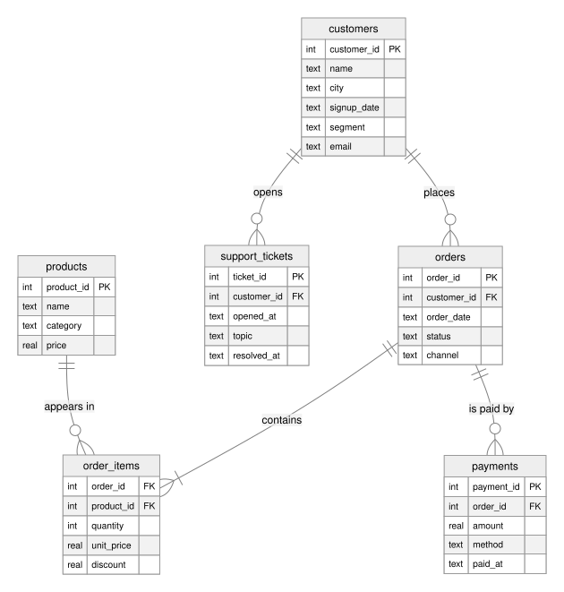

<!-- GENERATED by tools/nbpages.py from notebooks/. Do not edit. -->

# 05 · Databases and SELECT
{: .no_toc }

[Run it in Colab](https://colab.research.google.com/github/berdakh/mlengineering/blob/main/notebooks/05_sql_select.ipynb){: .btn .btn-primary .mr-2 target=_blank }
[View the .ipynb](https://github.com/berdakh/mlengineering/blob/main/notebooks/05_sql_select.ipynb){: .btn target=_blank }

{: .note }
> You are reading this notebook. To **run** it, open it in Colab with the button above - no install, no GPU needed for most of them - or clone the repository and open it in Jupyter.

1. TOC
{:toc}

---

**Week 2 · lesson · about 90 minutes**

Most of the data a company has does not live in CSV files. It lives in a **database**, and the language
everyone uses to ask a database questions is **SQL** (say "sequel" or "S-Q-L"; both are fine). Data
scientists, analysts and ML engineers write SQL every week: to find training data, to check a number, to
build features. This week you learn it from zero.

**What you will learn**

- what a relational database is: tables, rows, columns, primary and foreign keys;
- how to read a table with `SELECT ... FROM`, and filter it with `WHERE`;
- how to sort with `ORDER BY`, cut with `LIMIT` and remove duplicates with `DISTINCT`;
- what `NULL` means and the one rule that prevents most NULL bugs;
- how to compute new columns, including from dates.

**What you need:** notebook 01 (how this course works) and basic Python.

**How grading works:** after each exercise, run the grader cell under it. It runs your query on our database
*and* on a second, differently generated copy, and tells you in plain words if something is off.

```python
# --- Setup: works in Google Colab AND on your own computer. Safe to re-run. ---
# In Colab this downloads the course (about 30 s) and installs what it needs (about a minute, once
# per session). On your computer it just finds the course folder.
import os, sys, subprocess
from pathlib import Path

if "google.colab" in sys.modules and not Path("/content/mlengineering").exists():
    subprocess.run(["git", "clone", "--depth", "1",
                    "https://github.com/berdakh/mlengineering.git", "/content/mlengineering"], check=True)
    subprocess.run([sys.executable, "-m", "pip", "install", "-q", "-r",
                    "/content/mlengineering/requirements.txt"], check=True)
REPO_ROOT = Path("/content/mlengineering") if "google.colab" in sys.modules else next(
    p for p in [Path.cwd(), *Path.cwd().parents] if (p / "src" / "mlcourse").is_dir())
os.chdir(REPO_ROOT)
sys.path.insert(0, str(REPO_ROOT / "src"))
from mlcourse.grader import grade, quiz
print("Ready. Course folder:", REPO_ROOT)
from mlcourse.sql import sql, tables, schema
```

## 1. What a relational database is

**Why.** A spreadsheet works until two people edit it, it reaches a million rows, or the same customer appears
in five places with five spellings. Databases exist to keep shared data correct, consistent and fast to query.

**Idea.** A **relational database** stores data in **tables**. A table is like a spreadsheet with strict
rules: every **column** has a name and a type (number, text, date), and every **row** is one record of the
same kind of thing. Our course database, `shop`, belongs to a small (made-up) online shop:

| Table | One row is... |
|---|---|
| `customers` | one customer |
| `products` | one product in the catalogue |
| `orders` | one order a customer placed |
| `order_items` | one product line inside an order (an order with 3 different products has 3 lines) |
| `payments` | one payment for an order |
| `support_tickets` | one help request from a customer |

Two kinds of columns tie the tables together:

- A **primary key** identifies each row uniquely. `customers.customer_id` is a primary key: no two customers
  share an id, and it is never empty.
- A **foreign key** points to a row in another table. `orders.customer_id` is a foreign key: it holds the id
  of the customer who placed the order. This is how "which customer ordered what" is stored without copying
  the customer's name into every order.

The picture below is an **entity-relationship (ER) diagram**: boxes are tables, lines are foreign keys.


**See it.** `tables()` lists the tables; `schema(db, table)` shows a table's columns and types
(a non-zero `pk` marks the primary key; 1 and 2 mean first and second part when the key has two columns). These are small helpers from this course; underneath they ask SQLite, the
database engine built into Python, so nothing needs installing.

```python
print(tables("shop"))
schema("shop", "orders")
```

**Try it.** Change `"orders"` to `"order_items"`. Which columns form its key? (Answer: the pair
`order_id, product_id`; one product appears at most once per order.)

```python
schema("shop", "orders")
```

## 2. Your first query: SELECT ... FROM

**Why.** Before you can analyse anything, you need to get the right columns out of the right table.

**Idea.** Every query you will write this week has this shape:

```sql
SELECT <which columns>
FROM <which table>
```

`SELECT *` means "all columns". SQL keywords are not case sensitive (`select` works), but writing them in
capitals makes queries easier to read. Text values go in single quotes: `'Almaty'`.

The helper `sql(query, db)` runs a query and returns the result as a pandas DataFrame, which Colab shows
as a table. The database defaults to `"shop"`.

```python
sql("SELECT * FROM products")
```

There are 21 products. Their columns are `product_id`, `name`, `category` and `price`.

**Try it.** Edit the query to show only `name` and `category`. Then try a column that does not exist
(`colour`) and read the error message: SQLite tells you `no such column`. Reading error messages is half of
writing SQL.

```python
sql("SELECT name, category FROM products")
```

### Exercise 1 · All products

Write a query that returns **every column of every product**. Put your SQL between the triple quotes in the
cell below; the cell shows your result, and the cell after it grades it.

```python
# Write your query between the triple quotes, then run this cell and the next one.
query = """

"""
sql(query) if query.strip() else print("(no query yet)")
```

```python
grade("w02.all_products", query)
```

### Exercise 2 · Names and cities

Return two columns, **`name` then `city`**, for every customer (1,200 rows).

```python
# Write your query between the triple quotes, then run this cell and the next one.
query = """

"""
sql(query) if query.strip() else print("(no query yet)")
```

```python
grade("w02.customer_names_cities", query)
```

## 3. Filtering rows: WHERE

**Why.** You almost never want every row. "Orders from March", "products under 15", "students in Almaty"
are all filters.

**Idea.** `WHERE` keeps only the rows for which a condition is true:

```sql
SELECT name, price
FROM products
WHERE price < 15
```

The building blocks:

| You want | Write |
|---|---|
| compare | `=`, `!=` (or `<>`), `<`, `<=`, `>`, `>=` |
| both conditions | `cond1 AND cond2` |
| either condition | `cond1 OR cond2` |
| one of a list | `city IN ('Almaty', 'Astana')` |
| a range, inclusive | `price BETWEEN 10 AND 20` |
| a text pattern | `name LIKE 'A%'` (`%` = any text, `_` = one character) |
| the opposite | `NOT`, e.g. `NOT city IN ('Almaty')` |

**Order matters with AND and OR.** `AND` is evaluated before `OR`, exactly like `*` before `+` in arithmetic.
`a AND b OR c` means `(a AND b) OR c`. When you mix them, add parentheses.

**Dates.** In this database dates are text in `YYYY-MM-DD` form, such as `'2025-03-14'`. Because that format
sorts like a number, comparisons and `BETWEEN` work on it directly.

```python
sql("""
SELECT order_id, order_date, status
FROM orders
WHERE status = 'returned' AND order_date >= '2025-12-01'
""")
```

**Try it.** Change `'returned'` to `'cancelled'`. Then change `AND` to `OR` and look at how many rows
come back. (Long results are shortened on screen; Colab then prints the number of rows under the table. To get
it directly, wrap the call: `len(sql(...))`.)

```python
sql("""
SELECT order_id, order_date, status
FROM orders
WHERE status = 'returned' AND order_date >= '2025-12-01'
""")
```

### Exercise 3 · Cheap products

Return `name` and `price` of the products that cost **less than 15**.

```python
# Write your query between the triple quotes, then run this cell and the next one.
query = """

"""
sql(query) if query.strip() else print("(no query yet)")
```

```python
grade("w02.cheap_products", query)
```

### Exercise 4 · Expensive books

Return `name` and `price` of products in the category **`Books`** whose price is **greater than 20**.

```python
# Write your query between the triple quotes, then run this cell and the next one.
query = """

"""
sql(query) if query.strip() else print("(no query yet)")
```

```python
grade("w02.books_over_20", query)
```

### Exercise 5 · Students in two cities

Return `customer_id` and `name` of customers whose segment is **`student`** and who live in **Almaty or
Astana**. (Watch the AND/OR order.)

```python
# Write your query between the triple quotes, then run this cell and the next one.
query = """

"""
sql(query) if query.strip() else print("(no query yet)")
```

```python
grade("w02.students_two_cities", query)
```

### Exercise 6 · Orders in March 2025

Return `order_id` and `order_date` of every order placed in **March 2025** (1 to 31 March, inclusive).

```python
# Write your query between the triple quotes, then run this cell and the next one.
query = """

"""
sql(query) if query.strip() else print("(no query yet)")
```

```python
grade("w02.march_2025_orders", query)
```

### Exercise 7 · Names starting with A

Return `customer_id` and `name` of customers whose name starts with the letter **A**.

```python
# Write your query between the triple quotes, then run this cell and the next one.
query = """

"""
sql(query) if query.strip() else print("(no query yet)")
```

```python
grade("w02.names_starting_a", query)
```

## 4. Sorting and cutting: ORDER BY, LIMIT, DISTINCT

**Why.** "The five biggest", "the latest", "the list of categories" are everyday questions.

**Idea.**

- `ORDER BY price DESC` sorts by price, largest first (`ASC`, the default, is smallest first). You can sort by
  several columns: `ORDER BY price DESC, name` breaks ties in price by name.
- `LIMIT 5` keeps the first 5 rows of the result. **Without ORDER BY there is no "first"**: SQL does not
  promise any order, so `LIMIT` alone returns *some* rows.
- `SELECT DISTINCT category` removes duplicate rows from the result.

A query is written in one order but runs in another. It helps to read it the way the database does:


```python
sql("""
SELECT name, price
FROM products
ORDER BY price DESC
LIMIT 3
""")
```

**Try it.** Remove `DESC`. Then replace `LIMIT 3` with `LIMIT 3 OFFSET 3` to get the next three
(this is how websites page through results).

```python
sql("""
SELECT name, price
FROM products
ORDER BY price DESC
LIMIT 3
""")
```

### Exercise 8 · Top five by price

Return `name` and `price` of the **five most expensive products**, most expensive first; if two cost the same,
put them in alphabetical order of name. (Order is graded here.)

```python
# Write your query between the triple quotes, then run this cell and the next one.
query = """

"""
sql(query) if query.strip() else print("(no query yet)")
```

```python
grade("w02.top5_expensive", query)
```

### Exercise 9 · The categories

Return the list of **different categories** (one column, each category once), in alphabetical order.

```python
# Write your query between the triple quotes, then run this cell and the next one.
query = """

"""
sql(query) if query.strip() else print("(no query yet)")
```

```python
grade("w02.distinct_categories", query)
```

## 5. NULL: the value that is not there

**Why.** Real data has gaps. 73 customers in our shop never gave an email; 48 have no city. Handling gaps
wrongly is the most common silent SQL bug.

**Idea.** `NULL` means "unknown" or "missing". It is not zero and not an empty string. The rule that prevents
most bugs: **any comparison with NULL is unknown, and WHERE keeps only rows where the condition is true.** So:

- `WHERE email = NULL` returns **nothing**, ever. Write `WHERE email IS NULL` (or `IS NOT NULL`).
- `WHERE city != 'Almaty'` silently **drops** customers whose city is NULL, because for them the comparison is
  unknown, not true. On our data that is 1,018 rows instead of 1,066.

When a question includes the unknowns, say so explicitly: `WHERE city != 'Almaty' OR city IS NULL`.

```python
sql("SELECT COUNT(*) FROM customers WHERE email = NULL")   # 0, always: the classic mistake
```

```python
sql("SELECT COUNT(*) FROM customers WHERE email IS NULL")  # 73
```

(`COUNT(*)` counts rows; you will meet it properly in the next notebook.)

### Exercise 10 · Customers without an email

Return `customer_id` and `name` of customers who have **no email**.

```python
# Write your query between the triple quotes, then run this cell and the next one.
query = """

"""
sql(query) if query.strip() else print("(no query yet)")
```

```python
grade("w02.missing_email", query)
```

### Exercise 11 · Not in Almaty

Return the `customer_id` of every customer who does **not** live in Almaty, **including** customers whose
city is unknown.

```python
# Write your query between the triple quotes, then run this cell and the next one.
query = """

"""
sql(query) if query.strip() else print("(no query yet)")
```

```python
grade("w02.not_almaty", query)
```

## 6. Computing columns, and working with dates

**Why.** The number you need is often not stored: a line total, an age in days, a month to group by.

**Idea.** `SELECT` can compute: arithmetic (`+ - * /`), text (`name || ' (' || city || ')'`), and functions.
Give a computed column a name with `AS`. For dates, SQLite has a few functions you will use constantly:

| Function | Example | Result |
|---|---|---|
| `date(x)` | `date('2025-03-14', '+7 days')` | `'2025-03-21'` |
| `strftime(fmt, x)` | `strftime('%Y-%m', '2025-03-14')` | `'2025-03'` |
| `julianday(x)` | `julianday('2025-03-14') - julianday('2025-03-01')` | `13.0` (days) |

`%Y` is the year, `%m` the month, `%d` the day, `%w` the weekday (0 = Sunday).

One more trap: dividing two whole numbers gives a whole number in SQLite (`7 / 2` is `3`). Write `7 / 2.0`
or `7 * 1.0 / 2` when you need the fraction.

```python
sql("""
SELECT order_id, quantity, unit_price, discount,
       quantity * unit_price AS gross
FROM order_items
LIMIT 5
""")
```

```python
sql("""
SELECT order_id, order_date,
       strftime('%Y-%m', order_date) AS month,
       date(order_date, '+30 days') AS due_date
FROM orders
LIMIT 5
""")
```

**Try it.** Add a column `weekday` with `strftime('%w', order_date)`. Then compute `7 / 2` and
`7 / 2.0` with `sql("SELECT 7 / 2, 7 / 2.0")` and compare.

```python
sql("SELECT 7 / 2, 7 / 2.0")
```

### Exercise 12 · Line totals

For every row of `order_items`, return `order_id`, `product_id` and `line_total`, where
`line_total = quantity × unit_price × (1 − discount)` (`discount` is a fraction, e.g. 0.1 = 10% off).

```python
# Write your query between the triple quotes, then run this cell and the next one.
query = """

"""
sql(query) if query.strip() else print("(no query yet)")
```

```python
grade("w02.line_totals", query)
```

### Exercise 13 · Sign-ups in 2025

Return `customer_id`, `signup_date` and `signup_month` (the month as text like `'2025-03'`) for customers who
signed up in **2025**.

```python
# Write your query between the triple quotes, then run this cell and the next one.
query = """

"""
sql(query) if query.strip() else print("(no query yet)")
```

```python
grade("w02.signups_2025", query)
```

## Optional · Running SQL outside this notebook

Everything here runs on SQLite, which is built into Python, so Colab needs nothing extra. Two ways you will
meet SQL elsewhere:

- **VS Code, on your own computer.** Clone the course repository, install the free *SQLite Viewer* or
  *SQLTools* (with its SQLite driver) extension, open `data/course/shop.db`, and run the same queries in an
  editor with autocomplete. The [SQL tool guide](../tools/sql.html) has step-by-step setup.
- **DuckDB**, a fast analytical database popular in data teams. `pip install duckdb`, then
  `duckdb.sql("SELECT * FROM sqlite_scan('data/course/shop.db', 'products')")`. Almost everything you learn
  here works there unchanged.

Company databases (PostgreSQL, MySQL, BigQuery, Snowflake) differ in details such as date functions, but the
`SELECT ... FROM ... WHERE ... ORDER BY` core is the same everywhere.

## Quiz

Write the letter of your answer between the quotes and run the cell.

**Q1.** What makes `customers.customer_id` a primary key?
(a) it is the first column (b) it is unique for every row and never NULL (c) it decides the sort order
(d) it cannot be left empty

```python
answer = "?"  # your letter here
quiz("w02.05_q1", answer)
```

**Q2.** Which column in `orders` is a foreign key?
(a) `order_id` (b) `order_date` (c) `customer_id` (d) `status`

```python
answer = "?"  # your letter here
quiz("w02.05_q2", answer)
```

**Q3.** What does `SELECT * FROM customers WHERE email = NULL` return?
(a) the customers with no email (b) an error (c) every customer (d) no rows

```python
answer = "?"  # your letter here
quiz("w02.05_q3", answer)
```

**Q4.** What does `SELECT name FROM products LIMIT 5` return?
(a) some 5 products, in no guaranteed order (b) the 5 products added first (c) the 5 cheapest products
(d) an error, because LIMIT needs ORDER BY

```python
answer = "?"  # your letter here
quiz("w02.05_q4", answer)
```

**Q5.** Which names does `WHERE name LIKE 'A%'` keep?
(a) names exactly two characters long starting with A (b) names starting with A (c) names ending with A
(d) names containing an A anywhere

```python
answer = "?"  # your letter here
quiz("w02.05_q5", answer)
```

## Recap

- A relational database stores **tables**; each row is one thing, each column one typed attribute.
- A **primary key** identifies a row; a **foreign key** points to a row in another table.
- `SELECT cols FROM table WHERE condition ORDER BY cols LIMIT n` covers a large share of daily SQL.
- `AND` binds before `OR`; use parentheses or `IN` when mixing them.
- Without `ORDER BY`, there is no "first": `LIMIT` alone returns arbitrary rows.
- `NULL` is unknown: test it with `IS NULL`; `!=` silently drops NULL rows.
- `SELECT` can compute columns; name them with `AS`; dates are handled with `date`, `strftime`, `julianday`.

**On the job.** An ML engineer reaches for SQL to pull a training set, check how many rows a label has, or
see why a dashboard number moved. A two-line `SELECT ... WHERE ... LIMIT 20` to *look at the data* before
modelling it is one of the most valuable habits you can build.

**Going further.** The [SQL tool guide](../tools/sql.html) is a reference for everything in this week.
Next: notebook 06, where you summarise data with `GROUP BY`.

```python
# Record your progress (optional; stored in progress/progress.json):
from mlcourse.progress import mark
# mark("05", "reading")
# mark("05", "guided")
```
