<!-- GENERATED by tools/nbpages.py from notebooks/. Do not edit. -->

# 06 · Independent refactor: a real exploratory notebook becomes the project skeleton
{: .no_toc }

[Run it in Colab](https://colab.research.google.com/github/berdakh/mlengineering/blob/main/notebooks/06_notebook_to_package.ipynb){: .btn .btn-primary .mr-2 target=_blank }
[View the .ipynb](https://github.com/berdakh/mlengineering/blob/main/notebooks/06_notebook_to_package.ipynb){: .btn target=_blank }

{: .note }
> You are reading this notebook. To **run** it, open it in Colab with the button above - no install, no GPU needed for most of them - or clone the repository and open it in Jupyter.

1. TOC
{:toc}

---

**Week 1 · day 6 · 2 h essential path + up to 1 h optional** · lab files: [`labs/w1d6_notebook_to_package/`](https://github.com/berdakh/mlengineering/blob/main/labs/w1d6_notebook_to_package/)

**Objective.** Without step-by-step guidance, refactor an exploratory notebook on the project dataset into the `flowguard` package skeleton using small reviewed Git commits (branch, commit hygiene, .gitignore, lint).

```python
# --- Setup: works on your laptop AND in Google Colab ----------------------------
# In Colab this clones the course repository and installs the requirements (about a
# minute, first run only). On your own machine it just finds the repository. Every
# command in this notebook runs from the repository root. Safe to re-run.
import os
import subprocess
import sys
from pathlib import Path

if "google.colab" in sys.modules:
    if not Path("/content/mlengineering").exists():
        subprocess.run(["git", "clone", "--depth", "1",
                        "https://github.com/berdakh/mlengineering.git",
                        "/content/mlengineering"], check=True)
    os.chdir("/content/mlengineering")
    subprocess.run([sys.executable, "-m", "pip", "install", "-q",
                    "-r", "requirements.txt"], check=True)

REPO_ROOT = next(p for p in [Path.cwd(), *Path.cwd().parents]
                 if (p / "src" / "mlcourse").is_dir())
os.chdir(REPO_ROOT)
sys.path.insert(0, str(REPO_ROOT / "src"))
print("repo root:", REPO_ROOT)
```

**Unit id:** `w1d6` · **Week 1, core day 6** · **Handbook:** [H2.3 Git workflow and refactoring discipline](../handbook/ch02_maintainable_python/h2_3_git_workflow_refactoring.html)
**Data:** real SKAB recordings for the lab (`python project/get_skab.py`, see [docs/guides/project.md](../guides/project.html));
SYNTHETIC SKAB-format files for all checks and for the worked example.

> Commands are run from the course repository root unless a step says otherwise.
> This is an **independent** session. Section 4 is a checklist, not a walkthrough.

---

## 1. Purpose

**Primary objective.** Without step-by-step guidance, turn an exploratory notebook on the project
dataset into the first version of the `flowguard` package, as a sequence of small commits in which
structure changes and behaviour changes never share a commit.

**Why an applied ML engineer needs it.** Almost every model that reaches production started as a
notebook, and the notebook's conclusions were trusted before anyone checked its plumbing. The
valuable skill is not "tidying code". It is the ability to (a) change structure while holding
behaviour fixed, (b) notice where the held behaviour is wrong, and (c) leave a history in which a
reviewer can verify each of those claims separately. This notebook is a fair specimen: it runs
without error, prints plausible numbers, and is wrong in at least five ways that matter to the
project.

**You will practise**

- reading a notebook export for hidden state and order dependence before touching it;
- pinning current behaviour, then extracting functions behind it;
- separating "no behaviour change" commits from "behaviour change" commits, and saying which is which;
- using the staging area to review your own diff before it becomes history;
- keeping data, environments and debris out of the repository.

**Prerequisites.** [w1d3](03_package_structure.html) (package layout, entry point),
[w1d5](05_testing_ml_code.html) (tests on small constructed inputs). w1d4 is helpful, not
required. Git basics (`add`, `commit`, `log`, `diff`) are assumed; H2.3 covers what goes beyond them.
The dataset must be downloaded once: `python project/get_skab.py`.

**Deliverable.** A Git repository `flowguard` (outside the course repository) containing package
v0.1, tests, a README stub, a `.gitignore`, a `NOTES.md` that records every place where the package
disagrees with the notebook and why, and a completed `COMMIT_REVIEW.md`.

**Completion criteria**

- [ ] `WB_TARGET_DIR=<your repo> python -m pytest labs/w1d6_notebook_to_package/checks -q` passes.
- [ ] `flowguard summary --raw-dir <abs path>/data/raw/skab` run from `/tmp` reports **35** experiments and **46,806** rows.
- [ ] `NOTES.md` lists at least four notebook-versus-package discrepancies, each with both numbers and the mechanism.
- [ ] History has at least six commits; every behaviour change is alone in its commit and says so in its message.
- [ ] `COMMIT_REVIEW.md` is filled in honestly against your own `git log`.
- [ ] No hint beyond hint 1 was opened (otherwise mark `guided`, not `independent`).

**Time budget: essential path, 2 h**

| Activity | Minutes |
|---|---|
| Section 2 and handbook H2.3 quick reference | 20 |
| Section 3: replay the worked example and read its history | 15 |
| Section 4: the refactor | 70 |
| Sections 7-8: commit self-review, assessment, reflection | 15 |

**Optional extension, up to 1 h:** the challenge (about 40 min) and the debugging interview rep (about 15 min).

---

## 2. Conceptual explanation

### 2.1 A notebook is a program whose state you cannot see

A script's state at line *n* is determined by lines 1 to *n* − 1. A notebook's state at a cell is
determined by **the order in which cells were executed in that kernel session**, including cells
that were later edited or deleted. The file on disk records the cell text, not that order. So a
notebook export has two properties a script does not:

- **Hidden state.** A name such as `df` may refer to whatever was last assigned to it by any cell.
  The reader of cell 14 cannot tell which.
- **Order dependence.** Running the cells top to bottom may give a different result from the one the
  author saw, and neither run is "the" result.

Anyone who has used analysis notebooks has seen this: a filter cell re-run twice, a column list edited
after the data was split. The difference in industry is only that someone else will build on the
numbers without having been in the kernel session.

The practical consequence for refactoring: **the notebook's printed output is a claim about the code,
not a specification.** You pin it so that you can tell when *you* change something, and you expect
to overturn parts of it.



*Hidden state: the same cell gives different results depending on which cells ran before it, and the file on disk does not record which did.*

### 2.2 Two kinds of change, never in one commit

Let `f` be the program before a commit and `f'` after it.

- A **refactoring** is a change for which `f'(x) = f(x)` for every input `x` you care about. Its
  evidence is an unchanged characterization output plus passing tests.
- A **behaviour change** is one for which `f'(x) ≠ f(x)` for some `x`. Its evidence is a test that
  failed before and passes after, plus a sentence saying why the new value is the right one.

A commit that mixes them can be verified by neither kind of evidence: the characterization output
moved, so it no longer shows that the structural part was safe, and the reviewer cannot tell which
lines caused the numbers to move. This is the same discipline as changing one factor per experimental
condition, applied to code history.

The **characterization test** (also called a golden-master or approval test) is the instrument for
the first kind: run the program, store its output, assert the output is unchanged. It encodes no
opinion about correctness. When a behaviour-change commit moves the output, you update the stored
output *in that same commit*, and the diff of the golden file is the reviewable statement of what
changed. The worked example shows exactly this in commit 5.

Characterization has limits you should state rather than discover later: it only covers the inputs
you ran; it is as brittle as the output format; and it cannot be used when the output is known to be
wrong in ways that make it worthless to preserve. In today's lab the notebook's output is of that
last kind for several cells, which is why the lab asks for a discrepancy table instead of a golden
file.



*Two kinds of commit. In a refactoring the golden file must not move; in a behaviour change it must, visibly.*

### 2.3 Seams: where to cut

A **seam** is a place where behaviour can be observed or substituted without editing the code around
it. In a notebook export the natural seams are the points where data crosses from one concern to
another:

```
file on disk ──► one experiment as a DataFrame ──► all experiments as one table ──► summaries
             load_experiment(path)              load_raw(raw_dir)                summarize(tidy)
```

Each arrow becomes a function with data in and data out, no printing, no globals, no paths other
than its arguments. The order of extraction that keeps you safe is **from the leaves inward**: first
the function nothing else depends on being a function (one file to one frame), then its callers.

Three questions decide whether a notebook line belongs in the package at all:

1. Does a later step consume its *result* (keep, as a function), or did the author only *look* at it (drop, or keep as a report command)?
2. Is it a fact about the data (belongs in a test or a data-quality check, w2d3) or a transformation (belongs in the package)?
3. Was it an idea that was abandoned? Notebooks are full of these; the z-score cell in today's notebook is one, and it is wrong.

### 2.4 The staging area is a review tool

Git separates three things: the working tree (your files), the index or staging area (the content
of the *next* commit), and history. `git add -p` walks through your changes hunk by hunk and lets you
stage some and leave others; `git diff --staged` shows exactly what the next commit will contain.
Used together they make every commit a deliberate statement:

```bash
git add -p                 # choose hunks; this is where you notice the stray debug print
git diff --staged          # read the commit before it exists
python -m pytest -q        # the staged change should leave the tests passing
git commit -m "Extract load_experiment (no behaviour change)"
```

Commit size is governed by one rule: **a commit should be describable in one sentence without the
word "and"**, and the project should work after it. That makes `git bisect` usable later (every
commit is a valid state to test) and makes review cheap.



*The staging area is where you review yourself before anyone else does.*

### 2.5 What never goes into the repository

| Never commit | Why | Instead |
|---|---|---|
| Datasets, especially third-party ones | size; licence (SKAB is GPL-3.0); history keeps them forever | a download script, checksums, `.gitignore` |
| Model weights, run outputs, caches | size; they are *derived*, so the command that makes them is the source | ignore `runs/`, publish artifacts elsewhere (Week 5) |
| Environments (`.venv/`) and bytecode | machine-specific, large, reproducible from `pyproject.toml` | `.gitignore` |
| Secrets (keys, tokens, `.env`) | a pushed secret must be treated as compromised even if deleted | environment variables; rotate if it ever happens |
| Notebook outputs with data in them | patient or customer data leaks through rendered cells | strip outputs, or keep notebooks out of the package repo |

Two facts about Git make the first row important. Deleting a file in a later commit does not remove
it from history. And `.gitignore` only affects files that are **not yet tracked**: adding a pattern
after the file was committed changes nothing until you also run `git rm --cached <file>`.

### 2.6 An industry example

A team inherits a churn notebook whose final cell reports ROC AUC 0.91. The first engineer rewrites
it as a clean pipeline in one large commit; the pipeline reports 0.78. Nobody can say whether the
rewrite introduced a bug or removed one, and a week is spent re-deriving the notebook's behaviour by
hand. The second approach takes one more day up front: pin the notebook's output; extract loading,
feature and split functions with the output unchanged (four commits); then fix, one commit each, a
join that duplicated customers and a scaler fitted on all rows. The history then reads "0.91 → 0.91
→ 0.91 → 0.84 (deduplicate) → 0.78 (scaler)", and each drop is attributed to a named cause that a
stakeholder can be told about. The final number is the same. What differs is that the second team
can defend it.

### 2.7 Misconceptions

- *"The notebook ran, so its numbers are the baseline to reproduce."* It ran in an unknown cell order. Reproduce it once, then audit it.
- *"Refactoring means improving the code."* Refactoring means **not** changing behaviour. Improvement of behaviour is a separate, tested step.
- *"Small commits are bureaucracy."* They are what makes a behaviour change attributable. One large commit destroys that information permanently.
- *"`.gitignore` will keep the data out."* Only if the pattern exists before the first `git add`, and only for untracked files.
- *"I will squash it later."* Squashing after review is fine. Squashing a refactor together with a fix removes the evidence that the refactor was safe.
- *"Linting is about style."* The useful part of a linter finds real defects (unused variables that reveal a forgotten step, shadowed names, mutable defaults). Formatting is the unimportant part, which is why it should be automatic and never discussed.

---

## 3. Worked example: a meters notebook, commit by commit

A different, much smaller notebook is refactored in six commits. The data is SYNTHETIC (three
electricity meters, twelve readings each); it demonstrates the mechanics only.

```
example/
  steps/01_notebook_as_found/     explore_meters.py, meters.csv
  steps/02_characterization/      tests/test_characterization.py, tests/golden.txt, .gitignore
  steps/03_extract_loading/       meterkit.py, explore_meters.py
  steps/04_remove_hidden_state/   meterkit.py, explore_meters.py
  steps/05_fix_fleet_mean/        explore_meters.py, tests/test_meterkit.py, tests/golden.txt, ...
  steps/06_readme/                README.md
  replay_history.py               rebuilds these six commits in a scratch repository
```

Each `steps/` directory holds only the files that commit adds or changes. Rebuild the history and
read it:

```bash
python labs/w1d6_notebook_to_package/example/replay_history.py /tmp/meters-demo
cd /tmp/meters-demo
git log --oneline
git show HEAD~1            # the one behaviour-changing commit
git diff HEAD~3 HEAD~2     # a pure extraction
```

Output of the replay in the authoring session (hashes differ on every run, since they depend on time):

```
01_notebook_as_found       tests: no tests ran in 0.00s
02_characterization        tests: 1 passed in 0.39s
03_extract_loading         tests: 1 passed in 0.37s
04_remove_hidden_state     tests: 1 passed in 0.39s
05_fix_fleet_mean          tests: 3 passed in 0.70s
06_readme                  tests: 3 passed in 0.75s

32751cd Add README
611efe5 Fix fleet mean: it used M2 rows only (BEHAVIOUR CHANGE)
d991c63 Extract mean_kwh and peak_days, replace cells with main() (no behaviour change)
653497f Extract load_readings and daily_totals (no behaviour change)
47f30b4 Pin current output with a characterization test
c6808c8 Add notebook export and sample data as found
```



*The six commits of the worked example. Only the highlighted one changes what the program prints (3.603 to 1.949).*

**The flaw.** The notebook has a cell `df = df[df.meter_id == "M2"]` ("look at the big one"), and a
later cell prints `"fleet mean kwh per reading"` from `df`. The "fleet" mean is the mean of one meter.

**Decisions worth noticing**

1. **Commit 1 adds the notebook untouched.** History then contains the thing being refactored, and every later diff is measured against it.
2. **Commit 2 pins the output, wrong value included** (`fleet mean ... 3.603`). The test docstring says it is scaffolding, not a claim of correctness.
3. **Commits 3 and 4 move code and leave `golden.txt` untouched.** That untouched file is the evidence that they are refactorings. Commit 4 has to keep the bug alive to stay honest, so it does so explicitly: `mean_kwh(m2)` with a comment `BUG PRESERVED ON PURPOSE`. Hidden state became a visible, named argument. That is the whole trick: once the wrong input has a name, the bug is one line.
4. **Commit 5 is the only one that changes behaviour**, and its diff shows it three ways: one line of code, one line of golden output, and a new unit test that states the correct behaviour on a hand-checkable frame.

   ```
   611efe5 Fix fleet mean: it used M2 rows only (BEHAVIOUR CHANGE)

    explore_meters.py      |  4 +---
    tests/conftest.py      |  4 ++++
    tests/golden.txt       |  2 +-
    tests/test_meterkit.py | 23 +++++++++++++++++++++++
    4 files changed, 29 insertions(+), 4 deletions(-)

   -fleet mean kwh per reading: 3.603
   +fleet mean kwh per reading: 1.949
   ```
5. **The example keeps a flat layout** (`meterkit.py` beside the script) to stay small. Your project uses the `src` layout from w1d3.

**Interpretation.** The number moved from 3.603 to 1.949, a factor of 1.8, and the history attributes
all of it to one named cause. Nothing here says the new number is "good"; it says the new number is
what the label on the print statement claims.

**A real incident from building this example.** The first version of `replay_history.py` copied
files with their modification times preserved. Both versions of `golden.txt` had the same size and
the same timestamp, Git's change detection (which checks size and time before content) concluded
the file had not changed, and commit 5 silently omitted it while the tests passed. `git show --stat`
on the supposedly behaviour-changing commit is what revealed it. Reading your own commit before
moving on is not a formality.

---

## 4. Lab (independent): refactor `explore_skab.py`

The notebook export is [`lab/explore_skab.py`](https://github.com/berdakh/mlengineering/blob/main/labs/w1d6_notebook_to_package/lab/explore_skab.py). It loads the SKAB files,
renames columns, concatenates experiments and prints summaries. It runs without error:

```bash
python project/get_skab.py                                       # once; data/raw/skab/ is git-ignored
python labs/w1d6_notebook_to_package/lab/explore_skab.py | tee /tmp/notebook_output.txt
```

Its first lines of output in the authoring session:

```
valve1 16
valve2 4
other 14
(46806, 13)
(37401, 14)
experiments: 34
```

**Target.** `flowguard` v0.1 as specified in [docs/maintainers/flowguard-spec.md](../maintainers/flowguard-spec.html):

- `flowguard.data.SENSOR_COLUMNS`, `load_experiment(path) -> DataFrame`, `load_raw(raw_dir) -> DataFrame` (the tidy table defined in the spec);
- a console command `flowguard summary --raw-dir <dir>` that prints **one JSON document** on stdout:
  `{"n_experiments": ..., "n_rows": ..., "experiments": [{"experiment_id", "family", "n_rows", "anomaly_fraction", ...}, ...]}`;
- user errors (missing directory, no experiment files) give a one-line message on stderr and a non-zero exit code;
- `load_experiment` raises `FileNotFoundError` for a missing file and `ValueError` naming any missing column;
- tests that build their own tiny SKAB-format files, a README stub, a `.gitignore`.

**Where to work.** In a new repository **outside** the course repository, because this becomes your
portfolio project with its own history:

```bash
mkdir -p ~/projects/flowguard && cd ~/projects/flowguard && git init -b main
```

Grade it from the course repository with:

```bash
WB_TARGET_DIR=~/projects/flowguard python -m pytest labs/w1d6_notebook_to_package/checks -q
```

(`python wb.py check w1d6` honours the same variable.) The checks use synthetic files only. They do
not look at your Git history; that is what `COMMIT_REVIEW.md` is for.

```
data/raw/skab/                                   tidy table (flowguard.data.load_raw)
  anomaly-free/anomaly-free.csv   9,405 rows       experiment_id | family | t | datetime | 8 sensors | anomaly | changepoint
  valve1/0.csv ... 15.csv         16 files         --------------+--------+---+----------+-----------+---------+------------
  valve2/0.csv ... 3.csv           4 files   ==>   valve1/0      | valve1 | 0 | ...      | ...       | 0       | 0
  other/1.csv  ... 14.csv         14 files         valve1/0      | valve1 | 1 | ...      | ...       | 0       | 0
                                                   ...
  35 files, ';' separated,                         46,806 rows, one per (experiment_id, timestamp),
  8 sensor columns (+ 2 label columns              snake_case columns, sorted,
  except in anomaly-free)                          labels 0 where a file has none
```

*What the refactored loader must produce from the raw files (real SKAB counts).*

### Checklist

Work through these in order. How you do each one is up to you.

1. **Read before running.** Read the export once and write down, per cell: what it needs from earlier cells, and what it leaves behind. Predict two numbers you expect to be wrong. (10 min)
2. **Record the notebook's claims.** Commit the export untouched and its captured output (`notes/notebook_output.txt`) as the first commit. (5 min)
3. **Skeleton.** `pyproject.toml`, `src/flowguard/`, `.gitignore` **before** any data can be added by accident, an empty test that runs. One commit. (10 min)
4. **Extract leaf to root.** `load_experiment`, then `load_raw`, then the summary. Write each function's test on a constructed file *first or alongside*; make at least one constructed case hostile (a two-digit file name, shuffled rows, a file without label columns, reordered columns). (30 min)
5. **Confront the notebook.** For every number where package and notebook disagree, add a row to `NOTES.md`: notebook value, package value, mechanism, which is right and how you know. Fix-commits are separate from extraction-commits. (10 min)
6. **Command and README.** `flowguard summary`, then a README stub that says what this is, where the data comes from, and the two commands a stranger needs. (10 min)
7. **Review your history** with [`lab/COMMIT_REVIEW.md`](https://github.com/berdakh/mlengineering/blob/main/labs/w1d6_notebook_to_package/lab/COMMIT_REVIEW.md). Copy it into your repository, fill it in, commit it. (5 min)

### Checkpoints

| When | You should be able to show |
|---|---|
| After step 2 | `git log --oneline` has one commit; `git status` is clean; the data directory is not in the repository |
| After step 4 | `python -m pytest -q` passes in your repo **without** the dataset present and from another directory |
| After step 5 | The package reports a different number of experiments and of rows than the notebook, and you can say why in one sentence each |
| After step 6 | `cd /tmp && flowguard summary --raw-dir <abs path> \| python -m json.tool > /dev/null` succeeds |

### When something goes wrong

| Symptom | Likely cause | What to do |
|---|---|---|
| Check says "no pyproject.toml in .../lab" | `WB_TARGET_DIR` not set, or set to a path with `~` inside quotes | `export WB_TARGET_DIR=$HOME/projects/flowguard` |
| Your tests pass, the checks fail on experiment ids | your constructed files never had a name like `10.csv` | add the hostile case to your own tests first, watch it fail, then fix |
| Row count is 37,401 | the fault-free recording was dropped somewhere | find the line that can remove rows; ask what `NaN` labels came from |
| `git status` shows hundreds of data files | `.gitignore` written after `git add`, or pattern does not match | `git rm -r --cached data`, fix the pattern, verify with `git check-ignore -v data/raw/skab/valve1/0.csv` |
| JSON check fails with "stdout must be exactly one JSON document" | a progress `print` shares stdout with the result | diagnostics go to stderr or logging (w1d4) |
| A commit contains both moved code and a changed number | hunks were staged together | `git reset --soft HEAD~1`, then `git add -p` and commit twice |

The reference solution's own notes ([`solutions/.../lab/NOTES.md`](https://github.com/berdakh/mlengineering/blob/main/solutions/labs/w1d6_notebook_to_package/lab/NOTES.md))
contain every discrepancy with real numbers. Open them only after your `NOTES.md` is committed.

---

```python
# Run the automated checks on your guided lab.
# A fresh starter is expected to FAIL; passing means guided practice, not mastery.
from mlcourse.checks import check

check("w1d6")
```

## 5. Independent challenge

[`challenge/README.md`](https://github.com/berdakh/mlengineering/blob/main/labs/w1d6_notebook_to_package/challenge/README.md): add a sampling-gap report (`flowguard.data.find_gaps`
and `flowguard gaps`) test-first on a branch, and reconcile it with the notebook cell that printed
`n gaps > 5 s: 19`. It transfers today's method to behaviour the notebook only gestured at.

```bash
WB_TARGET_DIR=~/projects/flowguard python -m pytest labs/w1d6_notebook_to_package/checks_challenge -q
```


### The challenge brief


**Time:** about 40 minutes. **Assistance:** none beyond hint 1. **Where:** your `flowguard` repository.

#### Situation

The notebook has a cell that prints `median dt 1.0 max dt 1887107.0 n gaps > 5 s: 19`. A maximum
interval of 21.8 days between "consecutive" samples of a 1 Hz recording is not a sampling gap.
The project needs the true list of gaps: causal rolling features (w2d5) and detection delays (w3d4)
are both wrong across a hole in the data, so the pipeline has to know where the holes are.

#### Task

On a branch `gaps`, with tests written before or alongside the implementation:

1. `flowguard.data.find_gaps(tidy, max_gap_seconds=5.0) -> pandas.DataFrame`
   One row per gap, where a gap is a pair of **consecutive rows of the same experiment** whose
   timestamps differ by **strictly more** than `max_gap_seconds`. Columns (at least):
   `experiment_id`, `gap_start` (timestamp before the gap), `gap_end` (timestamp after it),
   `gap_seconds` (a number, in seconds). No gaps gives an empty frame that still has these columns.
   A negative threshold raises `ValueError`.
2. `flowguard gaps --raw-dir <dir> [--max-gap-seconds S]` prints one JSON document:
   `{"max_gap_seconds": S, "n_gaps": N, "gaps": [{"experiment_id", "gap_start", "gap_end", "gap_seconds"}, ...]}`.
   Errors behave like `summary`: one line on stderr, non-zero exit, nothing on stdout.
3. Add a row to `NOTES.md`: the notebook's count, yours, and the mechanism behind the difference.
4. Merge the branch into `main` when the tests pass. `summary` must keep working.

#### Acceptance criteria

- [ ] `WB_TARGET_DIR=<your repo> python -m pytest labs/w1d6_notebook_to_package/checks_challenge -q` passes.
- [ ] Your own tests include: a gap inside one experiment; two experiments far apart in time with no gap in either; an interval exactly equal to the threshold.
- [ ] `git log --oneline main..gaps` (before merging) showed at least three commits, and the first one that touches `find_gaps` adds a failing or newly passing test, not just code.
- [ ] On the real data you can state how many gaps longer than 5 s exist, in how many experiments, and the longest one. Write the three numbers in `NOTES.md`.
- [ ] You can explain in two sentences why the notebook's count was wrong *twice over*.

#### Optional extension question (no code required)

The notebook's summary table shows one experiment ending at `18:11:02` and the next one starting at
`18:10:42` on the same day. Recordings from one testbed cannot overlap. Investigate with your
package: what is going on, how many rows are involved, and why will it matter when experiments are
assigned to training and test sets? The reference notes give the answer with numbers.

No solution is given here. Hints are in `../hints/`; the reference is in
`solutions/labs/w1d6_notebook_to_package/challenge/`.

```python
# Run the automated checks on your independent challenge.
# A fresh starter is expected to FAIL; passing means guided practice, not mastery.
from mlcourse.checks import check

check("w1d6", challenge=True)
```

## 6. Progressive hints

Open in order, and only when stuck for more than ten minutes. Opening hint 2 or 3 means the unit is
recorded as *guided*.

1. [Concept](https://github.com/berdakh/mlengineering/blob/main/labs/w1d6_notebook_to_package/hints/hint1_concept.md): what to look for, without saying where.
2. [Approach](https://github.com/berdakh/mlengineering/blob/main/labs/w1d6_notebook_to_package/hints/hint2_approach.md): an extraction order and the hostile test cases.
3. [Partial implementation](https://github.com/berdakh/mlengineering/blob/main/labs/w1d6_notebook_to_package/hints/hint3_partial.md): the shape of `load_experiment` and one test.

Full reference: `solutions/labs/w1d6_notebook_to_package/` (lab, challenge, notes, answers).


Open one hint at a time, only after a real attempt.

<details>
<summary><b>Hint 1 concept</b></summary>


No locations, only kinds of fault. The notebook contains at least one of each.

1. **An identifier derived from position.** Whenever a label for a thing is computed from *where it
   happened to be in a list*, ask what determined the order of the list.
2. **A cleaning step that removes rows without saying how many.** Any line that can drop rows should
   make you compare the count before and after, and ask *which* rows went.
3. **An operation over the whole table that only makes sense within a group.** Sorting, differencing
   and indexing all have a "per recording" and an "over everything" version. In signal analysis the
   same mistake is a filter or a baseline computed across a concatenation of sessions.
4. **A name that means different things in different cells.** Find a variable that is assigned in
   more than one cell and read every use of it.
5. **Meaning assigned by column position.** It works until the file changes.

For the refactor itself: the smallest function is "one file in, one clean frame out". Everything
else is built from it. Write its test on a file you construct in a temporary directory, and make the
constructed file awkward on purpose.

For the challenge: what does "consecutive" mean when the table contains many recordings?

</details>

<details>
<summary><b>Hint 2 approach</b></summary>


Opening this hint means the unit is recorded as *guided*.

##### Commit plan that works

1. `Add notebook export as received` (the `.py` and its captured output under `notes/`).
2. `Add package skeleton and .gitignore` (`pyproject.toml`, `src/flowguard/__init__.py`, empty test).
3. `Add load_experiment with tests` - new code, no notebook behaviour involved yet.
4. `Add load_raw with tests`.
5. `Add summarize and the summary command`.
6. `Record notebook discrepancies in NOTES.md`.
7. `Add README stub`, then `Add commit self-review`.

Because the package is new code rather than edited notebook code, the "behaviour change" here shows
up as *disagreement with the recorded notebook output*, and `NOTES.md` is where each disagreement is
attributed. If instead you edit the notebook in place first (also legitimate), then each fix to the
notebook is its own commit, as in the worked example.

##### The four hostile fixtures

Build these as tiny files in `tmp_path` (semicolon-separated, raw SKAB column names):

| Fixture | Catches |
|---|---|
| a family folder containing `0.csv`, `2.csv`, `10.csv` with **different row counts** | ids taken from sort position (`0, 10, 2` is the lexicographic order) |
| a file **without** `anomaly` and `changepoint` columns | rows lost to `dropna()`; labels left as NaN or float |
| a file whose rows are **shuffled** | missing sort; `t` not a time index |
| a file whose columns are in a **different order** | renaming by position |

Assert on exact row counts per `experiment_id`, on `t == 0..n-1` within each experiment, and on a
sensor value landing in the right column (give each synthetic sensor a distinct mean).

##### Design decisions to make deliberately

* `experiment_id` = parent folder name + `/` + file stem. Nothing else.
* Rename with a mapping (`df.rename(columns=...)`) and check that required names are present; raise `ValueError` listing what is missing.
* The fault-free file has no labels: fill `0` and say so in the docstring. That is a labelling decision, so it also belongs in `NOTES.md`.
* Sort and index **within** each experiment; never sort the combined table by `datetime` alone.
* The CLI prints only JSON to stdout. Catch `FileNotFoundError` and `ValueError` at the entry point, print one line to stderr, return 2.

##### For the challenge

`groupby("experiment_id")["datetime"].diff()` or `.shift(1)`. The first row of each experiment then
has no predecessor (NaN), and a comparison of NaN with a threshold is False, which is what you want.
Test the threshold with an interval exactly equal to it.

</details>

<details>
<summary><b>Hint 3 partial</b></summary>


Opening this hint means the unit is recorded as *guided*. The reference solution is still more complete.

##### Shape of `load_experiment`

```python
RAW_TO_CANONICAL = {
    "datetime": "datetime",
    "Accelerometer1RMS": "accelerometer1_rms",
    # ... six more sensors ...
    "Volume Flow RateRMS": "flow_rate",
    "anomaly": "anomaly",
    "changepoint": "changepoint",
}
LABEL_COLUMNS = ("anomaly", "changepoint")


def load_experiment(path):
    path = Path(path)
    if not path.is_file():
        raise FileNotFoundError(f"experiment file not found: {path}")
    df = pd.read_csv(path, sep=";")
    required = [raw for raw, name in RAW_TO_CANONICAL.items() if name not in LABEL_COLUMNS]
    missing = [c for c in required if c not in df.columns]
    if missing:
        raise ValueError(f"{path} is missing required columns: {missing}")
    df = df.rename(columns=RAW_TO_CANONICAL)
    for label in LABEL_COLUMNS:
        ...            # absent in the fault-free file: decide, fill, cast to int
    ...                # parse datetime, sort by it, reset the index
    return df[[...]]   # canonical order
```

`load_raw` iterates `sorted(raw_dir.glob("*/*.csv"))`, calls `load_experiment`, and adds
`experiment_id`, `family` and `t` **per file, before concatenating**. That placement is what makes
the three per-experiment properties true by construction.

##### One hostile test, complete

```python
def test_ids_come_from_file_names_not_positions(tmp_path):
    root = tmp_path / "skab"
    write_experiment(root / "valve1" / "0.csv", n_rows=20, start="2020-03-09 10:00:00")
    write_experiment(root / "valve1" / "2.csv", n_rows=22, start="2020-03-09 11:00:00")
    write_experiment(root / "valve1" / "10.csv", n_rows=30, start="2020-03-09 12:00:00")
    sizes = load_raw(root).groupby("experiment_id").size().to_dict()
    assert sizes == {"valve1/0": 20, "valve1/2": 22, "valve1/10": 30}
```

`write_experiment` is yours to write: a frame with a `datetime` column from `pd.date_range`, the
eight raw sensor names, optional label columns, saved with `sep=";"`.

##### Challenge: the core three lines

```python
ordered = tidy.sort_values(["experiment_id", "datetime"])
previous = ordered.groupby("experiment_id")["datetime"].shift(1)
seconds = (ordered["datetime"] - previous).dt.total_seconds()
```

What remains is the strict comparison, assembling the result columns, the empty case and the CLI.

</details>

## 7. Assessment

`assessment.md` (section 7 of this notebook): five reasoning questions (one asks you to defend a design choice),
the commit-hygiene self-review rubric, and a 10-15 minute **debugging** interview rep. Write your
answers before opening `solutions/labs/w1d6_notebook_to_package/assessment_answers.md`.

Automated checks cover the package contract and that your tests are self-contained. They cannot
judge your history or your notes; the rubric does.


### Assessment questions


Write your answers (in `progress/notes.md` or a file in your project) **before** opening
`solutions/labs/w1d6_notebook_to_package/assessment_answers.md`. Short answers; reasoning matters
more than length.

#### A. Reasoning questions

**Q1. Order dependence.** In `explore_skab.py`, the cell "z-score against normal" uses `df`. State
exactly which rows `df` holds when the file is run top to bottom, why that is not what the comment
claims, and what *third* outcome the author could have seen in the live notebook.

**Q2. Counting what a cleaning step removes.** The notebook prints `(46806, 13)` and then
`(37401, 14)`. Without running anything else, what is the most likely identity of the 9,405 missing
rows, what single fact about the files makes `dropna()` remove them, and why is the resulting
`37401` a particularly dangerous wrong number?

**Q3. Design choice (explain and defend).** `load_experiment` has to do something with a file that
has no `anomaly`/`changepoint` columns. Options: (a) fill with 0, (b) fill with NaN and keep a
nullable column, (c) raise, (d) add a separate boolean `is_labelled` column. Choose one for this
project, justify it against at least two of the others, and name one later stage of the project that
your choice makes easier and one it makes riskier.

**Q4. Commit boundaries.** You discover the positional-id bug while extracting `load_raw`. Describe
the commits you make, in order, and what evidence each one carries. What is lost if you fix it
inside the extraction commit?

**Q5. Limits of the method.** Give two situations in which a characterization (golden-output) test is
the wrong tool, and say what you would use instead in each.

#### B. Rubric for open-ended answers (applies to Q3-Q5 and to your `NOTES.md`)

| Level | Description |
|---|---|
| **Demonstrated** | States the mechanism, not just the symptom; gives a concrete consequence for a later stage (splits, features, evaluation); compares alternatives on a stated criterion; names what the choice costs |
| **Partial** | Correct conclusion with a generic justification ("cleaner", "safer"); or mechanism right but no downstream consequence |
| **Not yet** | Restates the code; treats the notebook's output as ground truth; cannot say which commit would carry which change |

#### C. Commit hygiene

Self-review with `lab/COMMIT_REVIEW.md`. Its levels (Demonstrated / Partial / Not yet) are the
grade for the history; the automated checks deliberately do not look at Git.

#### D. Interview rep: debugging (10-15 minutes, timed)

Conditions for Week 1: first attempt untimed is allowed, but **say or write your hypotheses in the
order you would test them before running any code**. The rubric scores the ordering.

> A colleague reports: "`test_defaults` passes when I run it alone and fails when I run the whole
> file. Sometimes the alert thresholds in the service are wrong after someone calls the endpoint
> with an override." The function:
>
> ```python
> import json
> from pathlib import Path
>
> _CACHE = {}
>
>
> def load_thresholds(path, overrides={}):
>     """Per-sensor alert thresholds from a JSON file, with optional overrides."""
>     if path not in _CACHE:
>         _CACHE[path] = json.loads(Path(path).read_text())
>     thresholds = _CACHE[path]
>     thresholds.update(overrides)
>     return thresholds
> ```
>
> 1. List your hypotheses in the order you would check them, with the one-line experiment for each.
> 2. Identify the defect(s). Say which suspicious-looking thing is **not** the cause, and how you know.
> 3. Fix it, keeping the "parse each file once" behaviour.
> 4. Write the two tests that would have caught it.
> 5. One sentence: what does this have in common with today's notebook?

Reference, tests and scoring: `solutions/labs/w1d6_notebook_to_package/interview_rep/` and the
answers file.

## 8. Reflection and review

**You should now be able to, alone:**

- take a notebook you did not write and say which of its printed numbers depend on execution order;
- refactor it into tested functions with a history that separates structure from behaviour;
- explain, for each number that changed, what caused the change;
- keep a repository free of data, environments and secrets from the first commit.

**Reflection prompt** (write three or four sentences in `progress/notes.md` via
`python wb.py note w1d6 "..."`): Which of the notebook's errors would you have shipped if you had
simply "cleaned up" the code? What in your process caught it, and what would have caught it earlier?

**Retrieval question for the review day (answer from memory):** A colleague adds `data/` to
`.gitignore` and commits; `git status` still shows the 300 MB file they committed last week as
tracked, and the repository is still large after they delete the file. Explain both observations and
say what has to be done about each.

**Record progress**

```bash
python wb.py mark w1d6 reading
python wb.py mark w1d6 independent      # only if checks pass and no hint beyond hint 1 was used
python wb.py note w1d6 "flowguard repo: ~/projects/flowguard, commit <hash>; hints used: ..."
```

**Next:** `w1d7_review` (light day): Week 1 retrieval sheet and interview set 1. See
[roadmap/SCHEDULE.md](../guides/schedule.html). The repository you created today is where the
project continues in w2d3 (ingestion and data-quality checks).

---

### Verification record

| What | Result (2026-11-21, Python 3.13.18, pandas 3.0.5, Git 2.43.0) |
|---|---|
| `lab/explore_skab.py` on the real data | runs; output quoted above |
| Reference `flowguard summary` on the real data | 35 experiments, 46,806 rows |
| Worked example replay | six commits, tests pass after each (output quoted above) |
| `python tools/verify_checks.py labs/w1d6_notebook_to_package` | reference passes both parts; 7 lab mutants and 4 challenge mutants rejected |
| Shipped `lab/` against the checks | fails (no project there by design) |

**Next session:** [w1d7_review](https://github.com/berdakh/mlengineering/blob/main/labs/w1d7_review/README.md).

## Record your progress

Tick only what is true. Passing the supplied checks is *guided practice*; mark *independent* only for work done without hints or solutions.

```python
from mlcourse.progress import mark, note

# mark("w1d6", "reading")
# mark("w1d6", "guided")
# mark("w1d6", "independent")
# note("w1d6", "what tripped me up today")
```
