<!-- GENERATED by tools/nbpages.py from notebooks/. Do not edit. -->

# 06 · Aggregation: GROUP BY, HAVING, CASE
{: .no_toc }

[Run it in Colab](https://colab.research.google.com/github/berdakh/mlengineering/blob/main/notebooks/06_sql_aggregation.ipynb){: .btn .btn-primary .mr-2 target=_blank }
[View the .ipynb](https://github.com/berdakh/mlengineering/blob/main/notebooks/06_sql_aggregation.ipynb){: .btn target=_blank }

{: .note }
> You are reading this notebook. To **run** it, open it in Colab with the button above - no install, no GPU needed for most of them - or clone the repository and open it in Jupyter.

1. TOC
{:toc}

---

**Week 2 · lesson · about 90 minutes**

In notebook 05 every row of a result was a row of a table. Most business questions are different: "how many",
"how much", "on average", "per month", "per channel". This notebook turns many rows into a few summary rows.

**What you will learn**

- the aggregate functions `COUNT`, `SUM`, `AVG`, `MIN`, `MAX`, and how each treats `NULL`;
- `GROUP BY`: one summary row per group;
- `HAVING`: filter groups, and why it is not the same as `WHERE`;
- `CASE WHEN`: turn values into categories, and count conditions;
- grouping by month and computing durations from dates.

**What you need:** notebook 05 (SELECT, WHERE, NULL, dates).

**How grading works:** run the grader cell after each exercise; it checks your query on our database and on a
second, differently generated copy.

```python
# --- Setup: works in Google Colab AND on your own computer. Safe to re-run. ---
# In Colab this downloads the course (about 30 s) and installs what it needs (about a minute, once
# per session). On your computer it just finds the course folder.
import os, sys, subprocess
from pathlib import Path

if "google.colab" in sys.modules and not Path("/content/mlengineering").exists():
    subprocess.run(["git", "clone", "--depth", "1",
                    "https://github.com/berdakh/mlengineering.git", "/content/mlengineering"], check=True)
    subprocess.run([sys.executable, "-m", "pip", "install", "-q", "-r",
                    "/content/mlengineering/requirements.txt"], check=True)
REPO_ROOT = Path("/content/mlengineering") if "google.colab" in sys.modules else next(
    p for p in [Path.cwd(), *Path.cwd().parents] if (p / "src" / "mlcourse").is_dir())
os.chdir(REPO_ROOT)
sys.path.insert(0, str(REPO_ROOT / "src"))
from mlcourse.grader import grade, quiz
print("Ready. Course folder:", REPO_ROOT)
from mlcourse.sql import sql, tables, schema
```

## 1. Aggregate functions: many rows in, one value out

**Why.** "How many customers do we have?" and "what does the cheapest product cost?" are questions about a
whole table, not about one row.

**Idea.** An **aggregate function** reads a column over many rows and returns one value:

| Function | Returns | NULLs |
|---|---|---|
| `COUNT(*)` | number of rows | counted (it counts rows, not values) |
| `COUNT(col)` | number of non-NULL values in `col` | skipped |
| `COUNT(DISTINCT col)` | number of different non-NULL values | skipped |
| `SUM(col)`, `AVG(col)` | total, mean | skipped |
| `MIN(col)`, `MAX(col)` | smallest, largest | skipped |

So on our customers: `COUNT(*)` is 1,200, `COUNT(email)` is 1,127 (73 emails are NULL) and
`COUNT(DISTINCT city)` is 8, because NULL is not counted as a city. `AVG` skips NULLs too: it averages the known
values only, which is usually what you want but should be a decision, not an accident.

```python
sql("""
SELECT COUNT(*)              AS n_rows,
       COUNT(email)          AS n_emails,
       COUNT(DISTINCT city)  AS n_cities
FROM customers
""")
```

**Try it.** Add `COUNT(city)` and predict the result before running (hint: 48 cities are NULL).
Then try `SELECT COUNT(DISTINCT segment) FROM customers`.

```python
sql("SELECT COUNT(*), COUNT(email), COUNT(DISTINCT city) FROM customers")
```

### Exercise 1 · How many customers?

Return one row with one column: the **number of customers**.

```python
# Write your query between the triple quotes, then run this cell and the next one.
query = """

"""
sql(query) if query.strip() else print("(no query yet)")
```

```python
grade("w02.count_customers", query)
```

### Exercise 2 · How many emails do we know?

Return the **number of customers who have an email** (one row, one column).

```python
# Write your query between the triple quotes, then run this cell and the next one.
query = """

"""
sql(query) if query.strip() else print("(no query yet)")
```

```python
grade("w02.count_emails", query)
```

### Exercise 3 · How many cities?

Return the **number of different cities** customers live in (unknown cities do not count).

```python
# Write your query between the triple quotes, then run this cell and the next one.
query = """

"""
sql(query) if query.strip() else print("(no query yet)")
```

```python
grade("w02.count_cities", query)
```

### Exercise 4 · Price summary

Return one row with three columns, in this order: the **lowest**, **highest** and **average** product price.

```python
# Write your query between the triple quotes, then run this cell and the next one.
query = """

"""
sql(query) if query.strip() else print("(no query yet)")
```

```python
grade("w02.price_stats", query)
```

## 2. GROUP BY: one summary row per group

**Why.** One number for the whole table is rarely enough. Managers ask "how many orders *per status*",
"revenue *per channel*", "units *per product*".

**Idea.** `GROUP BY col` splits the rows into groups that share the same value of `col`, runs the aggregates
inside each group, and returns **one row per group**:


**The rule:** every column in `SELECT` must either be in `GROUP BY` or be inside an aggregate. `SELECT status,
order_date, COUNT(*) ... GROUP BY status` asks for "the" order date of a group of 3,816 orders, which has no
answer. (SQLite quietly picks one of them; most other databases raise an error. Both mean: fix the query.)

```python
sql("""
SELECT status, COUNT(*) AS n_orders
FROM orders
GROUP BY status
""")
```

Four statuses: 3,816 delivered, 375 shipped, 354 cancelled, 199 returned.

**Try it.** Group by `channel` instead. Then group by **two** columns, `channel, status`, and see how the
groups become pairs.

```python
sql("""
SELECT status, COUNT(*) AS n_orders
FROM orders
GROUP BY status
""")
```

### Exercise 5 · Orders per status

Return each `status` and the number of orders with that status.

```python
# Write your query between the triple quotes, then run this cell and the next one.
query = """

"""
sql(query) if query.strip() else print("(no query yet)")
```

```python
grade("w02.orders_per_status", query)
```

### Exercise 6 · Units sold per product

From `order_items`, return each `product_id` and the **total number of units** sold of it (a line with
`quantity = 3` is 3 units).

```python
# Write your query between the triple quotes, then run this cell and the next one.
query = """

"""
sql(query) if query.strip() else print("(no query yet)")
```

```python
grade("w02.units_per_product", query)
```

## 3. HAVING: filter groups, not rows

**Why.** "Which channels had more than 1,000 orders?" filters on a count, and the count only exists after
grouping.

**Idea.** A query with grouping runs in this order:


- `WHERE` runs **before** grouping. It sees single rows and cannot use `COUNT(*)` or `SUM(...)`.
- `HAVING` runs **after** grouping. It sees groups and their aggregates.

Use both when you need both: "among non-cancelled orders (WHERE), the channels with more than 1,000 of them
(HAVING)". Putting a row condition in `HAVING` or an aggregate in `WHERE` is the classic mistake; SQLite
answers the second with `misuse of aggregate`.

```python
sql("""
SELECT category, COUNT(*) AS n_products, AVG(price) AS avg_price
FROM products
GROUP BY category
HAVING COUNT(*) >= 5
""")
```

Only Electronics and Home have 5 products each.

**Try it.** Change `HAVING COUNT(*) >= 5` to `WHERE COUNT(*) >= 5` (before `GROUP BY`) and read the error.
Then filter to categories with an average price above 20.

```python
sql("""
SELECT category, COUNT(*) AS n_products, AVG(price) AS avg_price
FROM products
GROUP BY category
HAVING COUNT(*) >= 5
""")
```

### Exercise 7 · Busy channels

Return each `channel` and its number of orders, **not counting cancelled orders**, keeping only channels with
**more than 1,000** such orders.

```python
# Write your query between the triple quotes, then run this cell and the next one.
query = """

"""
sql(query) if query.strip() else print("(no query yet)")
```

```python
grade("w02.busy_channels", query)
```

### Exercise 8 · Best sellers

Return `product_id` and total `units` sold for the products with **more than 500 units** sold in total.

```python
# Write your query between the triple quotes, then run this cell and the next one.
query = """

"""
sql(query) if query.strip() else print("(no query yet)")
```

```python
grade("w02.products_over_500_units", query)
```

## 4. CASE WHEN: categories and conditional counts

**Why.** Business categories are often not stored: "cheap / mid / premium", "weekend / weekday", "late /
on time". And you often want several counts side by side: delivered *and* cancelled per channel.

**Idea.** `CASE` is SQL's if/else. It checks the `WHEN` conditions **top to bottom** and returns the `THEN` of
the first one that is true; if none is, it returns the `ELSE` value (or NULL if there is no `ELSE`):

```sql
CASE
  WHEN price < 15 THEN 'cheap'
  WHEN price < 40 THEN 'mid'      -- reached only if price >= 15
  ELSE 'premium'
END
```

Two common uses:

1. **A new category column**, which you can then `GROUP BY` (SQLite lets you group by its alias).
2. **Conditional counting**: `SUM(CASE WHEN status = 'cancelled' THEN 1 ELSE 0 END)` adds 1 for each cancelled
   row, so it counts them, inside any group.

```python
sql("""
SELECT name, price,
       CASE WHEN price < 15 THEN 'cheap'
            WHEN price < 40 THEN 'mid'
            ELSE 'premium' END AS band
FROM products
ORDER BY price
""")
```

**Try it.** Swap the first two `WHEN` lines (put `price < 40` first) and see what happens to the cheap
products. That is the "first true WHEN wins" rule.

```python
sql("""
SELECT name, price,
       CASE WHEN price < 15 THEN 'cheap'
            WHEN price < 40 THEN 'mid'
            ELSE 'premium' END AS band
FROM products
ORDER BY price
""")
```

### Exercise 9 · Price bands

Put every product in a band: **`cheap`** if its price is below 15, **`mid`** if below 40, otherwise
**`premium`**. Return each `band` and the number of products in it.

```python
# Write your query between the triple quotes, then run this cell and the next one.
query = """

"""
sql(query) if query.strip() else print("(no query yet)")
```

```python
grade("w02.price_bands", query)
```

### Exercise 10 · Delivered and cancelled per channel

Return three columns: `channel`, the number of **delivered** orders and the number of **cancelled** orders in
that channel (one row per channel).

```python
# Write your query between the triple quotes, then run this cell and the next one.
query = """

"""
sql(query) if query.strip() else print("(no query yet)")
```

```python
grade("w02.status_by_channel", query)
```

## 5. Grouping by time

**Why.** "Per month" is the most common grouping in business reporting, and "how long did it take" the most
common duration.

**Idea.** Group by a value computed from a date. `strftime('%Y-%m', order_date)` turns `'2025-03-14'` into
`'2025-03'`, so all March orders fall in one group. For durations, `julianday(later) - julianday(earlier)` is
the number of days between two dates. Our support tickets have `opened_at` and `resolved_at`; 90 of 691
tickets are still open, so `resolved_at` is NULL there, and since `AVG` skips NULLs, an average duration covers
resolved tickets only.

When the result is a time series, **sort it by time** with `ORDER BY month`: a report with months in random
order is hard to read.

```python
sql("""
SELECT strftime('%Y', order_date) AS year, COUNT(*) AS n_orders
FROM orders
GROUP BY year
ORDER BY year
""")
```

771 orders in 2024 and 3,973 in 2025: the shop is growing.

**Try it.** Change `'%Y'` to `'%Y-%m'` to see orders per month. Then try `'%w'` (weekday, 0 = Sunday): does the
shop have a quiet day?

```python
sql("""
SELECT strftime('%Y', order_date) AS year, COUNT(*) AS n_orders
FROM orders
GROUP BY year
ORDER BY year
""")
```

### Exercise 11 · Orders per month in 2025

Return `month` (text like `'2025-01'`) and the number of orders, for the months of **2025**, **sorted by
month** (order is graded).

```python
# Write your query between the triple quotes, then run this cell and the next one.
query = """

"""
sql(query) if query.strip() else print("(no query yet)")
```

```python
grade("w02.orders_per_month_2025", query)
```

### Exercise 12 · How long does support take?

For each ticket `topic`, return the topic and the **average number of days** between `opened_at` and
`resolved_at` (over resolved tickets).

```python
# Write your query between the triple quotes, then run this cell and the next one.
query = """

"""
sql(query) if query.strip() else print("(no query yet)")
```

```python
grade("w02.avg_resolution_days", query)
```

## 6. Putting it together: a rate per group

**Why.** Counts grow with volume: the busiest channel always has the most cancellations. To compare channels
fairly you need a **rate**: cancelled orders divided by all orders, per channel.

**Idea.** The average of a 0/1 column is the share of 1s. So `AVG(CASE WHEN status = 'cancelled' THEN 1.0 ELSE 0
END)` is the cancellation rate of each group. (Write `1.0`, not `1`, so nothing is ever rounded to a whole
number.) Read the query below clause by clause, in the order the database runs it:

1. `FROM orders`: start from all 4,744 orders.
2. `WHERE order_date >= '2025-01-01'`: keep the 2025 orders, row by row.
3. `GROUP BY channel`: one group per channel.
4. The aggregates `COUNT(*)` and `AVG(CASE ...)` are computed inside each group.
5. `HAVING COUNT(*) >= 500`: drop channels with too few orders to trust their rate.
6. `SELECT` names the columns; `ORDER BY cancel_rate DESC` puts the worst channel first.

The result: marketplace cancels 7.8% of its 606 orders, web 7.6% of 1,962, the mobile app 7.1% of 1,405.
The rates are close, which is itself a finding: no channel has a cancellation problem of its own. Notice how the
raw counts would have told a different story (web has by far the most cancellations, simply because it has the
most orders).

```python
sql("""
SELECT channel,
       COUNT(*) AS n_orders,
       AVG(CASE WHEN status = 'cancelled' THEN 1.0 ELSE 0 END) AS cancel_rate
FROM orders
WHERE order_date >= '2025-01-01'
GROUP BY channel
HAVING COUNT(*) >= 500
ORDER BY cancel_rate DESC
""")
```

**Try it.** Compute the **return** rate instead (`status = 'returned'`). Then group by `segment`... which
is not a column of `orders`. You will need a join for that: the topic of notebook 07.

```python
sql("""
SELECT channel,
       COUNT(*) AS n_orders,
       AVG(CASE WHEN status = 'cancelled' THEN 1.0 ELSE 0 END) AS cancel_rate
FROM orders
WHERE order_date >= '2025-01-01'
GROUP BY channel
HAVING COUNT(*) >= 500
ORDER BY cancel_rate DESC
""")
```

## Quiz

**Q1.** A table has 10 rows; the `email` column is NULL in 3 of them. Which is true?
(a) `COUNT(*)` and `COUNT(email)` both return 10 (b) `COUNT(*)` returns 7 and `COUNT(email)` returns 10
(c) `COUNT(*)` returns 10 and `COUNT(email)` returns 7 (d) `COUNT(email)` counts different emails

```python
answer = "?"  # your letter here
quiz("w02.06_q1", answer)
```

**Q2.** What is the difference between `WHERE` and `HAVING`?
(a) none; `HAVING` is the modern spelling (b) `WHERE` filters rows before grouping, `HAVING` filters groups
after (c) they can be swapped freely (d) `HAVING` can only be used with `COUNT`

```python
answer = "?"  # your letter here
quiz("w02.06_q2", answer)
```

**Q3.** Why is `SELECT channel, order_date, COUNT(*) FROM orders GROUP BY channel` a bad query?
(a) `order_date` is neither grouped nor aggregated, so its value per channel is undefined
(b) it is fine: SQL picks the right date (c) GROUP BY sorts by date first (d) you cannot use aggregates with GROUP BY

```python
answer = "?"  # your letter here
quiz("w02.06_q3", answer)
```

**Q4.** A column holds 4, NULL, 8. What does `AVG` return?
(a) 4, treating NULL as 0 (b) an error (c) NULL (d) 6, averaging the known values

```python
answer = "?"  # your letter here
quiz("w02.06_q4", answer)
```

**Q5.** With `CASE WHEN price < 40 THEN 'mid' WHEN price < 15 THEN 'cheap' ELSE 'premium' END`, what does a
product priced 10 get?
(a) `'cheap'`, the most specific condition (b) an error, because conditions overlap (c) `'mid'`, the first
true WHEN (d) `NULL`

```python
answer = "?"  # your letter here
quiz("w02.06_q5", answer)
```

## Recap

- `COUNT(*)` counts rows; `COUNT(col)`, `SUM`, `AVG`, `MIN`, `MAX` skip NULLs; `COUNT(DISTINCT col)` counts values.
- `GROUP BY` returns one row per group; every selected column is grouped or aggregated.
- `WHERE` filters rows before grouping; `HAVING` filters groups after.
- `CASE WHEN ... THEN ... ELSE ... END` makes categories; the first true `WHEN` wins.
- `SUM(CASE WHEN cond THEN 1 ELSE 0 END)` counts rows that meet a condition, per group.
- Group by `strftime('%Y-%m', date)` for monthly reports, sort them by month, and use `julianday` for durations.

**On the job.** Nearly every metric on a dashboard is a `GROUP BY`: daily active users, orders per channel,
error rate per model version. Before training a classifier, an ML engineer runs
`SELECT label, COUNT(*) ... GROUP BY label` to see the class balance, and the same query per month to see
whether it drifts.

**Going further.** The [SQL tool guide](../tools/sql.html) has a cheat sheet of everything here. Next:
notebook 07, where you combine tables with `JOIN`.

```python
# Record your progress (optional; stored in progress/progress.json):
from mlcourse.progress import mark
# mark("06", "reading")
# mark("06", "guided")
```
