<!-- GENERATED by tools/nbpages.py from notebooks/. Do not edit. -->

# 08 · Lab: business questions in SQL
{: .no_toc }

[Run it in Colab](https://colab.research.google.com/github/berdakh/mlengineering/blob/main/notebooks/08_lab_sql_business_questions.ipynb){: .btn .btn-primary .mr-2 target=_blank }
[View the .ipynb](https://github.com/berdakh/mlengineering/blob/main/notebooks/08_lab_sql_business_questions.ipynb){: .btn target=_blank }

{: .note }
> You are reading this notebook. To **run** it, open it in Colab with the button above - no install, no GPU needed for most of them - or clone the repository and open it in Jupyter.

1. TOC
{:toc}

---

**Week 2 · lab · about 90 minutes**

This lab introduces nothing new. You get a message from a product manager with seven questions, and you answer
each one with a query against the shop database, the way an analyst or ML engineer would in their first month
at a company.

**What you will practise**

- turning a vague business question into a precise definition (grain, filters, revenue);
- choosing between `GROUP BY`, `HAVING`, `CASE`, `INNER JOIN`, `LEFT JOIN` and anti-joins;
- checking your own numbers before anyone else sees them.

**What you need:** notebooks 05, 06 and 07.

**How grading works:** each answer is a query, graded on two databases with checks for the usual mistakes.
The questions build on each other: the definition of revenue from question 1 is used in 2, 3, 6.

```python
# --- Setup: works in Google Colab AND on your own computer. Safe to re-run. ---
# In Colab this downloads the course (about 30 s) and installs what it needs (about a minute, once
# per session). On your computer it just finds the course folder.
import os, sys, subprocess
from pathlib import Path

if "google.colab" in sys.modules and not Path("/content/mlengineering").exists():
    subprocess.run(["git", "clone", "--depth", "1",
                    "https://github.com/berdakh/mlengineering.git", "/content/mlengineering"], check=True)
    subprocess.run([sys.executable, "-m", "pip", "install", "-q", "-r",
                    "/content/mlengineering/requirements.txt"], check=True)
REPO_ROOT = Path("/content/mlengineering") if "google.colab" in sys.modules else next(
    p for p in [Path.cwd(), *Path.cwd().parents] if (p / "src" / "mlcourse").is_dir())
os.chdir(REPO_ROOT)
sys.path.insert(0, str(REPO_ROOT / "src"))
from mlcourse.grader import grade, quiz
print("Ready. Course folder:", REPO_ROOT)
from mlcourse.sql import sql, tables, schema
```

## The message

> **From:** Dana, Product Manager
> **Subject:** numbers for the quarterly review
>
> Hi! For Thursday's review I need a few numbers. Can you pull them from the shop database?
>
> 1. Revenue per month in 2025.
> 2. Our 10 best customers by revenue.
> 3. What share of our buyers come back for a second purchase?
> 4. Orders we shipped or delivered but never received a payment for. Finance is worried.
> 5. How fast does support resolve tickets, per topic? And how many are still open?
> 6. Revenue split by product category and sales channel.
> 7. People who signed up in 2024 but never bought anything, per segment: marketing wants to re-engage them.
>
> Thanks!

**Agreed definitions** (settled with Dana before you start; write them down in every real project):

- **Revenue** = the sum of line amounts `quantity * unit_price * (1 - discount)` over orders with status
  **`delivered` or `shipped`**. Cancelled orders were never paid; returned orders were refunded. (Notebook 07
  only excluded cancelled orders; here the definition is stricter. That is the point: the number depends on
  the definition, so state it.)
- A **buyer** is a customer with at least one revenue order.

A good habit for every question: before the query, write **the grain of the answer** (one row per what?) and
**the filter**. The workflow:


**Warm-up (not graded).** Total revenue across both years, by the definition above. You will use this
number later to check yourself. It should be 281,782.75.

```python
sql("""
SELECT SUM(oi.quantity * oi.unit_price * (1 - oi.discount)) AS revenue
FROM order_items AS oi
JOIN orders AS o ON o.order_id = oi.order_id
WHERE o.status IN ('delivered', 'shipped')
""")
```

### Question 1 · Revenue per month in 2025

Grain: one row per month. Return `month` (text like `'2025-01'`) and `revenue`, for 2025 only, **sorted by
month**.

```python
# Write your query between the triple quotes, then run this cell and the next one.
query = """

"""
sql(query) if query.strip() else print("(no query yet)")
```

```python
grade("w02.lab_monthly_revenue", query)
```

**Check yourself (not graded).** The months should add up to the 2025 total. Wrap your query in a
subquery and sum it, then compute the 2025 total directly; the two numbers must agree (both are 237,264.0).
This is called **reconciling** a number, and it catches more errors than any amount of re-reading.

```python
print(sql("SELECT SUM(revenue) FROM (" + query + ")") if query.strip() else "write question 1 first")
sql("""
SELECT SUM(oi.quantity * oi.unit_price * (1 - oi.discount)) AS revenue_2025
FROM order_items AS oi
JOIN orders AS o ON o.order_id = oi.order_id
WHERE o.status IN ('delivered', 'shipped')
  AND o.order_date BETWEEN '2025-01-01' AND '2025-12-31'
""")
```

### Question 2 · Top 10 customers

Grain: one row per customer. Return `customer_id`, `name` and `revenue` of the **10 customers with the highest
revenue**, highest first; break ties by `customer_id` (smallest first).

```python
# Write your query between the triple quotes, then run this cell and the next one.
query = """

"""
sql(query) if query.strip() else print("(no query yet)")
```

```python
grade("w02.lab_top_customers", query)
```

### Question 3 · Repeat purchase rate

Among **buyers** (customers with at least one delivered or shipped order), what fraction have **two or more**
such orders? Return one row, one column: a number between 0 and 1.

Hint for the shape: first build one row per buyer with their number of revenue orders (a subquery), then
average a condition over it. In SQLite a comparison such as `n >= 2` is 1 when true and 0 when false, so
`AVG(n >= 2)` is the share of rows where it holds.

```python
# Write your query between the triple quotes, then run this cell and the next one.
query = """

"""
sql(query) if query.strip() else print("(no query yet)")
```

```python
grade("w02.lab_repeat_rate", query)
```

### Question 4 · Payment gaps

Grain: one row per order. Return `order_id`, `customer_id` and `order_date` of **delivered or shipped** orders
that have **no payment** at all.

```python
# Write your query between the triple quotes, then run this cell and the next one.
query = """

"""
sql(query) if query.strip() else print("(no query yet)")
```

```python
grade("w02.lab_unpaid_orders", query)
```

### Question 5 · Support resolution

Grain: one row per ticket topic. Return four columns: `topic`, the number of tickets, the number of
**resolved** tickets, and the **average days to resolve** (over resolved tickets).

```python
# Write your query between the triple quotes, then run this cell and the next one.
query = """

"""
sql(query) if query.strip() else print("(no query yet)")
```

```python
grade("w02.lab_ticket_resolution", query)
```

### Question 6 · Revenue by category and channel

Grain: one row per (category, channel) pair. Return `category`, `channel` and `revenue`.

```python
# Write your query between the triple quotes, then run this cell and the next one.
query = """

"""
sql(query) if query.strip() else print("(no query yet)")
```

```python
grade("w02.lab_category_channel", query)
```

**Check yourself (not graded).** The revenue of all pairs must add up to the warm-up total, 281,782.75.
If it is larger, a join fanned out.

```python
print(sql("SELECT SUM(revenue) FROM (" + query + ")") if query.strip() else "write question 6 first")
```

### Question 7 · Sign-ups who never bought

Grain: one row per segment. Return `segment` and the number of customers who **signed up in 2024** and have
**no orders at all** (of any status).

```python
# Write your query between the triple quotes, then run this cell and the next one.
query = """

"""
sql(query) if query.strip() else print("(no query yet)")
```

```python
grade("w02.lab_inactive_2024_signups", query)
```

## Quiz

**Q1.** Dana asks "what was revenue last quarter?". What should you do first?
(a) write the fastest possible query (b) make the output look nice (c) write down the grain and the definition
of revenue (d) run something and think about it afterwards

```python
answer = "?"  # your letter here
quiz("w02.08_q1", answer)
```

**Q2.** For the repeat purchase rate, what is the right denominator?
(a) customers who bought at least once (b) all customers, including those who never bought (c) the number of
orders (d) customers with two or more orders

```python
answer = "?"  # your letter here
quiz("w02.08_q2", answer)
```

**Q3.** What is the best quick check that your monthly revenue query is right?
(a) the numbers look plausible (b) run it on a different database (c) the row count is 12
(d) the months add up to the yearly total computed separately

```python
answer = "?"  # your letter here
quiz("w02.08_q3", answer)
```

**Q4.** You send Dana a revenue number. What should come with it?
(a) nothing: the query is in your notebook (b) the definition used, e.g. "delivered and shipped orders, after
discounts" (c) the number rounded to millions (d) a chart

```python
answer = "?"  # your letter here
quiz("w02.08_q4", answer)
```

## Reflection

Write 3-5 sentences in the cell below (ungraded): which question was hardest to *define* (not to write), and
what would you ask Dana before sending the numbers? For example: should returned orders count in "best
customers"? Does "never bought" include customers whose only order was cancelled?

*Your reflection here.*

## What to show in your portfolio

A short write-up of this lab is a good first portfolio piece for analyst and ML engineering roles:

- the seven questions, each with its **definition** (grain, filters, revenue) and the query;
- the two reconciliation checks and their results;
- one paragraph of findings, in plain words. For example: monthly revenue grew from 9,893.60 in January 2025
  to 36,501.50 in December; about 73% of buyers came back for a second order; 139 delivered or shipped orders have
  no payment record, which finance should look at.

## Recap

- Settle the **definition** (what counts as revenue, who counts as a buyer) before writing SQL.
- Name the **grain** of each answer; it tells you what to `GROUP BY` and which joins are safe.
- Use `LEFT JOIN ... IS NULL` for "never" questions and `COUNT(col)` for "how many are filled in".
- **Reconcile**: parts should add up to the whole; a total that grows after a join means fan-out.
- Report numbers together with their definitions.

**On the job.** Requests like Dana's arrive every week, and the people who answer them well are trusted with
modelling work. The same skills define ML labels ("churned = no revenue order for 90 days") and features, and
a wrong definition there is much harder to spot than a SQL error.

**Going further.** Keep the [SQL tool guide](../tools/sql.html) open as a reference. Week 3 adds window
functions and CTEs, and repeats this kind of work in pandas.

```python
# Record your progress (optional; stored in progress/progress.json):
from mlcourse.progress import mark
# mark("08", "guided")
# mark("08", "independent")
```
