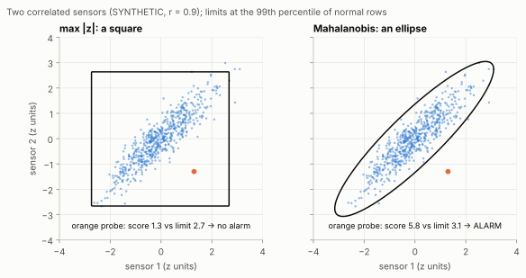
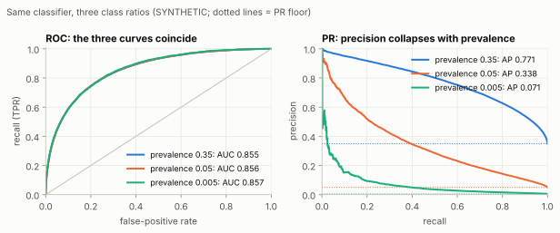
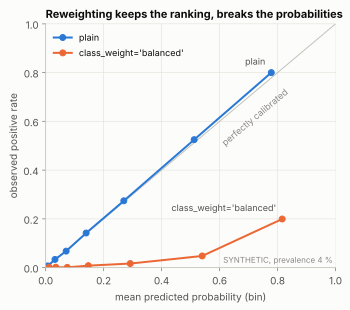
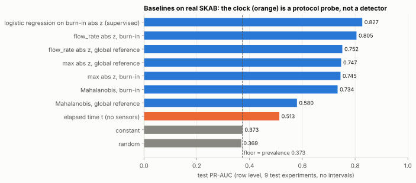
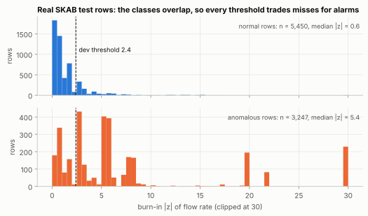

<!-- GENERATED by tools/nbpages.py from notebooks/. Do not edit. -->

# 12 · Strong simple baselines and metrics that match the decision
{: .no_toc }

[Run it in Colab](https://colab.research.google.com/github/berdakh/mlengineering/blob/main/notebooks/12_baselines_metrics.ipynb){: .btn .btn-primary .mr-2 target=_blank }
[View the .ipynb](https://github.com/berdakh/mlengineering/blob/main/notebooks/12_baselines_metrics.ipynb){: .btn target=_blank }

{: .note }
> You are reading this notebook. To **run** it, open it in Colab with the button above - no install, no GPU needed for most of them - or clone the repository and open it in Jupyter.

1. TOC
{:toc}

---

**Week 2 · day 6 · 2 h essential path + up to 1 h optional** · lab files: [`labs/w2d6_baselines_metrics/`](https://github.com/berdakh/mlengineering/blob/main/labs/w2d6_baselines_metrics/)

**Objective.** Establish trivial and classical baselines and choose metrics from the decision (imbalance, PR vs ROC, thresholds, calibration basics) on the project data and on an unfamiliar business table.

```python
# --- Setup: works on your laptop AND in Google Colab ----------------------------
# In Colab this clones the course repository and installs the requirements (about a
# minute, first run only). On your own machine it just finds the repository. Every
# command in this notebook runs from the repository root. Safe to re-run.
import os
import subprocess
import sys
from pathlib import Path

if "google.colab" in sys.modules:
    if not Path("/content/mlengineering").exists():
        subprocess.run(["git", "clone", "--depth", "1",
                        "https://github.com/berdakh/mlengineering.git",
                        "/content/mlengineering"], check=True)
    os.chdir("/content/mlengineering")
    subprocess.run([sys.executable, "-m", "pip", "install", "-q",
                    "-r", "requirements.txt"], check=True)

REPO_ROOT = next(p for p in [Path.cwd(), *Path.cwd().parents]
                 if (p / "src" / "mlcourse").is_dir())
os.chdir(REPO_ROOT)
sys.path.insert(0, str(REPO_ROOT / "src"))
print("repo root:", REPO_ROOT)
```

Status: see [STATUS.md](../guides/status.html). Handbook: [H5.1](../handbook/ch05_classical_ml_baselines/h5_1_trivial_and_linear_baselines.html),
[H5.2](../handbook/ch05_classical_ml_baselines/h5_2_metrics_from_decisions.html),
[H6.2](../handbook/ch06_evaluation_leakage_uncertainty/h6_2_thresholds_imbalance_calibration.html).
Solutions live in `solutions/labs/w2d6_baselines_metrics/`; open them after your own attempt.

## 1. Purpose

**Objective.** Establish trivial and classical baselines for the `flowguard` project and choose
metrics from the decision the model serves, on the project data and on an unfamiliar business table.

**Why an applied ML engineer needs it.** In a paper the baseline is somebody else's method and the
metric is the field's convention. In a product neither is given. The baseline you choose decides
whether a quarter of modelling work was worth anything, and the metric you choose decides which model
ships. A baseline table is also the cheapest instrument you have for finding out that a *benchmark*
is broken. In this session it will tell you something about SKAB that no model card mentions: a
detector that looks only at the clock, with no sensor input, gets a test F1 of 0.835.

**Deliverable.** `lab/BASELINES.md`: the baseline table on real SKAB data with your reading of it,
and (challenge) a one-page decision note for a retention offer.

**Prerequisites.** [w2d4](10_problem_framing_splits.html) split manifest and [w2d5](11_feature_pipeline.html)
ideas (causal features); neither needs to be finished, snapshots of `flowguard.data` and
`flowguard.splits` are in the lab. SKAB downloaded: `python project/get_skab.py`.

**Time budget (2 h essential).**

| Activity | Minutes |
|---|---|
| Read sections 2-3, run the worked example | 30 |
| Lab tasks 1-2: metrics from scratch | 30 |
| Lab tasks 3-4: scorers and the benchmark function | 35 |
| Lab task 5: run the table, write `BASELINES.md` | 15 |
| Assessment questions 1-3 | 10 |
| **Optional extension (up to 1 h):** challenge (transfer exercise part 1), interview rep | 60 |

The challenge is the first sitting of the course's transfer exercise. If the session is full, do it
on the light day; do not skip it.

## 2. Conceptual explanation

### 2.1 What a baseline is for

A baseline answers three different questions, and one model rarely answers all of them:

1. **Floor: what score is free?** A constant score, a random score, the training prevalence. Any
   metric has a value for "knows nothing", and that value is often not 0 and not 0.5.
2. **Sanity: is the pipeline measuring what I think?** Baselines that *should not* work (a clock, a
   row index, a shuffled label) are probes. If one of them works, the data or the protocol leaks.
3. **Bar: what must complexity beat?** The simplest method an informed practitioner would deploy.
   For sensors that is a per-sensor limit, which is what plant operators already have.

The research habit to drop is treating the baseline as a formality before the real model. Here it is
the comparison that makes every later number interpretable, and it is maintained as carefully as the
model: same split, same rows, same threshold rule.

### 2.2 The trivial ladder

| Baseline | What it tells you |
|---|---|
| Constant score | the floor of every metric; for average precision it equals prevalence |
| Random score | the same floor, plus its sampling noise at your sample size |
| Elapsed time / row index | whether labels are predictable from the experimental protocol |
| Last value, first difference | how much is explained by persistence (time-series forecasting floor) |
| One sensor, one threshold | what an operator's alarm limit already achieves |

An analogue from brain-signal research: decoding "task versus rest" when every recording has rest
first. A classifier can learn slow sensor drift instead of the brain state, and a "trial index"
baseline exposes it. The same structure appears whenever labels follow a fixed schedule.

### 2.3 Detectors fitted on normal data

Notation: a row is a vector of sensor values $$x \in \mathbb{R}^p$$ ($$p = 8$$). From normal rows we
estimate the mean $$\mu$$, standard deviations $$\sigma_j$$ and covariance $$\Sigma$$.

**Per-sensor z-score, combined by maximum.**

$$ s_{\max}(x) = \max_j \left| \frac{x_j - \mu_j}{\sigma_j} \right| $$

This is a bank of independent alarm limits. It is invariant to the units of each sensor and blind to
relationships between sensors.

**Mahalanobis distance (Hotelling's $$T^2$$).**

$$ d^2(x) = (x-\mu)^\top \Sigma^{-1} (x-\mu) $$

It measures distance in units of the data's own spread *along each principal direction*: with the
eigendecomposition $$\Sigma = \sum_k \lambda_k v_k v_k^\top$$, $$d^2 = \sum_k (v_k^\top (x-\mu))^2/\lambda_k$$.
A small deviation along a direction in which normal data barely varies (small $$\lambda_k$$) is a
large distance. That is how it detects a broken relationship, such as motor current rising while
flow falls, when each value alone is in range. If normal rows were Gaussian, $$d^2 \sim \chi^2_p$$,
which gives a threshold with a nominal false-alarm rate; real sensor data is autocorrelated and
non-Gaussian, so treat that as orientation and choose thresholds empirically (section 2.6).

The same $$1/\lambda_k$$ is the weakness. The smallest eigenvalues are the worst estimated, and they
get the largest weight. With few rows, collinear sensors, or a sensor that did not move during
training, $$\Sigma$$ is ill-conditioned or singular. **Shrinkage** replaces it with a blend of the
estimate and a simple target:

$$ \Sigma_\alpha = (1-\alpha)\,\hat\Sigma + \alpha\,T $$

with $$T$$ a scaled identity (scikit-learn's `ShrunkCovariance`, and Ledoit-Wolf chooses $$\alpha$$
analytically) or the diagonal of $$\hat\Sigma$$. The reference solution shrinks the *correlation*
matrix towards the identity, which keeps the score unit-free. At $$\alpha = 1$$ the distance becomes
the Euclidean norm of the z-vector: no singularity and no sensitivity to relationships. If you have met
PCA-based artefact removal or spatial whitening (common in multichannel sensor and EEG work), this is
the same matrix and the same regularisation problem.



*Two correlated sensors, SYNTHETIC (r = 0.9), limits at the 99th percentile of normal rows. The orange
probe has each value inside its own range (max |z| = 1.3 against a limit of 2.7) but breaks the
relationship, so its Mahalanobis distance is 5.8 against a limit of 3.1.*

**Where "normal" comes from** matters more than the choice between these two scorers, as the lab
table shows. Two regimes:

* *Global reference:* fit once on a fault-free recording, apply everywhere. Assumes that normal
  operation looks the same in every experiment.
* *Per-experiment burn-in:* fit on the first rows of each experiment, score the rest. This is
  per-subject baseline normalisation. It assumes each unit starts healthy and that you can afford a
  calibration period; the burn-in rows cannot be evaluated.

**A supervised baseline** (logistic regression on features) is legitimate when labelled faults of
the kind you will meet are available. It answers a different question, "do new faults resemble the
labelled ones?", so it is expected to do well on familiar fault families and may not on new ones.

### 2.4 Metrics at a threshold

Flag a row when $$s(x) \ge \tau$$. With counts TP, FP, FN, TN:

$$ \text{precision} = \frac{TP}{TP+FP}, \qquad \text{recall} = \frac{TP}{TP+FN}, \qquad
F_1 = \frac{2\,TP}{2\,TP+FP+FN}, \qquad \text{FPR} = \frac{FP}{FP+TN} $$

Recall and FPR are each computed *within one true class*; precision mixes the classes. That single
fact explains everything about imbalance below. Accuracy, $$(TP+TN)/n$$, is dominated by the majority
class: at 0.5 % prevalence "never alarm" is 99.5 % accurate.

### 2.5 Threshold-free summaries and prevalence

* **ROC AUC** is the probability that a random positive outscores a random negative. It is built from
  recall and FPR, both within-class rates, so it does not change when the class ratio changes.
* **Average precision** (the PR-AUC used in this project) is
  $$\text{AP} = \sum_k (R_k - R_{k-1})\,P_k$$ over the distinct thresholds. It is a step-wise sum, not
  a trapezoid; linear interpolation between PR points is optimistic. Its floor is the prevalence
  $$\pi$$, because a constant score has precision $$\pi$$ at every recall.

Precision at fixed recall $$r$$ and false-positive rate $$f$$ is

$$ \text{precision} = \frac{\pi r}{\pi r + (1-\pi) f} $$

so for the *same classifier* precision collapses as $$\pi \to 0$$. ROC AUC cannot show this. PR
metrics do, which is why they are preferred when positives are rare and alarms cost attention. The
price is that **PR numbers are not comparable across datasets or slices with different prevalence**:
always print the floor next to them. The worked example makes both statements concrete.



*SYNTHETIC, the score distributions of the worked example (part 1). ROC AUC stays at 0.855-0.857;
average precision falls from 0.771 to 0.071 as positives go from 35 % to 0.5 % of rows. Dotted lines
are each curve's floor, the prevalence.*

SKAB is *not* a rare-event problem at the row level: about 35 % of labelled rows are anomalous
(37 % of evaluated test rows here), because each experiment was built around one long fault. PR and
ROC will mostly agree on it. The challenge dataset (7-9 % positives) is where the difference bites,
and production monitoring is usually far more extreme.

### 2.6 Where the threshold comes from

A threshold is a fitted parameter. Choosing it on the data you report on gives a maximum over noisy
estimates, which is biased upward, and it is a number you could not have known at deployment.
Rule for this project: **thresholds are selected on development experiments and frozen before test
rows are scored.** The selection criterion (best $$F_1$$ in the lab) is a placeholder for a real cost
statement; section 2.8 and the challenge replace it.

### 2.7 Calibration, briefly

A score ranks. A *probability* additionally means something: among rows given $$\hat p \approx 0.2$$,
about 20 % are positive. Two instruments:

* **Reliability table/curve:** bin by $$\hat p$$, compare mean prediction with observed rate per bin.
* **Brier score:** $$\text{BS} = \frac1n\sum_i (\hat p_i - y_i)^2$$. A constant forecast $$\pi$$ scores
  $$\pi(1-\pi)$$; a useful probability model must beat that. Brier mixes calibration with
  discrimination, so a lower Brier score is not by itself proof of better calibration.

You need calibration when a number is compared with money or combined with other probabilities
(expected-cost rules, risk pricing, multiplying by an impact). You do not need it to rank. The common
way to destroy it is reweighting or resampling classes: `class_weight="balanced"` leaves the ranking
almost unchanged and moves every probability, as the worked example shows.

### 2.8 Choosing the metric from the decision

Write down the action and its costs first. If acting on a row costs $$C$$ and yields benefit $$B$$ when
the row is truly positive, act when the expected value is non-negative:

$$ \hat p\,B - C \ge 0 \iff \hat p \ge C/B $$

| Decision situation | Natural metric |
|---|---|
| Fixed capacity: "we can inspect k units a day" | precision@k, recall@k |
| Known costs per action and per miss | expected cost / net value at the cost threshold; needs calibrated $$\hat p$$ |
| Must catch nearly everything (safety) | precision or alarm rate at a recall floor |
| Alarm fatigue is the constraint | recall at a fixed false-alarm rate (per hour, not per row) |
| No decision yet, comparing rankers | average precision with its floor; ROC AUC if prevalence will vary |

**Industry example (illustrative numbers).** A card-fraud team reviews 2,000 transactions a day out of 4 million, with
fraud at roughly 0.1 %. The model is judged on value-weighted recall within those 2,000 reviews.
ROC AUC went from 0.971 to 0.975 in an offline experiment and nobody could say whether that
mattered; recall at the review budget could.

### 2.9 Limits and misconceptions

* *"ROC AUC is robust, so use it."* It is insensitive to exactly what operations cares about when
  positives are rare.
* *"PR-AUC of 0.8 is good."* Against which floor? On SKAB the floor is 0.37.
* *"Balanced classes are required for training."* Imbalance is a property of the problem. Handle it
  in the metric and the threshold; reweighting changes the meaning of the outputs.
* *"The best F1 threshold is the operating point."* $$F_1$$ encodes one arbitrary cost ratio.
* *Point-level metrics for event detection.* One row = one timestamp treats a 400-second fault as
  400 independent successes. A detector that fires for the last 200 seconds of every fault and one
  that fires in the first 5 seconds can have the same recall; one that catches 30 short faults and
  misses a long one looks worse than the reverse. Event recall, detection delay and false alarms per
  hour arrive in w3d4. Until then, every number in today's table is a *row-level* statement, and
  rows inside an experiment are strongly autocorrelated, so the effective sample size is closer to
  the 9 test experiments than to the 8,000 test rows. Intervals arrive in w3d5.

## 3. Worked example: metrics under changing prevalence, and what calibration buys

Code: [`example/metrics_under_imbalance.py`](https://github.com/berdakh/mlengineering/blob/main/labs/w2d6_baselines_metrics/example/metrics_under_imbalance.py). Data: **synthetic**,
generated inside the script. Part 1 draws scores from $$N(0,1)$$ for negatives and $$N(1.5,1)$$ for
positives; parts 2-3 draw four Gaussian features and a label from a logistic model with about 4 %
positives. It demonstrates properties of the metrics, which hold for any data; it says nothing about
any real detector.

```python
!python labs/w2d6_baselines_metrics/example/metrics_under_imbalance.py
```

Output of the authoring run (NumPy 2.5.3, scikit-learn 1.9.1; seeds are fixed in the script):

```
Part 1 - same score distributions, different prevalence (n = 400,000 rows each)
prevalence  ROC AUC  PR-AUC  floor  P@R=0.8  acc(all-neg)
     0.350    0.855   0.771  0.350    0.627         0.650
     0.050    0.856   0.338  0.050    0.143         0.950
     0.005    0.857   0.071  0.005    0.015         0.995

Part 2 - two logistic regressions, prevalence 0.040
model                      ROC AUC  PR-AUC   Brier  mean p
plain                        0.856   0.283  0.0330   0.040
class_weight='balanced'      0.856   0.283  0.1575   0.327
constant = prevalence        0.500   0.040  0.0384   0.040

reliability of plain:  bin, rows, mean predicted, observed rate
  [0.00, 0.02)    17524    0.007    0.007
  [0.02, 0.05)     6099    0.032    0.034
  [0.05, 0.10)     3340    0.071    0.068
  [0.10, 0.20)     1930    0.140    0.142
  [0.20, 0.40)      861    0.270    0.274
  [0.40, 0.70)      221    0.512    0.525
  [0.70, 1.00)       25    0.778    0.800

reliability of class_weight='balanced':  bin, rows, mean predicted, observed rate
  [0.00, 0.02)     1096    0.012    0.002
  [0.02, 0.05)     2347    0.035    0.002
  [0.05, 0.10)     3516    0.075    0.001
  [0.10, 0.20)     5415    0.147    0.008
  [0.20, 0.40)     7303    0.292    0.017
  [0.40, 0.70)     6829    0.540    0.048
  [0.70, 1.00)     3494    0.816    0.199

Part 3 - act iff p >= cost/benefit = 5/60 = 0.083
model                      acted on precision  net value per 1,000 rows
plain                         0.127     0.190                     812.7
class_weight='balanced'       0.805     0.049                   -1641.0
act on nobody                 0.000         -                       0.0
act on everybody              1.000         -                   -2600.0
```

**Reading it.**

* *Part 1.* The classifier never changes. ROC AUC stays at 0.855-0.857. At 80 % recall, precision
  is 63 % when positives are 35 % of rows and 1.5 % when they are 0.5 %: 65 false alarms per true
  one. Check it with the formula in 2.5: the FPR at 80 % recall is about 0.26, so
  $$0.005 \cdot 0.8 / (0.005 \cdot 0.8 + 0.995 \cdot 0.26) \approx 0.015$$. The last column is the
  accuracy of never alarming.
* *Part 2.* The two models rank identically (same ROC AUC and PR-AUC to three decimals). The balanced
  one believes the average risk is 33 % when it is 4 %, and its Brier score (0.158) is four times
  *worse than predicting the base rate for everyone* (0.038). No ranking metric can see this.
* *Part 3.* With a cost of 5 and a benefit of 60, the calibrated model acts on 12.7 % of rows and
  earns 813 per 1,000. The same decision rule fed miscalibrated probabilities acts on 80 % of rows
  and loses 1,641. The model was not worse at ranking; its numbers did not mean what the rule assumed.



*Part 2 as a picture (SYNTHETIC, 4 % positives). The class-weighted model predicts 0.82 where 20 %
are positive, and 0.29 where 1.7 % are: same ranking, unusable probabilities.*

**Key code decisions.** The reliability bins are hand-chosen and unequal because predicted
probabilities concentrate near zero; equal-width bins would put 95 % of the rows in the first bin
(the challenge uses equal-count bins instead). The evaluation half is separate from the fitting half
so reliability is not measured in-sample.

## 4. Guided lab: the `flowguard` baseline table

Work in `labs/w2d6_baselines_metrics/lab/`. Given and complete: `src/flowguard/data.py`,
`src/flowguard/splits.py`, `burn_in_scores` in `baselines.py`, and `baseline_table.py`. Yours:
`metrics.py`, the scorer classes in `baselines.py`, `benchmark.py`, and `BASELINES.md`.

The protocol every row of the table follows:



Check at any time (offline, synthetic frames, about 10 s):

```python
!python wb.py check w2d6
```

All 36 checks fail on the starter.

**Task 1 - data (5 min).** `python project/get_skab.py` if `data/raw/skab/` is absent. Then look
before modelling:

```bash
cd labs/w2d6_baselines_metrics/lab
PYTHONPATH=src python -c "
from flowguard.data import load_raw, SENSOR_COLUMNS
t = load_raw('../../../data/raw/skab')
ref = t[t.family == 'anomaly-free']; lab = t[(t.family != 'anomaly-free') & (t.anomaly == 0)]
print(ref[list(SENSOR_COLUMNS)].agg(['mean', 'std']).T.round(3))
print(lab[list(SENSOR_COLUMNS)].agg(['mean', 'std']).T.round(3))
print(t[t.anomaly == 1].groupby('experiment_id').t.min().describe())"
```

*Checkpoint.* Compare `flow_rate` in the two tables, and note where anomalies start. Write one
sentence predicting which fitting regime (global reference or burn-in) will work better and why.
You will check the prediction in task 5.

**Task 2 - metrics from scratch (30 min).** Implement `pr_auc`, `precision_recall_at_threshold`,
`best_f1_threshold` in `metrics.py` with NumPy. Conventions are in the module docstring.

*Checkpoint.* `python -m pytest labs/w2d6_baselines_metrics/checks/test_metrics.py -q` (run from
the repository root) passes 9 tests.

*Debugging.* If `pr_auc` disagrees with scikit-learn only on some random cases, you are mishandling
ties: rows with equal scores cross the threshold together and form one step. If it disagrees
everywhere by a small amount, you are integrating with trapezoids. If a constant score does not give
exactly the prevalence, check both.

**Task 3 - scorers (25 min).** Implement `ConstantScorer`, `SingleSensorZScorer`, `MaxAbsZScorer`,
`MahalanobisScorer`. Read the contract at the top of `baselines.py`: it is what makes a scorer usable
online later (w5d3).

*Checkpoint.* `test_baselines.py` passes 20 tests. The one worth reading is
`test_mahalanobis_catches_a_broken_correlation`: it is the only test that distinguishes Mahalanobis
from a diagonal approximation.

*Debugging.* `LinAlgError` or infinite scores: a sensor had zero variance in the fitting rows (this
happens for real in short burn-in windows), or the covariance is singular; see 2.3. Units test
failing: you are computing distances on raw values somewhere.

**Task 4 - the benchmark function (10 min).** Implement `evaluate_scores` in `benchmark.py`: threshold
from dev experiments only, metrics on test at that frozen threshold, per family, burn-in rows
excluded everywhere.

*Checkpoint.* `test_benchmark.py` passes 7 tests. Two of them change only test data and require the
threshold not to move.

**Task 5 - run and read (15 min).**

```python
!python labs/w2d6_baselines_metrics/lab/baseline_table.py
```

Paste the table into `lab/BASELINES.md` and answer its questions. Expected with the reference
implementation (your Mahalanobis rows may differ slightly if you regularise differently; the other
rows should match to three decimals):

```
experiments: dev 25, test 9; burn-in 100 rows; threshold = best F1 on dev

| baseline | dev PR-AUC | test PR-AUC | test P | test R | test F1 | PR-AUC other | PR-AUC valve1 | PR-AUC valve2 |
| constant | 0.388 | 0.373 | 0.373 | 1.000 | 0.544 | 0.358 | 0.383 | 0.384 |
| random | 0.388 | 0.369 | 0.373 | 1.000 | 0.544 | 0.352 | 0.381 | 0.382 |
| elapsed time t (no sensors) | 0.501 | 0.513 | 0.722 | 0.990 | 0.835 | 0.567 | 0.484 | 0.485 |
| flow_rate abs z, global reference | 0.675 | 0.752 | 0.910 | 0.573 | 0.703 | 0.684 | 0.935 | 0.885 |
| max abs z, global reference | 0.786 | 0.747 | 0.909 | 0.573 | 0.703 | 0.617 | 0.935 | 0.880 |
| Mahalanobis, global reference | 0.664 | 0.580 | 0.374 | 1.000 | 0.544 | 0.679 | 0.706 | 0.613 |
| flow_rate abs z, burn-in | 0.788 | 0.805 | 0.732 | 0.765 | 0.748 | 0.721 | 0.925 | 0.726 |
| max abs z, burn-in | 0.697 | 0.745 | 0.571 | 0.921 | 0.705 | 0.807 | 0.732 | 0.656 |
| Mahalanobis, burn-in | 0.700 | 0.734 | 0.639 | 0.836 | 0.724 | 0.801 | 0.757 | 0.675 |
| logistic regression on burn-in abs z (supervised) | 0.829 | 0.827 | 0.752 | 0.816 | 0.783 | 0.751 | 0.934 | 0.816 |

test prevalence of anomalous rows (t >= 100): 0.373
```



*Real SKAB, the table above as bars (row level, 9 test experiments, no intervals yet). Read PR-AUC
against the dashed floor, not against zero. The orange bar uses no sensor at all.*



*Real SKAB test rows for the `flow_rate abs z, burn-in` baseline, with the threshold chosen on dev
(2.4). Many anomalous rows sit below it and a tail of normal rows sits above: no threshold separates
them, which is why the choice of operating point is a cost decision (section 2.8).*

These are real results on SKAB at the pinned commit, reported as found. Do not read the solution's
interpretation before writing yours. Things you should be able to see for yourself:

* what the floor of test F1 is, and why it is not 0;
* which row has the highest test F1, and what that says about the benchmark rather than the method;
* whether one sensor does as well as eight, and in which families;
* that there are no intervals, and that the test set is nine experiments.

**Completion criteria.** All 36 lab checks pass; `BASELINES.md` contains your table, the floor, an
explanation of the clock row, and a stated baseline-to-beat with its metric and threshold rule.

```python
# Run the automated checks on your guided lab.
# A fresh starter is expected to FAIL; passing means guided practice, not mastery.
from mlcourse.checks import check

check("w2d6")
```

## 5. Independent challenge: transfer exercise, part 1

[`challenge/README.md`](https://github.com/berdakh/mlengineering/blob/main/labs/w2d6_baselines_metrics/challenge/README.md). A retention-offer decision on the StreamBox churn
snapshots (**synthetic**; the intended public dataset could not be reached from the authoring
environment, see the note there). The task is deliberately not "maximise a metric": you are given
costs and must produce calibrated probabilities, a per-customer decision rule, and a one-page
decision note. No solution is given in the instructions.

```python
!python wb.py check w2d6 --challenge
```

### The challenge brief


**Independent work. About 60 minutes.** No hints unless you are stuck for more than 10 minutes; if you
open one, record the work as guided.

#### Data note (read once)

The plan for this exercise was a public business dataset (UCI Bank Marketing). On 2026-11-21 the UCI
repository (`archive.ics.uci.edu`: dataset page, static zip and API) was unreachable from the authoring
environment, so **neither access nor licence terms could be verified, and the dataset is not used.**
The exercise runs on the course's **SYNTHETIC** StreamBox churn snapshots instead
(`diagnostic/data/churn_train.csv`, `churn_test.csv`; schema in
`diagnostic/data/README.md`).

What this substitution costs: the data is simulated, so nothing you find is evidence about real
customers, realistic effect sizes, or which model family is better. What it keeps: the task is
unfamiliar relative to the project's sensor domain, the table has missing values, categories, repeated
customers and time order, and the decision logic is the real one. A real-data sitting replaces or
supplements this when the dataset's terms have been verified.

This is a different task from diagnostic b1 on the same files. There you ranked customers for a fixed
phone budget. Here there is no budget.

#### Situation

StreamBox finance has approved a retention **discount offer**:

* Sending the offer to a customer costs **4.00 USD**, whether or not they would have churned.
* Past campaigns suggest the offer keeps **25 %** of customers who would otherwise have churned in the
  next 30 days. This is an assumption supplied by the business, not something in the data.
* A retained customer is worth **6 months** of their `monthly_price`.

On each snapshot date, decide per customer whether to send the offer. Finance wants to know the
expected net value per 1,000 active customers and how sure you are.

#### Task

Implement the functions in `challenge/offer_policy.py` (signatures and return structures are fixed in
the docstrings) and write `challenge/DECISION.md` (template provided, one page).

1. `temporal_fit_validation_split` - carve validation months out of the training file.
2. `churn_probabilities` - a first, defensible probability model. Your choice of model and features.
3. `brier_score`, `reliability_table` - instruments to check that your probabilities mean something.
4. `offer_threshold` - the per-customer break-even churn probability implied by the costs above.
5. `policy_value` - the value of any offer policy under the stated assumptions.
6. `run` - compare four policies on the test months: nobody, everybody, a prevalence-only forecast, your model.

#### Acceptance criteria

* `python wb.py check w2d6 --challenge` passes (11 checks).
* Your probabilities average to the churn rate on the data they were fitted on, and beat the
  prevalence forecast in Brier score on the test months.
* `DECISION.md` states: the recommendation in finance's terms; the evidence; whether calibration held
  on the *test* months and what you would do about it; the sensitivity of your policy's value to the
  assumed success rate (at least 0.125 and 0.5); what this analysis cannot establish and which
  experiment would.
* Nothing depends on test labels except the final evaluation. Thresholds come from costs, not from
  searching on test data.

#### What is deliberately not specified

Which model; which features; how to handle missing values and categories; whether to recalibrate;
how to present uncertainty. Decide, and defend the decisions in the note.

#### Submit

`challenge/offer_policy.py`, `challenge/DECISION.md`, time used, hints opened (if any).

```python
# Run the automated checks on your independent challenge.
# A fresh starter is expected to FAIL; passing means guided practice, not mastery.
from mlcourse.checks import check

check("w2d6", challenge=True)
```

## 6. Progressive hints (for the lab or the challenge; open in order, only when stuck)

1. [Concept](https://github.com/berdakh/mlengineering/blob/main/labs/w2d6_baselines_metrics/hints/hint1_concept.md)
2. [Approach](https://github.com/berdakh/mlengineering/blob/main/labs/w2d6_baselines_metrics/hints/hint2_approach.md)
3. [Partial implementation](https://github.com/berdakh/mlengineering/blob/main/labs/w2d6_baselines_metrics/hints/hint3_partial.md)

Reference solutions: `solutions/labs/w2d6_baselines_metrics/`. If you open a hint, the work counts
as guided, not independent.


Open one hint at a time, only after a real attempt.

<details>
<summary><b>Hint 1 concept</b></summary>


**Lab.**

* Every threshold-free metric is a walk down the list of rows sorted by score. At each *distinct*
  score value you have a (TP, FP) pair. Everything else is arithmetic on those pairs. Rows with equal
  scores cannot be ordered, so they must be consumed together.
* A scorer has two phases with different data rights. `fit` may look at the rows it is given.
  `score` may look at one row and at what `fit` stored. If `score` computes a mean, something is wrong.
* Mahalanobis distance is the Euclidean norm *after whitening*. Whitening divides by the square roots
  of eigenvalues; an eigenvalue of zero is a division by zero. Decide what replaces it.
* The benchmark function has three row sets (dev, test, ignored) and one fitted quantity (the
  threshold). Ask of every line: which set does this line read?

**Challenge.**

* The decision compares a probability with a ratio of money. That only works if the probability is a
  probability. Which training choices change the average predicted value?
* The benefit of acting is not "customer value". It is customer value times the chance the action
  works, and only for customers who would have churned.
* The test months come after the training months. What should validation look like so that it warns
  you about what test will do?

</details>

<details>
<summary><b>Hint 2 approach</b></summary>


**Lab, metrics.**

1. Sort by score descending. Compute cumulative positives `tp` and row counts.
2. Keep only the positions where the score changes (the last row of each tie group) plus the final row.
3. At those positions: `fp = count - tp`, `precision = tp / count`, `recall = tp / n_pos`.
4. Average precision: sum of `(recall_k - recall_{k-1}) * precision_k`, with `recall_0 = 0`.
5. Best F1: `2*tp / (2*tp + fp + fn)` at the same positions; the threshold is the score at the argmax.
   Flagging is `>=`, so the threshold *is* an observed score.

**Lab, scorers.**

1. Store `mean_` and `std_` in `fit`; replace zero standard deviations by 1.
2. `MaxAbsZScorer.score`: `abs(z).max(axis=1)`.
3. Mahalanobis: work on z-scores (unit-free). Correlation matrix of the training z-scores, blended
   with the identity (`(1-a)*R + a*I`, a around 0.1), inverted once in `fit`. In `score`:
   `sqrt(sum_jk z_j P_jk z_k)` per row.

**Lab, benchmark.** Build boolean masks: `usable = t >= burn_in`, `is_dev`, `is_test`. Threshold from
`best_f1_threshold(y[is_dev], scores[is_dev])`. One small helper that returns the metric dictionary for
a mask and a threshold; call it for dev, test, and test-and-family.

**Challenge.**

1. Split: sort the unique `snapshot_date` values; the last two are validation.
2. Model: a scikit-learn `Pipeline` with a `ColumnTransformer` (impute + scale numerics, impute +
   one-hot categories) and an unweighted `LogisticRegression`. Do not use `customer_id` or the date.
3. Break-even: offering is worth `p * success_rate * months * price - cost`. Solve for `p`.
4. Policy value: per offered row, `success_rate * months * price * y - cost`; sum, divide by the
   number of customers in the population, multiply by 1,000.
5. In the note, compare mean predicted with observed rate on validation *and* on test. They will not
   tell the same story; say why that matters for a rule of the form `p >= threshold`.

</details>

<details>
<summary><b>Hint 3 partial</b></summary>


The curve helper that all three metrics share (complete):

```python
def _curve(y, s):
    """Distinct thresholds (descending) with TP and FP counts when flagging score >= threshold."""
    order = np.argsort(-s, kind="stable")
    y, s = y[order], s[order]
    last_of_tie = np.r_[np.nonzero(np.diff(s))[0], len(s) - 1]
    tp = np.cumsum(y)[last_of_tie]
    fp = (last_of_tie + 1) - tp
    return s[last_of_tie], tp, fp
```

`pr_auc` from it (you finish the edge cases and the other two functions):

```python
_, tp, fp = _curve(y, s)
precision = tp / (tp + fp)
recall = tp / n_pos
return float(np.sum(np.diff(np.r_[0.0, recall]) * precision))
```

Mahalanobis `fit`, skeleton:

```python
z = (x - self.mean_) / self.std_
corr = (z.T @ z) / len(z)
np.fill_diagonal(corr, 1.0)                     # why is this line needed?
corr = (1 - self.shrinkage) * corr + self.shrinkage * np.eye(corr.shape[0])
self.precision_ = ...                           # invert once, here
```

Benchmark masks:

```python
usable = tidy["t"].to_numpy() >= burn_in
is_dev = tidy["experiment_id"].isin(dev_experiments(manifest)).to_numpy() & usable
is_test = tidy["experiment_id"].isin(manifest["test"]).to_numpy() & usable
```

Challenge, the decision rule and its value (complete; the modelling and the note are yours):

```python
def offer_threshold(monthly_price, offer_cost, success_rate, months_retained):
    return offer_cost / (success_rate * months_retained * np.asarray(monthly_price, dtype=float))

gain = success_rate * months_retained * price * y - offer_cost     # per row, if offered
net_value_per_1000 = gain[offered].sum() / len(y) * 1000.0
```

Full reference solutions: `solutions/labs/w2d6_baselines_metrics/lab/` and `.../challenge/`.

</details>

## 7. Assessment

`assessment.md` (section 7 of this notebook): six reasoning questions, one design-choice explanation, a rubric,
and one interview rep (ML fundamentals). Automated checks: `checks/` (36 tests) and
`checks_challenge/` (11 tests). Both were validated against the reference solution and against nine
plausible wrong submissions; passing them means the contracts hold, not that your reading of the
table is right.


### Assessment questions


Write answers before opening `solutions/labs/w2d6_baselines_metrics/assessment_answers.md`.
Short answers: 3-6 sentences, with a number or formula where one exists.

#### Reasoning questions

1. A detector has recall 0.90 and false-positive rate 0.02. Compute its precision at prevalence 0.30
   and at prevalence 0.001. State which of ROC AUC and average precision changes between the two
   settings and why.
2. In the lab table the constant scorer has test F1 = 0.544. Derive that number from the test
   prevalence (0.373), and explain what it implies for anyone quoting "F1 = 0.6" on this benchmark.
3. The clock baseline (score = elapsed time `t`) has test F1 0.835 but PR-AUC only 0.513. Explain
   both numbers from how the experiments are constructed. Name two kinds of model input that could
   let a learned model exploit the same regularity without being given `t`.
4. "Mahalanobis, global reference" has dev PR-AUC 0.664, yet on test its threshold flags everything
   (precision 0.374, recall 1.000). What does that say about the scores, and what is the general
   lesson about threshold transfer?
5. A colleague trains with `class_weight="balanced"`, reports the same PR-AUC as your unweighted
   model, and proposes to apply the rule "act if p >= 0.08". What happens, and what are two correct
   ways forward?
6. Your Brier score improved from 0.081 to 0.078 after adding features. Can you conclude that
   calibration improved? What would you look at?

#### Design-choice explanation (about 150 words)

For `flowguard` you must pick between fitting "normal" on the global fault-free recording and
calibrating on the first 100 rows of each experiment. Choose one for the baseline every later model
must beat. Justify the choice with the table, state the operational assumption it makes, describe a
realistic situation in which the assumption fails, and say what you would monitor to notice.

#### Rubric

| Criterion | Not yet | Adequate | Strong |
|---|---|---|---|
| Quantitative correctness (Q1, Q2) | formula missing or misapplied | correct numbers | correct numbers and the within-class / across-class reason |
| Reading evidence (Q3, Q4) | restates the table | explains each number from data structure | also names what would falsify the explanation and how to test it |
| Probability versus ranking (Q5, Q6) | treats scores and probabilities alike | identifies the miscalibration and one remedy | two remedies, and knows Brier mixes calibration with discrimination |
| Design choice | preference without evidence | choice tied to table and an assumption | assumption, failure scenario, monitoring signal, and what remains unknown (no intervals yet) |
| Honesty about uncertainty | claims ordering between close rows | notes small test set | states the unit of independence (experiment) and defers claims to w3d5 |

#### Interview rep (ML fundamentals, 10-15 minutes, spoken or written, no notes)

> "You have fitted an L2-regularised logistic regression to predict a rare event (1 % positive).
> (a) Write the loss you are minimising. (b) A stakeholder asks why you did not 'balance the classes'.
> Explain what downsampling the negatives by a factor of 10 does to the fitted model, precisely, and
> how you would correct for it. (c) They then ask whether to evaluate with accuracy, ROC AUC or
> PR-AUC. Give a recommendation and its limits."

Assistance level for Week 2: attempt untimed first, then read the rubric and worked answer in
`assessment_answers.md`, then redo part (b) from memory.

## 8. Reflection and review

**You should now be able to do, alone:** build a floor/sanity/bar baseline set for a new problem
before any modelling; compute precision, recall, F1 and average precision by hand and say what each
does when prevalence changes; say where a threshold came from and why it was not the test set; tell
when a decision needs calibrated probabilities and check whether you have them; derive a threshold
from costs.

**Reflection prompt** (write 5 lines in `progress/notes.md`, e.g. via `python wb.py note w2d6 "..."`):
in a paper, report or project you know well, which reported numbers had no floor printed next to
them, and which "clock-like" baseline might have explained part of a result?

**Retrieval question for later** (answer from memory in the w2d7 review, and again in Week 4): a
colleague reports PR-AUC 0.62 on dataset A and 0.48 on dataset B for the same model and concludes it
is better on A. What two numbers do you ask for, and why does ROC AUC not have this problem?

**Next.** [w2d7 review](https://github.com/berdakh/mlengineering/blob/main/labs/w2d7_review/README.md), then Week 3: [w3d1 leakage](13_leakage.html)
takes the clock baseline seriously as a leakage finding, w3d4 replaces row-level metrics with
event-level ones, and w3d5 puts intervals on today's table.

## Verification record

Authored and executed 2026-11-21 on Python 3.13.18, NumPy 2.5.3, pandas 3.0.5, scikit-learn 1.9.1.
Example output and the baseline table above are copied from runs in that environment (SKAB commit
`b2c0d46`). `python tools/verify_checks.py labs/w2d6_baselines_metrics`: reference passes both
suites; 5 lab mutants and 4 challenge mutants rejected. Not verified: other Python versions; time
boxes; access to the UCI Bank Marketing dataset (blocked, see the challenge).

## Record your progress

Tick only what is true. Passing the supplied checks is *guided practice*; mark *independent* only for work done without hints or solutions.

```python
from mlcourse.progress import mark, note

# mark("w2d6", "reading")
# mark("w2d6", "guided")
# mark("w2d6", "independent")
# note("w2d6", "what tripped me up today")
```
