<!-- GENERATED by tools/nbpages.py from notebooks/. Do not edit. -->

# 13 · Exploratory analysis with a purpose
{: .no_toc }

[Run it in Colab](https://colab.research.google.com/github/berdakh/mlengineering/blob/main/notebooks/13_eda_with_purpose.ipynb){: .btn .btn-primary .mr-2 target=_blank }
[View the .ipynb](https://github.com/berdakh/mlengineering/blob/main/notebooks/13_eda_with_purpose.ipynb){: .btn target=_blank }

{: .note }
> You are reading this notebook. To **run** it, open it in Colab with the button above - no install, no GPU needed for most of them - or clone the repository and open it in Jupyter.

1. TOC
{:toc}

---

**Week 4 · lesson · about 90 minutes**

This week turns the shop database into something a model can learn from. The running problem for the rest of
the course is **customer churn**: which customers are about to stop buying? Before building anything, you need
to (1) say precisely what "churn" means, as code, and (2) look at the data with questions in mind, so that what
you see changes what you build.

**What you will learn in this notebook**

- How to turn a vague business question ("who is leaving?") into a precise label with a **cutoff date**.
- Why features must only use data from *before* the cutoff: your first look at **leakage**.
- matplotlib from zero: figures and axes, histograms, bar charts, line charts, scatter plots, labels.
- How to explore with questions: distributions, groups, relationships, class balance and time.

**What you need:** notebooks 05-12 (SQL and pandas). You should be comfortable with `groupby`, `merge` and
boolean filters.

**How grading works:** after each exercise there is a grader cell. Run it and it tells you immediately
whether your answer works, and if not, what to look at.

```python
# --- Setup: works in Google Colab AND on your own computer. Safe to re-run. ---
# In Colab this downloads the course (about 30 s) and installs what it needs (about a minute, once
# per session). On your computer it just finds the course folder.
import os, sys, subprocess
from pathlib import Path

if "google.colab" in sys.modules and not Path("/content/mlengineering").exists():
    subprocess.run(["git", "clone", "--depth", "1",
                    "https://github.com/berdakh/mlengineering.git", "/content/mlengineering"], check=True)
    subprocess.run([sys.executable, "-m", "pip", "install", "-q", "-r",
                    "/content/mlengineering/requirements.txt"], check=True)
REPO_ROOT = Path("/content/mlengineering") if "google.colab" in sys.modules else next(
    p for p in [Path.cwd(), *Path.cwd().parents] if (p / "src" / "mlcourse").is_dir())
os.chdir(REPO_ROOT)
sys.path.insert(0, str(REPO_ROOT / "src"))
from mlcourse.grader import grade, quiz
print("Ready. Course folder:", REPO_ROOT)
```

We load the tables we need once, with the `sql` helper from Week 2, and turn the date columns into real
dates (`pd.to_datetime`), so that we can compare and subtract them.

```python
import numpy as np
import pandas as pd
from mlcourse.sql import sql
from mlcourse.graders.w04 import use  # explained below

orders = sql("SELECT * FROM orders", "shop")
orders["order_date"] = pd.to_datetime(orders["order_date"])
items = sql("SELECT * FROM order_items", "shop")
customers = sql("SELECT * FROM customers", "shop")
customers["signup_date"] = pd.to_datetime(customers["signup_date"])

print(orders.shape, items.shape, customers.shape)
print("orders from", orders["order_date"].min().date(), "to", orders["order_date"].max().date())
orders.head()
```

You should see 4,744 orders between 2024-01-04 and 2025-12-30, from a synthetic shop with 1,200 customers.

One helper needs a word: later cells use the functions you write in the exercises, wrapped as
`use(your_function, ...)`. It calls your function; if you have not written it yet, it runs the course's
reference version and prints a note, so you can keep reading and come back to an exercise later.

## 1. Exploration needs questions

**Why.** Opening a new dataset and plotting every column feels productive, but it produces pictures, not
decisions. On the job, exploration has a budget and a goal: decide what the label is, which features to build,
and what could go wrong.

**Idea.** Write the questions first, then answer each with one table or one plot. For churn, five questions
cover most of what matters:

| Question | Kind of look | Decision it informs |
|---|---|---|
| What does a typical order look like? | **distribution** of one variable | scaling, outliers, which summary (mean or median) |
| How many customers churn? | **class balance** | is accuracy meaningful? what is the baseline? |
| Do some groups churn more? | **groups** (rate per category) | which categorical features to keep |
| Does past behaviour relate to churn? | **relationship** between two variables | which numeric features to build |
| How does the business change over time? | **time** | which cutoff, which window lengths |

Before any of that, we need one number per order: what was it worth? The `order_items` table has one row per
product in an order, with a `quantity`, a `unit_price` and a `discount` (a fraction: 0.1 means 10% off).

**See it.** The value of one line is `quantity × unit_price × (1 - discount)`:

```python
items["line_value"] = items["quantity"] * items["unit_price"] * (1 - items["discount"])
items.head()
```

**Try it.** Before running: how many rows will `items[items["order_id"] == 1]` have, and what is the order's
total value? Run it and check.

```python
items[items["order_id"] == 1]
```

### Exercise 1 · order values

Write `order_values(items)`: it returns a pandas **Series** indexed by `order_id`, one value per order, the sum
of its line values. Do not rely on a `line_value` column already existing (compute it inside the function).

```python
def order_values(items):
    # YOUR CODE HERE
    raise NotImplementedError()
```

```python
grade("w04.order_values", order_values)
```

## 2. Turning "churn" into a label

**Why.** "Customers who left" is not something you can compute. A model needs a column of True/False values, and
every engineer on the team must get the *same* column from the same data. Vague labels are the most common
reason ML projects quietly fail.

**Idea.** Pick a **cutoff date**: a moment in time where we pretend we are standing. Then:

* a customer is **active at the cutoff** if they placed at least one non-cancelled order on or before it
  (cancelled orders never happened, as far as the business is concerned);
* an active customer **churned** if they placed no non-cancelled order in the **horizon** after the cutoff:
  the 90 days with `cutoff < order_date <= cutoff + 90 days`.



This split of time is the heart of the whole problem. Features (the model's inputs) may only use what was known
on the cutoff day; the label comes from the future. If a feature secretly uses data from after the cutoff (for
example "number of orders in 2025" when the cutoff is in September), the model looks brilliant in testing and
useless in production, because on the real day that information does not exist yet. That is **leakage**:
information from the answer sneaking into the inputs. Week 6 is devoted to it; this week we prevent the most
common kind by always filtering on the cutoff.

We will use `CUTOFF = 2025-09-30`: the data runs to the end of December, so the 90-day horizon fits inside it.

**See it.** A `pd.Timedelta` is a length of time; adding it to a date moves the date.

```python
CUTOFF = pd.Timestamp("2025-09-30")
HORIZON = pd.Timedelta(days=90)
print("horizon ends:", (CUTOFF + HORIZON).date())

before = orders[(orders["order_date"] <= CUTOFF) & (orders["status"] != "cancelled")]
print("non-cancelled orders on or before the cutoff:", len(before))
print("customers with at least one of them:", before["customer_id"].nunique())
```

**Try it.** Change `CUTOFF` to `2025-06-30` and re-run the cell. Do you expect more or fewer active customers?
(The shop grows over time.) Set it back to `2025-09-30` afterwards.

### Exercise 2 · active customers

Write `active_customers(orders, cutoff)`: a **sorted list** of the ids of customers with at least one
non-cancelled order on or before `cutoff`. Watch the edge cases: an order exactly on the cutoff day counts;
a customer whose only early order was cancelled does not.

```python
def active_customers(orders, cutoff):
    # YOUR CODE HERE
    raise NotImplementedError()
```

```python
grade("w04.active_customers", active_customers)
```

### Exercise 3 · churn labels

Write `churn_labels(orders, cutoff, horizon_days=90)`. It returns a DataFrame with one row per active customer
and two columns: `customer_id` and `churned` (True if they placed **no** non-cancelled order with
`cutoff < order_date <= cutoff + horizon_days days`). Use your `active_customers` function.

Tip: build the set of customers who came back in the window, then check each active customer against it.

```python
def churn_labels(orders, cutoff, horizon_days=90):
    # YOUR CODE HERE
    raise NotImplementedError()
```

```python
grade("w04.churn_labels", churn_labels)
```

## 3. Class balance: how many churn?

**Why.** The share of positive labels decides which metrics make sense and what "good" means. If 2% of customers
churned, a model that always says "stays" would be 98% accurate and completely useless.

**Idea.** The **class balance** is the share of each label value. For a True/False column, the mean *is* the share
of True values (True counts as 1, False as 0). The **majority baseline** always predicts the most common
class; any model must beat it. In *Learning from Data* terms, the baseline is the hypothesis with no inputs at
all: its error is the floor every real hypothesis has to get under.

### Exercise 4 · churn rate

Write `churn_rate(labels)`: the share of rows with `churned` True, as a plain number between 0 and 1.

```python
def churn_rate(labels):
    # YOUR CODE HERE
    raise NotImplementedError()
```

```python
grade("w04.churn_rate", churn_rate)
```

```python
labels = use(churn_labels, orders, CUTOFF)
rate = use(churn_rate, labels)
print("active customers:", len(labels))
print("churn rate:", round(rate, 3))
print("majority baseline accuracy:", round(max(rate, 1 - rate), 3))
```

You should see 860 active customers and a churn rate of 0.472: the classes are roughly balanced, and the
baseline to beat is 0.528 accuracy (always predict "stays").

## 4. matplotlib from zero: distributions

**Why.** Tables of numbers hide shape. A plot shows in one second whether values are bunched, skewed, or full of
outliers, which decides how you summarise and scale them.

**Idea.** matplotlib is Python's standard plotting library. Two objects matter:

* a **figure** (`fig`) is the whole picture, the canvas;
* an **axes** (`ax`) is one plot inside it, with an x axis and a y axis. You draw on the axes.

`fig, ax = plt.subplots()` creates both. Then you call methods on `ax`: `ax.hist(...)`, `ax.bar(...)`,
`ax.plot(...)`, `ax.scatter(...)`, and label it with `ax.set_title`, `ax.set_xlabel`, `ax.set_ylabel`. A plot
without axis labels is a riddle; always label. A **histogram** cuts the range of a numeric variable into
`bins` equal-width intervals and draws one bar per bin, as tall as the number of values that fall in it.

**See it.**

```python
import matplotlib.pyplot as plt

values = use(order_values, items)
fig, ax = plt.subplots(figsize=(7, 3.5))
ax.hist(values, bins=40)
ax.set_title("Order values")
ax.set_xlabel("order value")
ax.set_ylabel("number of orders")
plt.show()
print(values.describe().round(1))
```

The distribution is **right-skewed**: most orders are small (median 45.0), a few are large (maximum 675.0), so
the mean (67.4) sits well above the median. For skewed amounts the median is the better "typical" value, and a
few big spenders can dominate anything computed with means. Remember this for scaling in notebook 14.

**Try it.** Change `bins=40` to `bins=5` and then `bins=200`. Which one hides the shape, and which one is too
noisy to read?

### Exercise 5 · a labelled histogram

Write `value_histogram(values, bins)`: create a figure and axes, draw a histogram of `values` with `bins` bins,
give it a title and both axis labels, and **return `(fig, ax)`** (do not call `plt.show()` inside). `values` may
contain missing values (NaN); drop them first with `.dropna()`.

```python
def value_histogram(values, bins):
    # YOUR CODE HERE
    raise NotImplementedError()
```

```python
grade("w04.value_histogram", value_histogram)
```

## 5. Groups: who churns more?

**Why.** If one kind of customer churns far more than another, the category is a useful feature, and the business
may want to treat that group differently.

**Idea.** Join the labels to the `customers` table, then compute the churn rate per group with `groupby` and a
mean. Sorting from highest to lowest makes the comparison easy to read. A **bar chart** (`ax.bar(names,
heights)`) is the right picture for one number per category.

**See it.**

```python
table = labels.merge(customers[["customer_id", "segment", "city"]], on="customer_id")
print(table.groupby("segment")["churned"].agg(["mean", "size"]).round(3))
```

Consumers churn at 0.539, students at 0.489 and small businesses at only 0.293: segment looks like a strong
feature. Note the group sizes (551, 94 and 215): the student rate rests on fewer customers, so it is noisier.

### Exercise 6 · churn rate per group

Write `churn_rate_by(df, column)`: a Series with one churn rate per value of `column`, **sorted from highest to
lowest**. It must work for any column name.

```python
def churn_rate_by(df, column):
    # YOUR CODE HERE
    raise NotImplementedError()
```

```python
grade("w04.churn_rate_by", churn_rate_by)
```

### Exercise 7 · a bar chart of rates

Write `rate_bar_chart(rates)`: given a Series like the one `churn_rate_by` returns, draw one bar per group
(names on the x axis, rates as heights), label the y axis, and return `(fig, ax)`.

```python
def rate_bar_chart(rates):
    # YOUR CODE HERE
    raise NotImplementedError()
```

```python
grade("w04.rate_bar_chart", rate_bar_chart)
```

```python
fig, ax = use(rate_bar_chart, use(churn_rate_by, table, "city"))
ax.tick_params(axis="x", rotation=45)
plt.show()
```

City rates range from 0.417 (Almaty) to 0.539 (Aktobe). With about 100 customers per city, differences of a
few points can easily be noise. A difference in exploration is a **hint**, not a proof: keep the feature, let
validation (Week 6) decide whether it helps.

## 6. Relationships and time

**Why.** The strongest churn features usually describe past behaviour: how recently and how often someone bought.
Time plots tell you whether the business is stable, which matters for choosing the cutoff and the windows.

**Idea.** To relate a numeric variable to a True/False label, cut the numeric variable into ranges
(`pd.cut`) and compute the churn rate in each. To see change over time, count events per month and draw a
**line chart** (`ax.plot(x, y)`). A **scatter plot** (`ax.scatter(x, y)`) shows two numeric variables
against each other, one dot per row.

**See it.** Days since the last order before the cutoff ("recency") against churn:

```python
past = orders[(orders["order_date"] <= CUTOFF) & (orders["status"] != "cancelled")]
last_order = past.groupby("customer_id")["order_date"].max()
table["recency_days"] = table["customer_id"].map((CUTOFF - last_order).dt.days)
table["recency_range"] = pd.cut(table["recency_days"], [-1, 30, 90, 180, 365, 1000])
print(table.groupby("recency_range", observed=True)["churned"].agg(["mean", "size"]).round(3))
```

A clear pattern: customers who bought in the last 30 days churn at 0.347, those silent for more than a year at
0.774. Recency will be a core feature in notebook 14.

**Try it.** Draw a scatter plot of `recency_days` (x) against the customer's number of past orders (y), with
labels. Do frequent buyers tend to have small recency?

```python
n_past = past.groupby("customer_id").size()
fig, ax = plt.subplots(figsize=(6, 3.5))
ax.scatter(table["recency_days"], table["customer_id"].map(n_past), s=8, alpha=0.5)
ax.set_xlabel("days since last order (at the cutoff)")
ax.set_ylabel("orders before the cutoff")
plt.show()
```

### Exercise 8 · orders per month

Write `monthly_orders(orders)`: the number of **non-cancelled** orders per calendar month, as a Series in time
order. `order_date.dt.to_period("M")` turns each date into its month (for example `2025-09`); group by that.

```python
def monthly_orders(orders):
    # YOUR CODE HERE
    raise NotImplementedError()
```

```python
grade("w04.monthly_orders", monthly_orders)
```

```python
monthly = use(monthly_orders, orders)
fig, ax = plt.subplots(figsize=(8, 3.5))
ax.plot(monthly.index.to_timestamp(), monthly.values, marker="o")
ax.axvline(CUTOFF, color="black", linestyle="--")
ax.set_title("Non-cancelled orders per month (dashed line: cutoff)")
ax.set_xlabel("month")
ax.set_ylabel("orders")
plt.show()
```

The shop grows steadily: about 7 orders in January 2024 and over 500 a month by late 2025. Two consequences.
First, a model trained at one cutoff may face a different world at another (Week 11 calls this **drift**).
Second, a fixed count like "orders in the last 90 days" means more for an older customer than a raw total
over all time, which mixes customers of very different ages: windows of equal length make customers comparable.

## Quiz

Answer each question by putting a letter between the quotes, then run the cell.

**Q1.** Why do we pick a cutoff date before computing anything?

- a) To use as much history as possible for every feature.
- b) Because churn can be read directly from the orders table without one.
- c) To separate what we may use for features (on or before the cutoff) from what defines the label (after it).
- d) So we can move it later until the model scores well.

```python
answer = "?"  # put your letter between the quotes
quiz("w04.13_q1", answer)
```

**Q2.** 47% of active customers churned. What does that tell you?

- a) The model will be 47% accurate.
- b) Neither class is rare; a model must beat about 53% accuracy (always predicting "stays") to be useful.
- c) Any model above 50% accuracy is useful.
- d) Nothing until a model is trained.

```python
answer = "?"  # put your letter between the quotes
quiz("w04.13_q2", answer)
```

**Q3.** Which plot answers "how are order values spread out, and are there outliers?"

- a) A bar chart of the churn rate per segment.
- b) A line chart of orders per month.
- c) A scatter plot of recency against frequency.
- d) A histogram of order values.

```python
answer = "?"  # put your letter between the quotes
quiz("w04.13_q3", answer)
```

**Q4.** Customers in Aktobe churn at 0.539 and in Almaty at 0.417. What is the best conclusion?

- a) City may be a useful feature, but with about 100 customers per city the gap could be noise or come from other
  differences between the groups.
- b) Living in Aktobe causes churn.
- c) The difference is large, so it must be real.
- d) Remove Aktobe customers from the data.

```python
answer = "?"  # put your letter between the quotes
quiz("w04.13_q4", answer)
```

**Q5.** What makes exploration "purposeful"?

- a) Plotting every column so nothing is missed.
- b) Each look answers a question whose answer changes a decision (label, features, windows, metric).
- c) Doing it after the model is trained.
- d) Making the plots as attractive as possible.

```python
answer = "?"  # put your letter between the quotes
quiz("w04.13_q5", answer)
```

## Recap

- You turned "churn" into a precise label: active at a cutoff, no non-cancelled order in the next 90 days.
- You know why features may only use data from on or before the cutoff: anything later is leakage.
- You measured the class balance (0.472) and the majority baseline it implies (0.528).
- You can draw and label histograms, bar charts, line charts and scatter plots with `fig, ax = plt.subplots()`.
- You explored with questions: distributions, groups, relationships and time, and read each result as a hint.

## On the job

The first week on a new ML problem is mostly this notebook: arguing about the label definition with the people
who own the business question, checking the class balance, and producing a handful of plots that explain the
problem to a colleague. A one-page "label definition + five plots" note is often the most reused artefact of a
project, because every later model, dashboard and report depends on that definition.

## Going further

- Tool guide: [Plotting with matplotlib](../tools/matplotlib.html).
- Next: [14 · Feature engineering](14_feature_engineering.html).

## Record your progress

```python
from mlcourse.progress import mark

# mark("13", "reading")
# mark("13", "guided")
```
