<!-- GENERATED by tools/nbpages.py from notebooks/. Do not edit. -->

# 16 · Lab: a feature pipeline for churn
{: .no_toc }

[Run it in Colab](https://colab.research.google.com/github/berdakh/mlengineering/blob/main/notebooks/16_lab_feature_pipeline.ipynb){: .btn .btn-primary .mr-2 target=_blank }
[View the .ipynb](https://github.com/berdakh/mlengineering/blob/main/notebooks/16_lab_feature_pipeline.ipynb){: .btn target=_blank }

{: .note }
> You are reading this notebook. To **run** it, open it in Colab with the button above - no install, no GPU needed for most of them - or clone the repository and open it in Jupyter.

1. TOC
{:toc}

---

**Week 4 · lab · about 90 minutes**

This lab puts the week together. Starting from the raw shop database, you build the complete labelled churn table
(more features than in notebook 14, including support tickets), split it, and produce a ready-to-train scikit-learn
pipeline that you fit and compare against a baseline. Each exercise uses the result of the previous one. There are
no new concepts: everything here was in notebooks 13-15.



**What you will practise**

- Defining the churn label for any cutoff.
- Building backward-looking features from three tables, without leaking the future.
- Assembling one row per customer, splitting, and building a pipeline that survives messy input.
- Reporting honestly: train and test accuracy next to a baseline.

**What you need:** notebooks 13, 14 and 15. Keep them open: you may copy your own functions from them.

**How grading works:** after each exercise there is a grader cell. If you are stuck on one exercise, later cells
still run: `use(...)` substitutes the course's reference version (with a note) for anything you have not written.

```python
# --- Setup: works in Google Colab AND on your own computer. Safe to re-run. ---
# In Colab this downloads the course (about 30 s) and installs what it needs (about a minute, once
# per session). On your computer it just finds the course folder.
import os, sys, subprocess
from pathlib import Path

if "google.colab" in sys.modules and not Path("/content/mlengineering").exists():
    subprocess.run(["git", "clone", "--depth", "1",
                    "https://github.com/berdakh/mlengineering.git", "/content/mlengineering"], check=True)
    subprocess.run([sys.executable, "-m", "pip", "install", "-q", "-r",
                    "/content/mlengineering/requirements.txt"], check=True)
REPO_ROOT = Path("/content/mlengineering") if "google.colab" in sys.modules else next(
    p for p in [Path.cwd(), *Path.cwd().parents] if (p / "src" / "mlcourse").is_dir())
os.chdir(REPO_ROOT)
sys.path.insert(0, str(REPO_ROOT / "src"))
from mlcourse.grader import grade, quiz
print("Ready. Course folder:", REPO_ROOT)
```

## The data and the task

Four tables from `shop.db`, with dates converted. `support_tickets` has one row per customer-service ticket, with
the date it was `opened_at`.

The brief from the (imaginary) retention team: *"On the last day of each quarter we want a list of active
customers with their churn risk for the next 90 days. Build the training table and the pipeline, using the
quarter that ended on 2025-09-30."*

```python
import numpy as np
import pandas as pd
from mlcourse.sql import sql
from mlcourse.graders.w04 import use

orders = sql("SELECT * FROM orders", "shop")
orders["order_date"] = pd.to_datetime(orders["order_date"])
items = sql("SELECT * FROM order_items", "shop")
customers = sql("SELECT * FROM customers", "shop")
customers["signup_date"] = pd.to_datetime(customers["signup_date"])
tickets = sql("SELECT * FROM support_tickets", "shop")
tickets["opened_at"] = pd.to_datetime(tickets["opened_at"])

CUTOFF = pd.Timestamp("2025-09-30")
NUMERIC = ["recency_days", "orders_30d", "orders_90d", "orders_365d", "spend_90d", "spend_365d",
           "cancel_rate", "tenure_days", "tickets_90d"]
CATEGORICAL = ["segment", "city"]
print(len(orders), "orders,", len(tickets), "tickets,", len(customers), "customers")
```

## Exercise 1 · labels for any cutoff

Write `lab_labels(orders, cutoff)`: a DataFrame with columns `customer_id` and `churned`, one row per customer
active at `cutoff` (a non-cancelled order on or before it), `churned` True if they have no non-cancelled order with
`cutoff < order_date <= cutoff + 90 days`. The grader checks two different cutoffs.

```python
def lab_labels(orders, cutoff):
    # YOUR CODE HERE
    raise NotImplementedError()
```

```python
grade("w04.lab_labels", lab_labels)
```

## Exercise 2 · the feature table

Write `lab_features(customers, orders, items, tickets, cutoff)`: a DataFrame indexed by `customer_id`, one row per
active customer, with these columns (all windows are backward: `cutoff - d days < date <= cutoff`):

| column | meaning |
|---|---|
| `recency_days` | days from the last non-cancelled order (on or before the cutoff) to the cutoff |
| `orders_30d`, `orders_90d`, `orders_365d` | number of non-cancelled orders in the window (0 if none) |
| `spend_90d`, `spend_365d` | total value of those orders (0.0 if none); value = sum of quantity × unit_price × (1 - discount) |
| `cancel_rate` | share of the customer's orders (any status) on or before the cutoff that were cancelled |
| `tenure_days` | days from `signup_date` to the cutoff |
| `tickets_90d` | support tickets opened in the 90-day window (0 if none) |
| `segment`, `city` | copied from `customers`; leave missing cities missing (the pipeline imputes them) |

A small helper that counts rows in a window, or your functions from notebook 14, will save typing. The grader
also edits every order and ticket **after** the cutoff and checks that your features do not change.

```python
def lab_features(customers, orders, items, tickets, cutoff):
    # YOUR CODE HERE
    raise NotImplementedError()
```

```python
grade("w04.lab_features", lab_features)
```

## Exercise 3 · the labelled table

Write `lab_table(features, labels)`: the feature table with a `churned` column added, matched on `customer_id`.
Every customer keeps exactly one row. (Hint: `labels.set_index("customer_id")` lines the labels up with the
feature table's index.)

```python
def lab_table(features, labels):
    # YOUR CODE HERE
    raise NotImplementedError()
```

```python
grade("w04.lab_table", lab_table)
```

```python
labels = use(lab_labels, orders, CUTOFF)
features = use(lab_features, customers, orders, items, tickets, CUTOFF)
table = use(lab_table, features, labels)
print(table.shape, " churn rate:", round(table["churned"].mean(), 3))
print("missing values per column:", table.isna().sum()[table.isna().sum() > 0].to_dict())
table.describe().T.round(1)
```

You should see 860 rows and 12 columns (11 features and the label), a churn rate of 0.472, and missing values only
in `city` (35).

**Look before you model.** Use what you learned in notebook 13: draw one plot that answers a question about this
table (for example, the churn rate by `tickets_90d`, or a histogram of `spend_365d`). Write the question as a
comment first. This cell is not graded.

```python
import matplotlib.pyplot as plt

# Question: do customers with support tickets in the last 90 days churn more?
rates = table.groupby("tickets_90d")["churned"].mean()
fig, ax = plt.subplots(figsize=(5, 3))
ax.bar(rates.index.astype(str), rates.values)
ax.set_xlabel("support tickets in the last 90 days")
ax.set_ylabel("churn rate")
plt.show()
```

## Exercise 4 · the split

Write `lab_split(table, seed)`: return `X_train, X_test, y_train, y_test` with 25% of rows in the test set,
stratified on `churned`, reproducible for `seed`. `X` contains every column except `churned`; `y` is `churned` as
integers (0/1).

```python
from sklearn.model_selection import train_test_split


def lab_split(table, seed):
    # YOUR CODE HERE
    raise NotImplementedError()
```

```python
grade("w04.lab_split", lab_split)
```

## Exercise 5 · the pipeline

Write `lab_pipeline(numeric_cols, categorical_cols)`: an **unfitted** pipeline that imputes (median for numbers,
most frequent for categories), standardises the numbers, one-hot encodes the categories ignoring unknown values,
and ends with `LogisticRegression(max_iter=1000)`. The grader fits it and feeds it an unknown segment, an unknown
city and a missing city.

```python
from sklearn.compose import ColumnTransformer
from sklearn.impute import SimpleImputer
from sklearn.linear_model import LogisticRegression
from sklearn.pipeline import Pipeline
from sklearn.preprocessing import OneHotEncoder, StandardScaler


def lab_pipeline(numeric_cols, categorical_cols):
    # YOUR CODE HERE
    raise NotImplementedError()
```

```python
grade("w04.lab_pipeline", lab_pipeline)
```

## Exercise 6 · fit and report against a baseline

Write `lab_report(pipe, X_train, y_train, X_test, y_test)`: fit `pipe` on the training rows only, and return a
dict with three numbers:

* `"train_accuracy"`: accuracy on the training rows;
* `"test_accuracy"`: accuracy on the test rows;
* `"baseline_accuracy"`: test accuracy of the rule "predict the most common **training** label for everyone"
  (`y_train.mode()[0]` is that label).

```python
def lab_report(pipe, X_train, y_train, X_test, y_test):
    # YOUR CODE HERE
    raise NotImplementedError()
```

```python
grade("w04.lab_report", lab_report)
```

```python
X_train, X_test, y_train, y_test = use(lab_split, table, 0)
pipe = use(lab_pipeline, NUMERIC, CATEGORICAL)
report = use(lab_report, pipe, X_train, y_train, X_test, y_test)
{k: round(v, 3) for k, v in report.items()}
```

You should see a training accuracy of 0.722, a test accuracy of 0.651 and a baseline of 0.530: the features carry
real signal, about 12 points above doing nothing. The pipeline is "ready to train" in the sense that matters:
give it any table with these columns, for any cutoff, and it will fit and predict without manual steps.

**Optional.** Score the same pipeline with 5-fold cross-validation on the training rows (notebook 15), and build
the table for the cutoff `2025-06-30` too. Is the churn rate similar? Week 6 uses several cutoffs to validate the
way the model will really be used.

## Quiz

**Q1.** What makes this table safe from the most common kind of leakage?

- a) It uses the whole order history for every feature.
- b) It is split into train and test.
- c) Every feature uses only events on or before the cutoff; the label uses only the 90 days after it.
- d) Customers with missing cities were dropped.

```python
answer = "?"  # put your letter between the quotes
quiz("w04.16_q1", answer)
```

**Q2.** Why report the baseline next to the model's test accuracy?

- a) A model is only useful if it beats the trivial rule, and the baseline shows how high that bar is.
- b) The baseline uses the same features, so it checks the pipeline.
- c) Any accuracy above 50% is already good, so the baseline is a formality.
- d) It is too expensive to compute in practice.

```python
answer = "?"  # put your letter between the quotes
quiz("w04.16_q2", answer)
```

**Q3.** Next quarter (cutoff 2025-12-31) the retention team wants risk scores. What has to change in your code?

- a) Only the cutoff argument: the same feature functions and the already-fitted pipeline produce the scores.
- b) The feature code has to be rewritten for production.
- c) The pipeline must be refitted on the new customers before predicting.
- d) You first need the new customers' churn labels.

```python
answer = "?"  # put your letter between the quotes
quiz("w04.16_q3", answer)
```

**Q4.** A colleague adds the feature "number of support tickets ever", counted over the whole `support_tickets`
table. What do you say?

- a) Great: more data always helps.
- b) It counts tickets opened after the cutoff, so the future leaks in; use a backward window ending at the cutoff.
- c) Fine, as long as it is standardised.
- d) Tickets should never be used as features.

```python
answer = "?"  # put your letter between the quotes
quiz("w04.16_q4", answer)
```

## Reflection

Write three or four sentences in a text cell or in your notes: Which feature do you expect to matter most, and
why? Which feature would be easiest to compute wrongly in a way that leaks the future? What would you check first
if the test accuracy suddenly jumped to 0.95?

## What to show in your portfolio

A short notebook or README section with: the label definition in one sentence, the feature table's columns with a
one-line definition each (and the cutoff rule), the pipeline diagram, and the three numbers (train, test, baseline)
with one sentence of interpretation. This is exactly what an interviewer means by "walk me through how you built
your training data".

## Going further

- Tool guides: [scikit-learn](../tools/scikit-learn.html), [Plotting with matplotlib](../tools/matplotlib.html).
- Next week turns this pipeline into a model you can defend: notebook 17 · From Learning from Data to real problems: framing.

## Record your progress

```python
from mlcourse.progress import mark

# mark("16", "reading")
# mark("16", "guided")
```
