<!-- GENERATED by tools/nbpages.py from notebooks/. Do not edit. -->

# 17 · From Learning from Data to real problems: framing
{: .no_toc }

[Run it in Colab](https://colab.research.google.com/github/berdakh/mlengineering/blob/main/notebooks/17_theory_to_practice_framing.ipynb){: .btn .btn-primary .mr-2 target=_blank }
[View the .ipynb](https://github.com/berdakh/mlengineering/blob/main/notebooks/17_theory_to_practice_framing.ipynb){: .btn target=_blank }

{: .note }
> You are reading this notebook. To **run** it, open it in Colab with the button above - no install, no GPU needed for most of them - or clone the repository and open it in Jupyter.

1. TOC
{:toc}

---

**Week 5 · lesson · about 90 minutes**

In your machine-learning course somebody handed you a dataset with an `X` and a `y`, and the job was to learn
a good hypothesis. At work nobody hands you `y`. Someone hands you a *decision* ("whom should we call?"), and
turning that into a learning problem is the first, and often the most important, piece of engineering.

**What you will learn**

- what changes between the textbook setting and a real project, and which theory still applies;
- why the test set is a budget you can spend only once, shown with a simulation;
- the deployment question: *who will be scored, when, and what happens next?*, and how it fixes the label and
  the features;
- how to put a price on each kind of error, and when a prediction is worth acting on at all;
- a one-page framing worksheet you will reuse for every project in this course.

**What you need:** notebooks 13-16 (Week 4: the churn label and features, scikit-learn pipelines). The theory
from an introductory ML course: training vs test error, overfitting, validation.

**How grading works:** run the cell under each exercise; `grade(...)` checks your answer on several inputs
and explains what is wrong without giving the answer away.

```python
# --- Setup: works in Google Colab AND on your own computer. Safe to re-run. ---
# In Colab this downloads the course (about 30 s) and installs what it needs (about a minute, once
# per session). On your computer it just finds the course folder.
import os, sys, subprocess
from pathlib import Path

if "google.colab" in sys.modules and not Path("/content/mlengineering").exists():
    subprocess.run(["git", "clone", "--depth", "1",
                    "https://github.com/berdakh/mlengineering.git", "/content/mlengineering"], check=True)
    subprocess.run([sys.executable, "-m", "pip", "install", "-q", "-r",
                    "/content/mlengineering/requirements.txt"], check=True)
REPO_ROOT = Path("/content/mlengineering") if "google.colab" in sys.modules else next(
    p for p in [Path.cwd(), *Path.cwd().parents] if (p / "src" / "mlcourse").is_dir())
os.chdir(REPO_ROOT)
sys.path.insert(0, str(REPO_ROOT / "src"))
from mlcourse.grader import grade, quiz
print("Ready. Course folder:", REPO_ROOT)
import numpy as np
import pandas as pd
from mlcourse.sql import sql
```

## 1 · What changes between the textbook and the job

**Why.** Most failed ML projects do not fail because the model was weak. They fail because the model answered
a question nobody needed answered, used information that would not exist when it ran, or was judged by a number
that did not match what the business lost or gained.

**Idea.** In a course, the learning problem is *given*: an unknown target function, a dataset drawn from one
fixed distribution, an error measure, and a test set to estimate the out-of-sample error. On the job each of
those is a decision you make:

| Course | Job |
|---|---|
| the dataset `(X, y)` is given | you **assemble** it: which rows, which label, which dates |
| one distribution, forever | customers, prices and products change; tomorrow is not yesterday |
| error = misclassification rate | error = **money, time or harm**, and the two kinds of mistakes cost different amounts |
| report the test error | **act** on predictions, then measure what actually happened |



The good news: the theory still holds. In *Learning from Data* terms, you still want a small $$E_{in}$$ *and* a
small gap between $$E_{in}$$ and $$E_{out}$$, and you still estimate $$E_{out}$$ on data the model never saw. What
changes is that "the data", "the error" and "out of sample" now need precise, written definitions, and you are
the one who writes them.

**Running example.** All week we use the synthetic online shop from Weeks 2-4 (`data/course/shop.db`). Its
retention team wants to know which customers are about to stop buying ("churn"), so that they can call them.

**See it.** A reminder of what you start from on the job: tables, not a ready `X` and `y`.

```python
for t in ["customers", "orders", "support_tickets"]:
    n = sql(f"SELECT COUNT(*) AS n FROM {t}", "shop")["n"][0]
    print(f"{t:16s} {n:5d} rows")
sql("SELECT * FROM orders ORDER BY order_date LIMIT 3", "shop")
```

There is no `churned` column anywhere. Whether a customer "churned" is something *we* define from the order
history, and every choice in that definition (which orders count, how long a silence means "gone", from which
day we look) changes the labels and therefore the model.

**Try it.** Before reading on, write down in a comment: if you had to say on 30 June 2025 whether a customer had
"left", how many days without an order would convince you? There is no right answer yet; we fix one in
section 3.

```python
# My guess: a customer has left if they place no order for ... days, because ...
```

### Exercise 1 · textbook or job?

Mark each statement `True` (correct about real projects) or `False`. Answer with a dict
`{statement number: True or False}`.

1. In a course the dataset is given; on the job, deciding which rows, which label and which dates go into it is
   part of the work.
2. If a model's test accuracy is high, it will perform the same after deployment.
3. Looking at test-set results to choose between ten models makes the test estimate optimistic.
4. All errors cost the same, so accuracy is always the right metric.
5. You need to know what happens after a prediction before you can say whether the model is good enough.
6. A feature may use any column in the database, as long as it improves validation accuracy.

```python
statements = {1: None, 2: None, 3: None, 4: None, 5: None, 6: None}  # replace each None with True or False
```

```python
grade("w05.job_vs_textbook", statements)
```

## 2 · The test set is a budget you spend once

**Why.** A manager will ask "how good is it?" and plan around your answer. If that number is inflated because
you tuned against the test set, the plan fails in production and nobody knows why.

**Idea.** In *Learning from Data* terms, the test error is a good estimate of $$E_{out}$$ only for **one**
hypothesis chosen **before** you looked at the test set. If you evaluate many models on the same test set and
keep the best, you have used the test set for *selection*, and the winner's score is biased upwards: the
winner was partly chosen for its luck on those particular rows.

The cure is a three-way split: fit on **train**, choose (models, settings, thresholds) on **validation**, and
touch **test** once at the very end to report.

**See it.** Fifty "models" that flip a coin for every customer have a true accuracy of exactly 0.5. Score them
all on the same 200 test rows and keep the best:

```python
rng = np.random.default_rng(0)
y_test = rng.integers(0, 2, 200)                  # 200 true labels
coin_models = rng.integers(0, 2, (50, 200))       # 50 models x 200 random predictions
accuracies = (coin_models == y_test).mean(axis=1)
print("average accuracy:", accuracies.mean().round(3))
print("best of 50      :", accuracies.max().round(3))
```

The average is about 0.5, as it should be, but the best of fifty reaches about 0.58: a "model" that knows
nothing looks 8 points better than chance, only because we picked it *after* seeing the test results.

**Try it.** Change `50` to `5` and then to `500`, and change `200` to `5000`. Predict before you run: what
happens to "best of" in each case?

```python
rng = np.random.default_rng(0)
n_test, k = 200, 50                               # edit these
y_test = rng.integers(0, 2, n_test)
print("best of", k, ":", (rng.integers(0, 2, (k, n_test)) == y_test).mean(axis=1).max().round(3))
```

### Exercise 2 · simulate the selection bias

Write `simulate_selection_bias(n_test, k, seed)`: make a generator with `np.random.default_rng(seed)`, draw
`n_test` random 0/1 labels, then `k` random 0/1 prediction vectors of the same length, and return the **best**
accuracy among the `k` (a float). The grader averages your function over many seeds and checks that the bias
grows with `k` and shrinks with `n_test`.

```python
def simulate_selection_bias(n_test, k, seed):
    # YOUR CODE HERE
    raise NotImplementedError()
```

```python
grade("w05.selection_bias", simulate_selection_bias)
```

### Exercise 3 · a three-way split

Write `split_three_ways(df, seed)` returning `(train, val, test)`: shuffle the rows with
`np.random.default_rng(seed).permutation(len(df))`, then put the first `int(0.2 * n)` shuffled rows in `test`,
the next `int(0.2 * n)` in `val`, and the rest in `train`. Use `df.iloc[...]` with the shuffled positions so the
original index is kept. Same seed, same split; parts never overlap.

```python
def split_three_ways(df, seed):
    # YOUR CODE HERE
    raise NotImplementedError()
```

```python
grade("w05.split_three_ways", split_three_ways)
```

In notebook 18 you will use scikit-learn's `train_test_split` for the same job. Writing it once by hand shows
there is no magic: a split is a shuffled list of positions cut into pieces. (Week 6 shows when a *random* split
is the wrong choice, for example when time matters.)

## 3 · Who will be scored, when, and what happens next?

**Why.** A model that uses information from the future looks brilliant in a notebook and is useless in
production, because on the day it runs, the future has not happened. This is the most common, most expensive
mistake in applied ML, and it is prevented by answering one question before writing any model code.

**Idea.** Ask the *deployment question*: **who will be scored, when, and what happens next?** For the shop:
every customer who has bought something (who), on the morning after the quarter ends (when), and the retention
team calls the highest-risk ones (what next). The answer fixes a **cutoff date** that splits time in two:



- **features** may use only rows dated on or before the cutoff: that is all the database holds on the
  scoring morning;
- the **label** comes from a fixed window *after* the cutoff. This course uses the same definition as Week 4:
  a customer is *churned* if they have no non-cancelled order in the 90 days after the cutoff.

In *Learning from Data* terms, "out of sample" now has a direction in time: the model is trained on the past
and used on the future, so the training rows must look exactly like what the model will see when it runs.

**See it.** Split the orders at 30 June 2025: what the database knew that day, and what happened in the 90 days
after.

```python
orders = sql("SELECT * FROM orders", "shop")
orders["order_date"] = pd.to_datetime(orders["order_date"])
cutoff = pd.Timestamp("2025-06-30")
end = cutoff + pd.Timedelta(days=90)
print("label window ends:", end.date())
print("orders on or before the cutoff:", (orders["order_date"] <= cutoff).sum())
print("orders in the label window    :", ((orders["order_date"] > cutoff) & (orders["order_date"] <= end)).sum())
print("orders after the label window :", (orders["order_date"] > end).sum())
```

2,028 orders are history (usable for features), 1,066 fall in the 90-day label window (usable only to build the
label), and the rest are later still. Note the window ends on 28 September: 90 days after 30 June.

**Try it.** Move the cutoff to `"2025-03-31"`. How many history orders are there now? Is a model trained at that
cutoff trained on more or less data?

### Exercise 4 · the snapshot

Write `snapshot(orders, cutoff, horizon_days)` returning `(history, future)`: `history` holds the orders with
`order_date` on or before `cutoff`; `future` holds the orders strictly after `cutoff` and on or before
`cutoff + horizon_days` days (use `pd.Timedelta(days=horizon_days)`). Keep every status; do not modify `orders`.

```python
def snapshot(orders, cutoff, horizon_days):
    # YOUR CODE HERE
    raise NotImplementedError()
```

```python
grade("w05.snapshot", snapshot)
```

### Exercise 5 · which features exist on the scoring morning?

A teammate proposes these features for the churn model scored on the morning after the cutoff:

| name | meaning |
|---|---|
| `days_since_last_order` | days from the customer's last order to the cutoff |
| `orders_in_next_90_days` | number of orders the customer places in the next quarter |
| `segment` | consumer, student or small business, from the sign-up form |
| `tickets_opened_last_30_days` | support tickets opened in the 30 days up to the cutoff |
| `refund_issued_after_cutoff` | whether the customer got a refund after the cutoff |
| `answered_retention_call` | whether the customer picked up when the retention team called |
| `tenure_days` | days from sign-up to the cutoff |
| `lifetime_spend_including_next_quarter` | everything the customer spent, up to the end of the label window |

Put the names of the features you may use into a Python set.

```python
allowed = set()  # add the names, e.g. {"segment", ...}
```

```python
grade("w05.available_features", allowed)
```

`answered_retention_call` is the sneaky one: the call happens *because of* the score, so it cannot be an input
to the score. Features that are a consequence of the decision are the future too.

## 4 · Errors have prices

**Why.** "The model is 70% accurate" means nothing to the retention team. "Calling the 100 customers it ranks
highest brings back about X in margin and costs Y" is something they can decide on.

**Idea.** Write down what each outcome costs or earns. For the shop: a call costs about 5 in staff time; a
customer who was going to leave and is kept is worth 60 in margin; but a call keeps a churner only about one
time in four (`success_rate = 0.25`). Then:

| | customer would churn | customer would stay |
|---|---|---|
| **called** | on average $$0.25 \times 60 - 5 = +10$$ | $$-5$$ (a wasted call) |
| **not called** | 0, but we missed the $$+10$$ | 0 |

Two consequences. First, the value of a *list of customers to call* is a sum over that list, which you will
code below. Second, a call pays off only if the share of churners among the people you call (the
**precision** of the list) is high enough: the **break-even precision** solves
$$\text{precision} \times 0.25 \times 60 = 5$$, so precision $$= 5 / 15 \approx 0.33$$.
In notebook 19 you turn these prices into a threshold on the model's scores.

**See it.** Three policies on the real churn table (built by a helper in `mlcourse.churn`; Week 4 builds the same
table step by step): call nobody, call everyone, and the impossible "oracle" that calls exactly the churners.

```python
from mlcourse.churn import build_churn_table

table = build_churn_table(cutoff="2025-06-30")
y = table["churned"].to_numpy()
print(len(table), "active customers,", y.sum(), "churned, churn rate", y.mean().round(3))
per_call = {"churner": 0.25 * 60 - 5, "stayer": -5}
for name, contact in [("nobody", np.zeros(len(y), bool)), ("everyone", np.ones(len(y), bool)),
                      ("oracle", y == 1)]:
    value = (np.where(y[contact] == 1, per_call["churner"], per_call["stayer"])).sum()
    print(f"call {name:9s}: {contact.sum():4d} calls, net value {value:8.1f}")
```

Calling all 655 customers is worth 1,360 and the oracle 3,090; a real model will land somewhere between, and a
**budget** (the team can make only 100 calls) caps all of it. Those two numbers, "everyone" and "oracle", are
a useful frame: they bound what any model can be worth.

**Try it.** Change the success rate from 0.25 to 0.1. Is calling everyone still worth it? What is the new
break-even precision?

### Exercise 6 · the value of a contact list

Write `policy_value(y_true, contact, value_saved, contact_cost, success_rate)`: `y_true` is 0/1 (1 = would
churn), `contact` is True/False per customer. Return the expected net value (a float): every contacted customer
costs `contact_cost`, and every contacted churner also brings back `success_rate * value_saved` on average.
Customers who are not contacted add nothing. Inputs may be lists, NumPy arrays or pandas Series.

```python
def policy_value(y_true, contact, value_saved, contact_cost, success_rate):
    # YOUR CODE HERE
    raise NotImplementedError()
```

```python
grade("w05.policy_value", policy_value)
```

### Exercise 7 · break-even precision

Write `break_even_precision(contact_cost, value_saved, success_rate)`: the precision at which contacting pays
exactly zero on average. If `value_saved * success_rate` is 0 (a contact can never help), return
`float("inf")`: no precision is enough.

```python
def break_even_precision(contact_cost, value_saved, success_rate):
    # YOUR CODE HERE
    raise NotImplementedError()
```

```python
grade("w05.break_even_precision", break_even_precision)
```

Here the break-even precision (0.33) is below the churn rate (0.47), so even a random list of customers pays
off on average; the model's job is to make the 100 calls pay off *more*. In the lab the numbers are different
and calling at random loses money. Always compute this number before modelling: it tells you whether the
project can work at all.

## 5 · The framing worksheet

**Why.** Writing the framing down, before any code, turns vague requests into something you can build, test and
argue about. It is also the first thing a senior colleague will ask to see.

**Idea.** Six lines, filled in for every project:

| line | question | shop churn |
|---|---|---|
| **unit** | one row = one what? | a customer |
| **label** | what exactly is predicted, measured how and over which window? | no non-cancelled order in the 90 days after the cutoff |
| **prediction time** | when is the model run, and what data exists then? | the morning after the quarter ends, data up to the last day |
| **decision** | what action follows the score? | call the highest-risk customers |
| **cost of each error** | what does a false positive / false negative cost? | 5 / 10 (net value missed) |
| **constraints** | budget, latency, fairness, rules | 100 calls per quarter |

A **false positive** is a customer predicted to churn who would have stayed (a wasted call); a **false
negative** is a churner we did not flag (a missed save).

**See it.** A worked example on a different problem: the warehouse wants to warn customers whose delivery will
be late. *Unit:* an order. *Label:* delivered more than 2 days after the promised date. *Prediction time:* when
the order ships, using only what is known then (carrier, destination, weekday, warehouse load). *Decision:* send
an apology email with a coupon. *Costs:* an unnecessary coupon (FP) costs its value; a late order with no
warning (FN) costs some goodwill, estimated by the support team. *Constraints:* the email must go out the day
the order ships.

### Exercise 8 · frame the retention request

> **From:** Marat, retention lead
>
> At the start of every quarter my team can call at most **100** customers. A call takes staff time worth about
> **5**. A customer who was going to leave and stays is worth **60** in margin; from experience, about **1 in 4**
> of those we call stays. We count someone as lost when they have not ordered for 90 days. We would like the
> list on the first morning of the quarter.

Fill in the worksheet as a dict. Options:

- `"unit"`: one of `"customer"`, `"order"`, `"ticket"`, `"call"`;
- `"label"`: (a) the customer never orders again, (b) no non-cancelled order in the 90 days after the cutoff,
  (c) the customer opened a support ticket;
- `"prediction_time"`: (a) the morning after the quarter ends, using data up to its last day, (b) 90 days after
  the quarter ends, when we know who left, (c) the moment one of the customer's orders is cancelled;
- `"decision"`: (a) call every customer, (b) send a discount to everyone with a support ticket, (c) call the
  highest-scored customers, up to the limit;
- `"cost_fp"`, `"cost_fn"`: numbers, as in section 4 (the cost of a false negative is the net value missed);
- `"budget"`: a number.

```python
framing = {"unit": "?", "label": "?", "prediction_time": "?", "decision": "?",
           "cost_fp": None, "cost_fn": None, "budget": None}
```

```python
grade("w05.churn_framing", framing)
```

Why not label (a), "never orders again"? Because you could never observe it: at any date, a customer might
still come back. A good label is measured over a **fixed window**, so it is known for every customer at the
same time after the prediction.

### Exercise 9 · frame a support-ticket request

> **From:** Dana, head of support
>
> Some tickets drag on for days. When a new ticket arrives, could we predict whether it will take **more than 3
> days** to resolve, so we can route it to a senior agent straight away?

Options:

- `"unit"`: `"customer"`, `"ticket"` or `"agent"`;
- `"label"`: (a) resolved more than 3 days after opening, or still open 3 days after opening, (b) the ticket's
  topic is "refund", (c) the customer churns within 90 days;
- `"prediction_time"`: (a) when the ticket is resolved, (b) the moment the ticket is opened, (c) the end of the
  month;
- `"allowed_features"`: a set chosen from `"topic"` (chosen by the customer when opening), `"segment"` (from the
  customer's profile), `"past_tickets"` (the customer's tickets opened before this one), `"resolved_at"`,
  `"n_replies_at_close"` (messages in the thread when it was closed), `"satisfaction_score"` (the survey sent
  after closing).

```python
ticket_framing = {"unit": "?", "label": "?", "prediction_time": "?", "allowed_features": set()}
```

```python
grade("w05.ticket_framing", ticket_framing)
```

### Exercise 10 · does this need ML at all?

A model costs time to build, test, monitor and explain. Classify each request as `"ml"` (a pattern must be
learned from examples), `"rule"` (a known, simple rule does the job), or `"no_prediction"` (nothing is being
predicted):

1. Flag orders whose total exceeds the customer's credit limit.
2. Rank customers by risk of leaving, from a dozen behavioural signals whose importance nobody knows.
3. A monthly report of revenue per city.
4. Send a reminder three days after an invoice is still unpaid.
5. Predict which new support tickets will take more than three days, from their topic and the customer's
   history.

```python
needs_ml = {1: "?", 2: "?", 3: "?", 4: "?", 5: "?"}
```

```python
grade("w05.ml_or_not", needs_ml)
```

## Quiz

**Q1.** You compared 30 models on the test set and the best has test accuracy 0.81. What is the honest summary?
(a) its accuracy in production will be about 0.81 (b) 0.81 is probably optimistic; report a score from data that
was not used to choose the model (c) 0.81 is pessimistic, because the test set is small (d) the number is
exact, because the test set was never used for training

```python
answer = "?"  # your letter here
quiz("w05.17_q1", answer)
```

**Q2.** A churn model's best feature is "number of days the account was inactive *after* the cutoff". What is
going on? (a) a great feature: keep it (b) the feature comes from the label window: it will not exist on the
scoring day (c) it is fine if the model is retrained often (d) it only needs scaling

```python
answer = "?"  # your letter here
quiz("w05.17_q2", answer)
```

**Q3.** Contacting a customer costs 8, a saved churner is worth 40, and one call in five saves a churner. The churn
rate is 30%. Without any model, should the team call customers at random? (a) yes, because 30% of them churn
(b) no: the break-even precision is 1.0, so even a perfect list would only break even (c) yes, the break-even
precision is 0.2 (d) it cannot be decided without a model

```python
answer = "?"  # your letter here
quiz("w05.17_q3", answer)
```

**Q4.** Why must the churn label be measured over a fixed window (for example 90 days) rather than "never orders
again"? (a) shorter labels train faster (b) "never" can never be observed, so recent customers would get a
different kind of label than old ones (c) scikit-learn requires a window (d) 90 days is a legal requirement

```python
answer = "?"  # your letter here
quiz("w05.17_q4", answer)
```

**Q5.** Which question should you answer *first* on a new ML request? (a) which model family is most accurate
(b) how much data there is (c) who will be scored, when, and what happens next (d) which metric Kaggle uses for
similar problems

```python
answer = "?"  # your letter here
quiz("w05.17_q5", answer)
```

## Recap

- The theory still applies ($$E_{in}$$, $$E_{out}$$, overfitting, validation), but on the job *you* define the data,
  the label, the error and what "out of sample" means.
- The test set estimates $$E_{out}$$ for one model chosen beforehand. Choosing on it makes the estimate
  optimistic: train, choose on validation, report on test once.
- The deployment question, *who is scored, when, and what happens next*, fixes the cutoff: features from before
  it, the label from a fixed window after it.
- A feature that is a consequence of the decision (a response to the call) is information from the future.
- Put a price on each outcome. The break-even precision tells you whether acting on predictions can pay at all.
- The framing worksheet: unit, label, prediction time, decision, cost of each error, constraints.
- Sometimes the right answer is a rule or a report, not a model.

**On the job.** The first meeting about any ML project is a framing meeting. An engineer who arrives with the
worksheet already filled in (and with "everyone" and "oracle" values for the decision) saves the team weeks,
because disagreements about the label or the costs come out before anyone trains a model.

**Going further.** The handbook chapter on problem formulation goes deeper into stakeholder needs and
prediction targets. Week 6 (notebooks 21-22) returns to the cutoff: time-based validation and leakage. Next:
notebook 18, baselines and first models on the churn table.

```python
# Record your progress (optional; stored in progress/progress.json):
from mlcourse.progress import mark
# mark("17", "reading")
# mark("17", "guided")
```
