<!-- GENERATED by tools/nbpages.py from notebooks/. Do not edit. -->

# 21 · Validation done right: grouped and time-based splits
{: .no_toc }

[Run it in Colab](https://colab.research.google.com/github/berdakh/mlengineering/blob/main/notebooks/21_validation_done_right.ipynb){: .btn .btn-primary .mr-2 target=_blank }
[View the .ipynb](https://github.com/berdakh/mlengineering/blob/main/notebooks/21_validation_done_right.ipynb){: .btn target=_blank }

{: .note }
> You are reading this notebook. To **run** it, open it in Colab with the button above - no install, no GPU needed for most of them - or clone the repository and open it in Jupyter.

1. TOC
{:toc}

---

**Week 6 · lesson · about 100 minutes**

Every number you report about a model ("AUC 0.84") is an **estimate** of how it will do on data it has not seen. In
your ML course that estimate came from a validation or test set drawn at random. On the job, rows are rarely
independent: the same machine reports every day, the same customer orders many times, and the world changes over
time. A random split then gives a number that is too good, and sometimes it even picks the wrong model. This
notebook shows how that happens and how to split so the estimate matches the way the model will be used.

**What you will learn in this notebook**

- Hold-out, k-fold and stratified k-fold, built by hand and with scikit-learn.
- Why rows that belong together (one machine, one customer, one patient) must stay on one side: `GroupKFold`.
- Why time must flow forward: `TimeSeriesSplit`, and why to leave a gap.
- How to choose the splitter from the way the model will be used.

**What you need:** notebook 15 (pipelines, `cross_val_score`) and notebook 19 (ROC AUC).

**How grading works:** after each exercise there is a grader cell. Run it and it tells you immediately
whether your answer works, and if not, what to look at.

```python
# --- Setup: works in Google Colab AND on your own computer. Safe to re-run. ---
# In Colab this downloads the course (about 30 s) and installs what it needs (about a minute, once
# per session). On your computer it just finds the course folder.
import os, sys, subprocess
from pathlib import Path

if "google.colab" in sys.modules and not Path("/content/mlengineering").exists():
    subprocess.run(["git", "clone", "--depth", "1",
                    "https://github.com/berdakh/mlengineering.git", "/content/mlengineering"], check=True)
    subprocess.run([sys.executable, "-m", "pip", "install", "-q", "-r",
                    "/content/mlengineering/requirements.txt"], check=True)
REPO_ROOT = Path("/content/mlengineering") if "google.colab" in sys.modules else next(
    p for p in [Path.cwd(), *Path.cwd().parents] if (p / "src" / "mlcourse").is_dir())
os.chdir(REPO_ROOT)
sys.path.insert(0, str(REPO_ROOT / "src"))
from mlcourse.grader import grade, quiz
print("Ready. Course folder:", REPO_ROOT)
```

This week uses small **synthetic** datasets made by functions in `mlcourse.validation_data`. Because we generate
them, we can also generate *brand-new* data from the same world and check which validation method told the truth:
a luxury you never have on the job.

The first one: 60 factory machines, each reporting one row of sensor averages per day for 20 days. The label
`fault` is 1 if the machine reported a fault the next day.

```python
import warnings

import matplotlib.pyplot as plt
import numpy as np
import pandas as pd

from mlcourse.validation_data import make_machines, make_returns, plot_splits
from mlcourse.graders.w06 import use

warnings.filterwarnings("ignore", category=UserWarning)   # keeps the output short; nothing important is hidden

machines = make_machines()
SENSORS = ["temperature", "vibration", "pressure", "rpm"]
X, y, groups = machines[SENSORS], machines["fault"], machines["machine_id"]
print(machines.shape, "machines:", machines["machine_id"].nunique(), " fault rate:", round(y.mean(), 3))
machines.head()
```

You should see 1,200 rows, 60 machines and a fault rate of 0.356. Every machine appears 20 times.

## 1. Hold-out, k-fold and stratified k-fold

**Why.** Before a model is used, someone asks "how good will it be?". The answer decides whether it ships, and
which of two models wins. You need a number you can trust.

**Idea.** In *Learning from Data* terms, you want $$E_{out}$$, the error on new data. The validation error on rows the
model never saw is an estimate of it, and a good one **if the validation rows are like future rows and independent
of the training rows**. Remember that condition: the whole notebook is about it. Three standard ways to make
validation rows:

| method | how | when |
|---|---|---|
| **hold-out** | shuffle, keep e.g. 20% aside, train on 80% | lots of data, or a final test set |
| **k-fold** | cut the shuffled rows into $$k$$ folds; train $$k$$ times, each time scoring on one fold | the default for model choice |
| **stratified k-fold** | k-fold where each fold gets the same share of each class | classification, especially rare classes |

One hold-out gives one number, and that number depends on which rows happened to land in it. k-fold gives $$k$$
numbers: their mean is a steadier estimate and their spread shows the noise.

**See it.** The same random forest, five different random 80/20 hold-outs, then 5-fold cross-validation.

```python
from sklearn.ensemble import RandomForestClassifier
from sklearn.metrics import roc_auc_score
from sklearn.model_selection import KFold, cross_val_score, train_test_split

forest = RandomForestClassifier(n_estimators=100, min_samples_leaf=3, random_state=0, n_jobs=-1)
for seed in range(5):
    X_tr, X_te, y_tr, y_te = train_test_split(X, y, test_size=0.2, random_state=seed)
    forest.fit(X_tr, y_tr)
    print(f"hold-out with seed {seed}: AUC {roc_auc_score(y_te, forest.predict_proba(X_te)[:, 1]):.3f}")

scores = cross_val_score(forest, X, y, cv=KFold(5, shuffle=True, random_state=0), scoring="roc_auc")
print("5-fold:", scores.round(3), " mean", scores.mean().round(3), " std", scores.std().round(3))
```

The hold-outs range from 0.800 to 0.865 just by changing the seed, and 5-fold gives a mean of 0.836 with a standard
deviation of 0.032. Keep 0.836 in mind: it will turn out to be far too optimistic. A picture of what k-fold does
(`plot_splits` is a small helper from the course):

```python
splits = list(KFold(5, shuffle=True, random_state=0).split(np.arange(40)))
plot_splits(splits, n_rows=40, title="5-fold on 40 rows: every row is tested exactly once")
plt.show()
```

**Try it.** Change `KFold(5, ...)` to `KFold(4, ...)` in the cell above and predict first: how many orange cells in
each bar?

### Exercise 1 · a hold-out split by hand

Write `holdout_split(n, test_fraction, seed)` for rows numbered `0..n-1`. Shuffle the row positions with
`np.random.default_rng(seed).permutation(n)`, put the first `round(n * test_fraction)` of them in the test set and
the rest in the training set. Return `(train_idx, test_idx)` as two integer arrays.

```python
def holdout_split(n, test_fraction, seed):
    # YOUR CODE HERE
    raise NotImplementedError()
```

```python
grade("w06.holdout_split", holdout_split)
```

### Exercise 2 · k-fold by hand

Write `kfold_indices(n, k, seed)`: shuffle the positions `0..n-1` once (same way as above), cut them into `k`
nearly equal parts with `np.array_split(shuffled, k)`, and return a list of `k` pairs `(train_idx, test_idx)`, where
fold $$i$$ is the test set and every other row is training. (`np.setdiff1d(np.arange(n), test)` gives "all rows except
these".)

```python
def kfold_indices(n, k, seed):
    # YOUR CODE HERE
    raise NotImplementedError()
```

```python
grade("w06.kfold_indices", kfold_indices)
```

### Exercise 3 · stratified folds with scikit-learn

Now use the library. Write `stratified_folds(y, k, seed)` that returns the list of `(train_idx, test_idx)` pairs
from `StratifiedKFold(n_splits=k, shuffle=True, random_state=seed)`. Its `.split(X, y)` method needs an `X` with the
right number of rows but only looks at `y`, so `np.zeros(len(y))` is fine. Wrap the result in `list(...)`.

```python
from sklearn.model_selection import StratifiedKFold


def stratified_folds(y, k, seed):
    # YOUR CODE HERE
    raise NotImplementedError()
```

```python
grade("w06.stratified_folds", stratified_folds)
```

## 2. Rows that belong together: GroupKFold

**Why.** The maintenance team wants to install the model on **new** machines next month. The question is "how well
will it predict faults on machines it has never seen?", and the 0.836 above does not answer it.

**Idea.** Each machine has its own typical readings (its temperature runs a bit high, its rpm a bit low) and its
own tendency to fail. With a random split, 16 of a machine's 20 days are in training and 4 are in validation. A
flexible model like a forest can **recognise the machine** from its readings and recall how often it failed, which
works brilliantly on those 4 days and not at all on a new machine. The validation rows are not independent of the
training rows, so the condition from section 1 is broken.

The fix is to split by **group**: all rows of one machine go to the same side. `GroupKFold(n_splits=k)` does this;
you pass the group of every row as `groups=`.



**See it.** Same forest, same data: random folds, grouped folds, and, because the data is synthetic, the AUC on
300 brand-new machines (the truth we are trying to estimate).

```python
from sklearn.model_selection import GroupKFold

random_cv = cross_val_score(forest, X, y, cv=KFold(5, shuffle=True, random_state=0), scoring="roc_auc")
grouped_cv = cross_val_score(forest, X, y, groups=groups, cv=GroupKFold(5), scoring="roc_auc")
new_machines = make_machines(n_machines=300, seed=1)
forest.fit(X, y)
truth = roc_auc_score(new_machines["fault"], forest.predict_proba(new_machines[SENSORS])[:, 1])
print(f"random 5-fold: {random_cv.mean():.3f}   grouped 5-fold: {grouped_cv.mean():.3f}   new machines: {truth:.3f}")
```

Random folds say 0.836, grouped folds 0.715, and the new machines give 0.698. The grouped estimate is close to the
truth; the random one is 0.14 too high. Now the worse news: random folds can pick the wrong **model**.

```python
from sklearn.linear_model import LogisticRegression
from sklearn.pipeline import make_pipeline
from sklearn.preprocessing import StandardScaler

logreg = make_pipeline(StandardScaler(), LogisticRegression())
for name, model in [("forest", forest), ("logistic regression", logreg)]:
    r = cross_val_score(model, X, y, cv=KFold(5, shuffle=True, random_state=0), scoring="roc_auc").mean()
    g = cross_val_score(model, X, y, groups=groups, cv=GroupKFold(5), scoring="roc_auc").mean()
    model.fit(X, y)
    t = roc_auc_score(new_machines["fault"], model.predict_proba(new_machines[SENSORS])[:, 1])
    print(f"{name:20s} random {r:.3f}   grouped {g:.3f}   new machines {t:.3f}")
```

Random folds rank the forest first (0.836 against 0.759). Grouped folds rank logistic regression first (0.751
against 0.715), and the new machines agree (0.764 against 0.698). The simpler model cannot memorise machines, so it
has less to lose. Validated the wrong way, you would have shipped the worse model *and* promised 0.84.

**Try it.** Change `GroupKFold(5)` to `GroupKFold(3)` in the cell above. Do the conclusions change?

### Exercise 4 · which groups are on both sides?

A checking function you will reuse. Write `groups_on_both_sides(train_idx, test_idx, groups)`: return the **set**
of group values that appear in at least one training row and at least one test row. `groups` may be a NumPy array,
a list or a pandas Series; the indices are **positions**, so start with `g = np.asarray(groups)`.

```python
def groups_on_both_sides(train_idx, test_idx, groups):
    # YOUR CODE HERE
    raise NotImplementedError()
```

```python
grade("w06.groups_on_both_sides", groups_on_both_sides)
```

```python
tr, te = next(KFold(5, shuffle=True, random_state=0).split(X))
print("machines on both sides of a random split:", len(use(groups_on_both_sides, tr, te, groups)), "of 60")
```

Every one of the 60 machines appears on both sides of the random split: no wonder the forest looked good.

### Exercise 5 · grouped folds

Write `group_kfold_indices(groups, k)`: return the list of `(train_idx, test_idx)` pairs from
`GroupKFold(n_splits=k)`. Its `.split(X, y, groups)` only needs the groups, so pass `np.zeros(len(groups))` as `X`
and `None` as `y`.

```python
def group_kfold_indices(groups, k):
    # YOUR CODE HERE
    raise NotImplementedError()
```

```python
grade("w06.group_kfold_indices", group_kfold_indices)
```

```python
small = machines[machines["machine_id"].isin(["M001", "M002", "M003", "M004", "M005", "M006"])].reset_index(drop=True)
plot_splits(use(group_kfold_indices, small["machine_id"], 3), groups=small["machine_id"],
            title="GroupKFold, 6 machines x 20 days: each machine's block is tested together")
plt.show()
```

Each orange block lines up with whole machines in the "group" strip at the bottom.

### Exercise 6 · a grouped cross-validation score

Write `grouped_cv_auc(model, X, y, groups, k)`: the **mean** ROC AUC of `model` over `GroupKFold(k)` folds. Use
`cross_val_score(model, X, y, groups=groups, cv=GroupKFold(k), scoring="roc_auc")`.

```python
def grouped_cv_auc(model, X, y, groups, k):
    # YOUR CODE HERE
    raise NotImplementedError()
```

```python
grade("w06.grouped_cv_auc", grouped_cv_auc)
```

## 3. Time must flow forward: TimeSeriesSplit and a gap

**Why.** Most models predict the future from the past: next month's returns, tomorrow's demand, this week's fraud.
If validation lets the model train on days *after* the days it is scored on, it gets hints that it will never have
in production.

**Idea.** Real data changes slowly over time: a supplier has a bad quarter, a season starts. Rows close in time look
alike, and a model trained on the days around a test day can "look up" what was going on then. **Forward-chaining**
validation fixes this: train on the past, test on the period right after, then move forward. `TimeSeriesSplit(n_splits)`
does it on rows **sorted by time**: split $$i$$ trains on everything before test block $$i$$.

A **gap** leaves some time unused between the training and test periods. It copies a real constraint: if the label
is "returned within 14 days", the orders of the last 14 days before you train have no final label yet.

**See it.** Online orders over 240 days; the label is whether an order was returned. `warehouse_backlog` drifts
slowly, so it acts like a clock that lets a model locate a row in time.

```python
from sklearn.model_selection import TimeSeriesSplit

orders = make_returns()    # already sorted by order_date
FEATURES = ["price", "discount", "delivery_days", "warehouse_backlog"]
Xo, yo = orders[FEATURES], orders["returned"]
print(orders.shape, orders["order_date"].min().date(), "to", orders["order_date"].max().date())

shuffled = cross_val_score(forest, Xo, yo, cv=KFold(5, shuffle=True, random_state=0), scoring="roc_auc")
forward = cross_val_score(forest, Xo, yo, cv=TimeSeriesSplit(5), scoring="roc_auc")
print("shuffled 5-fold:", shuffled.mean().round(3), "  forward 5 splits:", forward.mean().round(3))

train_mask = orders["order_date"] < "2024-07-19"          # first 200 days: the past; last 40 days: "the future"
forest.fit(Xo[train_mask], yo[train_mask])
print("trained on 200 days, scored on the next 40:",
      round(roc_auc_score(yo[~train_mask], forest.predict_proba(Xo[~train_mask])[:, 1]), 3))
```

Shuffled folds say 0.671, forward splits 0.617, and the honest "train on the past, score the next 40 days" gives
0.608. If you drop `warehouse_backlog`, shuffled folds fall to about 0.62: the clock-like column was how the model
peeked at the neighbourhood of each test day. The picture of `TimeSeriesSplit` with a gap:

```python
plot_splits(list(TimeSeriesSplit(4, gap=3).split(np.arange(40))), n_rows=40,
            title="TimeSeriesSplit(4, gap=3) on 40 rows in time order: train on the past, test the next block")
plt.show()
```

**Try it.** Change `gap=3` to `gap=0` and to `gap=8`. What happens to the blue part of the first bar?

### Exercise 7 · forward splits by day

`TimeSeriesSplit` cuts by **row**, so the orders of one day can end up on both sides, and it needs the rows sorted.
Write a version that works on days. `forward_day_splits(dates, n_splits, gap_days)`:

1. `days = np.asarray(dates)`; `unique_days = np.unique(days)` (sorted);
2. run `TimeSeriesSplit(n_splits=n_splits, gap=gap_days).split(unique_days)`: it gives positions of *days*;
3. for each split, turn the train days and test days into row positions with
   `np.flatnonzero(np.isin(days, unique_days[day_positions]))`;
4. return the list of `(train_idx, test_idx)` pairs.

The rows do not need to be sorted, and `dates` may be dates or plain day numbers.

```python
def forward_day_splits(dates, n_splits, gap_days):
    # YOUR CODE HERE
    raise NotImplementedError()
```

```python
grade("w06.forward_day_splits", forward_day_splits)
```

### Exercise 8 · a forward-in-time score

Write `time_cv_auc(model, X, y, dates, n_splits, gap_days)`: for each split from your `forward_day_splits`, fit
`model` on the training rows and compute ROC AUC on the test rows; return the mean. `X` and `y` are NumPy arrays here,
so index them with `X[train_idx]`. Use `model.predict_proba(...)[:, 1]` for the scores.

```python
def time_cv_auc(model, X, y, dates, n_splits, gap_days):
    # YOUR CODE HERE
    raise NotImplementedError()
```

```python
grade("w06.time_cv_auc", time_cv_auc)
```

## 4. Choosing the splitter, and a final test set of whole groups

**Why.** There is no "best" splitter, only the one that matches how the model will be used. Picking it is a design
decision you write down, like the label definition.

**Idea.** Ask two questions: *will the model meet new entities?* and *will it predict a later period?*



| the model will be used on... | split with |
|---|---|
| a later period (forecasting, churn next quarter) | forward in time: `TimeSeriesSplit`, a gap if labels mature late |
| new machines, customers, patients, stores | `GroupKFold` with the entity as the group |
| new rows from the same independent population | `StratifiedKFold` (classification) or `KFold` |

The same rule applies to the **final test set**, the one you look at once at the very end: hold out whole groups
(or the latest period), never random rows. `GroupShuffleSplit(n_splits=1, test_size=..., random_state=...)` holds
out a random share of the **groups**; `next(...split(X, y, groups))` gives the single `(train_idx, test_idx)` pair.

### Exercise 9 · a grouped hold-out

Write `group_holdout(groups, test_fraction, seed)` returning `(train_idx, test_idx)` from
`GroupShuffleSplit(n_splits=1, test_size=test_fraction, random_state=seed)`.

```python
from sklearn.model_selection import GroupShuffleSplit


def group_holdout(groups, test_fraction, seed):
    # YOUR CODE HERE
    raise NotImplementedError()
```

```python
grade("w06.group_holdout", group_holdout)
```

**Try it.** Run `group_holdout(groups, 0.2, 0)` on the machines and count the test machines with
`groups.iloc[test_idx].nunique()`. Is it 12?

```python
# your experiment here
```

## Quiz

**Q1.** One 80/20 hold-out gives AUC 0.81; the same model with another seed gives 0.74. What do you conclude?

- a) The model trained with the first seed is better: keep it.
- b) One hold-out is a noisy estimate; use k-fold to average several held-out sets and see the spread.
- c) There is a bug, because the same model should give the same score.
- d) Report 0.81, since it is the best one observed.

```python
answer = "?"  # put your letter between the quotes
quiz("w06.21_q1", answer)
```

**Q2.** 50 patients, 30 visits each. Random 5-fold AUC is 0.92, `GroupKFold` by patient gives 0.71. The model will
be used on new patients. Which number do you report?

- a) 0.92, because random folds train on more rows.
- b) The average, about 0.82.
- c) 0.71, because only grouped folds test on patients the model has never seen.
- d) Neither: the two methods disagree, so validation is impossible here.

```python
answer = "?"  # put your letter between the quotes
quiz("w06.21_q2", answer)
```

**Q3.** Why do random folds overestimate performance when rows come in groups?

- a) Rows of a group are correlated, so the model can recognise the group and recall its labels; validation rows are
  then not independent of training, and their error underestimates $$E_{out}$$ on new groups.
- b) Because groups have different sizes.
- c) Because `GroupKFold` trains on more rows than `KFold`.
- d) Because `KFold` has a bug with repeated values.

```python
answer = "?"  # put your letter between the quotes
quiz("w06.21_q3", answer)
```

**Q4.** You are building a model that predicts next month's return rate from past orders. Which splitter matches
how it will be used?

- a) `KFold(5, shuffle=True)`.
- b) `StratifiedKFold(5, shuffle=True)`.
- c) `GroupKFold(7)` with the weekday as the group.
- d) Forward in time, like `TimeSeriesSplit`, on rows sorted by date.

```python
answer = "?"  # put your letter between the quotes
quiz("w06.21_q4", answer)
```

**Q5.** The label is "returned within 14 days of the order". Why leave a gap of 14 days between the training period
and the test period?

- a) It makes training faster.
- b) On the day you train, the last 14 days of orders have no final label yet; the gap makes validation leave out
  exactly what production will not have.
- c) It balances the classes.
- d) It gives the test set more rows.

```python
answer = "?"  # put your letter between the quotes
quiz("w06.21_q5", answer)
```

## Recap

- A validation score estimates $$E_{out}$$ only if validation rows are like future rows and independent of training rows.
- One hold-out is noisy; k-fold gives several estimates, their mean and their spread; stratify for classification.
- Rows that belong together (machine, customer, patient, store) go to one side: `GroupKFold`, `groups=`.
- Random folds on grouped data are optimistic and can pick the wrong model (here the forest over logistic regression).
- When the model predicts the future, validate forward in time (`TimeSeriesSplit`), by day not by row, with a gap
  when labels mature late.
- Choose the splitter from how the model will be used, and hold out the final test set the same way.

## On the job

"How did you validate?" is the first question in any model review, and "random 5-fold" is rarely the right answer
for company data. Before running anything, ML engineers write down what one row is, which entity repeats, and when
predictions will be made; the splitter follows from that. When a model's production numbers come in far below its
validation numbers, a mismatched split is one of the first suspects.

## Going further

- Tool guide: [scikit-learn](../tools/scikit-learn.html), the cross-validation section.
- scikit-learn's user guide on [cross-validation iterators](https://scikit-learn.org/stable/modules/cross_validation.html),
  including `StratifiedGroupKFold` (groups and class balance together).
- Next: [22 · Leakage: how good models lie](22_leakage.html).

## Record your progress

```python
from mlcourse.progress import mark

# mark("21", "reading")
# mark("21", "guided")
```
