<!-- GENERATED by tools/nbpages.py from notebooks/. Do not edit. -->

# 23 · Hyperparameter search without fooling yourself
{: .no_toc }

[Run it in Colab](https://colab.research.google.com/github/berdakh/mlengineering/blob/main/notebooks/23_hyperparameter_search.ipynb){: .btn .btn-primary .mr-2 target=_blank }
[View the .ipynb](https://github.com/berdakh/mlengineering/blob/main/notebooks/23_hyperparameter_search.ipynb){: .btn target=_blank }

{: .note }
> You are reading this notebook. To **run** it, open it in Colab with the button above - no install, no GPU needed for most of them - or clone the repository and open it in Jupyter.

1. TOC
{:toc}

---

**Week 6 · lesson · about 90 minutes**

Every model has settings that are not learned from the data: the regularisation strength of logistic regression,
the leaf size of a forest. Trying many settings and keeping the best is routine, and scikit-learn makes it a single
line. It also makes it easy to fool yourself in three ways: search with the wrong splits, preprocess outside the
search, and report the best score as if it were an honest estimate. This notebook does the search properly.

**What you will learn in this notebook**

- `GridSearchCV` and `RandomizedSearchCV` around a pipeline, with the right cross-validation splitter.
- Why the best cross-validated score is optimistic, measured by simulation.
- The protocol: search on training data, then one look at an untouched test set.
- Nested cross-validation as an idea, and the one-standard-error rule for choosing among close candidates.

**What you need:** notebooks 21 (splitters) and 22 (leakage, pipelines).

**How grading works:** after each exercise there is a grader cell. Run it and it tells you immediately
whether your answer works, and if not, what to look at.

```python
# --- Setup: works in Google Colab AND on your own computer. Safe to re-run. ---
# In Colab this downloads the course (about 30 s) and installs what it needs (about a minute, once
# per session). On your computer it just finds the course folder.
import os, sys, subprocess
from pathlib import Path

if "google.colab" in sys.modules and not Path("/content/mlengineering").exists():
    subprocess.run(["git", "clone", "--depth", "1",
                    "https://github.com/berdakh/mlengineering.git", "/content/mlengineering"], check=True)
    subprocess.run([sys.executable, "-m", "pip", "install", "-q", "-r",
                    "/content/mlengineering/requirements.txt"], check=True)
REPO_ROOT = Path("/content/mlengineering") if "google.colab" in sys.modules else next(
    p for p in [Path.cwd(), *Path.cwd().parents] if (p / "src" / "mlcourse").is_dir())
os.chdir(REPO_ROOT)
sys.path.insert(0, str(REPO_ROOT / "src"))
from mlcourse.grader import grade, quiz
print("Ready. Course folder:", REPO_ROOT)
```

We reuse notebook 21's machines (60 machines, 20 days each; the model will be used on new machines), and the
300 brand-new machines that tell us the truth.

```python
import warnings

import matplotlib.pyplot as plt
import numpy as np
import pandas as pd
from sklearn.ensemble import RandomForestClassifier
from sklearn.impute import SimpleImputer
from sklearn.linear_model import LogisticRegression
from sklearn.metrics import roc_auc_score
from sklearn.model_selection import GridSearchCV, GroupKFold, KFold
from sklearn.pipeline import Pipeline
from sklearn.preprocessing import StandardScaler

from mlcourse.validation_data import make_machines, make_returns
from mlcourse.graders.w06 import use

warnings.filterwarnings("ignore", category=UserWarning)

machines = make_machines()
SENSORS = ["temperature", "vibration", "pressure", "rpm"]
X, y, groups = machines[SENSORS], machines["fault"], machines["machine_id"]
new_machines = make_machines(n_machines=300, seed=1)


def auc_on_new_machines(model):
    return roc_auc_score(new_machines["fault"], model.predict_proba(new_machines[SENSORS])[:, 1])


print(X.shape, groups.nunique(), "machines")
```

## 1. Hyperparameters and grid search

**Why.** A forest with leaves of one row memorises; with leaves of 100 rows it barely learns. The right setting
depends on the data, so you have to try several and compare.

**Idea.** **Parameters** are learned by `fit` (the weights of logistic regression, the splits of a tree).
**Hyperparameters** are chosen before `fit` (`C`, `min_samples_leaf`, `max_depth`). In *Learning from Data* terms,
each setting gives a different hypothesis set, and you use **validation** to choose among them. Grid search tries
every combination in a **grid** (a dict: name to list of values) and cross-validates each one:

```python
search = GridSearchCV(pipeline, param_grid, cv=..., scoring="roc_auc")
search.fit(X, y)           # tries every combination, then refits the best on all of X
search.best_params_        # the winning setting
search.best_score_         # its mean cross-validated score
search.cv_results_         # a table of every candidate's scores
```

To tune a step inside a `Pipeline`, name the parameter `<step name>__<parameter>` (two underscores): with a step
called `"model"`, the forest's leaf size is `"model__min_samples_leaf"`. Searching a **pipeline**, not a model on
preprocessed data, keeps every fitted step inside each fold, exactly as in notebook 22.

**See it.** Five leaf sizes; cost: 5 candidates x 5 folds = 25 fits, plus one refit of the winner.

```python
pipe = Pipeline([("prep", StandardScaler()),
                 ("model", RandomForestClassifier(n_estimators=50, random_state=0, n_jobs=-1))])
grid = {"model__min_samples_leaf": [1, 5, 20, 50, 100]}
search = GridSearchCV(pipe, grid, cv=GroupKFold(5), scoring="roc_auc")
search.fit(X, y, groups=groups)
print("best:", search.best_params_, " best CV AUC:", round(search.best_score_, 3))
pd.DataFrame(search.cv_results_)[["param_model__min_samples_leaf", "mean_test_score", "std_test_score"]].round(3)
```

The best leaf size is 50 with a grouped CV AUC of 0.749; the table shows every candidate's mean and standard
deviation over the five folds.

**Try it.** Add `"model__max_features": [1, 2, 4]` to the grid. How many fits will the search run now? Predict,
then check the length of `search.cv_results_["params"]`.

### Exercise 1 · the size of a grid

Write `grid_size(param_grid)`: the number of candidates a grid search will try. `param_grid` is either one dict
(multiply the lengths of its value lists; an empty dict has 1 candidate) or a **list** of dicts (add up the size of
each). Write it with a loop; do not use `ParameterGrid`.

```python
def grid_size(param_grid):
    # YOUR CODE HERE
    raise NotImplementedError()
```

```python
grade("w06.grid_size", grid_size)
```

### Exercise 2 · a search around a pipeline

Write `make_search(param_grid, cv)`: return an **unfitted** `GridSearchCV` whose estimator is a `Pipeline` with

- a step `"prep"`: itself a `Pipeline` of `SimpleImputer(strategy="median")` then `StandardScaler()`;
- a step `"model"`: `LogisticRegression(max_iter=1000)`;

and with `param_grid=param_grid`, `cv=cv`, `scoring="roc_auc"`. The grid will use names like `"model__C"`.

```python
def make_search(param_grid, cv):
    # YOUR CODE HERE
    raise NotImplementedError()
```

```python
grade("w06.make_search", make_search)
```

## 2. The search needs the right splitter

**Why.** A search compares candidates by their validation scores. If those scores are biased, for example by
random folds on grouped data, the search optimises the bias: it picks the setting that is best at *memorising*.

**Idea.** Everything from notebook 21 applies inside the search: pass `cv=GroupKFold(k)` and
`.fit(X, y, groups=groups)` for grouped rows, `cv=TimeSeriesSplit(k)` for rows in time order. A plain `cv=5` means
(stratified) k-fold and silently ignores groups and time.

**See it.** The same grid, searched with random folds and with grouped folds; then each winner on new machines.

```python
for name, cv in [("random folds ", KFold(5, shuffle=True, random_state=0)), ("grouped folds", GroupKFold(5))]:
    s = GridSearchCV(pipe, grid, cv=cv, scoring="roc_auc").fit(X, y, groups=groups)
    print(f"{name}: picks leaf {s.best_params_['model__min_samples_leaf']:3d}, best CV AUC {s.best_score_:.3f}, "
          f"AUC on new machines {auc_on_new_machines(s):.3f}")
```

Random folds pick leaves of 5 rows, promise 0.840 and deliver 0.700 on new machines. Grouped folds pick leaves of 50
rows, promise 0.749 and deliver 0.739. The wrong splitter cost both honesty and performance: it chose the setting
that memorises machines best.

### Exercise 3 · a grouped search

Write `grouped_search(X, y, groups, Cs, k)`: build `make_search({"model__C": Cs}, GroupKFold(k))`, fit it with
`groups=groups`, and return the **fitted** search.

```python
def grouped_search(X, y, groups, Cs, k):
    # YOUR CODE HERE
    raise NotImplementedError()
```

```python
grade("w06.grouped_search", grouped_search)
```

**Random search.** A grid grows fast: 4 settings of 5 values each is 625 candidates. `RandomizedSearchCV` tries a
fixed number `n_iter` of random combinations instead, drawn from lists or from **distributions**.
`scipy.stats.loguniform(1e-3, 1e2)` draws values spread evenly on a log scale between 0.001 and 100, the natural
scale for `C`. Pass `random_state` to make the draws repeatable.

### Exercise 4 · a random search forward in time

The orders from notebook 21 are sorted by date and the model predicts later orders. Write
`time_search(X, y, param_distributions, n_iter, n_splits, seed)`: take the pipeline of `make_search` (any grid
will do; use `make_search({}, None).estimator`), wrap it in
`RandomizedSearchCV(pipeline, param_distributions, n_iter=n_iter, cv=TimeSeriesSplit(n_splits), scoring="roc_auc", random_state=seed)`,
fit it on `X, y`, and return the fitted search.

```python
from scipy.stats import loguniform
from sklearn.model_selection import RandomizedSearchCV, TimeSeriesSplit


def time_search(X, y, param_distributions, n_iter, n_splits, seed):
    # YOUR CODE HERE
    raise NotImplementedError()
```

```python
grade("w06.time_search", time_search)
```

## 3. The best score is optimistic

**Why.** After a search, it is tempting to report `best_score_`. But it is the **maximum** of many noisy numbers,
and a maximum of noisy numbers is biased upward: the winner is partly the candidate that got lucky folds.

**Idea.** Simulate it. Suppose every candidate has the same true accuracy, 0.70, and validation uses 200 rows. Each
candidate's validation accuracy is then a random draw: the number of correct rows is binomial,
`rng.binomial(200, 0.70) / 200`. With one candidate, the average is 0.70. With 100 candidates, the **best** of them
averages well above 0.70, although none is better. In *Learning from Data* terms: choosing among $$M$$ hypotheses
with a validation set costs a penalty that grows with $$\ln M$$; the chosen one's validation error is no longer an
unbiased estimate of its $$E_{out}$$.

**See it.**

```python
rng = np.random.default_rng(0)
for n_configs in (1, 10, 100, 1000):
    best = [(rng.binomial(200, 0.70, size=n_configs) / 200).max() for _ in range(2000)]
    print(f"{n_configs:5d} candidates, all truly 0.700: best validation accuracy averages {np.mean(best):.3f}")
```

One candidate: 0.701 on average. Ten: 0.749. A hundred: 0.779. A thousand: 0.801, from candidates that are all
exactly 0.70. Real searches mix this luck with real differences, so the best score is a little optimistic whenever
many candidates are close.

**Try it.** Change 200 to 2000 validation rows. Does the optimism grow or shrink? Why?

### Exercise 5 · the best of noisy scores

Write `best_of_noise(n_configs, n_val, true_acc, seed)`: with `rng = np.random.default_rng(seed)`, draw `n_configs`
validation accuracies `rng.binomial(n_val, true_acc, size=n_configs) / n_val` and return the largest, as a float.

```python
def best_of_noise(n_configs, n_val, true_acc, seed):
    # YOUR CODE HERE
    raise NotImplementedError()
```

```python
grade("w06.best_of_noise", best_of_noise)
```

### Exercise 6 · expected optimism

Write `expected_optimism(n_configs, n_val, true_acc, n_sims, seed)`: call `best_of_noise` `n_sims` times with the
seeds `seed, seed + 1, ..., seed + n_sims - 1`, average the results, and subtract `true_acc`.

```python
def expected_optimism(n_configs, n_val, true_acc, n_sims, seed):
    # YOUR CODE HERE
    raise NotImplementedError()
```

```python
grade("w06.expected_optimism", expected_optimism)
```

```python
configs = [1, 3, 10, 30, 100, 300]
fig, ax = plt.subplots(figsize=(6, 3.5))
for n_val in (100, 400, 1600):
    ax.plot(configs, [use(expected_optimism, m, n_val, 0.7, 300, 0) for m in configs], marker="o",
            label=f"{n_val} validation rows")
ax.set_xscale("log")
ax.set_xlabel("number of candidates tried")
ax.set_ylabel("best score minus true score")
ax.set_title("Optimism of the best validation score")
ax.legend()
plt.show()
```

The optimism grows with the number of candidates and shrinks with the number of validation rows (the noise of each
score falls like $$1/\sqrt{n}$$).

## 4. One look at an untouched test set

**Why.** Because the best CV score is optimistic, it cannot be the number you report. You need an estimate the
search never influenced.

**Idea.** The protocol:



1. **Before anything else**, hold out a test set the same way you validate (whole groups, or the latest period).
2. Run the search with cross-validation on the training part only.
3. The search refits the winner on the whole training part (`refit=True`, the default).
4. Score that model **once** on the test set and report this number. If you then change something and look again,
   the test set has become a validation set.

**See it.** A quarter of the machines held out, the search on the rest.

```python
from sklearn.model_selection import GroupShuffleSplit

train_idx, test_idx = next(GroupShuffleSplit(n_splits=1, test_size=0.25, random_state=0).split(X, y, groups))
search = GridSearchCV(pipe, grid, cv=GroupKFold(5), scoring="roc_auc")
search.fit(X.iloc[train_idx], y.iloc[train_idx], groups=groups.iloc[train_idx])
test_auc = roc_auc_score(y.iloc[test_idx], search.predict_proba(X.iloc[test_idx])[:, 1])
print(f"picked leaf {search.best_params_['model__min_samples_leaf']}, best CV AUC {search.best_score_:.3f}, "
      f"test AUC (15 machines) {test_auc:.3f}, new machines {auc_on_new_machines(search):.3f}")
```

The search promises 0.717; the test set says 0.659; the 300 new machines say 0.732. The test number is lower than
the truth this time: 15 machines is a small test set, and its estimate is noisy in both directions. That noise is
real, and Week 7 shows how to put an interval around it. What the test number is not is *biased by the search*.

### Exercise 7 · the whole protocol

Write `final_protocol(X, y, groups, Cs, seed)` for NumPy arrays `X`, `y`, `groups`:

1. `train_idx, test_idx` from `GroupShuffleSplit(n_splits=1, test_size=0.25, random_state=seed)`;
2. `search = grouped_search(X[train_idx], y[train_idx], groups[train_idx], Cs, 5)`;
3. `test = roc_auc_score(y[test_idx], search.predict_proba(X[test_idx])[:, 1])`;
4. return `{"cv_best": search.best_score_, "test": test, "best_C": search.best_params_["model__C"]}`.

```python
def final_protocol(X, y, groups, Cs, seed):
    # YOUR CODE HERE
    raise NotImplementedError()
```

```python
grade("w06.final_protocol", final_protocol)
```

## 5. Nested cross-validation, and choosing among close candidates

**Why.** With little data, holding out a test set is expensive and its number is noisy, as you just saw. Nested
cross-validation gives an honest estimate while still using every row for testing once.

**Idea.** Two loops. The **outer** loop splits the data into folds (grouped, here). For each outer fold, an
**inner** search runs on the outer-training rows only and picks its setting; the refitted winner is scored on the
outer-test fold, which the search never saw. The mean of the outer scores estimates how well **the whole procedure**
(search, then refit) does on new data. It does not give you one final setting: for that, run the search once on
all the data. Cost: outer folds x inner folds x candidates fits.

**See it.** 3 outer folds, 3 inner folds, 5 candidates: 45 fits plus refits, about ten seconds.

```python
outer_scores = []
for out_train, out_test in GroupKFold(3).split(X, y, groups):
    inner = GridSearchCV(pipe, grid, cv=GroupKFold(3), scoring="roc_auc")
    inner.fit(X.iloc[out_train], y.iloc[out_train], groups=groups.iloc[out_train])
    outer_scores.append(roc_auc_score(y.iloc[out_test], inner.predict_proba(X.iloc[out_test])[:, 1]))
    print(f"inner search picked leaf {inner.best_params_['model__min_samples_leaf']:3d}; "
          f"outer-fold AUC {outer_scores[-1]:.3f}")
print(f"nested CV estimate: {np.mean(outer_scores):.3f}")
```

The nested estimate is 0.706: below the search's own `best_score_` of 0.749 from section 1, and closer to the
0.739 on new machines. Notice also that the three inner searches picked three different leaf sizes (100, 20, 50):
with fold scores that vary by 0.05-0.07, the differences between 20, 50 and 100 in section 1 are within noise.

### Exercise 8 · nested cross-validation

Write `nested_cv_auc(X, y, groups, Cs, outer_k, inner_k)` for NumPy arrays: loop over
`GroupKFold(outer_k).split(X, y, groups)`; for each outer split, run
`grouped_search(X[tr], y[tr], groups[tr], Cs, inner_k)` and compute the ROC AUC of the fitted search on `X[te]`;
return the mean of the outer scores.

```python
def nested_cv_auc(X, y, groups, Cs, outer_k, inner_k):
    # YOUR CODE HERE
    raise NotImplementedError()
```

```python
grade("w06.nested_cv_auc", nested_cv_auc)
```

**The one-standard-error rule.** When several candidates score within noise of the best, prefer the **simplest**
(for logistic regression: the smallest `C`, the strongest regularisation). A common rule: compute the best mean
score and its standard error, `std / sqrt(number of folds)`; among the candidates whose mean is at least
`best - standard error`, take the simplest. It trades a difference you cannot distinguish from luck for a model
that is less likely to overfit.

### Exercise 9 · the one-standard-error choice

Write `one_se_choice(cv_results, n_splits)` for a search over `"model__C"`. `cv_results` is a search's
`cv_results_` dict: use `np.asarray(cv_results["param_model__C"], dtype=float)`, `cv_results["mean_test_score"]`
and `cv_results["std_test_score"]`. Find the best mean and the standard deviation of **that** candidate, compute the
threshold `best_mean - best_std / np.sqrt(n_splits)`, and return the smallest `C` whose mean is `>=` the threshold.

```python
def one_se_choice(cv_results, n_splits):
    # YOUR CODE HERE
    raise NotImplementedError()
```

```python
grade("w06.one_se_choice", one_se_choice)
```

**Try it.** Run a grouped search over `Cs = [0.001, 0.01, 0.1, 1, 10]` on the machines with your `grouped_search`,
and compare `search.best_params_` with `one_se_choice(search.cv_results_, 5)`.

```python
# your experiment here
```

## Quiz

**Q1.** Which statement about parameters and hyperparameters is right?

- a) Parameters are learned by `fit` from the data; hyperparameters are set before `fit` and chosen by validation.
- b) Hyperparameters are learned by `fit`; parameters are chosen by validation.
- c) Hyperparameters do not change the fitted model.
- d) Only neural networks have hyperparameters.

```python
answer = "?"  # put your letter between the quotes
quiz("w06.23_q1", answer)
```

**Q2.** You tried 200 configurations and the best cross-validated AUC is 0.83. What do you expect on new data?

- a) Exactly 0.83.
- b) More than 0.83, because the final model is refitted on more data.
- c) Somewhat less: the best of many noisy scores is biased upward; measure it on a test set the search never saw.
- d) About 0.5, because the search overfitted.

```python
answer = "?"  # put your letter between the quotes
quiz("w06.23_q2", answer)
```

**Q3.** Why search over a pipeline instead of over a model fitted on already-scaled `X`?

- a) It runs faster.
- b) Each candidate in each fold refits the preprocessing on that fold's training part, so validation rows never
  reach it.
- c) `GridSearchCV` only accepts pipelines.
- d) Scaling is not needed when tuning.

```python
answer = "?"  # put your letter between the quotes
quiz("w06.23_q3", answer)
```

**Q4.** Your rows come in groups (many rows per customer), and you write `GridSearchCV(pipe, grid, cv=5)`. What
happens?

- a) scikit-learn detects the groups and keeps them together.
- b) The search raises an error.
- c) The folds are shuffled, which keeps groups together.
- d) Groups are ignored: the search rewards settings that memorise customers and `best_score_` is optimistic.

```python
answer = "?"  # put your letter between the quotes
quiz("w06.23_q4", answer)
```

**Q5.** What does nested cross-validation estimate?

- a) How well the whole procedure (search, then refit) works on new data.
- b) The single best hyperparameter setting to deploy.
- c) The same as `best_score_`, but faster.
- d) Nothing a test set cannot give, so it is never useful.

```python
answer = "?"  # put your letter between the quotes
quiz("w06.23_q5", answer)
```

## Recap

- Parameters are learned by `fit`; hyperparameters are chosen by comparing validation scores.
- `GridSearchCV` tries every combination; `RandomizedSearchCV` tries `n_iter` random ones; name pipeline parameters
  `step__parameter`.
- Search over a pipeline, with the splitter that matches use: `GroupKFold` + `groups=`, or `TimeSeriesSplit`.
- The wrong splitter makes the search optimise memorisation and pick the wrong setting.
- `best_score_` is the maximum of noisy numbers, so it is optimistic; the more candidates and the fewer validation
  rows, the more so.
- Hold out a test set first (the right way), search on the rest, score the refitted winner once.
- Nested CV estimates the whole procedure; the one-standard-error rule prefers the simplest close candidate.

## On the job

Tuning jobs are often the most expensive thing an ML team runs, and their output goes straight into a report or a
deployment decision. Reviewers ask three questions about them: was the search run on the right folds, was the
preprocessing inside it, and where does the reported number come from? Teams that answer "a held-out test set,
looked at once" avoid the classic disappointment of a model that was tuned to its own validation folds.

## Going further

- Tool guide: [scikit-learn](../tools/scikit-learn.html), the model-selection section.
- scikit-learn's user guide on [tuning hyperparameters](https://scikit-learn.org/stable/modules/grid_search.html)
  and its example "Nested versus non-nested cross-validation".
- Next: [24 · Lab: find and fix the leaks](24_lab_find_the_leaks.html).

## Record your progress

```python
from mlcourse.progress import mark

# mark("23", "reading")
# mark("23", "guided")
```
