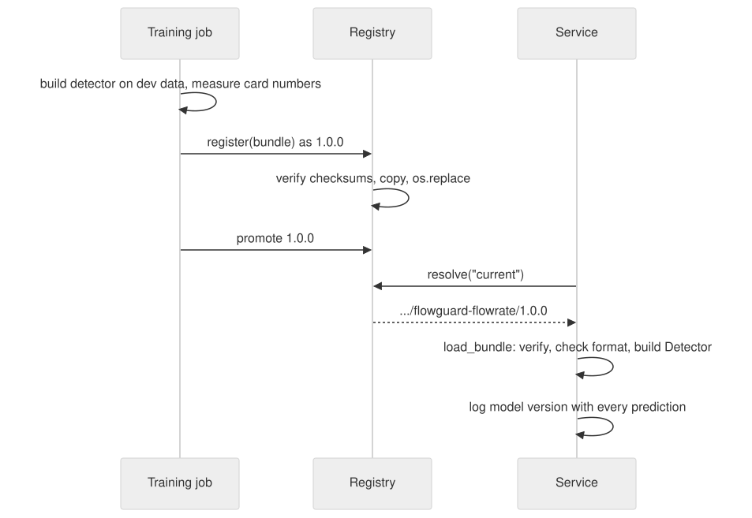
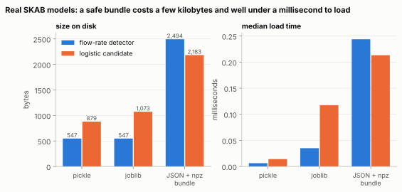

<!-- GENERATED by tools/nbpages.py from notebooks/. Do not edit. -->

# 26 · Model artifacts, metadata and versioning
{: .no_toc }

[Run it in Colab](https://colab.research.google.com/github/berdakh/mlengineering/blob/main/notebooks/26_artifacts_versioning.ipynb){: .btn .btn-primary .mr-2 target=_blank }
[View the .ipynb](https://github.com/berdakh/mlengineering/blob/main/notebooks/26_artifacts_versioning.ipynb){: .btn target=_blank }

{: .note }
> You are reading this notebook. To **run** it, open it in Colab with the button above - no install, no GPU needed for most of them - or clone the repository and open it in Jupyter.

1. TOC
{:toc}

---

**Week 5 · day 2 · 2 h essential path + up to 1 h optional** · lab files: [`labs/w5d2_artifacts_versioning/`](https://github.com/berdakh/mlengineering/blob/main/labs/w5d2_artifacts_versioning/)

**Objective.** Serialise models with the metadata needed to trust and reload them (schema, feature list, versions, data and code hashes); understand pickle risks and alternatives.

```python
# --- Setup: works on your laptop AND in Google Colab ----------------------------
# In Colab this clones the course repository and installs the requirements (about a
# minute, first run only). On your own machine it just finds the repository. Every
# command in this notebook runs from the repository root. Safe to re-run.
import os
import subprocess
import sys
from pathlib import Path

if "google.colab" in sys.modules:
    if not Path("/content/mlengineering").exists():
        subprocess.run(["git", "clone", "--depth", "1",
                        "https://github.com/berdakh/mlengineering.git",
                        "/content/mlengineering"], check=True)
    os.chdir("/content/mlengineering")
    subprocess.run([sys.executable, "-m", "pip", "install", "-q",
                    "-r", "requirements.txt"], check=True)

REPO_ROOT = next(p for p in [Path.cwd(), *Path.cwd().parents]
                 if (p / "src" / "mlcourse").is_dir())
os.chdir(REPO_ROOT)
sys.path.insert(0, str(REPO_ROOT / "src"))
print("repo root:", REPO_ROOT)
```

Unit id `w5d2_artifacts_versioning` · Week 5, day 2 · Handbook: [H10.2](../handbook/ch10_batch_online_inference/h10_2_artifacts_and_versioning.html) ·
Content status: see [STATUS.md](../guides/status.html)

## 1. Purpose

**Objective.** Serialise a model together with the metadata needed to trust and reload it. Build a
small registry with immutable versions and a movable `current` pointer. Know why loading a pickle is
running code, and what to use instead.

**Why an applied ML engineer needs it.** A month after release someone will ask: "which model made this
prediction, what data was it trained on, and can we go back to the previous one?" The artifact and
the registry are where those answers live. Teams that save `model.pkl` to a shared folder discover
three problems the hard way:
* a pickle runs code when loaded;
* it may not load after a library upgrade;
* "the latest file" is not the same thing as "the model that was serving last Tuesday".

**Deliverable.** `flowguard.artifacts` (bundle save, verify, load; register, promote, resolve,
list_versions), and the shipped detector registered as `flowguard-flowrate 1.0.0` with a model card,
promoted, resolved and shown to score the test experiments exactly like the built object.

**Completion criteria.**

* `python wb.py check w5d2` passes (guided practice).
* `python labs/w5d2_artifacts_versioning/lab/publish_model.py --fresh` registers 1.0.0 and prints
  `max |score difference| on test 0`.
* Independent skill: `python wb.py check w5d2 --challenge` passes, with `COMPATIBILITY.md` written
  without opening the hints.

**Prerequisites.**
* [w5d1](25_inference_pipeline.html): the `Detector` object and its configuration as data.
* [w4d5](23_model_choice.html): the decision memo; its numbers go into the model card.
* [w3d5](17_uncertainty.html): the cluster bootstrap for the card's interval.

**Time budget (2 h essential).**

| Activity | Minutes |
|---|---|
| Read section 2, run both worked examples | 30 |
| Guided lab: bundle, verification, registry, publish the real model | 65 |
| Independent challenge: start (finish in the extension or on the review day) | 15 |
| Assessment and reflection | 10 |
| *Optional extension: finish the challenge; sign `checksums.json`; a `flowguard models` CLI listing versions and the current pointer* | *up to 60* |

Data needed for the real-data steps: `python project/get_skab.py` (once). The checks need no download.

## 2. Conceptual explanation

### 2.1 What an artifact must carry

Yesterday's `model.json` was trusted because you had just built it. An artifact is trusted *later*, by
someone else, on another machine, after library upgrades. It must therefore carry the answers to the
questions that person will ask:

| Question | Where the answer lives in a flowguard bundle |
|---|---|
| What function is this? | `model.json`: kind, parameters, threshold, post-processing, input columns |
| What else does serving need? | `reference.npz`: named numeric arrays (here: development burn-in statistics for Week 7 monitoring) |
| What was it trained on, how good is it, for what use? | `card.json`: intended use, limitations, training data (manifest hash), evaluation with intervals, code version, library versions |
| Are these the bytes that were saved? | `checksums.json`: SHA-256 of every other file |
| Can this code interpret them? | `format` and `format_version` in `model.json` |



*Figure 1. Bundle anatomy and the two refusals that come before any interpretation.*

The **model card** idea (Mitchell et al., 2019) is a short, structured document that travels with a
model: what it is for, what it must not be used for, how it was evaluated and on what. Here it is
machine-readable JSON, and `save_bundle` refuses to write a bundle whose card lacks intended use,
limitations, training data, evaluation or code version.

### 2.2 Serialisation options and their trade-offs

| Option | What is stored | Loading runs code? | Survives library upgrades? | Use when |
|---|---|---|---|---|
| `pickle` / `joblib` | the Python object graph, as instructions to rebuild it | **yes**: any importable callable | not guaranteed; scikit-learn warns across versions | short-lived caches written and read by the same code |
| JSON + `.npz` (numeric arrays, `allow_pickle=False`) | the mathematics: parameters, layout, numbers | no | yes, if the loader is yours | models with small, well-defined state (linear models, thresholds, statistics) |
| skops (scikit-learn) | an inspectable format with an allow-list of types | only allow-listed types | better than pickle; still tied to estimator internals | larger scikit-learn models you do not want to re-implement |
| PyTorch `state_dict` + `torch.load(weights_only=True)` | tensors by name; architecture stays in code | no (restricted unpickler) | yes, while the code defines the same modules | neural networks |
| ONNX | a computation graph with weights | no Python code; runs in an ONNX runtime | designed for portability | cross-language or optimised serving |

**Why a pickle is code.** A pickle stream is a program for a small stack machine. Its `STACK_GLOBAL`
instruction imports any importable callable by name and `REDUCE` calls it with arguments from the
stream. Rebuilding a scikit-learn estimator works exactly that way, and so does a malicious payload.
The second worked example shows a harmless one.

### 2.3 Load-time compatibility checks

A loader should refuse, before interpreting anything, what it cannot interpret correctly:

1. **Integrity**: every listed file present with the recorded SHA-256, no unlisted files. This catches
   partial copies, sync conflicts, hand edits and "helpful" additions such as a `model.pkl` dropped
   next to the JSON. It does **not** stop a deliberate attacker, who can rewrite `checksums.json`.
   Signatures or digests kept elsewhere do that (H10.2).
2. **Format**: the bundle's `format` and `format_version` are ones this code reads. A newer format may
   carry fields that change meaning; reading it silently would be skew moved into the artifact.
3. **Content**: the kind of model, the feature layout, array shapes and the input schema match what the
   loader implements.

Library versions are *recorded* in the card. Whether they are *enforced* depends on whether library
code runs at load time: for a JSON + npz bundle it does not, so a NumPy upgrade cannot change what is
loaded. For a skops or pickle artifact, pin the training library's version and refuse a different
major version.

### 2.4 Versions: model, data, code, format

Four things version independently, and the bundle records all of them:

* **model version** (`1.0.0`): semantic versioning applied to the model's *contract*. PATCH = same
  scores (card edited, re-saved). MINOR = retrained on new data, same features, inputs and score
  meaning. MAJOR = a change consumers must react to (features, input contract, score scale; thresholds
  downstream must be revisited);
* **data version**: the split manifest and its SHA-256;
* **code version**: the git commit (with a flag if the working tree had uncommitted changes);
* **format version**: how the bundle is laid out (`format_version: 1`).

### 2.5 A local registry



*Figure 2. The life of a version. Only the pointer moves.*

The layout is deliberately plain:

```text
registry/
  flowguard-flowrate/
    1.0.0/        model.json  reference.npz  card.json  checksums.json   (never modified)
    1.1.0/        ...
    current       "1.0.0\n"                                               (replaced atomically)
```

Two properties do the work. **Immutability**: `register` refuses a version that exists, so "1.0.0" in
a prediction log means one function forever. **Atomic pointer**: `promote` writes `current.tmp` and
`os.replace`s it onto `current`, so a service starting at that instant reads the old version or the new
one, never an empty file. Rollback is a promote of the previous version: no rebuild, no retraining.
MLflow's model registry, SageMaker's and Vertex AI's registries implement the same ideas (immutable
versions, movable aliases or stages) with a database and access control around them.



*Figure 3. One release. The service never chooses a file; it resolves a name.*

### 2.6 Connection to what you know

You already do half of this for papers: a results table cites a commit, a dataset version and a
configuration, and a reviewer can ask for the trained weights. What is new is that the artifact is
*loaded by software you do not control* and must refuse what it cannot interpret. The closest analogy
from neural recordings is a file format: EDF, BIDS and NWB carry their own metadata (sampling rate,
channel names, units, format version) because a reader months later cannot ask the recording system.
A model bundle is a recording format for a function.

### 2.7 Industry example

A team retrains a ranking model weekly and saves `model.pkl` to a bucket, overwriting the previous
file. One week a dependency upgrade changes the estimator's internal attributes. The new pickle loads
in the new service image, but the canary still runs the old image and fails to load it, and nobody can
restore last week's model because the file was overwritten. The fix the team adopts is the one in this
lesson: versioned, immutable artifacts with checksums, a format the loader controls, a model card, and
an alias that the deployment resolves. (Illustrative composite, not a documented incident.)

### 2.8 Limitations and misconceptions

* *"The model is the weights file."* The function also includes preprocessing state, threshold,
  feature layout and input schema; an artifact without them cannot be served correctly.
* *"Checksums make it secure."* They detect accidents. Security against tampering needs signatures or
  digests stored where the attacker cannot write, and access control on who may register and promote.
* *"`latest` is a version."* It is a pointer that changes meaning over time; logs must record the
  resolved version.
* *"Version numbers are bureaucracy."* They are how consumers know whether a change requires them to
  act (MAJOR) or not (MINOR, PATCH).
* *"A safe format is always worth it."* For a short-lived, same-process cache, pickle is fine. The
  rule is about artifacts that cross time, machines or trust boundaries.

## 3. Worked examples

### 3.1 A demand forecaster, saved as its mathematics

[`example/demand_artifact.py`](https://github.com/berdakh/mlengineering/blob/main/labs/w5d2_artifacts_versioning/example/demand_artifact.py): a SYNTHETIC weekly demand series (3 years,
trend + yearly season + noise) and a ridge regression on lag-1, lag-52 and a trend term. It saves a JSON
spec (feature names in order, version, training window, library versions), an `.npz` of the weights and
a checksum file. It then loads the artifact, verifies it, flips one bit and loads again.

```python
!python labs/w5d2_artifacts_versioning/example/demand_artifact.py
```

```text
files: checksums.json 170 B, spec.json 228 B, weights.npz 544 B
reloaded forecasts identical: True (max diff 0)
after flipping one bit in weights.npz: refused (weights.npz does not match its checksum: refusing to load)
pickle of the Ridge object: 466 B. Loading it imports and calls: ['numpy._core.multiarray.scalar', 'numpy._core.numeric._frombuffer', 'numpy.dtype', 'sklearn.linear_model._ridge.Ridge']
```

**Key decisions.** The feature names are stored *in order*: the loader compares them with the layout it
implements, which a pickle would never do. `allow_pickle=False` makes the `.npz` incapable of running
code. The training scikit-learn version is recorded but not needed to load. **Interpretation.** The
pickle is smaller and needs no loader code. It names private module paths (`numpy._core...`,
`sklearn.linear_model._ridge`) that a future release may move, and loading it calls whatever those
names resolve to.

### 3.2 What a pickle does when it is loaded

[`example/pickle_is_code.py`](https://github.com/berdakh/mlengineering/blob/main/labs/w5d2_artifacts_versioning/example/pickle_is_code.py) builds a payload whose only effects are
printing one line and creating an empty marker file in a temporary directory (deleted at the end).

```python
!python labs/w5d2_artifacts_versioning/example/pickle_is_code.py
```

```text
payload: 179 bytes. Disassembly (what pickle.loads will do):
   14: \x8c     SHORT_BINUNICODE 'builtins'
   25: \x8c     SHORT_BINUNICODE 'print'
   33: \x93     STACK_GLOBAL
   35: \x8c     SHORT_BINUNICODE '   >>> this line was printed by pickle.loads, not by the script <<<'
   107: R        REDUCE
   109: \x8c     SHORT_BINUNICODE '_io'
   115: \x8c     SHORT_BINUNICODE 'open'
   122: \x93     STACK_GLOBAL
   124: \x8c     SHORT_BINUNICODE '/tmp/<random>/created-by-unpickling.txt'
   169: \x8c     SHORT_BINUNICODE 'w'
   175: R        REDUCE
marker exists before loading: False
   >>> this line was printed by pickle.loads, not by the script <<<
marker exists after loading:  True
numeric array with allow_pickle=False: [0. 1. 2.]
object array with allow_pickle=False: refused (Object arrays cannot be loaded when allow_pickle=False)
```

`print` and `open` were chosen because they are harmless. The mechanism accepts any importable
callable with any arguments. Never run this pattern with anything else, and never load a pickle you
did not write yourself in the same trust domain.

## 4. Guided lab

Work in `labs/w5d2_artifacts_versioning/lab/`. `src/flowguard/` holds the w5d1 reference
`inference.py` and `batch.py` as snapshots, plus everything before. You implement
`src/flowguard/artifacts.py`; its module docstring is the contract. `sha256_file`, `_json_bytes` and
`_check_reference` are given.

**Task 1. `save_bundle` (15 min).** Check the card fields first, then the directory, then write
`model.json` (`format`, `format_version`, `kind` and `Detector.to_config()`), `reference.npz`
(`np.savez`), `card.json` (metadata plus `created_with` versions), and `checksums.json` last.

**Task 2. `verify_bundle` (10 min).** Missing `checksums.json`, an extra file, a missing file, a digest
mismatch: four errors, each naming the file.

*Checkpoint (after Task 3, which the load path needs):* `python -m pytest labs/w5d2_artifacts_versioning/checks -q -k "tamper or missing or unlisted"`
passes 5 tests once Task 4-5 are done too; the three in `test_bundle.py` pass now.

**Task 3. `load_bundle` (10 min).** Verify; check `format`, `format_version` (name both versions in the
message), `kind`; `Detector.from_config` on the rest; `np.load(..., allow_pickle=False)`.

*Checkpoint:* `-k test_bundle` passes 15 tests. If `test_pickled_array_is_not_loaded` fails, look at
`allow_pickle`. If `test_newer_format_version...` fails, you are only checking integrity: the
checks rewrite the checksums to simulate a valid bundle from a newer release.

**Task 4. `register` and `list_versions` (15 min).** Version from the bundle, `SEMVER` check, refuse an
existing destination, copy into a temporary directory inside `<root>/<name>/`, verify the copy, then
`os.replace` it into place. Sort versions with a numeric key.

**Task 5. `promote` and `resolve` (10 min).** The pointer is a text file replaced atomically. Rollback
needs no extra code: it is a promote.

*Checkpoint:* `python wb.py check w5d2` passes all 26 checks.

**Task 6. Publish the real model (5 min, mostly waiting).**

```python
!python labs/w5d2_artifacts_versioning/lab/publish_model.py --fresh
```

The authoring run printed (paths shortened):

```text
registered flowguard-flowrate 1.0.0 at .../lab/results/registry/flowguard-flowrate/1.0.0
current -> 1.0.0; files: ['card.json', 'checksums.json', 'model.json', 'reference.npz']
sizes (bytes): card.json 1478, checksums.json 305, model.json 906, reference.npz 964
loaded == built: config True, max |score difference| on test 0, reference arrays ['burn_in_mean', 'burn_in_std'] of length 27
model card:
{
  "name": "flowguard-flowrate",
  "version": "1.0.0",
  "evaluation": {
    "development": {"clusters": 23, "pr_auc": 0.7648, "pr_auc_95ci": [0.6803, 0.8447], "resampling_unit": "overlap cluster"},
    "test_single_look": {"event_recall_wilson_95ci": [0.36, 0.92], "events_detected": "5/7",
                         "false_alarms_per_hour": 0.0, "pr_auc": 0.8843}
  },
  "code_version": "3734c415...+uncommitted-changes"
}
```

The card reproduces the w4d5 decision memo's numbers (development PR-AUC 0.765 [0.680, 0.845]; test
PR-AUC 0.884, 5 of 7 events). The `+uncommitted-changes` flag appeared because the authoring run had
unsaved edits in the lab. A release pipeline should refuse to publish in that state; here it is
recorded so you can see it.

Then try the failure paths by hand: run the script again without `--fresh` (register refuses 1.0.0);
edit the threshold in `results/registry/flowguard-flowrate/1.0.0/model.json` and call
`load_bundle` on it.



*Figure 4 (real SKAB models trained on development data; times from the authoring host).* The safe
bundle is about 2.5 times larger than the pickle and loads about 15 times more slowly. It costs 2 kB
and 0.2 ms, paid once when a service starts. Regenerate with
`python labs/w5d2_artifacts_versioning/figures/make_figures.py`.

```python
# Run the automated checks on your guided lab.
# A fresh starter is expected to FAIL; passing means guided practice, not mastery.
from mlcourse.checks import check

check("w5d2")
```

## 5. Independent challenge

[challenge/README.md](https://github.com/berdakh/mlengineering/blob/main/labs/w5d2_artifacts_versioning/challenge/README.md): register the supervised logistic candidate, whose state
includes a fitted scikit-learn estimator, as `flowguard-logistic 0.1.0` without pickle. The loader
must refuse a feature layout it does not implement. Then write the compatibility policy. No solution is
provided until you have attempted it.


### The challenge brief


**Setting.** The team wants the supervised logistic candidate from w4d5 in the registry, as
`flowguard-logistic 0.1.0`, to run as a shadow scorer. Unlike the shipped flow-rate detector, its state
includes a fitted scikit-learn `LogisticRegression`. The tempting artifact is `joblib.dump(model)`.
Your job is to produce one that is safe to load, survives library upgrades and refuses what it cannot
interpret, and to write down the rules.

**Given:** `src/flowguard/` (snapshots, including `detectors.SupervisedLogistic`), the frozen manifest,
and `publish_logistic.py`, which trains the model on the REAL development data,
calls your module, registers and promotes the bundle, loads it back and compares scores on the 7 test
experiments (needs `python project/get_skab.py` once).

**Your task.**

1. Copy your finished lab module to `src/flowguard/artifacts.py` (the challenge reuses `verify_bundle`,
   `register`, `promote` and `resolve`).
2. Write `logistic_bundle.py` to the contract in its docstring: `save_logistic` and `load_logistic`.
3. Write `COMPATIBILITY.md`: what is stored and why that format, what the loader refuses, what is only
   recorded, and how model versions and bundle format versions are numbered.
4. Run `publish_logistic.py` and record in COMPATIBILITY.md the bundle size and the largest score
   difference you observed.

**Acceptance criteria** (`python wb.py check w5d2 --challenge`):

* loaded scores equal the trained model's within 1e-12 on synthetic runs, including values far
  beyond the clip;
* no pickle is used to save or load, and no file in the bundle is a pickle stream;
* the bundle passes `verify_bundle`, can be registered, promoted and resolved, and loads from the registry;
* a bundle with an edited weight or parameter is refused; a bundle whose feature layout differs from the
  one your loader implements is refused even when its checksums agree; so is a newer format version;
* `COMPATIBILITY.md` has no `TODO`, at least 150 words, and mentions scikit-learn.

**Time.** 45 minutes. No solution is provided until you have attempted it.

```python
# Run the automated checks on your independent challenge.
# A fresh starter is expected to FAIL; passing means guided practice, not mastery.
from mlcourse.checks import check

check("w5d2", challenge=True)
```

## 6. Progressive hints

Open one at a time, only after 10 minutes stuck:
[hint 1, concept](https://github.com/berdakh/mlengineering/blob/main/labs/w5d2_artifacts_versioning/hints/hint1_concept.md) · [hint 2, approach](https://github.com/berdakh/mlengineering/blob/main/labs/w5d2_artifacts_versioning/hints/hint2_approach.md) ·
[hint 3, partial implementation](https://github.com/berdakh/mlengineering/blob/main/labs/w5d2_artifacts_versioning/hints/hint3_partial.md). The full reference solution is in
`solutions/labs/w5d2_artifacts_versioning/` and is for after you have finished.


Open one hint at a time, only after a real attempt.

<details>
<summary><b>Hint 1 concept</b></summary>


An artifact is trusted on load only if three questions have answers the loader checks:

1. **Are these the bytes that were saved?** A checksum per file, recorded when saving, recomputed when
   loading. Also: nothing missing, nothing extra.
2. **Can this code interpret them?** A format name and a format version written by the saver and
   compared by the loader *before* it interprets anything else.
3. **Does loading execute anything?** With JSON and numeric `.npz` it cannot, provided
   `numpy.load(..., allow_pickle=False)`.

A registry adds one rule: a version, once registered, is never changed. "Which model is live?" is a
separate, small, replaceable fact: the `current` pointer. Rolling back is promoting an older version.

</details>

<details>
<summary><b>Hint 2 approach</b></summary>


* `save_bundle`: check the card fields first and the directory second, so a refused call leaves nothing
  behind. Write `model.json`, `reference.npz`, `card.json`; compute their SHA-256; write
  `checksums.json` last. `sha256_file` and `_json_bytes` are given.
* `verify_bundle`: the set of files present (minus `checksums.json`) must equal the set listed; then
  compare each digest. Put the file name in every error message.
* `load_bundle`: verify, read `model.json`, check `format`, `format_version` and `kind`, strip those
  three keys and pass the rest to `Detector.from_config`.
* `register`: read name and version from the bundle; validate the version with the `SEMVER` regex;
  refuse an existing destination; copy into `tempfile.mkdtemp(dir=<root>/<name>)`, verify the copy,
  `os.replace` it onto the destination.
* `list_versions`: sort with a key that turns "1.10.0" into `(1, 10, 0)`.
* `promote`: check the version is registered and verifies; write `.current.tmp`; `os.replace` onto
  `current`.

</details>

<details>
<summary><b>Hint 3 partial</b></summary>


```python
def verify_bundle(bundle_dir):
    bundle = Path(bundle_dir)
    path = bundle / CHECKSUMS
    if not path.is_file():
        raise BundleIntegrityError(f"{bundle}: no {CHECKSUMS}")
    listed = json.loads(path.read_text())["files"]
    present = {p.name for p in bundle.iterdir() if p.name != CHECKSUMS}
    extra = sorted(present - set(listed))
    if extra:
        raise BundleIntegrityError(f"{bundle}: unexpected file {extra[0]!r}")
    for name, digest in listed.items():
        ...  # missing file? digest mismatch? name the file in the message
    return listed
```

```python
def promote(root, name, version):
    home = Path(root) / name
    if version not in list_versions(root, name):
        raise RegistryError(...)
    verify_bundle(home / version)
    tmp = home / ".current.tmp"
    tmp.write_text(version + "\n")
    os.replace(tmp, home / "current")
```

Challenge: the decision function of a fitted binary `LogisticRegression` is
`X @ lr.coef_.ravel() + lr.intercept_[0]`. Save those numbers and everything that defines `X`.

</details>

## 7. Assessment

assessment.md (section 7 of this notebook): reasoning questions, a design-choice explanation, a rubric and a
10-15 minute ML system design rep ("design the model registry for a team of 15"). Model answers are in
`solutions/labs/w5d2_artifacts_versioning/assessment_answers.md`.


### Assessment questions


Answer in writing before opening `solutions/labs/w5d2_artifacts_versioning/assessment_answers.md`.

#### Reasoning questions (5-10 minutes)

1. A colleague says: "our bucket is private, so loading pickles from it is safe". Give two ways this
   can still go wrong, and one situation in which you would accept pickle anyway.
2. `checksums.json` sits in the same directory as the files it protects, so anyone who can edit a file
   can also edit the checksums. What does the checksum protect against, then, and what would you add
   to protect against a deliberate attacker?
3. Why must a registered version be immutable, given that the `current` pointer already says which
   model is live? Name a record elsewhere in the system that would become wrong if `1.0.0` changed.
4. The bundle format version is 1 and the model version is 1.0.0. A teammate adds a field to `model.json`
   that old loaders would ignore. Which of the two versions changes, and how?
5. The JSON + npz bundle of the logistic candidate is 2.5 times larger and about 15 times slower to load
   than its pickle. When would that cost matter, and what would you change then?

#### Design-choice explanation (10 minutes, written)

You chose to store the logistic candidate's coefficients rather than the scikit-learn object. Explain
the choice to a teammate who prefers `joblib.dump`: what you gain, what you give up, and the kind of
model for which you would choose differently.

#### Rubric for open answers

| Criterion | Meets | Exceeds |
|---|---|---|
| Threat model | separates accidental corruption from deliberate tampering | names what each control (checksum, signature, access control) does and does not stop |
| Versioning | distinguishes artifact format version from model version | states what bump each kind of change requires and who must react |
| Immutability | ties versions to logged predictions and audits | explains rollback as a pointer change and why it is then safe and fast |
| Trade-offs | names one cost of the safe format | says when the cost would change the decision, with a measured number |

#### Interview rep: ML system design (10-15 minutes, timed, reduced assistance)

> "Design the model registry for a team of 15 that ships about 20 models, some retrained weekly. What
> does a registered model contain, how does a service find the model it should serve, how do you roll
> back, and how do you know which model produced a given prediction a month later?"

Draw the components and the flow of one retraining, then score yourself with the rubric in the answers
file before reading the model answer.

## 8. Reflection and review

**You should now be able to, without notes:**
* list what an artifact must carry for someone else to trust it later;
* explain why loading a pickle runs code and name safe alternatives for linear models, scikit-learn
  ensembles, PyTorch networks and cross-runtime serving;
* implement integrity, format and content checks that refuse before interpreting;
* distinguish model, data, code and format versions and say what bump a change needs;
* run a registry with immutable versions, an atomic pointer and rollback by promotion.

**Reflection prompt (3 sentences in `progress/notes.md`).** Which trained model from your own research
could you still load and run today, exactly as it was evaluated? What would it have needed?

**Retrieval question for the review day.** A bundle's checksums all match, but loading it is refused.
Give two different reasons the contract allows, and say which error each raises.

**Next.** [w5d3, online inference on streams](27_online_inference.html): the same detector,
loaded from the registry, scores one row at a time with per-run state and must agree with the batch
path.

## Verification record

Execution verified on 2026-11-22, Python 3.13.18, NumPy 2.5.3, pandas 3.0.5, scikit-learn 1.9.1, joblib 1.6.0:

| What | Command | Outcome |
|---|---|---|
| Worked examples | `python .../example/demand_artifact.py`, `python .../example/pickle_is_code.py` | outputs above (temporary path elided) |
| Publish real model | `python .../lab/publish_model.py --fresh` (reference) | output above; card numbers equal the w4d5 memo |
| Challenge, real data | `python .../challenge/publish_logistic.py` (reference) | registered `flowguard-logistic 0.1.0` (4 files, 2,468 bytes); max score difference 0 on the 7 test runs; test PR-AUC 0.901 (as in w4d5) |
| Figure | `python labs/w5d2_artifacts_versioning/figures/make_figures.py` | numbers in Figure 4 (load times host-dependent) |
| Checks | `python tools/verify_checks.py labs/w5d2_artifacts_versioning` | reference passes lab (26) and challenge (10); 7 lab and 4 challenge wrong submissions rejected |
| Starter | `python -m pytest labs/w5d2_artifacts_versioning/checks -q` | 25 of 26 fail (the one that passes checks given exception classes) |

## Record your progress

Tick only what is true. Passing the supplied checks is *guided practice*; mark *independent* only for work done without hints or solutions.

```python
from mlcourse.progress import mark, note

# mark("w5d2", "reading")
# mark("w5d2", "guided")
# mark("w5d2", "independent")
# note("w5d2", "what tripped me up today")
```
