<!-- GENERATED by tools/nbpages.py from notebooks/. Do not edit. -->

# 27 · Error analysis and choosing a model
{: .no_toc }

[Run it in Colab](https://colab.research.google.com/github/berdakh/mlengineering/blob/main/notebooks/27_error_analysis_model_choice.ipynb){: .btn .btn-primary .mr-2 target=_blank }
[View the .ipynb](https://github.com/berdakh/mlengineering/blob/main/notebooks/27_error_analysis_model_choice.ipynb){: .btn target=_blank }

{: .note }
> You are reading this notebook. To **run** it, open it in Colab with the button above - no install, no GPU needed for most of them - or clone the repository and open it in Jupyter.

1. TOC
{:toc}

---

**Week 7 · lesson · about 90 minutes**

A single score such as "AUC 0.80" hides *where* a model fails. Real users do not experience the average: the
driver on short city trips, the customer in one region, the machine of one type. **Error analysis** opens up the
score to find those weak spots and their causes. Then, with uncertainty (notebook 26), speed and simplicity on
the table, you choose a model and write the choice down in a short **decision memo**.

**What you will learn**

- slice metrics by segment (region, distance band, time of day) and find the weakest slice that is big enough
  to matter;
- read the model's most confident mistakes and turn them into a hypothesis (a missing feature, a label problem);
- measure prediction latency properly;
- choose between candidates with an explicit rule (metric with interval, latency, simplicity) and write a
  decision memo.

**What you need:** notebooks 25 and 26; Week 5 (precision, recall, thresholds).

**How grading works:** each exercise is a function, run by the grader on small hand-made tables with known
answers and edge cases (empty slices, slices without late deliveries, ties).

```python
# --- Setup: works in Google Colab AND on your own computer. Safe to re-run. ---
# In Colab this downloads the course (about 30 s) and installs what it needs (about a minute, once
# per session). On your computer it just finds the course folder.
import os, sys, subprocess
from pathlib import Path

if "google.colab" in sys.modules and not Path("/content/mlengineering").exists():
    subprocess.run(["git", "clone", "--depth", "1",
                    "https://github.com/berdakh/mlengineering.git", "/content/mlengineering"], check=True)
    subprocess.run([sys.executable, "-m", "pip", "install", "-q", "-r",
                    "/content/mlengineering/requirements.txt"], check=True)
REPO_ROOT = Path("/content/mlengineering") if "google.colab" in sys.modules else next(
    p for p in [Path.cwd(), *Path.cwd().parents] if (p / "src" / "mlcourse").is_dir())
os.chdir(REPO_ROOT)
sys.path.insert(0, str(REPO_ROOT / "src"))
from mlcourse.grader import grade, quiz
print("Ready. Course folder:", REPO_ROOT)
```

## The models and the rows we analyse

Same **synthetic** deliveries and the same three candidates as in notebook 26. Two rules for this notebook:

1. **Error analysis uses the validation couriers**, never the test couriers. Looking at test mistakes and then
   changing the model would turn the test set into a validation set.
2. Predictions become decisions at a **threshold**. The operations team decided (Week 5 style, from costs) to
   warn customers when the predicted probability of being late is at least **0.35**.

```python
import time
import numpy as np
import pandas as pd
import matplotlib.pyplot as plt
from sklearn.metrics import roc_auc_score
from sklearn.linear_model import LogisticRegression
from sklearn.pipeline import make_pipeline
from sklearn.preprocessing import StandardScaler
from sklearn.ensemble import RandomForestClassifier, HistGradientBoostingClassifier
from mlcourse.datasets_w07 import make_deliveries, split_by_courier, to_matrix

THRESHOLD = 0.35
train, valid, test = split_by_courier(make_deliveries())
X_train, X_valid, X_test = to_matrix(train), to_matrix(valid), to_matrix(test)
models = {
    "logistic": make_pipeline(StandardScaler(), LogisticRegression(max_iter=1000)),
    "forest": RandomForestClassifier(n_estimators=300, min_samples_leaf=20, random_state=0),
    "boosting": HistGradientBoostingClassifier(max_depth=3, learning_rate=0.05, max_iter=1000, early_stopping=True,
                                               validation_fraction=0.2, n_iter_no_change=20, random_state=0),
}
for m in models.values():
    m.fit(X_train, train["late"])

analysis = valid.copy()
analysis["score"] = models["forest"].predict_proba(X_valid)[:, 1]
analysis["pred"] = (analysis["score"] >= THRESHOLD).astype(int)
tp = ((analysis.pred == 1) & (analysis.late == 1)).sum()
print("validation AUC", round(roc_auc_score(analysis.late, analysis.score), 3),
      "| recall", round(tp / analysis.late.sum(), 3), "| precision", round(tp / analysis.pred.sum(), 3))
analysis.head()
```

The forest catches about 63% of late deliveries (recall 0.63) and about half of its warnings are right
(precision 0.49). Where does it miss?

## 1. Slice the metrics

**Why.** An average can hide a group the model fails completely. If short trips are most of your deliveries
and the model misses most late short trips, customers notice, whatever the overall score says.

**Idea.** A **slice** is a subset of rows defined by a feature value or a range: one region, a distance band,
weekday evenings. Compute the same metrics on every slice and put them in one table, with the **number of rows**
in each slice. Continuous features (distance) are first cut into **bands** with `pd.cut`:

```python
pd.cut(df["distance_km"], bins=[0, 5, 12, 20, np.inf], labels=["0-5", "5-12", "12-20", "20+"], right=False)
```

`right=False` makes each band include its left edge and exclude its right edge: 5.0 km falls in "5-12".



```python
by_region = analysis.groupby("region").agg(n=("late", "size"), late_rate=("late", "mean"))
by_region["recall"] = analysis[analysis.late == 1].groupby("region")["pred"].mean()
by_region.round(3)
```

**Try it.** Group by `rain` instead of `region`. Predict first: is recall higher or lower when it rains? Why
might that be (think about which situations the generator makes late)?

```python
analysis.groupby("rain").agg(n=("late", "size"), late_rate=("late", "mean")).round(3)
```

### Exercise 1.1 · Bands for a continuous feature

Write `add_bands(df, column, edges, labels)` returning a **copy** of `df` with a new column named
`f"{column}_band"`, made with `pd.cut(..., bins=edges, labels=labels, right=False)`. Do not change `df`.

```python
def add_bands(df, column, edges, labels):
    # YOUR CODE HERE
    raise NotImplementedError()


analysis = add_bands(analysis, "distance_km", [0, 5, 12, 20, np.inf], ["0-5", "5-12", "12-20", "20+"])
analysis = add_bands(analysis, "hour", [8, 12, 18, 22], ["morning", "afternoon", "evening"])
analysis[["distance_km", "distance_km_band", "hour", "hour_band"]].head()
```

```python
grade("w07.add_bands", add_bands)
```

### Exercise 1.2 · A slice table

Write `slice_metrics(df, by, threshold=0.35)`. `df` has a 0/1 column `late` and a column `score`; a row is
predicted late when `score >= threshold`. Return a DataFrame **indexed by the values of column `by`** (sorted,
only values that occur) with the columns:

| column | meaning |
|---|---|
| `n` | number of rows in the slice |
| `late_rate` | fraction of rows that are late |
| `recall` | of the late rows, the fraction predicted late (`NaN` if the slice has no late rows) |
| `precision` | of the rows predicted late, the fraction really late (`NaN` if nothing is predicted late) |
| `error_rate` | fraction of rows where the prediction differs from `late` |

```python
def slice_metrics(df, by, threshold=0.35):
    # YOUR CODE HERE
    raise NotImplementedError()


slice_metrics(analysis, "distance_km_band").round(3)
```

```python
grade("w07.slice_metrics", slice_metrics)
```

## 2. The weakest slice that matters

**Why.** A slice table with dozens of rows will always contain a terrible-looking slice. If it holds five
deliveries, that is noise (notebook 26); if it holds a third of your traffic, it is a problem.

**Idea.** Decide two things in advance: the **metric** that matters to users (here recall: a late delivery we
do not warn about is the costly mistake) and a **minimum slice size**. Then look for the worst slice among those
big enough. Read the result as a question, not an answer: *why* is this slice weak?

```python
for column in ["region", "distance_km_band", "hour_band", "rain", "weekend"]:
    print(slice_metrics(analysis, column)[["n", "late_rate", "recall", "precision"]].round(3), "\n")
```

**Try it.** Which slice has the lowest recall? Write down one hypothesis for it before reading on.

```python
slice_metrics(analysis, "courier_id").sort_values("recall").head()
```

### Exercise 2.1 · Find the worst slice

Write `worst_slice(table, metric="recall", min_n=50, higher_is_worse=False)`: among the rows of a slice table
with `n >= min_n` and a non-missing value of `metric`, return the **index label** of the worst slice (lowest
value, or highest if `higher_is_worse`). Return `None` if no slice qualifies. On ties, return the larger slice.

```python
def worst_slice(table, metric="recall", min_n=50, higher_is_worse=False):
    # YOUR CODE HERE
    raise NotImplementedError()


worst_slice(slice_metrics(analysis, "distance_km_band"))
```

```python
grade("w07.worst_slice", worst_slice)
```

On the forest, the worst sizeable band is **5-12 km**: 579 deliveries, recall about 0.25. Short and medium trips
are mostly on time, so the model learned "short means on time" and rarely warns there. But about a third of the
late deliveries in validation (101 of 305) are on 5-12 km trips. Which ones are late, if not the long ones?

## 3. Read the worst mistakes

**Why.** Tables tell you *where*; individual examples tell you *why*. Ten minutes reading the model's most
confident mistakes often finds a bug, a mislabelled row or a missing feature that no metric would reveal.

**Idea.** The most informative errors are the **confident** ones: late deliveries the model gave a very low
score (false negatives far below the threshold), and on-time deliveries it scored very high (false positives
far above it). Sort errors by their distance from the threshold, read the top ones, and look for a pattern.

### Exercise 3.1 · The most confident mistakes

Write `top_mistakes(df, k=10, threshold=0.35)`: keep only the rows where the prediction (`score >= threshold`)
is wrong, add a column `error` with the text `"false positive"` or `"false negative"` and a column `margin`
= `abs(score - threshold)`, and return the `k` rows with the largest margin, largest first. Do not change `df`.

```python
def top_mistakes(df, k=10, threshold=0.35):
    # YOUR CODE HERE
    raise NotImplementedError()


cols = ["courier_id", "region", "distance_km", "hour", "weekend", "rain", "score", "late", "error", "margin"]
top_mistakes(analysis, k=12)[cols].round(3)   # try: top_mistakes(analysis, k=200).query("error == 'false negative'").head(12)[cols]
```

```python
grade("w07.top_mistakes", top_mistakes)
```

The most confident mistakes are all false positives: long trips, in the north, in the rain, in the evening,
which the model has learned to expect late, yet they arrived on time. And one `courier_id` comes back again and
again: courier 76 has 4 of the top 12. Remember how the data was made: each courier has a hidden skill that is
**not a feature**. The model cannot know that courier 76 is better than average. (The comment in the
cell shows the other side: late deliveries the model scored around 0.05-0.08, from a handful of couriers such as
68, 45 and 24.) That is a **missing feature**, and no choice of algorithm fixes it.

### Exercise 3.2 · Errors that cluster by courier

Write `group_residuals(df, group="courier_id")`: for each group, the mean of `late` minus the mean of `score`
(positive = the group is late more often than the model expects). Return a Series indexed by group, sorted from
most positive to most negative, with `name="residual"`.

```python
def group_residuals(df, group="courier_id"):
    # YOUR CODE HERE
    raise NotImplementedError()


res = group_residuals(analysis)
fig, ax = plt.subplots(figsize=(6, 3))
res.plot.bar(ax=ax, color=np.where(res > 0, "tab:red", "tab:blue"))
ax.axhline(0, color="k", lw=0.8); ax.set_ylabel("late rate - mean score")
ax.set_title("Validation couriers: some are late more often than the model expects")
plt.show()
```

```python
grade("w07.group_residuals", group_residuals)
```

Couriers 40 and 48 are late about 10-11 percentage points more often than the model predicts; couriers 76, 28
and 5 are late 9-12 points *less* often. The fix to propose is
a feature such as "this courier's late rate over the previous 90 days", computed only from deliveries *before*
the one being predicted (Week 4's time windows, Week 6's leakage rules). For brand-new couriers it would be
missing, and the model must cope with that. Error analysis turned a vague "AUC 0.80" into a concrete, testable
next step.

## 4. Latency: how long does a prediction take?

**Why.** A model that is 0.003 AUC better but takes 50 times longer per request can be the wrong product: in an
online service (Week 9) each request waits for it, and in a nightly batch it may be fine. You have to measure.

**Idea.** Use `time.perf_counter()` (a high-resolution clock) around the call, repeat many times and take the
**median** (robust to one slow call caused by something else on the machine). Measure two cases:

- **single**: one row at a time, as an online API would see it;
- **batch**: many rows in one call, divided by the number of rows, as a nightly job would see it.

Absolute numbers depend on the machine, Colab's included; compare models measured on the same machine.

```python
one_row = X_test.iloc[:1]
for name, model in models.items():
    times = []
    for _ in range(20):
        start = time.perf_counter()
        model.predict_proba(one_row)
        times.append(time.perf_counter() - start)
    print(f"{name:9s} one row: {np.median(times) * 1000:.2f} ms")
```

**Try it.** Time `predict_proba(X_test)` (1,217 rows) for each model and divide by the number of rows. Which
model gains most from batching, and why might that be?

```python
start = time.perf_counter()
models["forest"].predict_proba(X_test)
(time.perf_counter() - start) * 1000
```

### Exercise 4.1 · A latency helper

Write `measure_latency(predict_fn, X, n_repeats=20)` that returns a dict with:

- `"single_ms"`: the median, over `n_repeats` calls, of the time of `predict_fn(X.iloc[:1])`, in milliseconds;
- `"batch_ms_per_row"`: the median, over `n_repeats` calls, of the time of `predict_fn(X)`, in milliseconds,
  divided by `len(X)`.

```python
def measure_latency(predict_fn, X, n_repeats=20):
    # YOUR CODE HERE
    raise NotImplementedError()


latency = {name: measure_latency(m.predict_proba, X_test, n_repeats=10) for name, m in models.items()}
pd.DataFrame(latency).T.round(4)
```

```python
grade("w07.measure_latency", measure_latency)
```

## 5. Choose, and write it down

**Why.** A model choice that lives only in someone's head is re-argued every month. A one-page **decision
memo** records what was compared, the evidence, the choice, and the risks, so that anyone can check it later.

**Idea.** Fix the rule *before* looking at the results:

1. a candidate is acceptable if it is **not detectably worse** than the best one: the upper end of its paired
   difference interval against the best (notebook 26) is at least 0;
2. among acceptable candidates, take the **simplest** (lowest complexity rank: fewer parts to maintain and
   explain); break ties by lower single-row latency.



The cell below builds the evidence table from the **test** couriers (the one-time evaluation of notebook 26):
test AUC, the paired group-bootstrap interval of each model's AUC minus the best model's AUC, single-row latency,
and a complexity rank (1 = logistic regression, 2 = a boosting model of about 100 small trees, 3 = a forest of
300 deep-ish trees).

```python
def paired_vs_best(y, scores, groups, best, n_boot=1000, seed=0):
    """Paired group bootstrap (as in notebook 26) of AUC(model) - AUC(best) for every model."""
    rng = np.random.default_rng(seed)
    unique = np.unique(groups)
    pos = {g: np.flatnonzero(groups == g) for g in unique}
    diffs = {name: [] for name in scores}
    for _ in range(n_boot):
        idx = np.concatenate([pos[g] for g in rng.choice(unique, size=len(unique), replace=True)])
        base = roc_auc_score(y[idx], scores[best][idx])
        for name, s in scores.items():
            diffs[name].append(roc_auc_score(y[idx], s[idx]) - base)
    return {name: np.percentile(d, [2.5, 97.5]) for name, d in diffs.items()}


def single_row_ms(model, n_repeats=20):
    """Median single-row latency in ms (the same measurement as section 4)."""
    times = []
    for _ in range(n_repeats):
        start = time.perf_counter()
        model.predict_proba(X_test.iloc[:1])
        times.append(time.perf_counter() - start)
    return float(np.median(times) * 1000)


y_test = test["late"].to_numpy()
test_scores = {name: m.predict_proba(X_test)[:, 1] for name, m in models.items()}
aucs = {name: roc_auc_score(y_test, s) for name, s in test_scores.items()}
best = max(aucs, key=aucs.get)
intervals = paired_vs_best(y_test, test_scores, test["courier_id"].to_numpy(), best)
candidates = pd.DataFrame({
    "model": list(models),
    "auc": [aucs[n] for n in models],
    "diff_low": [intervals[n][0] for n in models],
    "diff_high": [intervals[n][1] for n in models],
    "single_ms": [single_row_ms(m) for m in models.values()],
    "complexity": [1, 3, 2],
})
print("best point estimate:", best)
candidates.round(4)
```

### Exercise 5.1 · Apply the rule

Write `choose_model(table)` for a table with the columns above. Keep rows with `diff_high >= 0`; return the
`model` with the lowest `complexity`, breaking ties by the lowest `single_ms`.

```python
def choose_model(table):
    # YOUR CODE HERE
    raise NotImplementedError()


choice = choose_model(candidates)
choice
```

```python
grade("w07.choose_model", choose_model)
```

The forest has the highest point estimate, but boosting is not detectably worse (its interval contains 0),
is simpler by our ranking and several times faster per row, so the rule picks **boosting**. Logistic regression
is clearly worse (its whole interval is below 0) and is excluded even though it is the simplest and fastest.

### Exercise 5.2 · The decision memo

Write `write_memo(table, choice, worst)` returning a Markdown string with these four headings, each on its own
line, in this order: `## Decision`, `## Evidence`, `## Alternatives`, `## Risks`. Requirements:

- under **Decision**: the chosen model's name;
- under **Evidence**: the chosen model's AUC with 3 decimals (e.g. `0.798`), its difference interval with 3
  decimals, and its single-row latency in ms;
- under **Alternatives**: every other model's name, with one reason it was not chosen;
- under **Risks**: the text of `worst` (a description of the weakest slice), and the words "not a feature" or
  "missing feature" if you mention the courier finding (optional but recommended).

```python
def write_memo(table, choice, worst):
    # YOUR CODE HERE
    raise NotImplementedError()


memo = write_memo(candidates, choose_model(candidates), "5-12 km trips, recall about 0.25 on 579 validation deliveries")
print(memo)
```

```python
grade("w07.write_memo", write_memo)
```

## Quiz

**Q1.** You find that recall is 0.20 in the slice "west region, Sundays", which has 9 deliveries. What do you do?

- a) Retrain with extra weight on that slice immediately.
- b) Treat it as noise for now: with 9 rows the recall is extremely uncertain; note it and watch it as data grows.
- c) Remove Sunday deliveries in the west from the data.
- d) Report that the model fails in the west.

```python
answer = "?"
quiz("w07.27_q1", answer)
```

**Q2.** Why do error analysis on validation data and not on the test set?

- a) The test set is too small for slicing.
- b) Validation data is more representative.
- c) It is faster.
- d) Changes you make after studying errors are tuning; doing it on the test set makes the final test score
  optimistic.

```python
answer = "?"
quiz("w07.27_q2", answer)
```

**Q3.** The confident false negatives come mostly from three couriers. What is the most useful next step?

- a) Switch from a forest to boosting.
- b) Lower the threshold for everyone.
- c) Propose a leakage-safe courier-history feature (late rate before the delivery) and test it on validation.
- d) Drop those couriers' rows from training.

```python
answer = "?"
quiz("w07.27_q3", answer)
```

**Q4.** Why report the **median** of 20 timings rather than the mean or a single timing?

- a) A single call can be slowed by unrelated activity (other processes, a first-call warm-up); the median is
  robust to such outliers.
- b) The median is always smaller, which looks better.
- c) The mean cannot be computed for times.
- d) A single timing is more accurate because nothing else interferes.

```python
answer = "?"
quiz("w07.27_q4", answer)
```

**Q5.** Model A: AUC 0.801, paired interval vs the best [0, 0] (it *is* the best), 14 ms per row, complexity 3.
Model B: AUC 0.798, interval [-0.014, +0.010], 2 ms per row, complexity 2. By the rule in section 5, which one?

- a) A, because it has the highest AUC.
- b) B: it is not detectably worse, and it is simpler and faster.
- c) Neither: the intervals overlap.
- d) A, because the interval of B includes negative values.

```python
answer = "?"
quiz("w07.27_q5", answer)
```

## Recap

- One overall score hides where a model fails; slice metrics by segment and always show the slice size.
- Choose the metric and a minimum slice size in advance; look for the worst slice that is big enough to matter.
- Read the most confident mistakes; patterns there point to missing features, label problems or bugs.
- Do error analysis on validation data, never on the test set.
- Measure latency with `time.perf_counter()`, many repeats, the median; single-row and batch numbers differ.
- Choose with a rule fixed in advance (not detectably worse, then simplest, then fastest) and write a decision
  memo: decision, evidence with intervals, alternatives, risks.

## On the job

Error analysis is where most real model improvements come from: a weak slice leads to a new feature, a data fix
or a conversation with the team that owns the labels. Decision memos are how ML engineers make model changes
reviewable; many teams require one before a new model replaces the current one in production (Week 11).

## Going further

- Advanced track: [18 · Error analysis and transfer](https://github.com/berdakh/mlengineering/blob/main/advanced/notebooks/18_error_analysis_transfer.ipynb) and
  [23 · Model choice](https://github.com/berdakh/mlengineering/blob/main/advanced/notebooks/23_model_choice.ipynb) apply the same ideas to the project data.
- Next: [28 · Project milestone 1: fault detection on sensor data](28_project_m1_fault_detection.html).

## Record your progress

Flags: `reading`, `guided` (you passed the graded exercises), `independent` (you solved them without hints or
solutions), `review` (come back to this).

```python
from mlcourse.progress import mark

# mark("27", "reading")
# mark("27", "guided")
```
