<!-- GENERATED by tools/nbpages.py from notebooks/. Do not edit. -->

# 28 · Project milestone 1: fault detection on sensor data
{: .no_toc }

[Run it in Colab](https://colab.research.google.com/github/berdakh/mlengineering/blob/main/notebooks/28_project_m1_fault_detection.ipynb){: .btn .btn-primary .mr-2 target=_blank }
[View the .ipynb](https://github.com/berdakh/mlengineering/blob/main/notebooks/28_project_m1_fault_detection.ipynb){: .btn target=_blank }

{: .note }
> You are reading this notebook. To **run** it, open it in Colab with the button above - no install, no GPU needed for most of them - or clone the repository and open it in Jupyter.

1. TOC
{:toc}

---

**Week 7 · project lab · about 120 minutes**

**The situation.** This is the first milestone of the course project, which runs to Week 12. A reliability
engineer at a pumping station wants an **alert** soon after a pump-and-valve system starts operating abnormally,
with few enough false alerts that people keep trusting it. You have real recordings from a laboratory testbed:
the **Skoltech Anomaly Benchmark (SKAB)**, 34 experiments in which a fault was induced (for example a valve
closed), each recorded at about one row per second by eight sensors, with every row labelled normal or anomalous.
This is an **educational research prototype**: no claim is made about any real plant.

**Your job today:** load the data, respect the frozen experiment-level split, build a simple detector and one
model, evaluate them at point level *and* event level, put intervals on the numbers, and write a short findings
summary that milestone 2 (Week 9: a prediction API) and milestone 3 (Week 11: monitoring) will build on.

**What you will practise:** pandas (Week 3), feature pipelines without leakage (Weeks 4 and 6), metrics and
thresholds (Week 5), grouped validation (Week 6), and intervals, paired comparisons and error analysis (this
week). There are no new concepts.

**How grading works:** eight steps. Steps 1-7 are functions; their graders run them on small **synthetic**
sensor tables, so grading never depends on the download. Step 8 checks your final numbers on the real data
against loose ranges.

```python
# --- Setup: works in Google Colab AND on your own computer. Safe to re-run. ---
# In Colab this downloads the course (about 30 s) and installs what it needs (about a minute, once
# per session). On your computer it just finds the course folder.
import os, sys, subprocess
from pathlib import Path

if "google.colab" in sys.modules and not Path("/content/mlengineering").exists():
    subprocess.run(["git", "clone", "--depth", "1",
                    "https://github.com/berdakh/mlengineering.git", "/content/mlengineering"], check=True)
    subprocess.run([sys.executable, "-m", "pip", "install", "-q", "-r",
                    "/content/mlengineering/requirements.txt"], check=True)
REPO_ROOT = Path("/content/mlengineering") if "google.colab" in sys.modules else next(
    p for p in [Path.cwd(), *Path.cwd().parents] if (p / "src" / "mlcourse").is_dir())
os.chdir(REPO_ROOT)
sys.path.insert(0, str(REPO_ROOT / "src"))
from mlcourse.grader import grade, quiz
print("Ready. Course folder:", REPO_ROOT)
```

## Get the data

SKAB is published under the **GPL-3.0** licence, so it is not copied into the course repository. The next cell
runs `python project/get_skab.py`, which downloads the 35 files (about 4 MB) from the authors' GitHub repository
at a pinned version into `data/raw/skab/`, and records a SHA-256 checksum for each file. If the files are already
there it does nothing. Citation: Katser, I. D. and Kozitsin, V. O. (2020), *Skoltech Anomaly Benchmark (SKAB)*,
Kaggle, DOI 10.34740/KAGGLE/DSV/1693952.

```python
from mlcourse.data import ensure_skab, skab_dir

ensure_skab()
SKAB = skab_dir()
sorted(p.relative_to(SKAB).as_posix() for p in SKAB.rglob("*.csv"))[:6]
```

Files are grouped in three families (`valve1`, `valve2`, `other`) plus one `anomaly-free` recording. Each file
is **semicolon**-separated. The first lines of one file:

```python
print((SKAB / "valve1" / "0.csv").read_text().splitlines()[0])
print((SKAB / "valve1" / "0.csv").read_text().splitlines()[1])
```

Three facts about this data, established earlier in the project (see the
[project guide](../guides/project.html)), shape every decision below:

1. **The experiment is the unit.** Rows within one experiment are strongly related, so splits, cross-validation
   and bootstrap intervals all work on whole experiments, never on rows (Week 6; notebook 26).
2. **Some rows are duplicated across files.** Five pairs of files share 1,290 identical rows (for example
   `other/3` and `other/4`). Experiments that share rows must stay on the same side of a split.
3. **Elapsed time predicts the label.** In 31 of 34 experiments the fault starts between rows 550 and 600. A
   model given the row number (or anything that grows with it) learns the lab protocol, not the fault. So no
   feature may encode position in the recording.



## The plan

| Step | You write | What it does |
|---|---|---|
| 1 | `load_experiment(path, experiment)` | read one file into a tidy table |
| 2 | `split_violations(split, overlap_groups)` | check the frozen split keeps overlapping experiments together |
| 3 | `burn_in_abs_z(df, columns, burn_in)` | normalise each sensor by the start of its own experiment |
| 4 | `pr_auc_usable(df, score_col, split, burn_in)` | point-level PR-AUC on scorable rows of one split |
| 5 | `event_table(df, alert_col)` | per experiment: detected? false alarm? delay? |
| 6 | `persistent_alerts(df, alert_col, k)` | only alert after `k` alerts in a row |
| 7 | `experiment_bootstrap(df, score_col, n_boot, seed)` | interval for PR-AUC, resampling experiments |
| 8 | `findings` | your numbers and a short written summary |

The helper `prepare()` below runs steps 1 and 3 on all 34 labelled experiments once you have written them, and
remembers the result so later cells are fast. You do not need to change it.

```python
import json
import numpy as np
import pandas as pd
import matplotlib.pyplot as plt
from sklearn.metrics import average_precision_score, precision_recall_curve
from mlcourse.datasets_w07 import SKAB_SENSORS, skab_split

SPLIT = skab_split()                       # the frozen experiment-level split, version v2
MANIFEST = json.loads(Path("solutions/labs/w3d1_leakage/lab/splits/v2.json").read_text())
BURN_IN = 100                              # rows at the start of each experiment used for calibration
print(len(SPLIT["dev"]), "dev experiments:", SPLIT["dev"][:5], "...")
print(len(SPLIT["test"]), "test experiments:", SPLIT["test"])
_cache = {}


def prepare():
    """All labelled experiments: tidy rows (step 1), a `split` column, and |z| features (step 3), cached."""
    if "data" not in _cache:
        parts = [load_experiment(SKAB / f"{e}.csv", e) for e in SPLIT["dev"] + SPLIT["test"]]
        data = pd.concat(parts, ignore_index=True)
        data["split"] = np.where(data["experiment"].isin(SPLIT["test"]), "test", "dev")
        z = burn_in_abs_z(data, SKAB_SENSORS, BURN_IN)
        _cache["data"] = data.join(z.add_prefix("z_"))
    return _cache["data"].copy()
```

## Step 1 · Load one experiment

Write `load_experiment(path, experiment)` that returns a DataFrame with, in this order, the columns:

- `experiment`: the given id string (for example `"valve1/0"`) on every row;
- `t`: the row number within the file, 0, 1, 2, ...;
- `datetime`: the timestamp, parsed as a pandas datetime;
- the eight sensors, **renamed** with `SKAB_COLUMNS` (for example `Volume Flow RateRMS` becomes `flow_rate`);
- `anomaly` and `changepoint` as integers (0/1).

Use `pd.read_csv(path, sep=";")`. `SKAB_COLUMNS` (imported below) is the renaming dict.

```python
from mlcourse.datasets_w07 import SKAB_COLUMNS


def load_experiment(path, experiment):
    # YOUR CODE HERE
    raise NotImplementedError()


load_experiment(SKAB / "valve1" / "0.csv", "valve1/0").head()
```

```python
grade("w07.p_load_experiment", load_experiment)
```

## Step 2 · Check the split

The split manifest lists **overlap groups**: sets of experiments that share rows. A split is safe only if all
experiments of a group are on the same side. Write `split_violations(split, overlap_groups)`. `split` is a dict
with lists under `"dev"` and `"test"`; `overlap_groups` is a list of lists of experiment ids. Return the list of
groups (each as a **sorted** list) that have members in **both** dev and test, in the order given. Members that
are in neither list (such as the `anomaly-free` reference) are ignored.

```python
def split_violations(split, overlap_groups):
    # YOUR CODE HERE
    raise NotImplementedError()


print("overlap groups:", MANIFEST["overlap_groups"])
split_violations(SPLIT, MANIFEST["overlap_groups"])
```

```python
grade("w07.p_split_violations", split_violations)
```

The frozen split v2 has no violations (it was repaired for exactly this reason in the advanced track). Try a
broken split, such as moving `other/4` to test, to see your check fire.

## Step 3 · Burn-in normalisation

Sensors sit at different levels in every experiment (the rig was adjusted between runs), so a global "normal
range" does not work. Instead, treat the first `burn_in` rows of each experiment as a calibration period: for each
sensor, compute the mean and standard deviation of those rows, and score every row by how far it is from that
normal level, $$|z| = |x - \text{mean}| / \text{std}$$. Only past rows are used, so the feature is **causal**, and
it does not encode position in the recording.



Write `burn_in_abs_z(df, columns, burn_in=100)`. `df` has columns `experiment`, `t` and the sensor columns. Return
a DataFrame with the **same index** as `df` and one column per name in `columns`, holding $$|z|$$ computed per
experiment from the rows with `t < burn_in`. Use the pandas default standard deviation (`ddof=1`). If a sensor's
burn-in standard deviation is 0 (a constant sensor), its $$|z|$$ is 0 on every row of that experiment.

```python
def burn_in_abs_z(df, columns, burn_in=100):
    # YOUR CODE HERE
    raise NotImplementedError()


burn_in_abs_z(load_experiment(SKAB / "valve1" / "0.csv", "valve1/0"), ["flow_rate", "pressure"]).iloc[95:105]
```

```python
grade("w07.p_burn_in_abs_z", burn_in_abs_z)
```

With steps 1 and 3 written, `prepare()` loads all 34 labelled experiments. Here is one, with its anomalous
segment shaded. Notice that flow rate reacts clearly while other sensors barely move.

```python
data = prepare()
one = data[data.experiment == "valve1/0"]
fig, axes = plt.subplots(3, 1, figsize=(8, 5), sharex=True)
for ax, col in zip(axes, ["flow_rate", "pressure", "current"]):
    ax.plot(one["t"], one[col], lw=0.8)
    ax.fill_between(one["t"], one[col].min(), one[col].max(), where=one["anomaly"] == 1, color="tab:red", alpha=0.2)
    ax.set_ylabel(col)
axes[-1].set_xlabel("row (seconds since start)")
plt.show()
print(data.groupby("split").agg(experiments=("experiment", "nunique"), rows=("t", "size"),
                                 anomalous_share=("anomaly", "mean")).round(3))
```

## The detector and the model (provided)

Two candidates, both using only the burn-in $$|z|$$ features:

- **detector**: the $$|z|$$ of flow rate itself. No training at all; it is the simple, explainable baseline.
- **model**: a logistic regression on the $$|z|$$ of all eight sensors, trained on the **usable** dev rows
  (`t >= BURN_IN`); its predicted probability is the score.

The burn-in rows of every experiment are never scored or evaluated. The alert threshold is chosen on dev rows
(best F1, as in Week 5) and then frozen for test.

```python
from sklearn.linear_model import LogisticRegression
from sklearn.pipeline import make_pipeline
from sklearn.preprocessing import StandardScaler

Z_COLS = [f"z_{c}" for c in SKAB_SENSORS]


def best_f1_threshold(y, s):
    p, r, t = precision_recall_curve(y, s)
    f1 = 2 * p * r / np.maximum(p + r, 1e-12)
    return float(t[np.argmax(f1[:-1])])


def scored():
    """Usable rows (t >= BURN_IN) with a constant score, the detector and model scores, and alert columns (cached)."""
    if "scored" in _cache:
        return _cache["scored"].copy()
    data = prepare()
    data = data[data["t"] >= BURN_IN].copy()
    dev = data["split"] == "dev"
    model = make_pipeline(StandardScaler(), LogisticRegression(max_iter=1000))
    model.fit(data.loc[dev, Z_COLS], data.loc[dev, "anomaly"])
    data["score_detector"] = data["z_flow_rate"]
    data["score_model"] = model.predict_proba(data[Z_COLS])[:, 1]
    for name in ["detector", "model"]:
        thr = best_f1_threshold(data.loc[dev, "anomaly"], data.loc[dev, f"score_{name}"])
        data[f"alert_{name}"] = data[f"score_{name}"] >= thr
        print(f"{name}: threshold chosen on dev = {thr:.3f}")
    data["score_constant"] = 0.0
    _cache["scored"] = data
    return data.copy()


rows = scored()
rows[["experiment", "t", "split", "anomaly", "score_detector", "score_model", "alert_detector", "alert_model"]].head()
```

## Step 4 · Point-level PR-AUC

At **point level** every row is a separate prediction. Because about a third of rows are anomalous, a useless
constant score already gets PR-AUC equal to that share, so always report the constant baseline next to your
models.

Write `pr_auc_usable(df, score_col, split, burn_in=100)`: the PR-AUC (`average_precision_score`) of
`df[score_col]` against `df["anomaly"]`, using only rows with `df["split"] == split` and `t >= burn_in`.

```python
def pr_auc_usable(df, score_col, split, burn_in=100):
    # YOUR CODE HERE
    raise NotImplementedError()


rows = scored()
for col in ["score_constant", "score_detector", "score_model"]:
    print(f"{col:15s} dev {pr_auc_usable(rows, col, 'dev'):.3f}   test {pr_auc_usable(rows, col, 'test'):.3f}")
```

```python
grade("w07.p_pr_auc_usable", pr_auc_usable)
```

## Step 5 · Event-level evaluation

The engineer does not care about single rows; they care about **events**: was the fault noticed, how quickly,
and did the alarm go off when nothing was wrong? Every SKAB experiment has exactly one anomalous segment, so per
experiment:

- `detected`: at least one alert on an anomalous row;
- `false_alarm`: at least one alert on a normal row;
- `delay`: `t` of the first alert on an anomalous row minus `t` of the first anomalous row (in rows, about
  seconds); `NaN` if not detected.

Write `event_table(df, alert_col)` returning a DataFrame **indexed by experiment** (sorted) with the columns
`detected` (bool), `false_alarm` (bool) and `delay` (float). Use the rows you are given as they are.

```python
def event_table(df, alert_col):
    # YOUR CODE HERE
    raise NotImplementedError()


test_rows = scored().query("split == 'test'")
event_table(test_rows, "alert_detector")
```

```python
grade("w07.p_event_table", event_table)
```

Every fault in the 7 test experiments is detected, quickly, by both candidates. But every test experiment also
has at least one false alarm: a single row above the threshold is enough to raise one. Real alerting systems
deal with this by requiring the condition to **persist**.

## Step 6 · Persistent alerts

Write `persistent_alerts(df, alert_col, k)`: return a boolean Series (same index as `df`) that is True on a row
only if that row **and the `k - 1` rows before it in the same experiment** all have `alert_col` True. With
`k=1` it equals `alert_col`. The first `k - 1` rows of each experiment in `df` can never be True. Rows are in
time order within each experiment.

```python
def persistent_alerts(df, alert_col, k):
    # YOUR CODE HERE
    raise NotImplementedError()


test_rows = scored().query("split == 'test'")
for k in [1, 5, 10]:
    tbl = event_table(test_rows.assign(alert=persistent_alerts(test_rows, "alert_detector", k)), "alert")
    print(f"k={k:2d}: detected {tbl.detected.sum()}/7, experiments with a false alarm {tbl.false_alarm.sum()}/7, "
          f"median delay {tbl.delay.median():.0f} rows")
```

```python
grade("w07.p_persistent_alerts", persistent_alerts)
```

Requiring 5 alerts in a row cuts the experiments with a false alarm from 7 to 3 and still detects all 7 faults,
but the median delay grows from 4 to 47 rows (about 47 seconds): in several experiments the score flickers above
and below the threshold during the first part of the fault. With `k=10` one fault is missed altogether. Fewer
false alarms against later (or missed) detection is the conversation to have with the engineer; the right `k`
is their decision, informed by your numbers.

## Step 7 · Intervals over experiments

7 test experiments is very few. Write `experiment_bootstrap(df, score_col, n_boot=1000, seed=0)` that resamples
**experiments** with replacement (`rng = np.random.default_rng(seed)`, `rng.choice(unique_experiments,
size=number_of_experiments, replace=True)`), and returns a NumPy array of `n_boot` PR-AUC values
(`average_precision_score(anomaly, score)` on all rows of the drawn experiments). It is notebook 26's group
bootstrap with the experiment as the group.

```python
def experiment_bootstrap(df, score_col, n_boot=1000, seed=0):
    # YOUR CODE HERE
    raise NotImplementedError()


test_rows = scored().query("split == 'test'")
reps = experiment_bootstrap(test_rows, "score_detector", n_boot=500)
print("detector test PR-AUC 95% interval:", np.percentile(reps, [2.5, 97.5]).round(3))
```

```python
grade("w07.p_experiment_bootstrap", experiment_bootstrap)
```

## Step 8 · Findings

Put your numbers in a dict called `findings` with these keys (test set unless stated; PR-AUC at point level on
usable rows; intervals are 95% percentile intervals from your `experiment_bootstrap` with `n_boot=1000,
seed=0`):

| key | value |
|---|---|
| `n_dev_experiments`, `n_test_experiments` | how many experiments in each split |
| `ap_constant`, `ap_detector`, `ap_model` | test PR-AUC of the constant score, the detector and the model |
| `ap_detector_ci`, `ap_model_ci` | `(low, high)` intervals for the detector and the model |
| `diff_ci` | `(low, high)`: a **paired** interval of model minus detector PR-AUC, resampling experiments |
| `events_detected` | number of test faults detected by the detector with `k=1` |
| `false_alarm_experiments_k1`, `false_alarm_experiments_k5` | test experiments with a detector false alarm, with `k=1` and `k=5` |
| `summary` | 4-8 sentences in plain language for the reliability engineer (see below) |

The summary should say what was compared and on how many test experiments, the PR-AUC of both candidates with
intervals, whether the model is detectably better than the detector, what the event-level results show, and one
limitation. Write it yourself, from your numbers.

```python
findings = None   # build the dict described above
findings
```

```python
grade("w07.p_findings", findings)
```

## Quiz

**Q1.** Why is the burn-in normalisation computed per experiment from its first 100 rows, rather than from all
rows of the experiment?

- a) Using all rows would include the anomalous segment and future rows, so the feature would use information not
  available at prediction time (leakage).
- b) 100 rows is faster to compute.
- c) The first rows are the most anomalous.
- d) It makes no difference; it is a matter of taste.

```python
answer = "?"
quiz("w07.28_q1", answer)
```

**Q2.** A teammate adds the row number `t` as a feature and test PR-AUC jumps. What is the most likely
explanation?

- a) The pump wears out over time, so `t` is a genuine physical signal.
- b) In most experiments the fault starts at rows 550-600, so `t` encodes the lab protocol: the model learns
  *when* faults were induced, which will not hold on a real plant.
- c) More features always improve PR-AUC.
- d) It is fine because `t` is known at prediction time.

```python
answer = "?"
quiz("w07.28_q2", answer)
```

**Q3.** The model's test PR-AUC is a little higher than the detector's, and the paired interval of the
difference contains 0. Which recommendation follows this week's rules?

- a) Ship the model: it has the higher number.
- b) Collect more test experiments before doing anything.
- c) Ship both and average them.
- d) Prefer the detector for now: it is not detectably worse, needs no training and is easier to explain;
  revisit when more experiments are available.

```python
answer = "?"
quiz("w07.28_q3", answer)
```

**Q4.** Point-level PR-AUC is high, yet the engineer complains about alarms. What explains it?

- a) PR-AUC is computed incorrectly.
- b) A few isolated rows above the threshold are a small share of rows (barely visible at point level) but each
  one is a separate alarm event; event-level metrics and persistence rules capture this.
- c) The engineer is looking at the dev set.
- d) The threshold should be chosen on the test set.

```python
answer = "?"
quiz("w07.28_q4", answer)
```

## Reflection

Write four or five sentences (in a text cell or your own notes):

- The dev PR-AUC of the detector is lower than its test PR-AUC. What does that tell you about 7 test experiments?
- Which number in `findings` would you show the reliability engineer first, and why that one?
- Name one thing that could make this detector fail on a real plant that the testbed cannot reveal.

## What to show in your portfolio

A one-page evaluation report: the problem and the stakeholder, the dataset with its licence and citation, the
split rule (by experiment, overlap groups kept together, no position features), a table with both candidates and
the constant baseline with intervals, the event-level table with and without persistence, and your decision with
its reason. State clearly that it is an educational research prototype on laboratory data. Milestone 2 (Week 9)
will put the chosen detector behind a prediction API.

## Going further

- Project guide: [the portfolio project](../guides/project.html).
- Advanced track: [16 · Point vs event evaluation](https://github.com/berdakh/mlengineering/blob/main/advanced/notebooks/16_point_vs_event_evaluation.ipynb),
  [17 · Uncertainty](https://github.com/berdakh/mlengineering/blob/main/advanced/notebooks/17_uncertainty.ipynb) and
  [24 · Project milestone 1](https://github.com/berdakh/mlengineering/blob/main/advanced/notebooks/24_project_milestone_1.ipynb) go deeper (detection-delay
  distributions, false alarms per hour, a reproducible report built by `make`).

## Record your progress

Flags: `reading`, `guided` (you passed the graded exercises), `independent` (you solved them without hints or
solutions), `review` (come back to this).

```python
from mlcourse.progress import mark

# mark("28", "reading")
# mark("28", "guided")
```
