<!-- GENERATED by tools/nbpages.py from notebooks/. Do not edit. -->

# 31 · Configuration, logging and reproducibility
{: .no_toc }

[Run it in Colab](https://colab.research.google.com/github/berdakh/mlengineering/blob/main/notebooks/31_config_logging_reproducibility.ipynb){: .btn .btn-primary .mr-2 target=_blank }
[View the .ipynb](https://github.com/berdakh/mlengineering/blob/main/notebooks/31_config_logging_reproducibility.ipynb){: .btn target=_blank }

{: .note }
> You are reading this notebook. To **run** it, open it in Colab with the button above - no install, no GPU needed for most of them - or clone the repository and open it in Jupyter.

1. TOC
{:toc}

---

**Week 8 · lesson · about 90 minutes**

Three questions come up every week in an ML team: *"Which settings produced this model?"*, *"What happened during
last night's run?"* and *"Can you get that number again?"*. This notebook gives you the three habits that answer
them: settings in a **config file**, messages in a **log**, and every run saved with what is needed to
**reproduce** it.

**What you will learn**

- Keep settings in a YAML file, load them into a typed **dataclass**, override them from the command line, and
  validate them before any work starts.
- Use Python's `logging` module: levels, a format with timestamps, and a log file instead of `print`.
- Control randomness with seeds, and know what a seed does *not* control.
- Save each run in its own folder (config, metrics, library versions) and re-run it to check the numbers.

**What you need:** notebooks 29-30, and the churn table and scikit-learn pipelines from Weeks 4-5.

**How grading works:** each exercise is a function (or a class). The grader calls it with its own configs, files
and tables, including broken ones, and checks the behaviour.

```python
# --- Setup: works in Google Colab AND on your own computer. Safe to re-run. ---
# In Colab this downloads the course (about 30 s) and installs what it needs (about a minute, once
# per session). On your computer it just finds the course folder.
import os, sys, subprocess
from pathlib import Path

if "google.colab" in sys.modules and not Path("/content/mlengineering").exists():
    subprocess.run(["git", "clone", "--depth", "1",
                    "https://github.com/berdakh/mlengineering.git", "/content/mlengineering"], check=True)
    subprocess.run([sys.executable, "-m", "pip", "install", "-q", "-r",
                    "/content/mlengineering/requirements.txt"], check=True)
REPO_ROOT = Path("/content/mlengineering") if "google.colab" in sys.modules else next(
    p for p in [Path.cwd(), *Path.cwd().parents] if (p / "src" / "mlcourse").is_dir())
os.chdir(REPO_ROOT)
sys.path.insert(0, str(REPO_ROOT / "src"))
from mlcourse.grader import grade, quiz
print("Ready. Course folder:", REPO_ROOT)
```

```python
import json
import numpy as np
import pandas as pd
from mlcourse.churn import build_churn_table, NUMERIC
from mlcourse.graders.w08 import work_dir

C = work_dir() / "config_demo"          # this notebook's files go here
C.mkdir(exist_ok=True)
table = build_churn_table()             # the Week 5 churn table: one row per active customer at 2025-06-30
print(table.shape, "| numeric features:", NUMERIC)
```



The picture shows where this notebook ends up: by section 5 every training run starts from a validated config,
writes a log, and leaves a folder that records exactly what it did.

## 1. Settings belong in a config file

**Why.** A typical notebook has `CUTOFF = "2025-06-30"` in cell 3, `test_size=0.25` in cell 14, and a seed in
cell 20. To run a second experiment you edit three cells, and a month later nobody knows which values produced the
model in production.

**Idea.** Put every setting that can change between runs in one **config file**, read it once at the start, and
pass the values to the code. Two formats are common: **TOML** (you met it in `pyproject.toml`) and **YAML**, used
here because so many ML tools use it. YAML in five rules:

```yaml
data_path: data/churn.csv     # key: value, one per line
seed: 7                       # numbers become int or float
cutoff: 2025-06-30            # careful: an unquoted date becomes a datetime.date, not text
name: "run 1"                 # quotes keep something as text
models: [logreg, forest]      # a list ([...] or lines starting with "- "); indentation makes nested tables
```

`yaml.safe_load(text)` turns YAML into Python dicts and lists. (Always `safe_load`: the plain `yaml.load` can
create arbitrary Python objects from a file.)

In Python, the natural home for settings is a **dataclass**: a class that is just named, typed fields with
defaults. `@dataclass` writes the boring parts (`__init__`, a readable printout, `==`) for you, and a typo in a
field name becomes an error instead of a silent new variable.

**See it.**

```python
import yaml
from dataclasses import dataclass, asdict, fields, replace

raw = yaml.safe_load("data_path: data/churn.csv\ncutoff: 2025-06-30\nseed: 7\n")
print(raw, "| type of cutoff:", type(raw["cutoff"]).__name__)


@dataclass
class DemoConfig:
    data_path: str             # no default: required
    seed: int = 0              # default used when not given


cfg = DemoConfig(data_path="data/churn.csv", seed=3)
print(cfg, "|", cfg.seed, "|", asdict(cfg))
print("field names:", [f.name for f in fields(DemoConfig)])
```

`cutoff` came back as a `date`, not a string: one of YAML's classic surprises. `asdict` turns a dataclass into a
plain dict (handy for saving as JSON) and `fields` lists its fields.

**Try it.** Create `DemoConfig(data_path="x.csv", sede=3)` (note the typo). What happens? Would a plain dict
have caught the typo?

```python
# your experiment here
```

### Exercise 1 · `RunConfig`

Define a dataclass `RunConfig` with these fields, in this order, with these types and defaults:

| field | type | default |
|---|---|---|
| `data_path` | `str` | (required) |
| `cutoff` | `str` | (required) |
| `horizon_days` | `int` | 90 |
| `test_size` | `float` | 0.25 |
| `seed` | `int` | 0 |
| `model` | `str` | `"logreg"` |

```python
@dataclass
class RunConfig:
    # YOUR CODE HERE: the six fields (and delete the two lines below)
    def __post_init__(self):
        raise NotImplementedError()
```

```python
grade("w08.run_config", RunConfig)
```

### Exercise 2 · `load_config`

Write `load_config(path)` that reads a YAML file and returns a `RunConfig`. It must

- raise `ValueError` naming the key if the file contains a key that is **not** a field (a typo like `sede` must
  never be ignored silently),
- raise `ValueError` naming the key if a required field (`data_path`, `cutoff`) is missing,
- turn `cutoff` into a string (`str(datetime.date(2025, 6, 30))` is `"2025-06-30"`),
- leave missing optional keys at their defaults.

Tip: `{f.name for f in fields(RunConfig)}` is the set of allowed keys. An empty file loads as `None`, so start
from `yaml.safe_load(fh) or {}`.

```python
def load_config(path):
    # YOUR CODE HERE
    raise NotImplementedError()
```

```python
(C / "config.yaml").write_text("data_path: data/churn.csv\ncutoff: 2025-06-30\nseed: 7\n")
print(load_config(C / "config.yaml"))
```

```python
grade("w08.load_config", load_config)
```

## 2. Overrides and validation

**Why.** You want to try `seed=3` without editing the file, and you want a typo like `test_size: 2.5` to stop the
run at second 0, not after a 40-minute training job.

**Idea.** Command-line tools usually accept **overrides** as `key=value` text: `train --set seed=3 --set
model=forest`. Everything on a command line is text, so each value must be converted to the field's type
(`int("3")`). `dataclasses.replace(cfg, seed=3)` returns a *new* config with one field changed and leaves the
original alone.

**Validation** checks the values make sense together. A good pattern collects *all* problems in a list and reports
them at once, so the user fixes everything in one go.

**See it.**

```python
base = DemoConfig(data_path="data/churn.csv")
key, _, value = "seed=3".partition("=")      # split on the first "=": ('seed', '=', '3')
new = replace(base, **{key: type(getattr(base, key))(value)})
print(base, "->", new)
```

`type(getattr(base, key))` is the type of the current value (`int` for `seed`), so `int("3")` gives 3.

**Try it.** What does `"cutoff=2024=01".partition("=")` return? Why is `partition` safer than `split("=")` here?

```python
"cutoff=2024=01".partition("=")
```

### Exercise 3 · `apply_overrides`

Write `apply_overrides(cfg, overrides)`: `overrides` is a list of `"key=value"` strings. Return a **new** config
with each value converted to the type of the current value. Raise `ValueError` for an item without `=` or with a
key that is not a field. An empty list returns an equal config.

```python
def apply_overrides(cfg, overrides):
    # YOUR CODE HERE
    raise NotImplementedError()
```

```python
print(apply_overrides(load_config(C / "config.yaml"), ["seed=3", "model=forest"]))
```

```python
grade("w08.apply_overrides", apply_overrides)
```

### Exercise 4 · `validate_config`

Write `validate_config(cfg)` that returns a **list of problem messages** (empty when all is fine). Each message
must name its field. Rules:

- `test_size` strictly between 0 and 1;
- `horizon_days` greater than 0;
- `model` is `"logreg"` or `"forest"`;
- `cutoff` is a real date: `pd.Timestamp(cfg.cutoff)` raises an error (catch `ValueError`) for text like
  `"tomorrow"` or `"2025-13-45"`.

```python
def validate_config(cfg):
    # YOUR CODE HERE
    raise NotImplementedError()
```

```python
print(validate_config(replace(load_config(C / "config.yaml"), cutoff="2025-13-45", test_size=1.5)))
```

```python
grade("w08.validate_config", validate_config)
```

## 3. Logging instead of print

**Why.** A training job runs at 3 a.m. on a server. In the morning it has failed, and the only output was a few
`print` calls that went nowhere. With logging you would have a file saying, with timestamps, what happened up to
the failure.

**Idea.** Python's `logging` module has four pieces:

* a **logger**, obtained by name: `logger = logging.getLogger("churn")`. Calling `getLogger` with the same name
  always returns the same logger. In a package, use `logging.getLogger(__name__)`, which names it after the module;
* **levels**, in increasing order: `DEBUG` (details for developers), `INFO` (normal progress: "loaded 655 rows"),
  `WARNING` (unexpected but the program continues: "35 cities missing"), `ERROR` (an operation failed), `CRITICAL`
  (the program cannot continue). You call `logger.info("...")`, `logger.warning("...")` and so on, and a level
  setting decides which messages are kept;
* **handlers** decide where messages go: `logging.FileHandler(path)` to a file, `logging.StreamHandler(sys.stdout)`
  to the screen. A logger can have several;
* a **formatter** decides what each line looks like. `"%(asctime)s %(levelname)s %(name)s: %(message)s"` gives
  `2025-07-01 03:12:45,120 INFO churn: loaded 655 rows`.

Two notebook traps. `logging.basicConfig(...)` does nothing if some handler was already set up (pass `force=True`,
or configure your own logger as below). And adding a handler every time you re-run a cell makes every message
appear twice, three times...: remove old handlers first.

**See it.**

```python
import logging

demo_logger = logging.getLogger("demo")
demo_logger.handlers.clear()                      # re-running this cell must not add a second handler
handler = logging.StreamHandler(sys.stdout)
handler.setFormatter(logging.Formatter("%(asctime)s %(levelname)s %(name)s: %(message)s"))
demo_logger.addHandler(handler)
demo_logger.setLevel("INFO")
demo_logger.propagate = False                     # do not also pass messages to the root logger

demo_logger.debug("you do not see this: DEBUG is below INFO")
demo_logger.info("loaded %d rows", len(table))   # %d is filled in from the next argument
demo_logger.warning("this is a warning")
```

`logger.info("loaded %d rows", n)` fills `%d` with `n` only if the message is actually written, which is why
logging code uses this style instead of f-strings (both work).

**Try it.** Change `setLevel("INFO")` to `setLevel("DEBUG")` and re-run. Then to `"WARNING"`. Which lines appear
each time?

```python
# your experiment here (edit the cell above)
```

### Exercise 5 · `setup_logging`

Write `setup_logging(log_file, level="INFO")` that returns the logger named `"churn"`, configured so that

- it first removes any handlers it already has (so calling it twice does not duplicate lines);
- messages go to `log_file` through a `logging.FileHandler`, formatted as
  `"%(asctime)s %(levelname)s %(name)s: %(message)s"`;
- its level is `level`.

Optionally also add a `StreamHandler(sys.stdout)` with the same formatter, so you see the messages in the notebook.

```python
def setup_logging(log_file, level="INFO"):
    # YOUR CODE HERE
    raise NotImplementedError()
```

```python
grade("w08.setup_logging", setup_logging)
```

### Exercise 6 · log, don't print

Write `describe_table(df, logger)`: log **one INFO** message containing the number of rows, then **one WARNING per
column** that has missing values, naming the column and how many values are missing. Print nothing.

```python
def describe_table(df, logger):
    # YOUR CODE HERE
    raise NotImplementedError()
```

```python
log = setup_logging(C / "run.log")
describe_table(pd.DataFrame({"city": ["A", None], "spend": [1.0, 2.0]}), log)
print("--- the log file:")
print((C / "run.log").read_text())
```

A `FileHandler` **appends**: when you re-run cells, new lines are added at the end of `run.log`, which is what you
want for a log that collects many runs.

```python
grade("w08.describe_table", describe_table)
```

## 4. Reproducibility and seeds

**Why.** You report an accuracy of 0.68. Your colleague runs "the same" notebook and gets 0.66. Is the model
worse, or is it noise? If you cannot get your own number back, you cannot tell.

**Idea.** Randomness enters ML code in the split, in model training (random forests sample rows and features) and
in initialisation. Computers produce "random" numbers from a starting value, the **seed**: the same seed gives
exactly the same sequence. In scikit-learn, pass `random_state=seed` to everything random; in NumPy use
`rng = np.random.default_rng(seed)`.

In *Learning from Data* terms: $$E_{in}$$ and your test estimate of $$E_{out}$$ are random variables that depend on
which rows landed in the test set. A seed does not remove that randomness; it lets you **repeat** one draw. To see
how much the number moves, change the seed on purpose (Week 7 did this with cross-validation).

A seed does **not** control: the data (a table that gained rows since yesterday), library versions (a new
scikit-learn may change a default), or the hardware (some GPU operations are not deterministic). That is why a run
must also record the config, the library versions and ideally the data version.

**See it.**

```python
from sklearn.model_selection import train_test_split

a = train_test_split(table, test_size=0.25, random_state=0, stratify=table["churned"])[1].index[:5].tolist()
b = train_test_split(table, test_size=0.25, random_state=0, stratify=table["churned"])[1].index[:5].tolist()
c = train_test_split(table, test_size=0.25, random_state=1, stratify=table["churned"])[1].index[:5].tolist()
print("seed 0:", a, "\nseed 0:", b, "\nseed 1:", c)
```

**Try it.** Run `np.random.default_rng(42).integers(0, 100, 5)` twice, then with seed 43.

```python
# your experiment here
```

### Exercise 7 · `train_and_evaluate`

Write `train_and_evaluate(cfg, table)` that returns a dict of metrics, fully determined by `cfg`:

1. `X = table[NUMERIC]`, `y = table["churned"]`;
2. a stratified split with `test_size=cfg.test_size` and `random_state=cfg.seed`;
3. the model: if `cfg.model == "logreg"`, `make_pipeline(StandardScaler(), LogisticRegression(max_iter=1000))`;
   if `"forest"`, `RandomForestClassifier(n_estimators=100, random_state=cfg.seed)`;
4. fit on the training rows, then return
   `{"accuracy": ..., "roc_auc": ..., "n_train": ..., "n_test": ...}` on the test rows, with plain Python
   `float`/`int` values (JSON cannot store NumPy numbers). `roc_auc` uses `predict_proba(X_test)[:, 1]`.

```python
from sklearn.ensemble import RandomForestClassifier
from sklearn.linear_model import LogisticRegression
from sklearn.metrics import accuracy_score, roc_auc_score
from sklearn.pipeline import make_pipeline
from sklearn.preprocessing import StandardScaler


def train_and_evaluate(cfg, table):
    # YOUR CODE HERE
    raise NotImplementedError()
```

```python
cfg = load_config(C / "config.yaml")
print(cfg)
print(train_and_evaluate(cfg, table))
```

```python
grade("w08.train_and_evaluate", train_and_evaluate)
```

## 5. Saving runs so they can be reproduced

**Why.** Three weeks from now someone asks how the model in the slides was trained. "I think seed 7, maybe the
forest?" is not an answer. A **run folder** is: one folder per run, holding everything needed to explain and repeat
it.

**Idea.** For every run, create `runs/<run id>/` with

* `config.json`: every setting (`asdict(cfg)`);
* `metrics.json`: the results;
* `versions.json`: Python and the main library versions (`platform.python_version()`, `np.__version__`, ...);
* ideally the Git commit of the code (Week 10 adds it in CI) and a fingerprint of the data.

The run id must be unique, for example a timestamp plus a few random characters (`uuid.uuid4().hex[:6]`). A short
**hash** of the config (a fingerprint computed with `hashlib`) is also handy: two runs with the same hash used
exactly the same settings. Do not use Python's built-in `hash()` for this: for strings it changes every time
Python starts.

The tools tracking experiments in industry (MLflow, Weights & Biases) are this idea with a web interface.

**See it.**

```python
import hashlib
import platform
import time
import uuid

print("run id:", time.strftime("%Y%m%d-%H%M%S") + "-" + uuid.uuid4().hex[:6])
text = json.dumps({"b": 1, "a": 2}, sort_keys=True)     # sort_keys: same dict -> same text
print("sha256:", hashlib.sha256(text.encode()).hexdigest()[:12])
print("python", platform.python_version(), "| numpy", np.__version__)
```

**Try it.** Remove `sort_keys=True` and hash `{"a": 2, "b": 1}` and `{"b": 1, "a": 2}`. Are the hashes equal?

```python
# your experiment here
```

### Exercise 8 · `save_run`

Write `save_run(cfg, metrics, runs_dir)`: create a new, uniquely named folder inside `runs_dir` (create `runs_dir`
too if needed), write `config.json` (`asdict(cfg)`), `metrics.json` (the dict unchanged) and `versions.json` with
the keys `python`, `numpy`, `pandas` and `sklearn`, and return the folder's `Path`.

```python
import sklearn


def save_run(cfg, metrics, runs_dir):
    # YOUR CODE HERE
    raise NotImplementedError()
```

```python
grade("w08.save_run", save_run)
```

### Exercise 9 · `config_hash`

Write `config_hash(cfg)`: a 12-character hexadecimal fingerprint of the config. Equal configs give equal hashes,
any changed field gives a different hash, and the result is the same in every Python session.

```python
def config_hash(cfg):
    # YOUR CODE HERE
    raise NotImplementedError()
```

```python
grade("w08.config_hash", config_hash)
```

### Exercise 10 · `reproduce_run`

Write `reproduce_run(run_dir, table)`: read `config.json` into a `RunConfig` (`RunConfig(**data)`), run
`train_and_evaluate` again, read the saved `metrics.json`, and return `(new_metrics, new_metrics == saved)`.
This is the check a reviewer runs before trusting a number.

```python
def reproduce_run(run_dir, table):
    # YOUR CODE HERE
    raise NotImplementedError()
```

Everything together: load, override, validate, log, train, save, reproduce.

```python
cfg = apply_overrides(load_config(C / "config.yaml"), ["model=forest"])
problems = validate_config(cfg)
if problems:
    raise ValueError(problems)
log = setup_logging(C / "run.log")
log.info("config %s: %s", config_hash(cfg), cfg)
metrics = train_and_evaluate(cfg, table)
log.info("metrics: %s", metrics)
run_dir = save_run(cfg, metrics, C / "runs")
log.info("saved run to %s", run_dir)
print("reproduced:", reproduce_run(run_dir, table))
```

```python
grade("w08.reproduce_run", reproduce_run)
```

## Quiz

**Q1.** Which of these belongs in the config file rather than in the code?

- a) The value of pi.
- b) The cutoff date, the data path, the seed and the model choice.
- c) The database password.
- d) The code that trains the model.

```python
answer = "?"  # put your letter between the quotes
quiz("w08.31_q1", answer)
```

**Q2.** A config file says `cutoff: 2025-06-30` and later code does `cutoff + "T00:00"`, which fails. Why?

- a) YAML cannot read dates.
- b) The file has a syntax error.
- c) JSON would also have turned it into a date.
- d) YAML read the unquoted date as a `datetime.date`, not a string; quote it or convert it when loading.

```python
answer = "?"  # put your letter between the quotes
quiz("w08.31_q2", answer)
```

**Q3.** What does logging give you that `print` does not?

- a) Levels you can filter, a timestamp and source on every line, and output to files that outlive the notebook.
- b) Faster output.
- c) Output on the screen.
- d) Nothing that matters for short jobs that run at night.

```python
answer = "?"  # put your letter between the quotes
quiz("w08.31_q3", answer)
```

**Q4.** You fixed every seed, yet a colleague gets a slightly different accuracy from your code. Which explanation
is plausible?

- a) Seeds freeze the data as well, so this is impossible.
- b) Different library versions can never change results.
- c) Their data or library versions differ: a seed fixes random numbers, not the data or the software.
- d) Seeds are useless and should be removed.

```python
answer = "?"  # put your letter between the quotes
quiz("w08.31_q4", answer)
```

**Q5.** 35 customers have no city, so the pipeline imputes it and the run continues. Which level fits this
message?

- a) DEBUG
- b) WARNING
- c) ERROR
- d) CRITICAL

```python
answer = "?"  # put your letter between the quotes
quiz("w08.31_q5", answer)
```

## Recap

- Settings that change between runs go in a config file; `yaml.safe_load` reads it; a `@dataclass` gives it
  names, types and defaults.
- Reject unknown keys, convert types (watch YAML dates), apply `key=value` overrides with `dataclasses.replace`,
  and validate everything before work starts, reporting all problems at once.
- `logging.getLogger(name)`, levels DEBUG < INFO < WARNING < ERROR < CRITICAL, a `FileHandler` with a formatter;
  remove old handlers when re-configuring.
- Pass `random_state=seed` to everything random; a seed repeats one draw but does not fix data or versions.
- Save each run in its own folder (config, metrics, versions), fingerprint configs with `hashlib`, and re-run
  saved configs to check numbers.

## On the job

When a model's performance is questioned, the first thing a senior engineer asks for is the run's config and
logs. Teams that keep them answer in minutes; teams that do not spend days re-creating experiments. Experiment
trackers like MLflow automate exactly what you built (config, metrics, versions, artifacts per run), and job
schedulers collect the log files you now know how to write. Next, the lab packages all of this into `churnkit`.

## Going further

- Tool guides: [Python packaging and environments](../tools/packaging.html) (pinning versions, which is the
  other half of reproducibility) and [pytest](../tools/pytest.html).
- The advanced track's [configuration and logging](https://github.com/berdakh/mlengineering/blob/main/advanced/notebooks/04_config_logging.ipynb) and
  [experiment tracking](https://github.com/berdakh/mlengineering/blob/main/advanced/notebooks/22_experiment_tracking.ipynb) notebooks go further.
- Next: [32 · Lab: package and test the churn pipeline](32_lab_package_and_test.html).

## Record your progress

```python
from mlcourse.progress import mark

# mark("31", "reading")
# mark("31", "guided")
```
