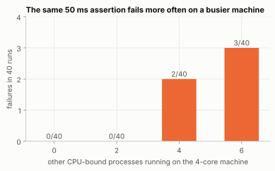
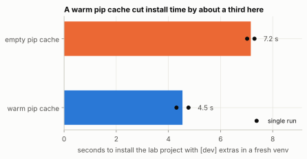

<!-- GENERATED by tools/nbpages.py from notebooks/. Do not edit. -->

# 33 · Continuous integration with GitHub Actions
{: .no_toc }

[Run it in Colab](https://colab.research.google.com/github/berdakh/mlengineering/blob/main/notebooks/33_ci.ipynb){: .btn .btn-primary .mr-2 target=_blank }
[View the .ipynb](https://github.com/berdakh/mlengineering/blob/main/notebooks/33_ci.ipynb){: .btn target=_blank }

{: .note }
> You are reading this notebook. To **run** it, open it in Colab with the button above - no install, no GPU needed for most of them - or clone the repository and open it in Jupyter.

1. TOC
{:toc}

---

**Week 6 · day 3 · 2 h essential path + up to 1 h optional** · lab files: [`labs/w6d3_ci/`](https://github.com/berdakh/mlengineering/blob/main/labs/w6d3_ci/)

**Objective.** Automate lint, tests and image build on every push; decide what belongs in CI versus scheduled evaluation jobs.

```python
# --- Setup: works on your laptop AND in Google Colab ----------------------------
# In Colab this clones the course repository and installs the requirements (about a
# minute, first run only). On your own machine it just finds the repository. Every
# command in this notebook runs from the repository root. Safe to re-run.
import os
import subprocess
import sys
from pathlib import Path

if "google.colab" in sys.modules:
    if not Path("/content/mlengineering").exists():
        subprocess.run(["git", "clone", "--depth", "1",
                        "https://github.com/berdakh/mlengineering.git",
                        "/content/mlengineering"], check=True)
    os.chdir("/content/mlengineering")
    subprocess.run([sys.executable, "-m", "pip", "install", "-q",
                    "-r", "requirements.txt"], check=True)

REPO_ROOT = next(p for p in [Path.cwd(), *Path.cwd().parents]
                 if (p / "src" / "mlcourse").is_dir())
os.chdir(REPO_ROOT)
sys.path.insert(0, str(REPO_ROOT / "src"))
print("repo root:", REPO_ROOT)
```

Unit id `w6d3_ci` · Week 6, day 3 · Handbook:
[H14.1 Continuous integration](../handbook/ch14_cicd/h14_1_continuous_integration.html)
· Content status: see [STATUS.md](../guides/status.html)

## 1. Purpose

**Objective.** Write the two workflows a small ML service needs: a fast, deterministic **per-push gate**
(lint, tests on a Python matrix, image build and container smoke test) and a separate **scheduled
lane** for anything that needs downloaded data, takes long, or measures wall-clock time. Then
diagnose three real-looking CI failures.

**Why an applied ML engineer needs it.** In research, "the code works" means it worked on your
machine once. In a team, `main` is shared, and continuous integration is the agreement that every
commit on it installs from scratch, passes its tests and builds a deployable image, checked by a
machine that nobody can talk into an exception. ML projects add a specific temptation: putting the
model evaluation in the per-push gate ("so we notice regressions"). That makes every push depend on a
download and on a statistical estimate from seven experiments. Knowing what belongs where is the core
skill of this session.

**Deliverables.**
* `lab/.github/workflows/ci.yml`: the per-push workflow for the `flowguard` service in `lab/`.
* `lab/.github/workflows/evaluate.yml`: the scheduled evaluation and perf lane.
* `challenge/project/` fixed and `challenge/DIAGNOSIS.md` written (section 5).

**Completion criteria.**
* `python wb.py check w6d3` passes (contract checks on both workflows; `actionlint` too if installed).
* `python wb.py check w6d3 --challenge` passes.
* You can say, without notes, which three things the per-push gate must never contain and why.
* **The real test comes later:** the first push of your own project to GitHub. The checks here read
  your workflow as data; nothing in this repository executes GitHub Actions.

**Prerequisites.** [w1d5](05_testing_ml_code.html) (unit tests vs statistical checks),
[w5d5](29_api_testing.html) (API tests), [w5d6](30_project_milestone_2.html)
(the release candidate). Docker basics from w6d1 help but are not required: the lab ships a
minimal `Dockerfile`. Install PyYAML if it is missing: `pip install pyyaml`. Optional:
`pip install actionlint-py` (a workflow linter; it downloads a binary).

**Time budget (2 h essential).**

| Activity | Minutes |
|---|---|
| Read section 2 | 25 |
| Worked example: run a workflow's steps locally | 10 |
| Guided lab: `ci.yml` then `evaluate.yml` | 55 |
| Challenge: diagnose the three logs, start the fixes | 20 |
| Assessment and reflection | 10 |
| *Optional extension: push your own project and make CI green; add a pre-commit hook; read a real runner log end to end* | *up to 60* |


## 2. Conceptual explanation

### 2.1 What CI is a contract about

Continuous integration is a policy, enforced by automation: **every change is merged into the shared
branch only after the same, scripted checks pass on a clean machine.** Three words carry the meaning.

* *Same*: the checks are code in the repository (`.github/workflows/*.yml`), reviewed like any code.
* *Scripted*: no step depends on a person remembering it.
* *Clean*: a fresh virtual machine with nothing installed beyond the image. Anything your laptop
  has by accident (a cached dataset, a system library, an environment variable, an editable install of
  a sibling package) is absent. Most "works on my machine" bugs surface here for the first time.

What CI promises is narrow: *this commit installs, lints, passes its tests and builds*. It does not
promise that the model is good. That claim needs data and statistics, and it lives elsewhere.

### 2.2 Anatomy of a GitHub Actions workflow



| Term | Meaning | Consequence |
|---|---|---|
| **Event / trigger** (`on:`) | what starts the workflow | `push` on `main` and `pull_request` for the gate; `schedule` / `workflow_dispatch` for the slow lane |
| **Job** | a unit of work on its own fresh runner VM | jobs share nothing (files, installed packages) unless you pass artifacts; they run **in parallel** unless `needs:` orders them |
| **Step** | either `uses:` an action (reusable code at a version) or `run:` a shell script | a failing step fails the job and skips later steps (unless `if:` says otherwise) |
| **Runner** (`runs-on:`) | the VM image, e.g. `ubuntu-latest` | 2-4 vCPUs, shared hardware, variable speed |
| **Matrix** | one job definition expanded into several jobs | `python-version: ["3.11", "3.12"]` = two jobs; `fail-fast: false` lets both report |
| **Expression** `${{ ... }}` | evaluated by GitHub **before** the shell sees the script | interpolating untrusted or secret values into `run:` text is how injection and leaks happen |
| **`permissions:`** | what the job's automatic `GITHUB_TOKEN` may do | default can include write; declare `contents: read` and grant more per job only when needed |
| **`concurrency:`** | at most one run per group | `cancel-in-progress: true` stops CI time being spent on superseded commits |
| **Cache** | files restored across runs by key | the key must change when the content should change, and only then |
| **Artifact** | files kept after the run | a report or a test log you can download later |

A YAML detail that bites every team once, executed with PyYAML 6.0.3:

```text
python-version: [3.10, 3.11, "3.12"]   ->  {'python-version': [3.1, 3.11, '3.12']}
on: [push]                             ->  {True: ['push']}
country: NO                            ->  {'country': False}
```

Unquoted `3.10` is the number 3.1, so that matrix entry asks for Python 3.1. Quote versions. (The
`on:` key read as `True` is harmless to GitHub but matters when you read workflows with a YAML library,
as the checks do.)

### 2.3 Least privilege and secrets

Every job gets a `GITHUB_TOKEN`. What it may do is set by `permissions:`; when the workflow sets
nothing, the repository or organisation default applies, which may allow writing. A test workflow
only needs `contents: read`. Grant more at job level and only to the job that needs it (a job that
pushes an image to GitHub's container registry needs `packages: write`, nothing else).

Secrets (`secrets.X`) are injected at run time and masked in logs, but masking is string matching:
a transformed secret (base64, split across lines) is printed in clear. Two rules follow:

1. Pass secrets to scripts through `env:`, never as `${{ secrets.X }}` inside the `run:` text. The
   expression is substituted into the script **before** the shell runs, so the secret becomes part of
   the generated script file.
2. The per-push gate should need **no secrets**. Workflows triggered by a pull request from a fork do
   not receive repository secrets (GitHub withholds them, because the fork's author controls the code
   that runs). A gate that needs secrets therefore cannot check contributions from forks.

Secret values never belong in the repository, in workflow files or in logs; cloud credentials come in
w6d5 with short-lived tokens.

### 2.4 Pinning actions

`uses: actions/checkout@v7` runs whatever the action's maintainers tag as `v7`. That tag moves with
patch releases: you get fixes, and you trust the maintainers. `uses: actions/checkout@<40-hex SHA>`
runs exactly one commit forever: reproducible and immune to a compromised tag, but you must update it
yourself (tools such as Dependabot can open those pull requests). `@main` is neither: it is a branch,
and it changes whenever someone pushes. This course uses major-version tags for readability; a
security-sensitive organisation pins SHAs. Versions checked against the actions' own README files on
2026-11-22: `actions/checkout@v7`, `actions/setup-python@v7`, `actions/upload-artifact@v7`,
`actions/cache@v6`, `docker/build-push-action@v7`, `docker/setup-buildx-action@v4`.

### 2.5 Fast lane and slow lane

The single most important design decision in an ML project's CI is what *not* to put in the gate.



| Belongs in the per-push gate | Belongs in the scheduled lane |
|---|---|
| Lint, type checks | Evaluation on real data (needs a download, takes minutes) |
| Unit tests with known answers (w1d5) | Statistical performance checks: they are estimates with intervals (w3d5), and a threshold on them flips on noise |
| API tests through TestClient (w5d5) | Wall-clock timing: a shared runner's speed varies run to run |
| Building the image and a smoke test against it | Drift reports (week 7), long load tests (w6d4) |
| Contract tests against the API schema | Anything that needs secrets or external services |

The test for "gate or schedule" is: **would a red result on this commit, with no code change, be
possible?** If yes (noise, network, a slow runner, a new day's data), it is not a gate.



*Figure 2. The challenge's single-request "under 50 ms" test, run 40 times at each level of competing
CPU-bound work on the 4-core authoring machine (real runs, `figures/measure.py`; the machine was also
shared with other jobs, so the counts are noisy). The code is identical in every run. A hosted runner is
a shared VM: the same assertion is a coin with an unknown, varying bias.*

### 2.6 Caching: keys that can be hit

A cache is a key-value store: `key -> directory`. A run restores the entry whose key matches and saves
a new one after the job. The key must be a function of the **inputs that determine the content**:
operating system, Python version, and a hash of the dependency declaration (`pyproject.toml` or a
lockfile). If the key contains something new on every run (`github.sha`, `github.run_id`), it can never
match an earlier save: every run misses, downloads everything and then stores another unused entry.
`actions/setup-python` with `cache: pip` builds a correct key for you (by default it hashes
`requirements.txt` or `pyproject.toml`; `cache-dependency-path` names the file explicitly).
Docker layer caching is separate: `docker/build-push-action` with `cache-from/to: type=gha` stores
layers in the same cache service.

What a cache saves depends on where the time goes. Measured on the authoring machine for the lab
project (fresh virtual environment, `pip install .[dev]`, two runs each): **7.0 and 7.3 s with an
empty pip cache, 4.8 and 4.3 s with a warm one**. The download is only part of an install; unpacking
and byte-compiling remain. Do not assume a number; look at the step timings in your own runs.



*Figure 1. Install time of the lab project in a fresh venv, real measurements on the authoring machine
(`figures/measure.py`). The cache helps, by about a third here; on a slow network it helps more.*

### 2.7 Building the image in CI and smoke-testing it

A unit test proves the code; a **smoke test** proves the artifact: the image builds, the container
starts as a non-root user, loads its model, answers `/readyz`, scores a request and rejects a bad one.
The lab's `scripts/smoke_test.py` uses only the standard library so it runs on the runner without
installing anything. Run it **from the runner against the published port**, not inside the container:
the production image should not carry test tools (the challenge shows what happens when it is
assumed to). On the authoring machine the lab's image built in 26 s cold and 0.3 s from cache
(405 MB, `python:3.12-slim` base), and the smoke test passed:

```text
ready: model flowguard-z-1.0.0
PASS: /predict scored 150 samples with flowguard-z-1.0.0
```

(Building required a proxy CA injected by a verification-only helper outside the repository, because
the authoring environment intercepts TLS. The course `Dockerfile` was not changed. On GitHub's runners
no such step is needed.)

### 2.8 Branch protection and triage

CI only enforces anything when the repository requires it: **branch protection** on `main` with the
CI jobs as **required status checks** means a pull request cannot be merged while they are red. That
is a setting in the repository, not in the workflow file. When a run fails, triage in this order:

1. Find the **first** line that explains the failure, not the last red line.
2. Ask whether the failure reproduces on the same commit (re-run once, *to learn*, not to get green).
   If it does not, it is flaky: fix the test or move it to the slow lane (section 2.5).
3. Ask what differs from your machine: OS packages, Python version, environment variables, files that
   are git-ignored locally but needed, network, CPU speed, time zone.
4. Reproduce locally with the same commands (the worked example), then fix the cause.

### 2.9 Connection to other domains

In a research project, the equivalent of the gate is "the analysis script runs end to end on a clean
checkout", and the equivalent of the scheduled lane is re-running the full cross-subject evaluation
after a preprocessing change. Good research practice already separates "the code is correct" from "the
model generalises": CI makes the first one automatic and keeps the second one out of it. A real-time
system with a hard latency budget (a brain-computer interface, a game, a trading engine) is the closest
analogue to the perf lane: latency is measured on the target machine under realistic load, not in a
unit test on a laptop.

### 2.10 An industry example (illustrative composite, not a documented case)

A team added "AUC on the validation set must exceed 0.90" to its pull-request checks. For a month it
worked; then a data refresh moved the validation AUC to 0.897 on an unchanged model, every pull request
turned red, and the team lowered the threshold to 0.85 "temporarily". Six weeks later a real regression
to 0.87 merged without anyone noticing, because the gate now allowed it. The fix was structural: a
nightly evaluation job reporting the metric with an interval and a trend, owned by a person, and a
per-push gate restricted to deterministic tests.

### 2.11 Limitations and misconceptions

* **"Green CI means the model works."** It means the code passed the tests you wrote. Model quality is
  measured by the scheduled evaluation and, in production, by monitoring (week 7).
* **"Re-run until green."** A re-run is a diagnostic. If the second run passes, you have a flaky test
  to fix, not a passing build.
* **"More checks in the gate is always safer."** Slow and noisy gates get bypassed; a gate is valuable
  because people trust and respect it.
* **"actionlint passed, so the workflow is right."** It finds syntax and type errors in workflow files.
  The lab's starter workflow has at least eight design problems and passes actionlint 1.7.12 cleanly.
* **"The checks in this lab prove the workflow runs."** They read it as data. Nothing here executes
  GitHub Actions; `act` can run workflows locally in Docker but was not used for this lesson.


## 3. Worked example: running a workflow's steps on your machine

`example/churnscore/` is a tiny unrelated library (a SYNTHETIC churn-risk rule) with a complete
workflow in `example/churnscore/.github/workflows/ci.yml`. `example/run_ci_steps.py` reads that
workflow as data, prints its structure and runs the job's `run:` steps in order in a temporary
virtual environment, timing each and stopping at the first failure, as a runner would.

```python
!python labs/w6d3_ci/example/run_ci_steps.py labs/w6d3_ci/example/churnscore --job test
```


Real output on the authoring machine (timings vary):

```text
workflow 'ci': triggers ['push', 'pull_request']
job 'test': runs-on ubuntu-latest, 3 matrix combination(s) {'python-version': ['3.11', '3.12', '3.13']}
permissions: {'contents': 'read'}

[1] actions/checkout@v7                      uses an action (skipped here) with {}
[2] actions/setup-python@v7                  uses an action (skipped here) with {'python-version': '${{ matrix.python-version }}', 'cache': 'pip', 'cache-dependency-path': 'pyproject.toml'}
[3] Install                                  exit 0    3.34 s
[4] Lint                                     exit 0    0.02 s
[5] Test                                     exit 0    0.29 s

job succeeded: run steps took 3.65 s on this machine
```

**Decisions worth noticing.**
* One job, three matrix entries: on GitHub this is three VMs in parallel. Locally the script runs one.
* `uses:` steps are *code you import*. `checkout` and `setup-python` do what you would otherwise do by
  hand; locally the repository is already checked out and the temporary venv stands in for setup-python.
* The install step dominates. That is why caches and small dependency lists matter for CI time.
* The script is a teaching tool, not an emulator: it has no secrets, no caches, no fresh VM, and it
  blanks `${{ }}` expressions. Its value is that it makes "a job is a list of shell scripts" concrete,
  and it is how you reproduce a CI failure locally (section 2.8, step 4).


## 4. Guided lab: the two workflows for `flowguard`

The lab is the `flowguard` service from week 5 as a standalone project: `src/flowguard/` (API,
detector, bundle loader), `models/flowguard-z/1.0.0/` (the w4d5 bundle built from the frozen v2
manifest), `tests/` (fast API tests plus one `perf`-marked wall-clock test that `pyproject.toml`
deselects by default), a minimal `Dockerfile`, `scripts/smoke_test.py`, `scripts/fetch_skab.py`
and `scripts/evaluate.py`. The starter `lab/.github/workflows/ci.yml` is a first draft with at least
eight problems.

**Task 1. Read the starter and list its problems (10 min).** Write them in a comment at the top of
your new file. Then confirm the project's own commands work locally:

```bash
cd labs/w6d3_ci/lab
python -m pip install -e ".[dev]"
ruff check .
python -m pytest -q            # 5 passed, 1 deselected (the perf test)
python -m pytest -q -m perf    # 1 passed, 5 deselected
cd -
```

*Checkpoint.* You can name at least: no `pull_request` trigger; no permissions; `@main`; unquoted
`3.10`; no lint; data download and evaluation in the gate; image built in the same job as tests and
never started; no timeouts; no cache.

**Task 2. Triggers, permissions, concurrency (10 min).** `on: push` (to `main`) and `pull_request`;
top-level `permissions: contents: read`; a `concurrency` group keyed on `github.ref` with
`cancel-in-progress: true`. Every job gets `timeout-minutes`.

**Task 3. Lint and test jobs (15 min).** A `lint` job (`ruff check .`) and a `test` job on a matrix of
`"3.11"` and `"3.12"` (quoted). Use `actions/setup-python@v7` with `cache: pip` and
`cache-dependency-path: pyproject.toml`; install with `python -m pip install -e ".[dev]"`; run
`python -m pytest -q`. Pin every action to a release tag.

**Task 4. Image job (10 min).** A job that `needs: [lint, test]`, builds the image
(`docker build -t flowguard:ci .` or `docker/build-push-action@v7` with `load: true`), starts it with
`docker run -d --name app -p 127.0.0.1:8000:8000 flowguard:ci`, runs
`python3 scripts/smoke_test.py --url http://127.0.0.1:8000 --timeout 60`, and prints `docker logs app`
`if: failure()`.

*Checkpoint.* `python wb.py check w6d3` now fails only the `evaluate.yml` checks.

**Task 5. The scheduled lane (10 min).** Write `lab/.github/workflows/evaluate.yml`: `schedule` (a cron
in UTC, off the hour) and `workflow_dispatch`; read-only permissions; install, `scripts/fetch_skab.py`,
`scripts/evaluate.py --min-events 4`, `pytest -m perf`, and `actions/upload-artifact@v7` with
`if: always()` for `reports/`.

To see what the evaluation job will report, run it locally (the data is the course's SKAB download):

```bash
cd labs/w6d3_ci/lab
python scripts/fetch_skab.py && python scripts/evaluate.py --min-events 4
cd -
```

Real output on the authoring machine:

```text
flowguard-z-1.0.0: AP 0.8843 (prevalence 0.3735), 6/7 test faults hit -> .../reports/evaluation.json
```

This is the frozen v2 test set (7 experiments). It counts **raw** threshold exceedances inside each
faulty segment, so it reports 6 of 7; w4d5 reported 5 of 7 for the same model *after* its
minimum-duration and merge post-processing. Both are correct for their definitions; a monitoring
report must say which one it uses.

*Checkpoint.* `python wb.py check w6d3` passes. If `actionlint` is installed it also runs.

**Debugging guidance.**
* *"... is read by YAML as a number"*: quote the version strings.
* *"must declare `needs`"*: without `needs`, jobs run in parallel.
* *"interpolates a secret"*: this workflow needs no secrets; if a later one does, use `env:`.
* *A check about `on:`*: PyYAML reads the bare key `on` as `True`; the checks handle it, your editor
  may highlight it oddly. Both are fine.

```python
# Run the automated checks on your guided lab.
# A fresh starter is expected to FAIL; passing means guided practice, not mastery.
from mlcourse.checks import check

check("w6d3")
```

## 5. Independent challenge: three red runs

`challenge/project/` is the same service with a different CI history. `challenge/logs/` holds three
failing jobs (read `challenge/logs/README.md` for what in them is real and what is reconstructed).
For each: find the first explaining line, the cause, why it appears in CI and not reliably on a laptop,
and fix it in `challenge/project/`. Write `challenge/DIAGNOSIS.md` (one `##` section per log, in order).

Acceptance criteria (checked by `python wb.py check w6d3 --challenge`):
* The default `pytest` run of `challenge/project` contains no assertion on elapsed wall-clock time:
  it passes even when the clock is made to run 0.5 s per read, and still runs the functional tests.
* The latency check is kept, marked `perf` (registered marker), and run by a scheduled or manually
  dispatched workflow that does not trigger on push or pull_request.
* `ci.yml` still caches pip, with a key that can repeat between runs and that tracks a dependency file.
* The image job still checks the running service, without calling a tool the image does not contain.
* `DIAGNOSIS.md` explains cause, fix and evidence for each log.


### The challenge brief


`project/` is the `flowguard` service with a CI history that went wrong. `logs/` holds three failing
jobs; `logs/README.md` says what in each log is real and what is reconstructed.

For each log:
1. Find the **first** line that explains the failure.
2. State the cause, and why it appears in CI and not (or not always) on a laptop.
3. Fix it in `project/`. Fix the cause; do not delete the check that caught it.
4. Say how you know the fix works.

Write your answers in `DIAGNOSIS.md` (one `##` section per log, in order: flaky test, cache, image).

#### Acceptance criteria

Checked by `python wb.py check w6d3 --challenge`:

* The default `pytest` run of `project/` contains no assertion on elapsed wall-clock time: it passes
  even when the clock is made to run 0.5 s per read, and it still runs the functional tests.
* The latency check is kept, marked `perf` (a registered marker), and run by a workflow that is
  scheduled or manually dispatched and does not trigger on push or pull_request.
* `ci.yml` still caches pip, with a key that can repeat between runs and that tracks a dependency file
  that exists.
* The image job still checks the running service, without calling a tool that the image does not
  contain.
* If `actionlint` is installed, every workflow in `project/.github/workflows/` passes it.
* `DIAGNOSIS.md` has a substantive section for each log that names its cause.

Not checked automatically, but part of the rubric in the assessment: whether your fix is the one you
would defend in a code review, and whether your "evidence" paragraph says what you actually observed.

```python
# Run the automated checks on your independent challenge.
# A fresh starter is expected to FAIL; passing means guided practice, not mastery.
from mlcourse.checks import check

check("w6d3", challenge=True)
```


## 6. Progressive hints

Try for 15 minutes before opening each level.
[Hint 1: concepts](https://github.com/berdakh/mlengineering/blob/main/labs/w6d3_ci/hints/hint1_concept.md) · [Hint 2: approach](https://github.com/berdakh/mlengineering/blob/main/labs/w6d3_ci/hints/hint2_approach.md) ·
[Hint 3: partial implementation](https://github.com/berdakh/mlengineering/blob/main/labs/w6d3_ci/hints/hint3_partial.md)


Open one hint at a time, only after a real attempt.

<details>
<summary><b>Hint 1 concept</b></summary>


* **Gate vs lane.** Ask of every step: "could this be red on an unchanged commit?" A download, a
  statistical estimate on 7 experiments and a wall-clock assertion can all be red with no code change.
  They go to a scheduled workflow. Lint, deterministic tests and the image build stay in the gate.
* **Jobs run in parallel** unless `needs:` orders them, and each job is a fresh machine.
* **YAML types.** `3.10` without quotes is the number 3.1. `on` without quotes is read as `True` by
  YAML 1.1 parsers (GitHub handles it; Python's YAML library does not).
* **Least privilege.** The workflow token's rights come from `permissions:`. A test workflow reads.
* **Expressions are substituted before the shell runs.** `${{ secrets.X }}` inside `run:` puts the
  secret into the script text.
* **Challenge.** Each log is one of: a test that measures the machine instead of the code; a cache key
  that is new on every run; a command that does not exist where it is run.

</details>

<details>
<summary><b>Hint 2 approach</b></summary>


**Lab, `ci.yml`.** Three jobs: `lint`, `test` (matrix), `image` (`needs: [lint, test]`). Top level:
`on` (push to main, pull_request), `permissions: {contents: read}`, `concurrency` (group on
`github.ref`, cancel in progress). Each job: `timeout-minutes`. Each `uses:` at a release tag.
In `test`: `actions/setup-python@v7` with `python-version: ${{ matrix.python-version }}`,
`cache: pip`, `cache-dependency-path: pyproject.toml`.

**Lab, `evaluate.yml`.** `on: schedule` (cron) and `workflow_dispatch`; same permissions; one job
that installs, runs `scripts/fetch_skab.py`, `scripts/evaluate.py --min-events 4`, `pytest -m perf`,
then `actions/upload-artifact@v7` with `if: always()`.

**Challenge.**
1. Flaky test: keep it, mark it `@pytest.mark.perf`, register the marker in `pyproject.toml`
   (`markers = [...]`), deselect it by default (`addopts = "-m 'not perf'"`), and add a scheduled
   workflow that runs `pytest -m perf`. Make the measurement itself less noisy while you are there.
2. Cache: replace the `actions/cache` step by setup-python's `cache: pip`, or keep `actions/cache` with
   a key built from `runner.os`, the Python version and `hashFiles('pyproject.toml')`.
3. Image: run the check from the runner (the smoke script) instead of inside the container, or install
   the tool in the image (and say why you chose which).

</details>

<details>
<summary><b>Hint 3 partial</b></summary>


A skeleton of `lab/.github/workflows/ci.yml` with the image job left to you:

```yaml
name: ci
on:
  push:
    branches: [main]
  pull_request:
permissions:
  contents: read
concurrency:
  group: ci-${{ github.workflow }}-${{ github.ref }}
  cancel-in-progress: true
jobs:
  lint:
    runs-on: ubuntu-latest
    timeout-minutes: 5
    steps:
      - uses: actions/checkout@v7
      - uses: actions/setup-python@v7
        with:
          python-version: "3.12"
          cache: pip
          cache-dependency-path: pyproject.toml
      - run: python -m pip install ruff
      - run: ruff check .
  test:
    runs-on: ubuntu-latest
    timeout-minutes: 15
    strategy:
      fail-fast: false
      matrix:
        python-version: ["3.11", "3.12"]
    steps:
      - uses: actions/checkout@v7
      - uses: actions/setup-python@v7
        with:
          python-version: ${{ matrix.python-version }}
          cache: pip
          cache-dependency-path: pyproject.toml
      - run: python -m pip install -e ".[dev]"
      - run: python -m pytest -q
  image:
    # needs: ...   (which jobs?)
    # steps: checkout; build; docker run -d ... -p 127.0.0.1:8000:8000 ...;
    #        python3 scripts/smoke_test.py --url http://127.0.0.1:8000 --timeout 60;
    #        docker logs app  if: failure()
```

Challenge, part 1, in `project/pyproject.toml`:

```toml
[tool.pytest.ini_options]
testpaths = ["tests"]
markers = ["perf: wall-clock performance checks; excluded from the per-push gate"]
addopts = "-m 'not perf'"
```

</details>



## 7. Assessment

Reasoning questions, a design-choice explanation, the rubric and a 10-15 minute debugging interview
rep are in assessment.md (section 7 of this notebook). Model answers are in the solutions tree; open them only
after writing yours.


### Assessment questions


Write your answers before opening `solutions/labs/w6d3_ci/assessment_answers.md`.

#### Reasoning questions

1. Your `test` job takes 4 minutes and `image` takes 3. Without `needs:`, a push with a failing test
   finishes in how long, and what has been spent? With `needs: [test]`? Which do you choose for a
   pull request, and would you choose differently for a release tag?
2. A matrix entry `python-version: 3.10` fails with "Version 3.1 was not found". Explain the cause
   precisely (which component reads what), and why `3.11` unquoted happens to work.
3. Give the rule that decides whether a check belongs in the per-push gate or in the scheduled lane,
   and classify: (a) `ruff check`; (b) "AUC on the frozen test set >= 0.80"; (c) a test that the API
   returns 422 for a NaN; (d) "p95 latency of /predict < 100 ms"; (e) building the Docker image;
   (f) a drift report on last week's production inputs.
4. A workflow interpolates `${{ secrets.TOKEN }}` into a `run:` line and the log shows `***`. Is the
   secret safe? Name two ways it can still leak, and the safer pattern.
5. Why do pull requests from forks not get repository secrets, and what does that imply for what your
   per-push gate may depend on?
6. `actions/checkout@v7`, `@main`, `@<40-hex SHA>`: rank them by reproducibility and by maintenance
   effort, and say which you would require in a regulated organisation.

#### Design-choice explanation (write 150-250 words)

The challenge's image job ran `docker exec app curl ...` and failed because the image has no curl.
You can fix it by installing curl in the image or by checking from the runner. Argue for one, covering:
image size and attack surface, what the check is supposed to prove, and how a container *health check*
(the orchestrator's probe) differs from a CI smoke test.

#### Rubric (for the open answers)

| Criterion | Strong | Adequate | Weak |
|---|---|---|---|
| Correct mechanism | names the component and the behaviour (YAML parser, expression substitution, job parallelism) | right idea, vague mechanism | restates the symptom |
| Gate/lane reasoning | applies "red on an unchanged commit?" consistently and explains (b), (d), (f) | classifies correctly without the rule | puts statistical checks in the gate |
| Security | separates masking from protection; mentions env and fork policy | one of the two | trusts `***` |
| Trade-offs | states what is given up by each option | one side only | no trade-off |
| Evidence | cites a log line, a measurement or a check result | general claims | none |

#### Interview rep (10-15 minutes, debugging, reduced assistance)

Say your answer aloud or write it in 10 minutes, then compare with the rubric in the answers file.

> "Our CI has been red on `main` since this morning, and nobody merged anything that touches the model.
> The failing step is `pip install -e .[dev]` in the Python 3.13 matrix entry that someone added on
> Friday; the 3.11 and 3.12 entries are green. The log ends with
> `error: subprocess-exited-with-error ... Building wheel for <some dependency> ... failed`.
> On my laptop `pip install -e .` works. What do you look at, in what order, and what are the likely
> causes? How do you unblock `main` today, and what do you change so this does not recur?"


## 8. Reflection and review

**You should now be able to, without notes:** write a per-push workflow with least privilege, a quoted
matrix, a correct pip cache, a dependent image job and a smoke test; write a scheduled lane for
data-dependent and wall-clock checks; read a failing run from its first explaining line; and explain
why a statistical threshold does not belong in the gate.

**Reflection prompt (5 minutes, write it in `progress/notes.md`).** Which check from your own research
code would you have put in the gate on day one, and on which side of the section 2.5 line does it fall?

**Later retrieval question (for the w6d7 review).** A colleague proposes "fail the pull request if the
model's F1 on the validation set drops by more than 0.01". Give two reasons this is a poor gate and
the design you would propose instead.

**Next.** w6d4 measures what the perf lane only samples: latency percentiles, throughput and resource
use under load. See [w6d4](34_latency_resources.html).

## Verification record

Executed on the authoring machine, 2026-11-22 (Python 3.13, PyYAML 6.0.3, actionlint 1.7.12,
Docker 29.10):
* `python tools/verify_checks.py labs/w6d3_ci`: reference solution passes both parts; 6 lab mutants
  and 4 challenge mutants are rejected, each by its intended check. The shipped starter fails 9 lab
  checks (6 more error on the missing `evaluate.yml`) and 6 of 7 challenge checks.
* `actionlint` on the reference workflows: 0 errors; on the starter: 0 errors (see section 2.11).
* The lab project: `ruff check .` clean, `pytest` 5 passed / 1 deselected, `pytest -m perf` 1 passed.
* The image built (through a verification-only proxy-CA helper; the Dockerfile is unchanged), ran as
  uid 10001, and `scripts/smoke_test.py` passed against it. `docker exec ... curl` failed with
  `sh: 1: curl: not found`, exit 127, as in the challenge log.
* `scripts/evaluate.py` on real SKAB: AP 0.8843, 6/7; its average precision matches scikit-learn's
  `average_precision_score` on random inputs.
* The worked example's output above is copied from a run; the figures come from `figures/measure.py`.
* **Not executed:** any workflow on GitHub's runners, `act`, the `type=gha` Docker cache, scheduled
  triggers. Your first push is that test.

## Record your progress

Tick only what is true. Passing the supplied checks is *guided practice*; mark *independent* only for work done without hints or solutions.

```python
from mlcourse.progress import mark, note

# mark("w6d3", "reading")
# mark("w6d3", "guided")
# mark("w6d3", "independent")
# note("w6d3", "what tripped me up today")
```
