<!-- GENERATED by tools/nbpages.py from notebooks/. Do not edit. -->

# 33 · Saving models and batch prediction
{: .no_toc }

[Run it in Colab](https://colab.research.google.com/github/berdakh/mlengineering/blob/main/notebooks/33_saving_models_batch.ipynb){: .btn .btn-primary .mr-2 target=_blank }
[View the .ipynb](https://github.com/berdakh/mlengineering/blob/main/notebooks/33_saving_models_batch.ipynb){: .btn target=_blank }

{: .note }
> You are reading this notebook. To **run** it, open it in Colab with the button above - no install, no GPU needed for most of them - or clone the repository and open it in Jupyter.

1. TOC
{:toc}

---

**Week 9 · lesson · about 90 minutes**

Until now every model you trained lived only as long as your notebook. Close the tab and it is gone. A model is
only useful to a business once it can be **saved**, **handed to another program**, and **used to score new rows**,
for example every night for every customer. This notebook does exactly that, carefully.

**What you will learn in this notebook**

- Save and load a fitted scikit-learn pipeline with `joblib`.
- Why a saved model file is *code*, and the one safety rule that follows from it.
- Checksums (SHA-256): proving a file is exactly the one you saved.
- A **model bundle**: the model file plus metadata (versions, features, metrics, training date, checksum).
- A **batch prediction** job that validates its input and reports rejected rows instead of crashing or guessing.

**What you need:** notebook 15 (pipelines) and the churn problem from Weeks 4-5. Week 8 (functions, tests) helps.

**How grading works:** after each exercise there is a grader cell. Run it and it tells you immediately
whether your answer works, and if not, what to look at.

```python
# --- Setup: works in Google Colab AND on your own computer. Safe to re-run. ---
# In Colab this downloads the course (about 30 s) and installs what it needs (about a minute, once
# per session). On your computer it just finds the course folder.
import os, sys, subprocess
from pathlib import Path

if "google.colab" in sys.modules and not Path("/content/mlengineering").exists():
    subprocess.run(["git", "clone", "--depth", "1",
                    "https://github.com/berdakh/mlengineering.git", "/content/mlengineering"], check=True)
    subprocess.run([sys.executable, "-m", "pip", "install", "-q", "-r",
                    "/content/mlengineering/requirements.txt"], check=True)
REPO_ROOT = Path("/content/mlengineering") if "google.colab" in sys.modules else next(
    p for p in [Path.cwd(), *Path.cwd().parents] if (p / "src" / "mlcourse").is_dir())
os.chdir(REPO_ROOT)
sys.path.insert(0, str(REPO_ROOT / "src"))
from mlcourse.grader import grade, quiz
print("Ready. Course folder:", REPO_ROOT)
```

## 0. The model we will save

The next cell is **given**. It builds the churn table you know from Weeks 4-5 (one row per active customer on the
cutoff date 2025-09-30, five features, and the label `churned`) with the helper `churn_table()`, then trains the
same kind of pipeline as notebook 15. Everything this week writes goes into a scratch folder, `runs/week09/`,
which Git ignores.

`use(your_function, ...)` (from the course) runs your function, or the course's reference version with a note if
you have not written it yet, so later cells always work.

```python
import json
import numpy as np
import pandas as pd
from sklearn.model_selection import train_test_split
from mlcourse.graders.w09 import churn_table, make_pipeline, FEATURES, use

WORK = REPO_ROOT / "runs" / "week09"
WORK.mkdir(parents=True, exist_ok=True)

table = churn_table()
X, y = table[FEATURES], table["churned"]
X_tr, X_te, y_tr, y_te = train_test_split(X, y, test_size=0.25, random_state=0, stratify=y)
pipe = make_pipeline().fit(X_tr, y_tr)
test_accuracy = float((pipe.predict(X_te) == y_te).mean())
print(table.shape, "| features:", FEATURES)
print("test accuracy:", round(test_accuracy, 3))
pipe
```

You should see 860 customers, the five features, and a test accuracy of 0.651. The last line shows the pipeline:
a `ColumnTransformer` (scaling the four numbers, one-hot encoding `segment`) followed by a logistic regression.
That whole object, with everything it learned, is what we want to keep.

## 1. Saving and loading with joblib

**Why.** Training happens once (say, every month), but predictions are needed every day, by a different program,
often on a different machine. That program must use *exactly* the fitted object you evaluated, not a re-trained
lookalike.

**Idea.** Python can turn almost any object into bytes and back. This is called **serialisation** (to bytes) and
**deserialisation** (from bytes). Python's built-in format is **pickle**. The library **joblib** (installed with
scikit-learn) uses pickle underneath, but handles the large NumPy arrays inside models efficiently. It is what
the scikit-learn documentation recommends:

```python
import joblib
joblib.dump(pipe, "churn.joblib")      # object -> file
pipe2 = joblib.load("churn.joblib")    # file -> object, ready to predict
```

The file extension is a convention (`.joblib` or `.pkl`); it does not change the format.

**See it.** Save the pipeline, load it back into a new variable, and check that both give *identical*
predictions on the test rows.

```python
import joblib

path = WORK / "churn.joblib"
joblib.dump(pipe, path)
loaded = joblib.load(path)

same = np.array_equal(pipe.predict_proba(X_te), loaded.predict_proba(X_te))
print("file size:", path.stat().st_size, "bytes | identical predictions:", same)
```

The file is a few kilobytes (a logistic regression is small; a large random forest can be hundreds of
megabytes), and the loaded copy predicts identically: `True`.

**Try it.** Run `loaded.named_steps["model"].coef_` and compare with `pipe.named_steps["model"].coef_`. The
learned coefficients came back with the file.

```python
loaded.named_steps["model"].coef_
```

### Exercise 1 · save a model

Write `save_model(model, path)`: save `model` with `joblib.dump` to `path` and **return the path** as a `Path`.
If the folder does not exist yet (for example `runs/week09/models/v3/model.joblib`), create it first:
`Path(path).parent.mkdir(parents=True, exist_ok=True)`. Accept `path` as a string or a `Path`.

```python
def save_model(model, path):
    # YOUR CODE HERE
    raise NotImplementedError()
```

```python
grade("w09.save_model", save_model)
```

### Exercise 2 · load a model, with a clear error

Write `load_model(path)`: return `joblib.load(path)`. But if there is no file at `path`, raise
`FileNotFoundError` with a message that **contains the path**, so whoever reads the log knows which file was
missing. (`joblib.load` would also fail, but you decide the message.)

```python
def load_model(path):
    # YOUR CODE HERE
    raise NotImplementedError()
```

```python
grade("w09.load_model", load_model)
```

## 2. A model file is code: the one safety rule

**Why.** People share model files the way they share CSV files: from a colleague, a download, a bucket in the
cloud. With pickle that is dangerous, and every ML engineer is expected to know why.

**Idea.** A pickle file does not only contain data. It contains **instructions** that tell Python how to rebuild
each object, and an object can ask for *any function to be called* while it is being rebuilt. So loading a pickle
(or joblib) file can **run code chosen by whoever made the file**: delete files, read your credentials, send them
somewhere. Hence:

> **Only load model files that you, or your own pipeline, produced. Never load a pickle/joblib file from an
> untrusted source.**

A CSV or JSON file cannot do this: reading them only reads data.

**See it.** A harmless demonstration. The class below tells pickle "to rebuild me, call `print(...)`". Watch the
message appear during *loading*, before you touch the object.

```python
import pickle


class Surprise:
    def __reduce__(self):
        # "To rebuild this object, call print with this argument." It could have been any function.
        return (print, ("This line was run by pickle.loads, just by LOADING the bytes.",))


payload = pickle.dumps(Surprise())
print("payload is", len(payload), "bytes; now loading it ...")
result = pickle.loads(payload)
```

The message was printed by `pickle.loads`. A malicious file would call something worse than `print`.

**Checksums.** So you only load your own files. How do you know a file is still *your* file: not truncated by a
failed copy, not swapped for an older version, not edited? You record its **checksum**. A cryptographic hash
function such as **SHA-256** turns any file into a 64-character fingerprint; change a single byte and the
fingerprint changes completely. Save the fingerprint when you save the model, recompute it before loading, and
refuse the file if they differ. (A checksum proves "unchanged since it was recorded", not "made by a trusted
person": anyone can compute one.)

**See it.** In Python, `hashlib.sha256()` gives a hash object; you feed it bytes with `.update(...)` and read the
fingerprint with `.hexdigest()`.

```python
import hashlib

print(hashlib.sha256(b"hello").hexdigest())
print(hashlib.sha256(b"hellp").hexdigest())   # one letter changed
```

Two completely different fingerprints for a one-letter change.

**Try it.** Compute `hashlib.sha256(path.read_bytes()).hexdigest()` for the model file you saved above. Run it
twice: the same file always gives the same fingerprint.

```python
hashlib.sha256(path.read_bytes()).hexdigest()
```

### Exercise 3 · the fingerprint of a file

Write `sha256_of(path)`: return the SHA-256 hex digest (a string) of the file's bytes. Open the file in
**binary** mode (`open(path, "rb")`) and read it in chunks (for example `fh.read(65536)` in a loop until it returns
`b""`), calling `.update()` on each chunk. Reading in chunks keeps memory small even for a 2 GB model.

```python
def sha256_of(path):
    # YOUR CODE HERE
    raise NotImplementedError()
```

```python
grade("w09.sha256_of", sha256_of)
```

### Exercise 4 · verify a checksum

Write `verify_checksum(path, expected)`: return `True` if the file's SHA-256 equals `expected`; otherwise raise
`ValueError` (with a message naming the file). Use your `sha256_of`.

```python
def verify_checksum(path, expected):
    # YOUR CODE HERE
    raise NotImplementedError()
```

```python
grade("w09.verify_checksum", verify_checksum)
```

## 3. A model bundle: the model plus its metadata

**Why.** Six months from now someone asks: "Which model made last Tuesday's predictions? What was it trained on?
How good was it? Can we load it in the new environment?" A file called `churn.joblib` answers none of that.

**Idea.** Save a **bundle**: a folder with the model file and a small JSON file describing it.



| Key in `metadata.json` | Example | Why |
|---|---|---|
| `created_at` | `"2025-10-01T09:12:44+00:00"` | when it was trained (in UTC, so time zones never confuse anyone) |
| `python_version`, `sklearn_version` | `"3.11.9"`, `"1.5.2"` | a pickled model is only guaranteed to load in the **same** scikit-learn version |
| `model_class` | `"Pipeline"` | what kind of object to expect |
| `features` | `["recency_days", ...]` | the exact input columns, in order |
| `metrics` | `{"test_accuracy": 0.651}` | how good it was when it was approved |
| `train_rows` | `645` | how much data it saw |
| `sha256` | `"3f9a..."` | the checksum of `model.joblib` |

JSON is used because any program, in any language, can read it, and a human can open it in a text editor.
JSON only knows strings, numbers, booleans, lists, dicts and `null`, so NumPy numbers such as `np.float64` must
be converted to plain `float` first, or `json.dumps` raises a `TypeError`.

**See it.** The building blocks for exercise 5:

```python
import platform
from datetime import datetime, timezone
import sklearn

print("now, in UTC:", datetime.now(timezone.utc).isoformat(timespec="seconds"))
print("Python", platform.python_version(), "| scikit-learn", sklearn.__version__)
print("class name:", type(pipe).__name__)
try:
    json.dumps({"accuracy": np.float64(0.651), "rows": np.int64(645)})
    print("json.dumps worked")
except TypeError as err:
    print("TypeError:", err)
```

Note the `TypeError`: `np.int64` is not JSON-serialisable. (`np.float64` happens to be accepted because it is a
subclass of Python's `float`, but `np.int64` is not a subclass of `int`.) Converting with `int(...)` and
`float(...)` avoids both surprises.

### Exercise 5 · the metadata dict

Write `make_metadata(model, feature_names, metrics, train_rows)` returning a dict with exactly the keys
`created_at` (current UTC time as an ISO string), `python_version`, `sklearn_version`, `model_class` (the class
name of `model`), `features` (a **list**), `metrics` (a dict whose values are converted to `float`) and
`train_rows` (an `int`). The result must survive `json.dumps`.

```python
def make_metadata(model, feature_names, metrics, train_rows):
    # YOUR CODE HERE
    raise NotImplementedError()
```

```python
grade("w09.make_metadata", make_metadata)
```

### Exercise 6 · save a bundle

Write `save_bundle(model, metadata, folder)`:

1. create `folder` (with parents);
2. save the model to `folder / "model.joblib"` (your `save_model`);
3. compute its SHA-256 **after** saving;
4. write `metadata` plus a `"sha256"` key to `folder / "metadata.json"` (use `json.dumps(..., indent=2)` and
   `Path.write_text`). Do not modify the caller's dict: build a new one with `dict(metadata, sha256=...)`;
5. return `Path(folder)`.

```python
def save_bundle(model, metadata, folder):
    # YOUR CODE HERE
    raise NotImplementedError()
```

```python
grade("w09.save_bundle", save_bundle)
```

### Exercise 7 · load a bundle safely

Write `load_bundle(folder)` returning `(model, metadata)`. The order of checks matters:

1. if `metadata.json` or `model.joblib` is missing, raise `FileNotFoundError`;
2. read the metadata (`json.loads(path.read_text())`);
3. **verify the checksum before loading** (your `verify_checksum`, which raises `ValueError`): never unpickle a
   file you have not checked;
4. if `metadata["sklearn_version"]` differs from `sklearn.__version__`, raise `RuntimeError` saying both versions;
5. load the model and return `(model, metadata)`.

```python
def load_bundle(folder):
    # YOUR CODE HERE
    raise NotImplementedError()
```

```python
grade("w09.load_bundle", load_bundle)
```

**See it.** Save the real churn model as a bundle, look inside, and load it back. (If you skipped an exercise,
`use` fills in the course's version and says so.)

```python
meta = use(make_metadata, pipe, FEATURES, {"test_accuracy": test_accuracy}, len(X_tr))
bundle = use(save_bundle, pipe, meta, WORK / "bundles" / "churn_v1")
print(sorted(p.name for p in bundle.iterdir()))
print((bundle / "metadata.json").read_text())
model, meta_loaded = use(load_bundle, bundle)
print("loaded:", type(model).__name__, "| features:", meta_loaded["features"])
```

**Try it.** Simulate a corrupted copy: append one byte to the model file, then try to load the bundle. Predict
the error type before you run it. (The second line repairs the bundle by saving it again.)

```python
with open(bundle / "model.joblib", "ab") as fh:
    fh.write(b"\x00")
try:
    use(load_bundle, bundle)
except ValueError as err:
    print("refused:", err)
bundle = use(save_bundle, pipe, meta, WORK / "bundles" / "churn_v1")   # repair
```

## 4. Batch prediction with input validation

**Why.** The most common way models are used is not a fancy API: it is a **batch job**, a script run on a
schedule (say, every night) that reads a file of rows, scores them, and writes the scores somewhere for the
business to act on (here: who should get a retention offer). Real input files are messy: a column renamed by
someone upstream, a negative count from a bug, a new customer segment nobody told you about.

**Idea.** Two kinds of problems, two reactions:

* **Structural problems** (a required column is missing): nothing can be scored correctly. **Stop loudly**, with
  a message naming the column, before predicting anything.
* **Row problems** (one row has a missing or impossible value, or an unknown category): **score the good rows,
  reject the bad ones with a reason**, and report how many were rejected. Never fill in a made-up value silently,
  and never drop rows silently: either way, nobody knows those customers were never really scored.

The output has one row per input row: `customer_id`, `churn_probability` (empty for rejected rows) and `status`
(`"ok"` or the reason).

**See it.** The next cell writes tonight's input file: the test customers, plus three rows broken the way real
files break.

```python
incoming = table.loc[X_te.index, ["customer_id"] + FEATURES].reset_index(drop=True)
incoming.loc[3, "orders_90d"] = -2             # a bug upstream
incoming.loc[7, "spend_90d"] = np.nan          # a missing value
incoming.loc[11, "segment"] = "enterprise"     # a segment the model never saw
in_csv = WORK / "incoming" / "customers_2025-10-01.csv"
in_csv.parent.mkdir(parents=True, exist_ok=True)
incoming.to_csv(in_csv, index=False)
print(len(incoming), "rows written to", in_csv.relative_to(REPO_ROOT))
incoming.iloc[[2, 3, 7, 11]]
```

215 rows; rows 3, 7 and 11 are the broken ones. Notice that the model would happily score the
`"enterprise"` row (the one-hot encoder ignores unknown categories), which is exactly why the job must check
it: a prediction for a customer type the model never saw is a guess dressed up as a number.

### Exercise 8 · missing columns

Write `missing_columns(df, required)`: return a **sorted list** of the names in `required` that are not columns
of `df` (an empty list when nothing is missing).

```python
def missing_columns(df, required):
    # YOUR CODE HERE
    raise NotImplementedError()
```

```python
grade("w09.missing_columns", missing_columns)
```

### Exercise 9 · row problems

Write `row_problems(df)`: return a pandas `Series` with the **same index** as `df`, holding one message per row:
`""` if the row is fine, otherwise a short reason that **names the column**. The rules:

* each of `recency_days`, `orders_90d`, `spend_90d`, `tenure_days` must be present (not NaN) and not negative
  (zero is fine), e.g. `"orders_90d is negative"`, `"spend_90d is missing"`;
* `segment` must be one of `"consumer"`, `"small_business"`, `"student"`, e.g. `"segment 'enterprise' is unknown"`.

Reporting the first problem of each row is enough. A loop over `df.iterrows()` is fine for a nightly batch.

```python
SEGMENTS = ["consumer", "small_business", "student"]
NUMERIC = ["recency_days", "orders_90d", "spend_90d", "tenure_days"]


def row_problems(df):
    # YOUR CODE HERE
    raise NotImplementedError()
```

```python
grade("w09.row_problems", row_problems)
```

### Exercise 10 · score a batch

Write `predict_batch(model, df, features)`:

1. if any of `features` or `"customer_id"` is missing from `df`, raise `ValueError` naming them (use
   `missing_columns`);
2. compute `problems = row_problems(df)` and `ok = problems == ""`;
3. predict **only** the ok rows: `model.predict_proba(df.loc[ok, features])[:, 1]` (skip the call if no row is ok);
4. return a DataFrame with columns `customer_id`, `churn_probability` (NaN for rejected rows) and `status`
   (`"ok"` or the problem), one row per input row, in the input order.

```python
def predict_batch(model, df, features):
    # YOUR CODE HERE
    raise NotImplementedError()
```

```python
grade("w09.predict_batch", predict_batch)
```

### Exercise 11 · the whole job

Write `run_batch(bundle_folder, in_csv, out_csv)`: load the bundle (your `load_bundle`, which checks the
checksum), read the CSV, score it with `predict_batch` using `metadata["features"]`, create the output folder if
needed, write the result with `to_csv(out_csv, index=False)`, and return `{"ok": <number scored>, "rejected":
<number rejected>}` as plain `int`s.

```python
def run_batch(bundle_folder, in_csv, out_csv):
    # YOUR CODE HERE
    raise NotImplementedError()
```

```python
grade("w09.run_batch", run_batch)
```

**See it.** Tonight's run, end to end: from the bundle on disk and the CSV on disk to a scores file on disk. Note
that nothing from the training cells is used, only files: this is what a scheduled job would do.

```python
out_csv = WORK / "scores" / "scores_2025-10-01.csv"
summary = use(run_batch, WORK / "bundles" / "churn_v1", in_csv, out_csv)
print(summary)
scores = pd.read_csv(out_csv)
print(scores[scores["status"] != "ok"])
scores.sort_values("churn_probability", ascending=False).head()
```

You should see `{'ok': 212, 'rejected': 3}`, the three rejected rows with their reasons, and the customers with
the highest churn probability at the top: the list the retention team would work through first.

**Try it.** Delete a column from the input (`incoming.drop(columns=["tenure_days"]).to_csv(...)` to a new file)
and run the job on it. You should get a `ValueError` naming `tenure_days`, before any prediction is made.

```python
broken_csv = WORK / "incoming" / "broken.csv"
incoming.drop(columns=["tenure_days"]).to_csv(broken_csv, index=False)
try:
    use(run_batch, WORK / "bundles" / "churn_v1", broken_csv, WORK / "scores" / "broken_scores.csv")
except ValueError as err:
    print("stopped:", err)
```

## Quiz

**Q1.** A colleague emails you `best_model.pkl`, found "on a forum", that supposedly beats yours. Why should you
not simply `joblib.load` it?

- a) Because it might be too large for memory.
- b) Because it might have been made with another scikit-learn version.
- c) Because loading a pickle/joblib file can run arbitrary code chosen by whoever made it.
- d) Because it might be compressed.

```python
answer = "?"  # put your letter between the quotes
quiz("w09.33_q1", answer)
```

**Q2.** What does a matching SHA-256 checksum prove about `model.joblib`?

- a) That the model is accurate.
- b) That the file is byte-for-byte the one whose checksum was recorded in the metadata.
- c) That loading it will be fast.
- d) That a trusted person created it.

```python
answer = "?"  # put your letter between the quotes
quiz("w09.33_q2", answer)
```

**Q3.** Why does the bundle record `sklearn_version`?

- a) To know which data the model was trained on.
- b) To make loading faster.
- c) Because Python cannot load files from older versions.
- d) Because a pickled scikit-learn model is only guaranteed to work in the version that saved it.

```python
answer = "?"  # put your letter between the quotes
quiz("w09.33_q3", answer)
```

**Q4.** In a nightly batch of 50,000 customers, 12 rows have a negative `orders_90d`. What should the job do?

- a) Score the 49,988 valid rows and report the 12 rejected rows with their reason.
- b) Replace the negative values with 0 and score everything.
- c) Drop the 12 rows and say nothing.
- d) Stop the whole job.

```python
answer = "?"  # put your letter between the quotes
quiz("w09.33_q4", answer)
```

**Q5.** The input file arrives without the `segment` column (someone renamed it to `customer_segment`). What
should the job do?

- a) Mark every row as rejected and carry on.
- b) Fill `segment` with `"consumer"`, the most common value.
- c) Stop before predicting, with an error that names the missing column.
- d) Predict without that column.

```python
answer = "?"  # put your letter between the quotes
quiz("w09.33_q5", answer)
```

## Recap

- `joblib.dump(model, path)` and `joblib.load(path)` save and restore a fitted pipeline exactly.
- Loading a pickle/joblib file can run code: only load files you or your own pipeline produced.
- A SHA-256 checksum proves a file is unchanged since it was recorded; verify it **before** loading.
- A bundle is a folder with `model.joblib` and `metadata.json` (time, versions, features, metrics, size of
  training data, checksum). JSON needs plain Python numbers.
- Refuse a bundle whose scikit-learn version differs from the running one, instead of hoping.
- A batch job stops on structural problems (missing columns) and scores good rows while reporting bad ones.

## On the job

Most production models start life as a batch job like this one, run every night by a scheduler, writing scores
to a table the business reads. When something goes wrong, the first questions are always "which model produced
these numbers?" and "which rows were not scored, and why?". Your bundle metadata and your status column answer
both in seconds. Teams also keep bundles in a **model registry** (a catalogue of approved bundles); the advanced
track's artifact lesson shows one.

## Going further

- Tool guide: [FastAPI and pydantic](../tools/fastapi.html) (next notebook's tools) and
  [Python packaging](../tools/packaging.html) (how a batch job becomes an installable command).
- Advanced track: notebook 26 · artifacts and versioning, in `advanced/notebooks/`.
- Next: [34 · APIs and FastAPI](34_apis_and_fastapi.html).

## Record your progress

```python
from mlcourse.progress import mark

# mark("33", "reading")
# mark("33", "guided")
```
