<!-- GENERATED by tools/nbpages.py from notebooks/. Do not edit. -->

# 35 · Testing APIs and handling bad input
{: .no_toc }

[Run it in Colab](https://colab.research.google.com/github/berdakh/mlengineering/blob/main/notebooks/35_testing_apis_bad_input.ipynb){: .btn .btn-primary .mr-2 target=_blank }
[View the .ipynb](https://github.com/berdakh/mlengineering/blob/main/notebooks/35_testing_apis_bad_input.ipynb){: .btn target=_blank }

{: .note }
> You are reading this notebook. To **run** it, open it in Colab with the button above - no install, no GPU needed for most of them - or clone the repository and open it in Jupyter.

1. TOC
{:toc}

---

**Week 9 · lesson · about 90 minutes**

Your API from notebook 34 works when you call it the way you intended. Its users will not be so kind: they will
forget fields, send text where numbers belong, send yesterday's field names, and call it while the model is
missing. This notebook makes the API's promises explicit with **tests**, and makes its failures clear and safe.

**What you will learn in this notebook**

- Testing an API with `TestClient`: what to check on the happy path and on bad input.
- Why tests use a **stand-in model**, and how to judge a test: it must fail when the service is broken.
- Many bad cases at once (the idea behind pytest's `parametrize`).
- Safe behaviour when the model is missing (503) or crashes (500 without leaking internals).
- Friendly, consistent error responses with a custom validation error handler.
- A real pytest file with a **fixture**, run with `python -m pytest`.

**What you need:** notebook 34 (FastAPI, pydantic), notebook 30 (pytest basics).

**How grading works:** after each exercise there is a grader cell. Several exercises ask you to write *tests*:
the grader runs them against the correct service (they must pass) and against copies with planted bugs (they
must fail).

```python
# --- Setup: works in Google Colab AND on your own computer. Safe to re-run. ---
# In Colab this downloads the course (about 30 s) and installs what it needs (about a minute, once
# per session). On your computer it just finds the course folder.
import os, sys, subprocess
from pathlib import Path

if "google.colab" in sys.modules and not Path("/content/mlengineering").exists():
    subprocess.run(["git", "clone", "--depth", "1",
                    "https://github.com/berdakh/mlengineering.git", "/content/mlengineering"], check=True)
    subprocess.run([sys.executable, "-m", "pip", "install", "-q", "-r",
                    "/content/mlengineering/requirements.txt"], check=True)
REPO_ROOT = Path("/content/mlengineering") if "google.colab" in sys.modules else next(
    p for p in [Path.cwd(), *Path.cwd().parents] if (p / "src" / "mlcourse").is_dir())
os.chdir(REPO_ROOT)
sys.path.insert(0, str(REPO_ROOT / "src"))
from mlcourse.grader import grade, quiz
print("Ready. Course folder:", REPO_ROOT)
```

## 0. The service under test

The next cell is **given**: the churn API from notebook 34, as one function `build_app(model, threshold,
version)`. Read it once; nothing in it is new.

```python
from typing import Literal

import numpy as np
import pandas as pd
from fastapi import FastAPI, HTTPException
from fastapi.testclient import TestClient
from pydantic import BaseModel, ConfigDict, Field

from mlcourse.graders.w09 import StubModel, buggy_app, use, service_source


class CustomerFeatures(BaseModel):
    model_config = ConfigDict(extra="forbid")
    recency_days: int = Field(ge=0)
    orders_90d: int = Field(ge=0)
    spend_90d: float = Field(ge=0)
    tenure_days: int = Field(ge=0)
    segment: Literal["consumer", "small_business", "student"]


class PredictionOut(BaseModel):
    churn_probability: float = Field(ge=0, le=1)
    will_churn: bool
    model_version: str


def build_app(model, threshold=0.5, version="v1"):
    app = FastAPI(title="Churn prediction API")

    @app.get("/health")
    def health():
        return {"status": "ok", "model_version": version}

    @app.post("/predict", response_model=PredictionOut)
    def predict(features: CustomerFeatures):
        p = float(model.predict_proba(pd.DataFrame([features.model_dump()]))[0, 1])
        return PredictionOut(churn_probability=p, will_churn=p >= threshold, model_version=version)

    return app


VALID = {"recency_days": 90, "orders_90d": 1, "spend_90d": 40.0, "tenure_days": 300, "segment": "consumer"}
client = TestClient(build_app(StubModel()))
print(client.post("/predict", json=VALID).json())
```

Notice the model: `StubModel()`, not the trained pipeline. It is a **stand-in** (also called a *stub* or *fake*)
whose churn probability is simply `recency_days / 180`, capped at 1. For `recency_days = 90` it says 0.5, as the
output shows. Why use it? API tests check the **API's behaviour** (status codes, validation, the shape of the
answer), not the model's accuracy, which Weeks 5-7 evaluate properly. A stub is instant, needs no training data,
and lets you know the right answer in advance.

## 1. A test is a function that can fail

**Why.** Every change to the service (a new field, a library upgrade, a refactor) can quietly break a promise to
its users. Tests re-check every promise in seconds, every time.

**Idea.** An API test is a function that takes a `client`, sends a request and **asserts** what the response
must be. If every assert holds, it returns quietly (pass); otherwise it raises `AssertionError` (fail).

The quality of a test is not "it passes". A test that would also pass on a broken service is worthless; worse,
it gives false confidence. So the grader judges your tests like a code reviewer would: it runs them against the
correct service **and** against copies with one planted bug each (in testing jargon: *mutants*). A good test
passes on the first and fails on the bugs it is about.



**See it.** A test for unknown paths, run against the correct service and against a copy whose `/health` is
broken (`buggy_app("health_broken")` builds that copy).

```python
def test_unknown_path_is_404(client):
    r = client.get("/no-such-path")
    assert r.status_code == 404, f"expected 404, got {r.status_code}"


def run(test, app):
    """Run one test function against an app and say whether it passed."""
    try:
        test(TestClient(app, raise_server_exceptions=False))
        return "passed"
    except AssertionError as err:
        return f"FAILED: {err}"


print("correct service: ", run(test_unknown_path_is_404, build_app(StubModel())))
print("broken /health:  ", run(test_unknown_path_is_404, buggy_app("health_broken")))
```

It passes on both, which is fine: that test is about unknown paths, not about `/health`. To catch the broken
`/health`, you need a test about `/health`. (`raise_server_exceptions=False` makes `TestClient` turn a crash
into a 500 response, as a real server would, instead of raising the Python error in your notebook.)

### Exercise 1 · test the health endpoint

Write `test_health(client)`: call `GET /health` and assert that the status is 200 **and** that the body's
`status` is `"ok"`. The grader also runs it against a service whose `/health` answers 500, and one that answers
200 but says `"down"`.

```python
def test_health(client):
    # YOUR CODE HERE
    raise NotImplementedError()
```

```python
grade("w09.test_health", test_health)
```

## 2. The happy path

**Why.** The **happy path** is the normal, valid request. It is the one every user depends on, and the one that
is easiest to break subtly: a probability that becomes a percentage, a decision with its sign flipped, a missing
field in the answer.

**Idea.** Assert the **contract**, the promises the API makes, not one exact number:

* the status is 200;
* `churn_probability` is between 0 and 1;
* `will_churn` agrees with the probability and the threshold (0.5 here);
* `model_version` is present.

Checking properties like these keeps the test valid when the model is retrained and the numbers change.

**Try it.** Run the request below with `recency_days` 30, 90 and 200. Which probabilities do you expect from the
stub, and which `will_churn`?

```python
client.post("/predict", json=dict(VALID, recency_days=30)).json()
```

### Exercise 2 · test the happy path

Write `test_predict_happy(client)` checking the four promises above for a valid request. The planted bugs it must
catch: a probability returned as a percentage (50.0 instead of 0.5), an inverted `will_churn`, and a missing
`model_version`.

```python
def test_predict_happy(client):
    # YOUR CODE HERE
    raise NotImplementedError()
```

```python
grade("w09.test_predict_happy", test_predict_happy)
```

## 3. Bad input must get 422

**Why.** The most valuable API tests are about bad input, because that is where silent disasters hide. A service
that fills a missing field with 0, or accepts `-3` orders, returns a perfectly normal-looking prediction for a
customer that does not exist.

**Idea.** For each kind of bad input, one test: build a request that is valid **except for one thing**, send it,
and assert the status is exactly 422. "Not 200" is not enough: a crash (500) is also a bug, because it blames the
server for the client's mistake and hides what was wrong.

A safe way to break one thing: copy the valid payload first, so tests never change `VALID` for each other.

```python
bad = dict(VALID)            # a copy
del bad["segment"]           # remove one field
bad = dict(VALID, orders_90d=-1)   # or: a copy with one value replaced
```

**See it.** What the correct service and a lax copy (one that fills missing fields with 0) answer to the same
incomplete request:

```python
incomplete = dict(VALID)
del incomplete["orders_90d"]
for name, app in [("correct", build_app(StubModel())), ("lax copy", buggy_app("missing_defaults"))]:
    r = TestClient(app).post("/predict", json=incomplete)
    print(f"{name:9}", r.status_code, r.json() if r.status_code == 200 else r.json()["detail"][0]["msg"])
```

The lax copy happily predicts for a customer with "0 orders": the kind of bug nobody notices for months.

### Exercise 3 · a missing field

Write `test_missing_field(client)`: send a valid payload with one field removed and assert 422.

```python
def test_missing_field(client):
    # YOUR CODE HERE
    raise NotImplementedError()
```

```python
grade("w09.test_missing_field", test_missing_field)
```

### Exercise 4 · a wrong type

Write `test_wrong_type(client)`: send `recency_days` as the text `"soon"` and assert 422. (The planted bug lets
any type through, so the text reaches the model and the service crashes with 500.)

```python
def test_wrong_type(client):
    # YOUR CODE HERE
    raise NotImplementedError()
```

```python
grade("w09.test_wrong_type", test_wrong_type)
```

### Exercise 5 · out of range

Write `test_out_of_range(client)`: send a negative value for one of the numeric features and assert 422.

```python
def test_out_of_range(client):
    # YOUR CODE HERE
    raise NotImplementedError()
```

```python
grade("w09.test_out_of_range", test_out_of_range)
```

## 4. Many cases, one test

**Why.** There are many ways to be wrong, and writing one function per case gets repetitive. You want a **table of
cases** and one piece of code that checks them all.

**Idea.** Put the cases in a list and loop. pytest has a built-in way to do this, which you will use in section 7:

```python
@pytest.mark.parametrize("payload", BAD_PAYLOADS)
def test_bad_payload_is_422(client, payload):
    assert client.post("/predict", json=payload).status_code == 422
```

`parametrize` runs the test once per case and reports each case separately, so you see exactly which payload got
through. In a notebook, a plain loop does the same job.

### Exercise 6 · a table of bad payloads

Build `BAD_PAYLOADS`, a list of at least 5 request bodies (dicts), each one valid except for **one** thing. The
grader checks that the correct service answers 422 to every case, and that, together, your cases catch a service
that: fills missing fields with defaults, accepts any type for `recency_days`, accepts negative numbers, accepts
any segment, and silently ignores unexpected fields (typos).

```python
BAD_PAYLOADS = []  # YOUR CODE HERE: a list of at least 5 dicts, each breaking one rule
```

```python
grade("w09.bad_payloads", BAD_PAYLOADS)
```

**See it.** Your table against the correct service and two buggy ones. Each line shows the status codes, case
by case; any code other than 422 means that case got through.

```python
for name in ["good", "no_segment_check", "extra_allowed"]:
    c = TestClient(buggy_app(name), raise_server_exceptions=False)
    print(f"{name:17}", [c.post("/predict", json=p).status_code for p in BAD_PAYLOADS])
```

## 5. When the model is missing or crashes

**Why.** Services start before everything is ready, bundles go missing, a model can crash on an input nobody
anticipated. How the service fails matters: a clear, honest error lets the caller retry or fall back; a fake
answer or a stack trace does not.

**Idea.** Three rules:

* **No model, no prediction.** If the model could not be loaded, `/predict` answers **503 Service Unavailable**
  (`HTTPException(status_code=503, detail="model not loaded")`). Never a made-up probability.
* **`/health` reports, it does not crash.** It still answers 200, with `"status": "degraded"` and
  `"model_loaded": false`, so monitoring sees the problem.
* **Do not leak internals.** If the model raises, catch the exception and answer **500** with a short message
  (`"prediction failed"`). The full error belongs in the server's logs (Week 11), not in the response: error text
  can reveal file paths, library versions or data.

```python
try:
    p = float(model.predict_proba(row)[0, 1])
except Exception:
    raise HTTPException(status_code=500, detail="prediction failed")
```

**See it.** What an unprotected service sends when its model crashes (a model that raises on every call):

```python
class CrashingModel:
    def predict_proba(self, X):
        raise RuntimeError("matrix not invertible in /opt/models/churn_v1/model.joblib")


r = TestClient(build_app(CrashingModel()), raise_server_exceptions=False).post("/predict", json=VALID)
print(r.status_code, r.headers["content-type"], repr(r.text))
```

A plain-text `Internal Server Error`: honest about the status, but not JSON, so clients that expect JSON break
again while reading the error.

### Exercise 7 · a safe service

Write `make_app_safe(model, threshold=0.5, version="v1")`: like `build_app`, but

* `GET /health` returns `{"status": "ok", "model_loaded": True}` with a model, and
  `{"status": "degraded", "model_loaded": False}` when `model is None`;
* `POST /predict` answers 503 when `model is None`, and 500 with `detail="prediction failed"` when the model
  raises; otherwise it behaves exactly like `build_app`.

```python
def make_app_safe(model, threshold=0.5, version="v1"):
    # YOUR CODE HERE
    raise NotImplementedError()
```

```python
grade("w09.make_app_safe", make_app_safe)
```

**See it.** The safe service without a model, and with the crashing one:

```python
for model in [None, CrashingModel()]:
    c = TestClient(use(make_app_safe, model), raise_server_exceptions=False)
    print(c.get("/health").json(), "|", c.post("/predict", json=VALID).status_code,
          c.post("/predict", json=VALID).json())
```

## 6. Friendly error responses

**Why.** FastAPI's default 422 body is precise but noisy (types, locations as lists, the input echoed back). Teams
usually agree on **one error format** for all their services, so that every client handles errors the same way.

**Idea.** FastAPI raises a `RequestValidationError` for every invalid request. You can register your own
**exception handler** for it, a function that receives the error and returns the response:

```python
from fastapi.exceptions import RequestValidationError
from fastapi.responses import JSONResponse

@app.exception_handler(RequestValidationError)
async def friendly(request, exc):
    ...                                  # exc.errors() is the list of problems
    return JSONResponse(status_code=422, content={...})
```

(`async def` is required here by FastAPI; treat it as an ordinary `def`.) Each item of `exc.errors()` is a dict
with `"loc"` (where, e.g. `("body", "orders_90d")`) and `"msg"` (what).

**See it.** The raw problems for one bad request:

```python
from pydantic import ValidationError

try:
    CustomerFeatures(**dict(VALID, orders_90d=-1, segment="vip"))
except ValidationError as err:
    for e in err.errors():
        print(e["loc"], "|", e["msg"])
```

Inside FastAPI the locations start with `"body"` (the problem is in the request body), e.g.
`("body", "orders_90d")`.

### Exercise 8 · one error format

Write `add_friendly_errors(app)`: register a handler on `app` so that every invalid request gets status 422 and
the body

```json
{"error": "invalid input", "problems": [{"field": "orders_90d", "message": "Input should be greater than or equal to 0"}]}
```

with **one item per problem**. `field` is the location without the leading `"body"`, joined with dots
(`".".join(...)`). Return the app.

```python
from fastapi.exceptions import RequestValidationError
from fastapi.responses import JSONResponse


def add_friendly_errors(app):
    # YOUR CODE HERE
    raise NotImplementedError()
```

```python
grade("w09.add_friendly_errors", add_friendly_errors)
```

**Try it.** Send a request with two problems to the friendlier service and read the body.

```python
friendly_client = TestClient(use(add_friendly_errors, build_app(StubModel())))
friendly_client.post("/predict", json=dict(VALID, orders_90d=-1, segment="vip")).json()
```

## 7. A real pytest file

**Why.** Test functions in a notebook are a good way to learn, but a team's tests live in files that run with one
command, on every change (in Week 10, automatically on every push). That command is `python -m pytest`.

**Idea.** Two pytest features make API tests tidy (both from notebook 30):

* a **fixture**: a function decorated with `@pytest.fixture` that builds something tests need. Any test with an
  argument of the same name receives it. Here: `client`.
* `@pytest.mark.parametrize("name", values)`: run one test once per value (section 4).

```python
import pytest
from fastapi.testclient import TestClient
from churn_service import app          # the module under test

@pytest.fixture
def client():
    return TestClient(app)

def test_health(client):
    assert client.get("/health").status_code == 200
```

pytest finds files named `test_*.py` and functions named `test_*`, runs them, and prints a dot per pass and an
`F` per failure, with details.

**See it.** The next cell writes the service under test, `churn_service.py`, into `runs/week09/api_tests/` (it is
the same API with the stub model built in).

```python
TESTS_DIR = REPO_ROOT / "runs" / "week09" / "api_tests"
TESTS_DIR.mkdir(parents=True, exist_ok=True)
(TESTS_DIR / "churn_service.py").write_text(service_source("good"))
print("written:", (TESTS_DIR / "churn_service.py").relative_to(REPO_ROOT))
```

### Exercise 9 · a test file

Complete the file `runs/week09/api_tests/test_churn_service.py` below with **at least three** test functions that
use the `client` fixture: for example `/health`, the happy path, and a parametrized test over bad payloads. The
grader runs your file with pytest against `churn_service.py` and against three buggy versions of it (negative
numbers accepted; `will_churn` inverted; the probability returned as a percentage). Your file must pass on the
first and fail on each of the others.

```python
%%writefile runs/week09/api_tests/test_churn_service.py
import pytest
from fastapi.testclient import TestClient

from churn_service import app

VALID = {"recency_days": 90, "orders_90d": 1, "spend_90d": 40.0, "tenure_days": 300, "segment": "consumer"}


@pytest.fixture
def client():
    return TestClient(app)

# YOUR CODE HERE: write at least three test functions (names starting with test_), each taking `client`
```

Run it the way you would on your own computer. `!` sends the line to the terminal; `cd` moves into the folder so
that `from churn_service import app` finds the file. `-q` means "quiet" output.

```python
!cd runs/week09/api_tests && python -m pytest -q -p no:cacheprovider test_churn_service.py
```

With the solution you should see six dots (`......`): `test_health`, `test_predict_contract` and four
parametrized cases of the negative-number test, then `6 passed`.

```python
grade("w09.pytest_file", TESTS_DIR / "test_churn_service.py")
```

## Quiz

**Q1.** Your new test passes on the service. What else must be true before you trust it?

- a) Nothing: passing is what tests are for.
- b) It should be part of a large test suite.
- c) It must fail when the behaviour it checks is broken.
- d) It must run every line of the service.

```python
answer = "?"  # put your letter between the quotes
quiz("w09.35_q1", answer)
```

**Q2.** Why do these API tests use `StubModel` instead of the trained churn model?

- a) The stub is instant and predictable, so the tests check the API's behaviour, not the model.
- b) Because model accuracy should be tested in API tests.
- c) Because the trained model is never used in production.
- d) Because tests are not allowed to use real models.

```python
answer = "?"  # put your letter between the quotes
quiz("w09.35_q2", answer)
```

**Q3.** The service started but its model bundle is missing. What should `POST /predict` answer?

- a) 422
- b) 200 with probability 0.5
- c) 404
- d) 503 with a short message such as "model not loaded"

```python
answer = "?"  # put your letter between the quotes
quiz("w09.35_q3", answer)
```

**Q4.** The model raised `RuntimeError("cannot open /opt/models/churn_v1/model.joblib")`. What should the client
receive?

- a) The full error and stack trace, to help them debug.
- b) A 500 with a short message like "prediction failed"; the details go to the server's logs.
- c) Nothing: catch the error and hide it everywhere.
- d) A 200 with a default prediction.

```python
answer = "?"  # put your letter between the quotes
quiz("w09.35_q4", answer)
```

**Q5.** What do you gain from `@pytest.mark.parametrize("payload", BAD_PAYLOADS)` over a loop inside one test?

- a) Each case runs and is reported separately, so a failure names the exact payload.
- b) Some cases are skipped to save time.
- c) The tests run faster.
- d) It chooses the best model.

```python
answer = "?"  # put your letter between the quotes
quiz("w09.35_q5", answer)
```

## Recap

- An API test sends a request with `TestClient` and asserts the contract: status code, value ranges, consistency,
  required fields.
- Tests use a stand-in model so they are fast and their expected answers are known.
- A test is only useful if it fails when its behaviour is broken; checking against planted bugs proves it.
- Bad input gets exactly 422: missing fields, wrong types, out-of-range values, unknown categories, extra fields.
- No model: `/predict` answers 503, `/health` reports `degraded`. A crashing model: 500 with a short JSON message,
  details only in the logs.
- One error format for all services, via an exception handler for `RequestValidationError`.
- A pytest file uses a `client` fixture and `parametrize`, and runs with `python -m pytest`.

## On the job

In code review, an API change without tests is usually sent back. The tests you wrote are exactly the ones teams
keep: a health check, a contract test on the happy path, and a table of bad payloads that grows every time a
real client finds a new way to send nonsense. In Week 10 these tests run automatically on every push with GitHub
Actions, so nobody can merge a change that breaks them.

## Going further

- Tool guides: [FastAPI and pydantic](../tools/fastapi.html), [pytest](../tools/pytest.html).
- Advanced track: notebook 29 (API testing), in `advanced/notebooks/`.
- Next: [36 · Project milestone 2: a prediction API](36_project_m2_prediction_api.html).

## Record your progress

```python
from mlcourse.progress import mark

# mark("35", "reading")
# mark("35", "guided")
```
