<!-- GENERATED by tools/nbpages.py from notebooks/. Do not edit. -->

# 36 · Project milestone 2: a prediction API
{: .no_toc }

[Run it in Colab](https://colab.research.google.com/github/berdakh/mlengineering/blob/main/notebooks/36_project_m2_prediction_api.ipynb){: .btn .btn-primary .mr-2 target=_blank }
[View the .ipynb](https://github.com/berdakh/mlengineering/blob/main/notebooks/36_project_m2_prediction_api.ipynb){: .btn target=_blank }

{: .note }
> You are reading this notebook. To **run** it, open it in Colab with the button above - no install, no GPU needed for most of them - or clone the repository and open it in Jupyter.

1. TOC
{:toc}

---

**Week 9 · lab (project milestone) · about 120 minutes**

In milestone 1 (notebook 28) you built and evaluated fault detectors on the **SKAB** sensor data: recordings from
a laboratory water-circulation testbed, one file per experiment, each with one labelled anomalous segment. This
milestone turns the simplest of them, the **burn-in z-score detector on the flow rate**, into a tested web
service: `POST /score` receives a window of sensor readings and answers with the alarms.

**What you will build** (each exercise uses the previous ones):

1. the detector as three small functions: burn-in statistics, z-scores, alarms with a persistence rule;
2. a FastAPI app with a validated request model and a `POST /score` endpoint;
3. a client function that scores one experiment and measures the detection delay;
4. a behaviour check of the service on all 34 experiments, and a **parity check** against the batch code;
5. tests that catch the four ways this service most plausibly breaks.

**What you need:** notebooks 28 (milestone 1), 34 and 35. No new concepts: this lab combines them.

**How grading works:** each exercise has a grader cell. Grading uses small synthetic sensor series, so it works
offline; only the behaviour check in step 4 uses the real data.

```python
# --- Setup: works in Google Colab AND on your own computer. Safe to re-run. ---
# In Colab this downloads the course (about 30 s) and installs what it needs (about a minute, once
# per session). On your computer it just finds the course folder.
import os, sys, subprocess
from pathlib import Path

if "google.colab" in sys.modules and not Path("/content/mlengineering").exists():
    subprocess.run(["git", "clone", "--depth", "1",
                    "https://github.com/berdakh/mlengineering.git", "/content/mlengineering"], check=True)
    subprocess.run([sys.executable, "-m", "pip", "install", "-q", "-r",
                    "/content/mlengineering/requirements.txt"], check=True)
REPO_ROOT = Path("/content/mlengineering") if "google.colab" in sys.modules else next(
    p for p in [Path.cwd(), *Path.cwd().parents] if (p / "src" / "mlcourse").is_dir())
os.chdir(REPO_ROOT)
sys.path.insert(0, str(REPO_ROOT / "src"))
from mlcourse.grader import grade, quiz
print("Ready. Course folder:", REPO_ROOT)
```

## The data

SKAB is licensed under GPL-3.0, so the course does not copy it into its repository: the script
`project/get_skab.py` downloads it (about 4 MB, pinned to one version, with a checksum per file) into
`data/raw/skab/`. The next cell runs it only if the data is not there yet, then loads one experiment.

Each file has one row per second: eight sensor columns (vibration, motor current, pressure, temperatures,
voltage, and the circulation flow rate `Volume Flow RateRMS` in litres per minute) and the labels `anomaly`
(1 during the faulty segment) and `changepoint`.

```python
import numpy as np
import pandas as pd
import matplotlib.pyplot as plt

SKAB = REPO_ROOT / "data" / "raw" / "skab"
if not (SKAB / "MANIFEST.json").is_file():
    subprocess.run([sys.executable, "project/get_skab.py"], check=True)

FLOW = "Volume Flow RateRMS"
exp = pd.read_csv(SKAB / "valve1" / "10.csv", sep=";")
start = int(np.argmax(exp["anomaly"].to_numpy() == 1))
print(exp.shape, "| anomaly starts at row", start)
exp[[FLOW, "anomaly"]].describe().round(2)
```

**The detector, in one paragraph.** Every experiment starts in normal operation. Treat the first `burn_in`
readings (default 100, about 100 seconds) as the **baseline**: compute their mean $$\mu$$ and standard deviation
$$\sigma$$. Every reading $$x_t$$ then gets a score $$|z_t| = |x_t - \mu| / \sigma$$: how many baseline standard
deviations it is away from normal. A reading after the burn-in is **above threshold** if $$|z_t| > 3$$. New in this
milestone: one noisy reading should not wake anyone up, so an **alarm** is raised at reading $$t$$ only when the
last `min_run` readings (default 5) were all above threshold.



**See it.** The experiment we loaded: the flow rate, the burn-in window, and the labelled faulty segment.

```python
fig, ax = plt.subplots(figsize=(10, 3.2))
ax.plot(exp[FLOW].to_numpy(), lw=0.8, label="flow rate")
ax.axvspan(0, 100, color="tab:green", alpha=0.15, label="burn-in (baseline)")
ax.axvspan(start, len(exp), color="tab:red", alpha=0.10, label="labelled anomaly")
ax.set_xlabel("reading (about 1 per second)")
ax.set_ylabel("flow rate (L/min)")
ax.set_title("SKAB valve1/10: flow rate")
ax.legend(loc="lower left", fontsize=8)
plt.show()
```

The flow sensor reports whole litres per minute, which is why the line jumps between 29 and 33. Around reading 600
the flow drops by about two litres per minute and stays low for about 300 readings: the fault.

## Exercise 1 · burn-in statistics

Write `burn_in_stats(values, burn_in)` returning the tuple `(mean, std)` of the first `burn_in` values, as plain
floats. Use NumPy's default standard deviation (`np.std`, which divides by $$n$$; pandas' `.std()` divides by
$$n-1$$, a classic source of train/serve differences). Raise `ValueError` if there are fewer than `burn_in`
values. Accept a list or a NumPy array.

```python
def burn_in_stats(values, burn_in):
    # YOUR CODE HERE
    raise NotImplementedError()
```

```python
grade("w09.burn_in_stats", burn_in_stats)
```

## Exercise 2 · z-scores

Write `zscores(values, burn_in)` returning a NumPy array with $$|x_t - \mu| / \sigma$$ for **every** value
(burn-in included), using your `burn_in_stats`. If $$\sigma = 0$$ (a perfectly constant baseline), raise
`ValueError` with a message saying the burn-in is constant, instead of dividing by zero.

```python
def zscores(values, burn_in):
    # YOUR CODE HERE
    raise NotImplementedError()
```

```python
grade("w09.zscores", zscores)
```

## Exercise 3 · alarms with a persistence rule

Write `alarms(values, burn_in=100, threshold=3.0, min_run=5)` returning the **list of indices** $$t$$ at which an
alarm is raised:

* a reading is *above* if its z-score is greater than `threshold`; readings inside the burn-in (index below
  `burn_in`) never count as above;
* walk through the readings keeping a counter of consecutive *above* readings (reset to 0 on a normal one);
* record index $$t$$ whenever the counter is `min_run` or more.

So a fault that lasts 8 readings with `min_run=5` produces alarms at its 5th, 6th, 7th and 8th readings.

```python
def alarms(values, burn_in=100, threshold=3.0, min_run=5):
    # YOUR CODE HERE
    raise NotImplementedError()
```

```python
grade("w09.alarms", alarms)
```

**See it.** The detector on valve1/10:

```python
from mlcourse.graders.w09 import use

found = use(alarms, exp[FLOW].to_numpy())
print(len(found), "alarm readings; first alarm at", found[0] if found else None, "| anomaly starts at", start)
```

The first alarm comes 61 readings (about a minute) after the labelled start: the flow rate changes gradually at
first, and the persistence rule adds a few readings on top.

**Try it.** Load `valve1/1.csv` instead (change the file name in the data cell above and re-run it and this
cell). This time there is no alarm at all: the fault is real, but the flow rate stays within three baseline
standard deviations for long enough runs. Not every fault shows up in every sensor.

## Exercise 4 · the scoring service

Now put the detector behind an API. First the **request model** (4a), then the app (4b); the grader checks both
through the app.

**4a.** Define `ScoreRequest`:

* `readings`: a list of finite floats (`list[FiniteFloat]`; `FiniteFloat` from pydantic rejects infinity),
  at most 100,000 of them (`Field(max_length=100_000)`);
* `burn_in`: int, default 100, between 10 and 10,000;
* `threshold`: float, default 3.0, greater than 0 and at most 50;
* `min_run`: int, default 5, between 1 and 100;
* extra fields forbidden;
* one rule that involves **two** fields: there must be more readings than `burn_in`. pydantic runs such checks in
  a method decorated with `@model_validator(mode="after")`; it receives the validated object as `self`, raises
  `ValueError` (FastAPI turns that into a 422) or returns `self`. This one is given.

```python
from typing import Optional

from fastapi import FastAPI, HTTPException
from fastapi.testclient import TestClient
from pydantic import BaseModel, ConfigDict, Field, FiniteFloat, model_validator


class ScoreRequest(BaseModel):
    # YOUR CODE HERE: model_config and the four fields

    @model_validator(mode="after")
    def more_readings_than_burn_in(self):
        if len(self.readings) <= self.burn_in:
            raise ValueError(f"need more than burn_in={self.burn_in} readings, got {len(self.readings)}")
        return self


class ScoreResponse(BaseModel):          # given
    n: int                              # number of readings received
    n_alarms: int                       # number of alarm indices
    first_alarm: Optional[int]          # first alarm index, or null if none
    max_z: float                        # largest |z| after the burn-in
```

**4b.** Write `make_score_app()` returning a new app with:

* `GET /health` returning `{"status": "ok", "detector": "burn-in z-score"}`;
* `POST /score` taking a `ScoreRequest` and returning a `ScoreResponse` computed with your `zscores` and
  `alarms` (with the request's `burn_in`, `threshold` and `min_run`);
* a constant burn-in must not crash the service: catch the `ValueError` from your functions and raise
  `HTTPException(status_code=422, detail=...)` with the message (which says "constant").

```python
def make_score_app():
    # YOUR CODE HERE
    raise NotImplementedError()
```

```python
grade("w09.make_score_app", make_score_app)
```

## Exercise 5 · score one experiment

Write `score_experiment(client, df, column="Volume Flow RateRMS", **params)`:

* post `{"readings": <df[column] as a list of floats>, **params}` to `/score` (so `threshold=4.0` can be passed
  through);
* if the status is not 200, raise `RuntimeError` with the status and the response text;
* return `{"first_alarm": ..., "anomaly_start": ..., "delay": ...}` where `anomaly_start` is the first index with
  `df["anomaly"] == 1` (or `None` if there is none) and `delay = first_alarm - anomaly_start` when both exist
  (otherwise `None`). A **negative** delay means the alarm came before the fault: a false alarm.

```python
def score_experiment(client, df, column=FLOW, **params):
    # YOUR CODE HERE
    raise NotImplementedError()
```

```python
grade("w09.score_experiment", score_experiment)
```

## Step 4 · behaviour check on all 34 experiments, and parity

The next cell (given) sends every labelled experiment through **your service** with the default settings and
sorts the outcomes into *detected* (first alarm at or after the fault starts), *early* (first alarm before it: a
false alarm) and *missed* (no alarm). It also runs a **parity check**: for each experiment, the alarms the API
reports must equal the alarms your batch function computes directly. If they differ, the service is not the
detector you evaluated.

This is a check of the service's behaviour on every experiment, not a new evaluation: the honest numbers for
the detector remain milestone 1's, computed on the held-out test experiments.

```python
from mlcourse.graders.w09 import _ref_score_app

try:
    app = make_score_app()
except NotImplementedError:
    print("(note: make_score_app is not finished yet, so the course's reference service is used here)")
    app = _ref_score_app()
service = TestClient(app)

rows, parity_failures = [], 0
for path in sorted(SKAB.glob("*/*.csv")):
    if path.parent.name == "anomaly-free":
        continue
    df = pd.read_csv(path, sep=";")
    result = use(score_experiment, service, df)
    api = service.post("/score", json={"readings": df[FLOW].tolist()}).json()
    batch = use(alarms, df[FLOW].to_numpy())
    parity_failures += (api["n_alarms"], api["first_alarm"]) != (len(batch), batch[0] if batch else None)
    rows.append({"experiment": f"{path.parent.name}/{path.stem}", **result})

outcomes = pd.DataFrame(rows)
outcomes["outcome"] = np.select(
    [outcomes["first_alarm"].isna(), outcomes["delay"] < 0], ["missed", "early"], default="detected")
print(outcomes["outcome"].value_counts().to_string())
print("median delay of detected faults:", outcomes.loc[outcomes["outcome"] == "detected", "delay"].median(), "readings")
print("parity failures (API vs batch):", parity_failures)
outcomes.head(8)
```

With the reference solution this prints 24 detected, 6 missed and 4 early, a median delay of 59 readings (about
a minute), and 0 parity failures. Look at `other/2`: its fault starts at reading 104, right after the burn-in, so
the baseline already contains the start of the fault and nothing stands out: a limitation of this detector, and
one to state in the README.

**Try it.** Re-run the loop's scoring with `min_run=1` (pass it to `score_experiment` and to the parity line) and
compare the number of *early* alarms. Then try `threshold=4.0`. Each setting trades false alarms for missed or
later detections; the choice belongs to whoever pays for each kind of mistake (Week 5).

## Exercise 6 · tests that protect the service

Write test functions (each taking `client`) and put them in the list `SCORE_TESTS`. The grader runs them against
your contract on the correct service (they must all pass) and against four broken versions; each broken version
must make **at least one** of your tests fail:

1. a window shorter than the burn-in crashes with 500 instead of a 422;
2. alarms are raised **inside** the burn-in (hint: a burn-in that contains one huge spike, and `min_run=1`);
3. `min_run` is ignored, so a single spike after the burn-in raises an alarm;
4. a constant burn-in crashes with 500 instead of a clear 422.

Build the readings by hand so you know the right answer: for example `[0.0, 1.0] * 100` is a normal signal with
mean 0.5 and standard deviation 0.5.

```python
# YOUR CODE HERE: write your test functions above this line, then list them (without parentheses)
SCORE_TESTS = []
```

```python
grade("w09.score_tests", SCORE_TESTS)
```

## Quiz

**Q1.** A client sends a window that starts in the middle of a fault. What does this service do, and why?

- a) It detects the fault, because the model adapts between requests.
- b) It detects the fault if the threshold is low enough.
- c) It probably raises no alarm: the baseline is computed from the first readings it receives, which are
  already faulty.
- d) It answers slowly.

```python
answer = "?"  # put your letter between the quotes
quiz("w09.36_q1", answer)
```

**Q2.** What does `min_run=5` buy, and what does it cost?

- a) Fewer false alarms from single spikes, at the cost of alarming at least 4 readings later.
- b) Earlier alarms at no cost.
- c) Smaller z-scores.
- d) It removes the need for a burn-in.

```python
answer = "?"  # put your letter between the quotes
quiz("w09.36_q2", answer)
```

**Q3.** What does the parity check (API vs batch function on the same experiments) protect you from?

- a) A slow API.
- b) An API whose numbers look plausible but differ slightly.
- c) Too little data.
- d) Serving a detector that is not the one you evaluated in milestone 1.

```python
answer = "?"  # put your letter between the quotes
quiz("w09.36_q3", answer)
```

**Q4.** Your tests pass and the behaviour check looks reasonable. Which sentence belongs in the project README?

- a) "The service detects faults reliably in production."
- b) "A tested API around a simple baseline detector; on the 34 laboratory experiments it misses some faults and
  raises some early alarms; it has not been evaluated on data from a real plant."
- c) "All tests pass, so the detector is correct."
- d) "The API rejects some requests, which is a known weakness."

```python
answer = "?"  # put your letter between the quotes
quiz("w09.36_q4", answer)
```

## Reflection

Write three or four sentences in your project notes: What does `POST /score` promise (inputs, outputs, errors)?
Which of your tests protects which promise? What would a client have to know to use it correctly (for example,
that the window must start in normal operation)? What would you change before letting a real plant call it?

## What to show in your portfolio

- The service code (the request model, the endpoint) and the test functions, in your project repository.
- The behaviour table (detected / early / missed, median delay) with the sentence that it is a behaviour check,
  and a pointer to milestone 1's test-set evaluation for the real numbers.
- The parity check result, and one known limitation in your own words (the `other/2` case is a good one).

In Week 10 this service goes into a Docker container and its tests run on every push; in Week 11 you add
logging and monitoring around it.

## Going further

- Project brief: [the portfolio project](../guides/project.html).
- Tool guide: [FastAPI and pydantic](../tools/fastapi.html).
- Advanced track: notebook 30 (project milestone 2, the packaged `flowguard` service), in `advanced/notebooks/`.

## Record your progress

```python
from mlcourse.progress import mark

# mark("36", "reading")
# mark("36", "guided")
```
