<!-- GENERATED by tools/nbpages.py from notebooks/. Do not edit. -->

# 37 · VS Code and a local setup
{: .no_toc }

[Run it in Colab](https://colab.research.google.com/github/berdakh/mlengineering/blob/main/notebooks/37_vscode_local_setup.ipynb){: .btn .btn-primary .mr-2 target=_blank }
[View the .ipynb](https://github.com/berdakh/mlengineering/blob/main/notebooks/37_vscode_local_setup.ipynb){: .btn target=_blank }

{: .note }
> You are reading this notebook. To **run** it, open it in Colab with the button above - no install, no GPU needed for most of them - or clone the repository and open it in Jupyter.

1. TOC
{:toc}

---

**Week 10 · lesson · about 90 minutes**

Until now everything ran in Colab. Real projects live in a folder on a computer: yours, a colleague's, a build
server, a container. This week you set up that folder properly, so that the code runs the same way everywhere.
This notebook teaches the ideas and grades them in Colab; the boxes marked **💻 On your computer** are steps you
do on your own machine (Linux, macOS or Windows), at your own pace.

**What you will learn**

- install VS Code, Python and Git, and check each one works;
- how your terminal decides *which* `python` runs (the `PATH`), the cause of most setup problems;
- create, activate and use a **virtual environment** per project, and pin dependencies in `requirements.txt`;
- open a project in VS Code, select its interpreter, run notebooks and tests, and keep the right files out of Git;
- read the six setup errors everyone meets, and find a bug with the debugger.

**What you need:** notebook 03 (terminal and Git) and Week 8 (packages and pytest).

**How grading works:** run the cell under each exercise; `grade(...)` tries your answer on several cases and
explains what is wrong without giving the answer away. Nothing here needs your computer to be set up.

```python
# --- Setup: works in Google Colab AND on your own computer. Safe to re-run. ---
# In Colab this downloads the course (about 30 s) and installs what it needs (about a minute, once
# per session). On your computer it just finds the course folder.
import os, sys, subprocess
from pathlib import Path

if "google.colab" in sys.modules and not Path("/content/mlengineering").exists():
    subprocess.run(["git", "clone", "--depth", "1",
                    "https://github.com/berdakh/mlengineering.git", "/content/mlengineering"], check=True)
    subprocess.run([sys.executable, "-m", "pip", "install", "-q", "-r",
                    "/content/mlengineering/requirements.txt"], check=True)
REPO_ROOT = Path("/content/mlengineering") if "google.colab" in sys.modules else next(
    p for p in [Path.cwd(), *Path.cwd().parents] if (p / "src" / "mlcourse").is_dir())
os.chdir(REPO_ROOT)
sys.path.insert(0, str(REPO_ROOT / "src"))
from mlcourse.grader import grade, quiz
print("Ready. Course folder:", REPO_ROOT)
import shutil
from mlcourse.graders.w10 import use, work_dir

WORK = work_dir()
print("working folder:", WORK)
```

## 1 · Three tools on your own computer

**Why.** Colab is a computer someone else set up for you. Your team's code runs on laptops, CI machines (notebook
39) and containers (notebook 38), and none of them is Colab. If you cannot set up a project from nothing, you
cannot reproduce a bug, run the tests before a push, or build an image.

**Idea.** You need three programs. Each has a "does it work?" command you run in a terminal (notebook 03: on
Windows use **PowerShell**, on macOS **Terminal**, on Linux your terminal app).

| Tool | What it is | Install | Check it works |
|---|---|---|---|
| **Python 3.12** | the interpreter | Windows: python.org installer, tick *Add python.exe to PATH*. macOS: python.org installer. Linux: usually present; else your package manager (`sudo apt install python3 python3-venv`) | `python --version` (macOS/Linux: `python3 --version`) prints `Python 3.12.x` |
| **Git** | version control (notebook 03) | Windows: git-scm.com (defaults are fine). macOS: `xcode-select --install`. Linux: `sudo apt install git` | `git --version` prints `git version 2.x` |
| **VS Code** | the editor | code.visualstudio.com, then the **Python** and **Jupyter** extensions (Extensions panel, `Ctrl+Shift+X`, macOS `Cmd+Shift+X`) | `code --version` prints a version number |

Close and reopen the terminal after each install: a terminal reads its settings only when it starts.

**See it.** The same checks, run here in Colab with `subprocess` (Python's way of running a terminal command).
The exact versions depend on the day Colab was updated.

```python
for cmd in (["python3", "--version"], ["git", "--version"]):
    out = subprocess.run(cmd, capture_output=True, text=True)
    print(" ".join(cmd), "->", (out.stdout or out.stderr).strip())
print("this notebook's Python:", sys.executable)
```

> **💻 On your computer.** Install the three tools now, then run the three check commands. If one fails, keep
> reading: section 5 lists the error messages and their fixes. Do not continue the local steps until all three
> print a version.

**Try it.** `sys.executable` is the full path of the Python running this notebook. Predict: is it inside a
folder called `.venv`? Run `print(sys.prefix)` to see the folder that Python considers its home.

## 2 · Which `python`? The PATH

**Why.** "I installed pandas but Python says *No module named pandas*" is the most common setup problem in the
world. It almost always means *two* Pythons are installed and you are talking to the other one.

**Idea.** When you type `python`, the terminal does not search your whole disk. It reads an **environment
variable** (a named setting every program inherits) called `PATH`: a list of folders, separated by `:` (macOS,
Linux) or `;` (Windows). It looks in each folder **in order** and runs the first `python` it finds.



Two commands tell you who wins: `which python` (macOS, Linux) or `where python` (Windows), and, from inside
Python, `sys.executable`. Make checking them a reflex.

**See it.** The PATH of this Colab session and the winner for `python3`:

```python
path_dirs = os.environ["PATH"].split(os.pathsep)   # os.pathsep is ':' here, ';' on Windows
for d in path_dirs[:6]:
    print("  ", d)
print("which python3 ->", shutil.which("python3"))
```

**Try it.** Run `shutil.which("git")` and `shutil.which("docker")`. A result of `None` means "not found in any
PATH folder": the program is either not installed or installed in a folder that is not on the PATH.

### Exercise 1 · simulate `which`

Write `which(command, path_value, sep, files)`. `path_value` is a PATH string such as
`"/home/a/p/.venv/bin:/usr/bin"`, `sep` is the separator (`":"` or `";"`), and `files` is a set of full paths that
exist. Return the first `folder + "/" + command` that is in `files`, or `None`. Skip empty entries (`"::"`) and
drop a trailing `/` from a folder before joining.

```python
def which(command, path_value, sep, files):
    # YOUR CODE HERE
    raise NotImplementedError()
```

```python
grade("w10.which", which)
```

## 3 · One virtual environment per project

**Why.** Project A needs scikit-learn 1.4, project B needs 1.6, and the operating system needs its own Python
untouched. Installing everything into one global Python breaks one of them sooner or later. (Recent macOS and
Linux versions refuse `pip install` into the system Python for exactly this reason.)

**Idea.** A **virtual environment** ("venv") is a folder, by convention `.venv` inside the project, holding a
private copy of the Python launcher and its own `site-packages` (the folder where `pip` installs packages).

| Step | macOS / Linux | Windows (PowerShell) |
|---|---|---|
| create (once) | `python3 -m venv .venv` | `python -m venv .venv` |
| activate (each new terminal) | `source .venv/bin/activate` | `.venv\Scripts\Activate.ps1` |
| install | `python -m pip install -r requirements.txt` | same |
| check | `which python` → `.../.venv/bin/python` | `where python` → `...\.venv\Scripts\python.exe` first |
| leave | `deactivate` | `deactivate` |

(The old Command Prompt, `cmd.exe`, activates with `.venv\Scripts\activate.bat`.) **Activation** does one
thing: it puts the venv's `bin` (or `Scripts`) folder at the **front of PATH** in that terminal, so its `python`
and `pip` win. The prompt shows `(.venv)` while it is active. Inside Python, `sys.prefix != sys.base_prefix` is
true exactly when you run in a venv.

Always install with `python -m pip`, not plain `pip`: it guarantees that pip installs into the Python you will
run, even if PATH has surprises.

**See it.** We create a venv in the working folder and ask *its* Python where home is. (If Colab ever refuses,
the error is printed instead; on your computer this works.)

```python
demo = WORK / "venv-demo"
result = subprocess.run([sys.executable, "-m", "venv", str(demo / ".venv")], capture_output=True, text=True)
if result.returncode != 0:
    print("could not create a venv here:", result.stderr.strip()[-300:])
else:
    bin_dir = demo / ".venv" / ("Scripts" if os.name == "nt" else "bin")
    print("files in .venv/bin:", sorted(p.name for p in bin_dir.iterdir())[:8])
    check = "import sys; print('prefix     ', sys.prefix); print('base_prefix', sys.base_prefix); " \
            "print('in a venv? ', sys.prefix != sys.base_prefix)"
    print(subprocess.run([str(bin_dir / "python"), "-c", check], capture_output=True, text=True).stdout)
print("this notebook in a venv?", sys.prefix != sys.base_prefix)
```

The venv's Python reports its own folder as `prefix` and the Python it was made from as `base_prefix`. The new
venv contains `pip` and nothing else: every package must be installed into it.

**Try it.** Look at `(demo / ".venv" / "pyvenv.cfg").read_text()`. This small file is what makes a folder a venv.
Which Python was it created from?

### Exercise 2 · activation commands

Fill in the dict with the command that activates a venv called `.venv` from the project folder, for each kind of
terminal.

```python
activate = {
    "linux": "?",
    "macos": "?",
    "windows_powershell": "?",
    "windows_cmd": "?",
}
```

```python
grade("w10.activate", activate)
```

### Exercise 3 · is this interpreter the project's venv?

VS Code and `sys.executable` show you a path. Write `uses_project_venv(python_path, project_dir)` that returns
`True` only when the interpreter is **inside** `project_dir/.venv`. It must work for Linux/macOS paths and for
Windows paths (backslashes, drive letters, and case does not matter on Windows). Tip: `pathlib.PurePosixPath` and
`pathlib.PureWindowsPath` split a path into `.parts` without touching the disk.

```python
from pathlib import PurePosixPath, PureWindowsPath


def uses_project_venv(python_path, project_dir):
    # YOUR CODE HERE
    raise NotImplementedError()
```

```python
grade("w10.in_venv", uses_project_venv)
```

## 4 · `requirements.txt`: what the project needs

**Why.** The `.venv` folder never goes into Git: it is large (the empty one above is about 13 MB), tied to one
operating system and one folder. What goes into Git is the *recipe* to rebuild it: `requirements.txt`.

**Idea.** One requirement per line. The form matters:

| Line | Means |
|---|---|
| `fastapi==0.110.0` | exactly this version (**pinned**) |
| `pandas>=2.1` | this or newer (a lower bound) |
| `requests` | any version |
| `uvicorn[standard]==0.29.0` | pinned, plus optional extras |
| `-r requirements.txt` | include another file (common in `requirements-dev.txt`) |
| `# comment` | ignored |

A library (code others install) uses lower bounds so it fits into many projects. An **application** or a service
(code you deploy) pins everything with `==`, so CI, your colleague and the Docker image install *exactly* what
you tested. `python -m pip freeze` prints every installed package pinned, a quick way to see what you have.
This course's own `requirements.txt` uses lower bounds because it must install in many places.

**See it.** The first lines of `pip freeze` in this session, and this course's requirements file:

```python
frozen = subprocess.run([sys.executable, "-m", "pip", "freeze"], capture_output=True, text=True).stdout
print("\n".join(frozen.splitlines()[:5]), "\n...", len(frozen.splitlines()), "packages\n")
print((REPO_ROOT / "requirements.txt").read_text()[:400])
```

### Exercise 4 · read a requirements file

Write `parse_requirements(text)` returning a dict `{name: version or None}`:

- cut everything after `#`; skip blank lines and lines starting with `-` (options such as `-r`);
- drop an environment marker (everything after `;`) and extras (`[...]`);
- normalise the name: lower case, `_` and `.` become `-` (pip treats `Scikit_Learn` and `scikit-learn` as one);
- the version is the text after `==` only for an exact pin; anything else (`>=`, `~=`, a range with a comma, no
  version) gives `None`.

```python
import re


def parse_requirements(text):
    # YOUR CODE HERE
    raise NotImplementedError()
```

```python
grade("w10.parse_requirements", parse_requirements)
```

### Exercise 5 · find what is not pinned

Write `unpinned(text)`: the sorted list of names whose version is not pinned. Call your parser through
`use(parse_requirements, text)`: if you have not finished exercise 4, `use` falls back to the course's version.

```python
def unpinned(text):
    # YOUR CODE HERE
    raise NotImplementedError()
```

```python
grade("w10.unpinned", unpinned)
```

## 5 · VS Code: folder, interpreter, terminal, tests

**Why.** An editor that knows your project catches typos as you type, runs one test with a click, and stops in the
middle of a function to show you every variable. The setup takes ten minutes once per project.

**Idea.** Five things to know.

1. **Open Folder** (File → Open Folder), never single files. VS Code treats the folder as the project.
2. **Select Interpreter**: `Ctrl+Shift+P` (macOS `Cmd+Shift+P`) opens the **Command Palette**; type *Python:
   Select Interpreter* and pick the one in `.venv`. The status bar (bottom right) then shows it.
3. **Integrated terminal**: `` Ctrl+` `` opens a terminal in the project folder; with the interpreter selected,
   new terminals activate `.venv` for you.
4. **Notebooks**: open any `.ipynb`; choose the kernel (top right) → *Python Environments* → `.venv`. If it asks to
   install `ipykernel`, accept: that is the bridge between notebooks and a venv.
5. **Testing**: the beaker icon in the left bar finds pytest tests and runs one, a file, or all of them.

Project settings live in `.vscode/settings.json`, a JSON file committed to Git so the whole team shares them.
Next to it, `.gitignore` lists what Git must never record.



> **💻 On your computer.** In a terminal: `git clone https://github.com/berdakh/mlengineering.git`, then
> `cd mlengineering`, create and activate `.venv`, and `python -m pip install -r requirements.txt` (a few minutes).
> Run `code .` (or Open Folder), select the `.venv` interpreter, open `notebooks/37_vscode_local_setup.ipynb` and
> run its first cell: it prints `Ready. Course folder: ...` with your local path. That is this course, running on
> your machine.

### Exercise 6 · a `settings.json` for the team

Write the contents of `.vscode/settings.json` as a JSON string with three settings:
`python.defaultInterpreterPath` pointing at the venv's interpreter (use `${workspaceFolder}/.venv/bin/python`),
`python.testing.pytestEnabled` set to true, and `python.testing.pytestArgs` a list containing `"tests"`. JSON
rules: double quotes only, `true` without quotes, commas between entries and none after the last.

```python
settings_json = """{
    YOUR SETTINGS HERE
}"""
```

```python
grade("w10.settings_json", settings_json)
```

### Exercise 7 · a `.gitignore` that is neither too narrow nor too wide

Write a `.gitignore` that keeps out of Git: the `.venv` folder, `__pycache__` folders at any depth, Jupyter's
`.ipynb_checkpoints` folders, the `.pytest_cache` folder, and any file called `.env` (it holds secrets). It must
**not** ignore `.env.example` (a committed template without real values), `requirements.txt`, your code, tests,
notebooks or `.vscode/settings.json`.

Rules: one pattern per line; `name/` matches only folders; a pattern without a `/` in the middle matches at any
depth; `*` matches any characters except `/`. The grader checks your file the way `git check-ignore` would.

```python
gitignore = """# YOUR PATTERNS HERE
"""
```

```python
grade("w10.gitignore", gitignore)
```

## 6 · Reading setup errors, and the debugger

**Why.** Setup errors look scary and are almost always one of six. Recognising them saves hours; so does a
debugger, which replaces twenty `print` calls with one click.

**Idea.** The six errors and what they mean:

| The message contains | Meaning | Fix | Label |
|---|---|---|---|
| `No module named 'x'` | this Python does not have `x` | activate `.venv` (or select it in VS Code), then `python -m pip install x` | `install_in_venv` |
| `not recognized as an internal or external command` / `command not found` (for python) | no Python on the PATH | reinstall with *Add to PATH*, or use `py` (Windows) / `python3` (macOS, Linux); reopen the terminal | `python_not_on_path` |
| `externally-managed-environment` | pip refuses to touch the system Python | create and use a venv | `use_a_venv` |
| `not a git repository` | you are in the wrong folder | `cd` into the project (check with `pwd`) | `wrong_folder` |
| `running scripts is disabled` | PowerShell blocks `Activate.ps1` | once: `Set-ExecutionPolicy -Scope CurrentUser RemoteSigned` | `powershell_policy` |
| `Permission denied (publickey)` | GitHub does not know your SSH key | use the HTTPS URL, or add your key to GitHub | `ssh_key` |

**The debugger.** Click left of a line number to set a **breakpoint** (a red dot). Start with *Run → Start
Debugging* (`F5`) for a script, *Debug Test* (right-click the test's green arrow) for a test, or *Debug Cell* in a
notebook. Execution stops **before** that line runs. The left panel shows every variable; `F10` runs one line
(*step over*), `F11` goes into a function call (*step into*), `F5` continues. The **Debug Console** evaluates any
expression at the paused moment.

### Exercise 8 · diagnose an error message

Write `diagnose(message)` returning one label from the table, or `"unknown"`. Compare in lower case and look for
the tell-tale phrase. (For `python_not_on_path`, the message must also mention python.)

```python
def diagnose(message):
    # YOUR CODE HERE
    raise NotImplementedError()
```

```python
grade("w10.diagnose", diagnose)
```

### Exercise 9 · find two bugs with the debugger

This function is supposed to return the median order value. It gives wrong answers, and it also changes data it
does not own. Run the cell below it: the numbers are wrong for an even number of orders, and `orders` itself has
changed.

> **💻 On your computer** (optional but recommended): paste it into a file in VS Code, set a breakpoint on the
> `mid = ...` line, press `F5`, and watch `values` and `orders` in the Variables panel before and after `sort()`.
> In Colab, `%debug` after an error or `print` calls do the same job more slowly.

Fix both bugs. An empty list should raise `ValueError`.

```python
def median_order_value(values):
    values.sort()
    n = len(values)
    mid = n // 2
    if n % 2 == 1:
        return float(values[mid])
    return (values[mid] + values[mid + 1]) / 2
```

```python
orders = [40.0, 10.0, 30.0, 20.0]
print("median:", median_order_value(orders), "(expected 25.0)")
print("orders afterwards:", orders, "(expected [40.0, 10.0, 30.0, 20.0])")
```

```python
grade("w10.debug_fix", median_order_value)
```

## Quiz

**Q1.** In VS Code's terminal you run `python app.py` and get `No module named 'fastapi'`, although you installed
fastapi yesterday. What do you check first? (a) reinstall Python (b) `pip install fastapi` into the global Python
(c) which interpreter runs: `which python` / `where python` or `sys.executable`, and whether `.venv` is active
(d) the code of `app.py`

```python
answer = "?"  # your letter here
quiz("w10.37_q1", answer)
```

**Q2.** Why commit `requirements.txt` but not `.venv`? (a) `.venv` should be committed too (b) `requirements.txt`
is a small recipe that rebuilds the environment anywhere; `.venv` is large and tied to one OS and folder (c) a venv
is personal to each user (d) Git cannot store folders

```python
answer = "?"  # your letter here
quiz("w10.37_q2", answer)
```

**Q3.** You set a breakpoint on line 12 and start debugging. When execution stops, (a) line 12 has not run yet;
you see the values just before it (b) line 12 is deleted (c) line 12 has just run (d) nothing happens unless the
file is a notebook

```python
answer = "?"  # your letter here
quiz("w10.37_q3", answer)
```

**Q4.** What does activating a venv actually do? (a) copies Python into the project (b) reinstalls the packages
(c) uninstalls the system Python for this terminal (d) puts the venv's `bin`/`Scripts` folder at the front of
PATH in this terminal, so its `python` and `pip` are found first

```python
answer = "?"  # your letter here
quiz("w10.37_q4", answer)
```

**Q5.** Why does a service pin `fastapi==0.110.0` instead of writing `fastapi`? (a) pinned installs are faster
(b) so every machine (CI, colleagues, the Docker image) installs exactly the version that was tested (c) for
licensing (d) so it never has to be updated

```python
answer = "?"  # your letter here
quiz("w10.37_q5", answer)
```

## Recap

- Three tools, three checks: `python --version`, `git --version`, `code --version`.
- The terminal runs the first program it finds on the PATH; `which`/`where` and `sys.executable` tell you which.
- One venv per project, in `.venv`: create once, activate per terminal, install with `python -m pip`.
- `requirements.txt` goes into Git, `.venv` never does; services pin with `==`.
- VS Code: Open Folder, Select Interpreter, integrated terminal, notebook kernel, Testing panel, settings.json.
- Six setup errors cover most of what you will meet; the debugger shows variables at a paused line.

**On the job.** Your first day on a team usually means cloning a repository and following its README to a green
test run. Engineers who can do that alone, and fix the README when a step is missing, are trusted quickly.
"Which Python is this?" is the first question experienced people ask when anything import-related breaks.

**Going further.** The [VS Code tool guide](../tools/vscode.html) has the per-OS install steps, shortcuts and
troubleshooting in one place. Next: notebook 38, Docker from zero, which packs the whole environment, not just
the Python packages, into one image.

```python
# Record your progress (optional; stored in progress/progress.json):
from mlcourse.progress import mark
# mark("37", "reading")
# mark("37", "guided")
```
