<!-- GENERATED by tools/nbpages.py from notebooks/. Do not edit. -->

# 38 · Docker from zero
{: .no_toc }

[Run it in Colab](https://colab.research.google.com/github/berdakh/mlengineering/blob/main/notebooks/38_docker_from_zero.ipynb){: .btn .btn-primary .mr-2 target=_blank }
[View the .ipynb](https://github.com/berdakh/mlengineering/blob/main/notebooks/38_docker_from_zero.ipynb){: .btn target=_blank }

{: .note }
> You are reading this notebook. To **run** it, open it in Colab with the button above - no install, no GPU needed for most of them - or clone the repository and open it in Jupyter.

1. TOC
{:toc}

---

**Week 10 · lesson · about 100 minutes**

"It works on my machine" stops being an excuse when the machine itself ships with the code. A **container image**
packs your service with its Python, its libraries and its start command, so it runs the same on your laptop, in
CI and in the cloud. This notebook explains Docker from the ground up and has you write a Dockerfile for a small
FastAPI service.

**Where things run.** Colab cannot run Docker, so every **graded** exercise here works on text: you write
Dockerfiles and small helper functions, and the grader checks them. Building and running images happens
**💻 on your computer** with Docker installed. Every Docker output quoted below is real: we ran the commands with
Docker 29.10 on Linux while writing this notebook. Yours will differ in IDs, times and dates.

**What you will learn**

- what images, containers, layers and registries are, and how a container differs from a virtual machine;
- every line of a production-style Dockerfile, and why its order matters for the build cache;
- `docker build`, `run`, port mapping, environment variables, volumes, `logs` and `exec`;
- how to keep images small and safe: `.dockerignore`, slim bases, a non-root user, no secrets inside.

**What you need:** notebook 37 (requirements files, PATH) and notebook 34 (FastAPI).

**How grading works:** run the cell under each exercise; `grade(...)` checks your function or your Dockerfile on
several cases and explains what is wrong without giving the answer away.

```python
# --- Setup: works in Google Colab AND on your own computer. Safe to re-run. ---
# In Colab this downloads the course (about 30 s) and installs what it needs (about a minute, once
# per session). On your computer it just finds the course folder.
import os, sys, subprocess
from pathlib import Path

if "google.colab" in sys.modules and not Path("/content/mlengineering").exists():
    subprocess.run(["git", "clone", "--depth", "1",
                    "https://github.com/berdakh/mlengineering.git", "/content/mlengineering"], check=True)
    subprocess.run([sys.executable, "-m", "pip", "install", "-q", "-r",
                    "/content/mlengineering/requirements.txt"], check=True)
REPO_ROOT = Path("/content/mlengineering") if "google.colab" in sys.modules else next(
    p for p in [Path.cwd(), *Path.cwd().parents] if (p / "src" / "mlcourse").is_dir())
os.chdir(REPO_ROOT)
sys.path.insert(0, str(REPO_ROOT / "src"))
from mlcourse.grader import grade, quiz
print("Ready. Course folder:", REPO_ROOT)
import json
import re
import shlex
from mlcourse.graders.w10 import use, work_dir

WORK = work_dir()
print("working folder:", WORK)
```

## 1 · Images, containers and registries

**Why.** Your API from Week 9 needs Python 3.12, FastAPI, uvicorn and the right scikit-learn. A server, a
colleague's Mac and a CI machine each have something different installed. Shipping instructions ("install these
ten things") fails in a hundred small ways; shipping the finished environment does not.

**Idea.** Four words.

- An **image** is a read-only template: a small Linux file system with your code, its libraries and the command
  that starts it. You build it from a recipe called a **Dockerfile**.
- A **container** is a running copy of an image: an ordinary process on the host, fenced off so it sees only the
  image's files, its own network address and its own process list. You can start many containers from one image.
- A **registry** stores images (Docker Hub, GitHub's GHCR, AWS's ECR). `docker pull` downloads, `docker push`
  uploads.
- An **image name** is `[registry/]repository:tag`, e.g. `python:3.12-slim` or `ghcr.io/acme/scorer:1.4.2`.
  The tag is a label, not a guarantee: `latest` is just the default tag and moves whenever someone pushes. A
  **digest** (`python@sha256:...`) names exact bytes and never moves.

A container is not a virtual machine. A VM boots a whole guest operating system with its own kernel; containers
share the host's kernel, so they start in about a second and weigh tens or hundreds of MB, not GB. The price:
isolation is weaker than a VM's. A container is a packaging tool, not a security sandbox.





### Exercise 1 · is this image pinned?

A Dockerfile that starts `FROM python` builds differently next month. Write `is_pinned(image)`: `True` when the
reference names a fixed version, `False` otherwise. Rules: a digest (`@sha256:`) always pins; otherwise the tag is
what follows `:` **in the last `/`-separated part** (a registry may have a port, as in `localhost:5000/scorer`);
no tag, or the tag `latest`, is not pinned.

```python
def is_pinned(image):
    # YOUR CODE HERE
    raise NotImplementedError()
```

```python
grade("w10.is_pinned", is_pinned)
```

## 2 · A Dockerfile, line by line

**Why.** The Dockerfile is the single, reviewable description of how your service is built. Each line is a
decision about speed, size and safety.

**Idea.** Here is a small service (a made-up scoring rule, so we need no model file yet) and the Dockerfile we
will use all week. The cell writes both into your working folder.

```python
SERVICE = WORK / "scorer"
(SERVICE / "app").mkdir(parents=True, exist_ok=True)
(SERVICE / "app" / "__init__.py").write_text("")
(SERVICE / "app" / "main.py").write_text('''"""A tiny prediction service: scores how likely a basket is to be returned (a made-up rule)."""
from fastapi import FastAPI
from pydantic import BaseModel, Field

app = FastAPI(title="basket-scorer")


class Basket(BaseModel):
    n_items: int = Field(ge=1, le=100)
    total: float = Field(ge=0)


@app.get("/health")
def health():
    return {"status": "ok"}


@app.post("/predict")
def predict(basket: Basket):
    score = min(1.0, 0.05 * basket.n_items + basket.total / 1000)
    return {"return_risk": round(score, 3)}
''')
(SERVICE / "requirements.txt").write_text("fastapi==0.165.0\nuvicorn==0.54.0\n")

EXAMPLE_DOCKERFILE = """# 1. Start from a small, pinned Python image
FROM python:3.12-slim

# 2. Work inside /app in the image
WORKDIR /app

# 3. Dependencies first: this layer is cached until requirements.txt changes
COPY requirements.txt .
RUN pip install --no-cache-dir -r requirements.txt

# 4. Then the code, which changes more often
COPY app/ app/

# 5. Do not run as root
RUN useradd --create-home appuser
USER appuser

# 6. Document the port and say how to start
EXPOSE 8000
CMD ["uvicorn", "app.main:app", "--host", "0.0.0.0", "--port", "8000"]
"""
(SERVICE / "Dockerfile").write_text(EXAMPLE_DOCKERFILE)
for p in sorted(SERVICE.rglob("*")):
    print("  ", p.relative_to(WORK))
```

| Instruction | What it does |
|---|---|
| `FROM python:3.12-slim` | starts from an official image with Python 3.12 on a minimal Debian; *slim* drops compilers and docs |
| `WORKDIR /app` | creates `/app` in the image and makes it the current folder for the following lines |
| `COPY requirements.txt .` | copies a file from your project (the **build context**) into the image (`.` = the WORKDIR) |
| `RUN pip install --no-cache-dir -r requirements.txt` | runs a command at **build** time; `--no-cache-dir` stops pip from keeping its download cache in the image |
| `COPY app/ app/` | copies the code folder |
| `RUN useradd ...` / `USER appuser` | creates an ordinary user and runs everything after it, including the server, as that user |
| `EXPOSE 8000` | documents which port the server listens on (it does not open anything by itself) |
| `CMD [...]` | the command a container runs when it **starts**; one per Dockerfile, the last one wins |

`RUN` happens once, when the image is built; `CMD` happens every time a container starts. `CMD` is written in
**exec form**, a JSON list of words, so Docker starts uvicorn directly (it receives the stop signal and shuts down
cleanly). The **shell form**, `CMD uvicorn app.main:app`, wraps it in `/bin/sh -c`, which swallows that signal:
we measured `docker stop` at 10.1 s for the shell form (Docker waits 10 s, then kills) and 0.3 s for exec form.
And `--host 0.0.0.0` matters: section 4 shows what happens without it.

**Try it.** Which line would you change to move to Python 3.13? Which lines would change if the code lived in
`src/` instead of `app/`?

### Exercise 2 · parse a Dockerfile

Tools that check Dockerfiles (and the next exercises) need the instructions as data. Write
`parse_dockerfile(text)` returning a list of `(INSTRUCTION, arguments)` tuples:

- skip blank lines and comment lines (starting with `#`);
- a line ending in a backslash `\` continues on the next line: join them with one space (comment lines inside a
  continuation are skipped too);
- split each joined instruction once on whitespace; upper-case the instruction, strip the arguments.

```python
def parse_dockerfile(text):
    # YOUR CODE HERE
    raise NotImplementedError()
```

```python
grade("w10.parse_dockerfile", parse_dockerfile)
```

**See it.** Your parser on the example (through `use`, which falls back to the course's version if yours is not
finished):

```python
for instruction, args in use(parse_dockerfile, EXAMPLE_DOCKERFILE):
    print(f"{instruction:8} {args}")
```

## 3 · Layers and the build cache

**Why.** A build that takes 7 seconds after every one-line code change instead of 1 second wastes minutes a day;
with a real ML stack (scikit-learn, pandas) the difference becomes minutes per build. The order of the Dockerfile
decides which you get.

**Idea.** Each instruction produces a **layer**, a snapshot of the files it changed, stacked on the previous one.
Docker caches layers. When you rebuild, it reuses each step's cached layer as long as the step and everything it
depends on are unchanged. For `COPY`, "unchanged" means the copied files have the same content. The first step
that cannot be reused breaks the cache, and **every step after it runs again**.



That is why we copy `requirements.txt` alone, install, and only then copy the code. Measured on our machine
after editing one line of `app/main.py`:

| Dockerfile | What re-ran | Rebuild time |
|---|---|---|
| the example above | `COPY app/ app/` and the steps after it; `pip install` was `CACHED` | 1.1 s |
| `COPY . .` first, then `pip install` | `COPY . .`, then the whole `pip install` (4.8 s on its own) | 7.0 s |

`docker history scorer:0.1` lists the layers with their sizes: the `pip install` layer was 28.6 MB, the code
layer 16.4 kB.

### Exercise 3 · which steps re-run?

Write `rebuilt_steps(instructions, changed)`: `instructions` is a parsed Dockerfile (a list of tuples) and
`changed` a set of file paths you edited. Return the list of step indices (0-based) that run again. Walk the steps
in order; the first `COPY` or `ADD` whose **sources** include a changed file breaks the cache. The sources are
every word of the arguments except the last one (the destination); `.` means "everything"; a folder source such
as `app/` covers every file under `app/`. If nothing breaks the cache, return `[]`.

```python
def rebuilt_steps(instructions, changed):
    # YOUR CODE HERE
    raise NotImplementedError()
```

```python
grade("w10.rebuilt_steps", rebuilt_steps)
```

### Exercise 4 · write the Dockerfile yourself

Close the example above (scroll away) and write a Dockerfile for the scorer service from memory, following the
same rules: a pinned **slim** base; a `WORKDIR`; `requirements.txt` copied alone and installed with
`--no-cache-dir` **before** the code is copied; the code in `app/`; a non-root user; `EXPOSE 8000`; and an
exec-form `CMD` that starts uvicorn with `app.main:app` on `--host 0.0.0.0 --port 8000`. The grader reads your
Dockerfile like a reviewer would and names the first rule it breaks.

```python
my_dockerfile = """# YOUR DOCKERFILE HERE
"""
```

```python
grade("w10.dockerfile", my_dockerfile)
```

## 4 · Running containers

**Why.** Building an image is half the job; you also need to start it, talk to it, give it settings, look at its
logs and get inside it when something is wrong.

**Idea.** The commands you will use every day (run them in the service folder, `WORK/scorer` copied to your
computer):

| Command | What it does |
|---|---|
| `docker build -t scorer:0.1 .` | builds an image from the Dockerfile in `.` and names it `scorer:0.1` |
| `docker run --rm -p 8080:8000 scorer:0.1` | starts a container; `--rm` deletes it when it stops; `-p HOST:CONTAINER` forwards port 8080 on your computer to 8000 inside |
| `docker run -d --name scorer ...` | `-d` runs it in the background; `--name` gives it a name for later commands |
| `-e LOG_LEVEL=debug` | sets an environment variable inside the container (how you pass settings and secrets at **run** time) |
| `-v "$(pwd)/data:/app/data"` | mounts a folder of your computer into the container (a **bind mount**); data written there survives the container |
| `docker ps` / `docker logs scorer` / `docker exec scorer whoami` | list running containers / show its output / run a command inside it |
| `docker stop scorer` | stops it (with `--rm`, it is also deleted) |

What we saw (real output, abridged):

```
$ docker run -d --rm --name scorer -p 8080:8000 basket-scorer:0.1
$ curl -s localhost:8080/health
{"status":"ok"}
$ curl -s -X POST localhost:8080/predict -H "Content-Type: application/json" -d '{"n_items": 3, "total": 120.5}'
{"return_risk":0.271}
$ docker ps
IMAGE               PORTS                    STATUS         NAMES
basket-scorer:0.1   0.0.0.0:8080->8000/tcp   Up 3 seconds   scorer
$ docker logs scorer
INFO:     Uvicorn running on http://0.0.0.0:8000 (Press CTRL+C to quit)
INFO:     172.17.0.1:51682 - "GET /health HTTP/1.1" 200 OK
INFO:     172.17.0.1:51686 - "POST /predict HTTP/1.1" 200 OK
$ docker exec scorer whoami
appuser
```

And the classic mistake: we started the same image with `--host 127.0.0.1` instead of `0.0.0.0`. The log said
`Uvicorn running on http://127.0.0.1:8000`, yet `curl localhost:8081/health` failed with
`Recv failure: Connection reset by peer`. Inside a container, 127.0.0.1 means "this container only"; traffic
forwarded by `-p` arrives from outside it, so the server must listen on `0.0.0.0` (all interfaces).

Containers are disposable: anything written inside one disappears with it. Data you need to keep goes in a
volume, a database or object storage, never in the container.

### Exercise 5 · build a `docker run` command

Scripts often build commands as lists of words (Python's `subprocess.run` takes exactly that). Write
`docker_run_args(image, ports=None, env=None, volume=None, detach=False, name=None)` returning the list of words.
Always include `--rm`. `ports` is a dict `{host_port: container_port}`, `env` a dict of variables, `volume` a
tuple `(host_folder, container_folder)`. Every option comes **before** the image, which is the last word.

```python
def docker_run_args(image, ports=None, env=None, volume=None, detach=False, name=None):
    # YOUR CODE HERE
    raise NotImplementedError()
```

```python
print(use(docker_run_args, "scorer:0.1", ports={8080: 8000}, env={"LOG_LEVEL": "debug"}, detach=True, name="scorer"))
grade("w10.docker_run_args", docker_run_args)
```

### Exercise 6 · which URL works?

In each case the image's server listens on port 8000 unless stated otherwise. Give the port number you would put
after `http://localhost:` in your browser, or `"none"` if no URL on your computer reaches the server.

- **a** `docker run --rm -p 9000:8000 scorer:0.1`
- **b** `docker run --rm scorer:0.1`
- **c** `docker run --rm -p 8000:8000 scorer:0.1`
- **d** `docker run --rm -p 8080:8000 scorer:0.1 uvicorn app.main:app --host 127.0.0.1 --port 8000`

```python
ports_answer = {"a": "?", "b": "?", "c": "?", "d": "?"}
```

```python
grade("w10.ports", ports_answer)
```

### Exercise 7 · shell form to exec form

Write `to_exec_form(command)` that turns a command line into the JSON text of an exec-form `CMD`, for example
`'uvicorn app.main:app --port 8000'` → `'["uvicorn", "app.main:app", "--port", "8000"]'`. Quoted words such as
`"two words"` must stay one word. Two library functions do the work: `shlex.split` splits like a shell, and
`json.dumps` writes a list with the double quotes Docker requires.

```python
def to_exec_form(command):
    # YOUR CODE HERE
    raise NotImplementedError()
```

```python
grade("w10.exec_form", to_exec_form)
```

## 5 · Small and safe images

**Why.** Every MB is downloaded by every server that runs your service, and everything inside an image can be read
by anyone who can pull it. Size and safety are reviewed like code.

**Idea.** Five habits.

1. **A slim base.** On our machine `python:3.12` used 1.62 GB of disk, `python:3.12-slim` 179 MB, and the whole
   scorer image 215 MB.
2. **A `.dockerignore`.** `docker build .` first sends the **build context** (the folder) to Docker, and
   `COPY . .` copies all of it. A `.dockerignore` keeps out `.git`, `.venv`, caches, notebooks and `.env`. Watch
   out: unlike `.gitignore`, every pattern starts at the project root, so `__pycache__` only matches the top
   folder; `**/__pycache__` matches at any depth. (We checked: with `__pycache__` alone,
   `app/__pycache__/main.cpython-312.pyc` still entered the image.)
3. **A non-root user** (`USER`). If someone breaks into the process, they are not root inside the container.
4. **No secrets in the image.** `ENV API_KEY=...` is visible to anyone with `docker inspect`, and a file deleted in
   a later layer still sits in the earlier one. Pass secrets at run time: `-e API_KEY=...` from a secret store.
5. **A health check.** `HEALTHCHECK CMD python -c "import urllib.request; urllib.request.urlopen('http://127.0.0.1:8000/health')"`
   lets Docker mark the container *unhealthy* when `/health` stops answering. (Slim images have no `curl`, so
   Python makes the request; here 127.0.0.1 is right, because the check runs inside the container.) The lab
   uses it.

### Exercise 8 · a `.dockerignore`

Write a `.dockerignore` for the scorer project that excludes `.git`, `.venv`, `__pycache__` folders at **any**
depth, `.env` and the `notebooks/` folder, but keeps `app/`, `requirements.txt` and the `Dockerfile`. The grader
checks it with the same rules Docker uses.

```python
dockerignore = """# YOUR PATTERNS HERE
"""
```

```python
grade("w10.dockerignore", dockerignore)
```

### Exercise 9 · find secrets baked into a Dockerfile

Write `find_secrets(text)`: the list of variable names (in order) set by `ENV` or `ARG` **with a non-empty value**
whose name contains `KEY`, `TOKEN`, `SECRET` or `PASSWORD` (any case). Use your parser (`use(parse_dockerfile,
text)`). Forms to handle: `ENV A=1 B=2` (several on one line), the old `ENV NAME value`, `ARG NAME=default`, and
`ARG NAME` without a value (not a secret yet: it gets its value at build time). Values may be quoted; an empty
value such as `""` does not count. Commands in `RUN` lines are out of scope.

```python
def find_secrets(text):
    # YOUR CODE HERE
    raise NotImplementedError()
```

```python
grade("w10.find_secrets", find_secrets)
```

## 💻 On your computer: build and run the scorer

1. Install Docker: **Docker Desktop** on Windows and macOS (docker.com; on Windows it asks to enable WSL 2, accept),
   or **Docker Engine** on Linux (docs.docker.com/engine/install, then `sudo usermod -aG docker $USER` and log out
   and in). Check: `docker run --rm hello-world` prints *Hello from Docker!*
2. Copy the `scorer` folder from your working folder to your computer (Colab: Files panel → right-click
   `work/scorer` → Download; or use the copy in your local clone after running this notebook in VS Code).
3. In a terminal in that folder:

```bash
docker build -t scorer:0.1 .
docker run --rm -p 8080:8000 scorer:0.1
```

4. Open `http://localhost:8080/docs` in your browser: FastAPI's interactive page. Try `/predict`. Stop the
   container with `Ctrl+C`.
5. Edit the title in `app/main.py`, rebuild, and look for `CACHED` next to the `pip install` step.

On Apple-silicon Macs the image is built for ARM; that is fine locally. Cloud servers are often x86, which is one
reason teams build images in CI (notebook 39) rather than on laptops.

## Quiz

**Q1.** What is the main difference between a container and a virtual machine? (a) containers compute faster (b) a
container includes its own kernel (c) containers share the host's kernel and package only the app and its files,
so they start in about a second and are much smaller (d) containers are more strongly isolated

```python
answer = "?"  # your letter here
quiz("w10.38_q1", answer)
```

**Q2.** Why copy `requirements.txt` and install **before** copying the code? (a) the image contains different files
otherwise (b) so the slow install layer stays cached when only the code changes (c) Docker requires that order
(d) it makes the image smaller

```python
answer = "?"  # your letter here
quiz("w10.38_q2", answer)
```

**Q3.** `docker run -p 8080:8000 scorer` starts fine, the log says `Uvicorn running on http://127.0.0.1:8000`, but
the browser gets nothing at `localhost:8080`. Why? (a) the port mapping is reversed (b) `EXPOSE` is missing
(c) Docker blocks port 8080 (d) the server listens only on the container's own loopback; it must use
`--host 0.0.0.0`

```python
answer = "?"  # your letter here
quiz("w10.38_q3", answer)
```

**Q4.** A Dockerfile has `ENV DB_PASSWORD=hunter2`, and a later `RUN` removes a credentials file copied earlier.
What is true? (a) anyone who can pull the image can read both (b) the later `RUN` removed the file from the image
for good (c) a private registry makes it safe (d) `ENV` values are encrypted

```python
answer = "?"  # your letter here
quiz("w10.38_q4", answer)
```

**Q5.** Your container writes predictions to `/app/out.csv`. After `docker stop`, where are they? (a) a restart
brings them back (b) use `docker commit` to keep them (c) gone with the container (with `--rm`); mount a volume
(`-v`) or write to storage outside it (d) writes inside containers fail

```python
answer = "?"  # your letter here
quiz("w10.38_q5", answer)
```

## Recap

- An image is a read-only template built from a Dockerfile; a container is a running copy; a registry stores
  images. Pin base images: a tag like `3.12-slim` or a digest, never `latest`.
- Order the Dockerfile for the cache: base, WORKDIR, requirements, install, code, user, EXPOSE, CMD.
- `RUN` runs at build time, `CMD` at start; write `CMD` in exec form; listen on `0.0.0.0`.
- `docker build -t`, `docker run --rm -p HOST:CONTAINER -e KEY=value -v host:container`, `ps`, `logs`, `exec`.
- Small and safe: slim base, `.dockerignore` (with `**/` for any depth), non-root `USER`, no secrets in the image,
  a `HEALTHCHECK`.

**On the job.** Almost every model you deploy will ship as a container image. Reviewing a Dockerfile (pinned base?
cache-friendly order? non-root? secrets?) is a routine part of code review, and "the image got 2 GB bigger"
is a real bug report.

**Going further.** The [Docker tool guide](../tools/docker.html) collects the commands, a cheat sheet and the
common error messages. Next: notebook 39, where GitHub builds and tests your code on every push.

```python
# Record your progress (optional; stored in progress/progress.json):
from mlcourse.progress import mark
# mark("38", "reading")
# mark("38", "guided")
```
