<!-- GENERATED by tools/nbpages.py from notebooks/. Do not edit. -->

# 40 · Lab: containerise the API and add CI
{: .no_toc }

[Run it in Colab](https://colab.research.google.com/github/berdakh/mlengineering/blob/main/notebooks/40_lab_container_and_ci.ipynb){: .btn .btn-primary .mr-2 target=_blank }
[View the .ipynb](https://github.com/berdakh/mlengineering/blob/main/notebooks/40_lab_container_and_ci.ipynb){: .btn target=_blank }

{: .note }
> You are reading this notebook. To **run** it, open it in Colab with the button above - no install, no GPU needed for most of them - or clone the repository and open it in Jupyter.

1. TOC
{:toc}

---

**Week 10 · lab · about 100 minutes**

You get a small, working prediction API: a scikit-learn model that scores how likely an online-shop basket is to
be returned, served by FastAPI. Your job is everything that turns it into something a team can ship: pinned
requirements, tests of the API's promises, a `.dockerignore`, a Dockerfile you check with your own linter, and a
GitHub Actions workflow that tests the code and then builds the image. Each step uses the previous one's files.



**Where things run.** Everything graded runs in Colab. Building the image and watching CI happen
**💻 on your computer and on GitHub** at the end (optional, recommended for your portfolio).

**What you need:** notebooks 37-39, and notebook 34 (FastAPI) and 35 (testing APIs). No new concepts: if a step
is unclear, go back to the lesson it names.

**How grading works:** each exercise writes a file in the project folder or defines a function; run the grader
cell under it. The data and model are synthetic (generated below), so the lab runs offline.

```python
# --- Setup: works in Google Colab AND on your own computer. Safe to re-run. ---
# In Colab this downloads the course (about 30 s) and installs what it needs (about a minute, once
# per session). On your computer it just finds the course folder.
import os, sys, subprocess
from pathlib import Path

if "google.colab" in sys.modules and not Path("/content/mlengineering").exists():
    subprocess.run(["git", "clone", "--depth", "1",
                    "https://github.com/berdakh/mlengineering.git", "/content/mlengineering"], check=True)
    subprocess.run([sys.executable, "-m", "pip", "install", "-q", "-r",
                    "/content/mlengineering/requirements.txt"], check=True)
REPO_ROOT = Path("/content/mlengineering") if "google.colab" in sys.modules else next(
    p for p in [Path.cwd(), *Path.cwd().parents] if (p / "src" / "mlcourse").is_dir())
os.chdir(REPO_ROOT)
sys.path.insert(0, str(REPO_ROOT / "src"))
from mlcourse.grader import grade, quiz
print("Ready. Course folder:", REPO_ROOT)
import json
from importlib.metadata import version
import numpy as np
from mlcourse.graders.w10 import use, work_dir, nb38_helpers

LAB = work_dir() / "basket-api"
for sub in ("app", "model", "tests", ".github/workflows"):
    (LAB / sub).mkdir(parents=True, exist_ok=True)
print("project folder:", LAB)
```

## The starting point: a model and an API (given)

The next cell generates 2,000 synthetic baskets (number of items, total in dollars, and whether the basket was
returned), trains a small pipeline, and saves it with its **metadata** next to it, as in notebook 33. Read it, run
it, and note the scikit-learn version it records: the service must load the model with that same version.

```python
import joblib
import sklearn
from sklearn.linear_model import LogisticRegression
from sklearn.model_selection import train_test_split
from sklearn.pipeline import make_pipeline
from sklearn.preprocessing import StandardScaler
from sklearn.metrics import roc_auc_score

rng = np.random.default_rng(40)
n_items = rng.integers(1, 31, size=2000)
total = np.round(n_items * rng.uniform(5, 40, size=2000), 2)
logit = -2.5 + 0.08 * n_items + 0.003 * total          # synthetic: bigger baskets are returned more often
returned = rng.random(2000) < 1 / (1 + np.exp(-logit))
X = np.column_stack([n_items, total])
X_train, X_test, y_train, y_test = train_test_split(X, returned, test_size=0.25, random_state=0, stratify=returned)

model = make_pipeline(StandardScaler(), LogisticRegression()).fit(X_train, y_train)
auc = roc_auc_score(y_test, model.predict_proba(X_test)[:, 1])
joblib.dump(model, LAB / "model" / "model.joblib")
metadata = {"model_version": "2026-11-basket-v1", "features": ["n_items", "total"],
            "sklearn_version": sklearn.__version__, "test_roc_auc": round(float(auc), 3),
            "data": "synthetic baskets generated in notebook 40 (seed 40)"}
(LAB / "model" / "metadata.json").write_text(json.dumps(metadata, indent=2))
print(json.dumps(metadata, indent=2))
```

And the service. It loads the model once, when the module is imported, and keeps three promises (its
**contract**):

1. `GET /health` answers 200 with `{"status": "ok"}`;
2. `POST /predict` with `{"n_items": <1-100>, "total": <0 or more>}` answers 200 with `return_risk`, a probability
   between 0 and 1, and the `model_version`;
3. anything else sent to `/predict` (missing fields, wrong types, out-of-range values) gets 422.

```python
(LAB / "app" / "__init__.py").write_text("")
(LAB / "app" / "main.py").write_text('''"""Basket return-risk API: serves the model in ../model/ (see model/metadata.json)."""
import json
from pathlib import Path

import joblib
from fastapi import FastAPI
from pydantic import BaseModel, Field

MODEL_DIR = Path(__file__).resolve().parent.parent / "model"
model = joblib.load(MODEL_DIR / "model.joblib")
metadata = json.loads((MODEL_DIR / "metadata.json").read_text())

app = FastAPI(title="basket-api", version=metadata["model_version"])


class Basket(BaseModel):
    n_items: int = Field(ge=1, le=100)
    total: float = Field(ge=0)


@app.get("/health")
def health():
    return {"status": "ok"}


@app.post("/predict")
def predict(basket: Basket):
    risk = model.predict_proba([[basket.n_items, basket.total]])[0, 1]
    return {"return_risk": round(float(risk), 4), "model_version": metadata["model_version"]}
''')
(LAB / "requirements-dev.txt").write_text("-r requirements.txt\n"
                                         f"pytest=={version('pytest')}\nhttpx=={version('httpx')}\n")

sys.path.insert(0, str(LAB))
from fastapi.testclient import TestClient
from app.main import app
client = TestClient(app)
print(client.get("/health").json())
print(client.post("/predict", json={"n_items": 3, "total": 45.0}).json())
print(client.post("/predict", json={"n_items": 0, "total": 45.0}).status_code)
```

## Exercise 1 · pinned runtime requirements

Write the text of `requirements.txt` for the **service**: exactly the packages it imports at run time
(`fastapi`, `uvicorn` to serve it, `scikit-learn` and `joblib` for the model), each pinned with `==` to the
version installed here (the cell below prints them). Test tools are already in `requirements-dev.txt`, which
includes this file with `-r`; they do not belong in the image.

```python
for package in ("fastapi", "uvicorn", "scikit-learn", "joblib"):
    print(f"{package}=={version(package)}")
```

```python
requirements = """# YOUR PINNED REQUIREMENTS HERE
"""
(LAB / "requirements.txt").write_text(requirements)
print(requirements)
```

```python
grade("w10.lab_requirements", LAB / "requirements.txt")
```

## Exercise 2 · tests of the contract

Write `tests/test_api.py`: plain test functions (no fixtures) that use `TestClient` to check each of the three
promises above. Do **not** assert an exact `return_risk`: it changes every time the model is retrained, and that
is not a bug. The grader runs your tests against a correct app (they must pass) and against five apps with planted
bugs (each must make at least one of your tests fail). The next cell also runs them for real with pytest against
the actual service.

```python
%%writefile {LAB}/tests/test_api.py
# YOUR TESTS HERE
```

```python
result = subprocess.run([sys.executable, "-m", "pytest", "-q", "--color=no", "-p", "no:cacheprovider",
                         "-o", "pythonpath=.", "tests"], cwd=LAB, capture_output=True, text=True)
print(result.stdout[-1200:])
```

```python
grade("w10.lab_tests", LAB / "tests" / "test_api.py")
```

## Exercise 3 · your own Dockerfile linter

Before writing the Dockerfile, build the reviewer. Write `lint_dockerfile(text)` returning a **set** of problem
codes (empty when the Dockerfile is fine):

| Code | When |
|---|---|
| `unpinned_base` | the `FROM` image is not pinned |
| `runs_as_root` | there is no `USER`, or the last `USER` is `root` or `0` |
| `deps_after_code` | a `COPY`/`ADD` of something other than a requirements file comes before the first `pip install` |
| `pip_cache` | some `RUN ... pip install` lacks `--no-cache-dir` |
| `secret_in_env` | `find_secrets` finds anything |
| `shell_form_cmd` | the last `CMD` is not a JSON list (exec form) |

The notebook-38 helpers are ready for you as `nb38_helpers.parse_dockerfile`, `nb38_helpers.is_pinned` and
`nb38_helpers.find_secrets`.

```python
def lint_dockerfile(text):
    # YOUR CODE HERE
    raise NotImplementedError()
```

```python
quick_and_dirty = """FROM python
COPY . .
RUN pip install -r requirements.txt
ENV API_KEY=abc123
CMD uvicorn app.main:app --host 0.0.0.0
"""
print(sorted(use(lint_dockerfile, quick_and_dirty)))
grade("w10.lab_lint", lint_dockerfile)
```

## Exercise 4 · `.dockerignore`

The image needs `app/`, `model/` and `requirements.txt`. Keep everything else out: `.git`, `.venv`, `__pycache__`
folders at any depth, `.env`, `notebooks/`, the `tests/` folder, the `.github/` folder and `requirements-dev.txt`
(tests run in CI, not inside the service). Remember: `.dockerignore` patterns start at the project root.

```python
dockerignore = """# YOUR PATTERNS HERE
"""
_ = (LAB / ".dockerignore").write_text(dockerignore)
```

```python
grade("w10.lab_dockerignore", LAB / ".dockerignore")
```

## Exercise 5 · the Dockerfile

Write the Dockerfile: everything notebook 38's exercise required, plus the `model/` folder copied after the
dependencies, and a `HEALTHCHECK` that calls `/health` with Python (the slim image has no `curl`), for example
`HEALTHCHECK --interval=30s --timeout=3s CMD python -c "import urllib.request; urllib.request.urlopen('http://127.0.0.1:8000/health')"`.
Your linter from exercise 3 must find nothing; the grader then checks the rest.

```python
dockerfile = """# YOUR DOCKERFILE HERE
"""
(LAB / "Dockerfile").write_text(dockerfile)
print("your linter says:", use(lint_dockerfile, dockerfile) or "no problems")
```

```python
grade("w10.lab_dockerfile", LAB / "Dockerfile")
```

## Exercise 6 · CI: test, then build the image

Write `.github/workflows/ci.yml` with read-only permissions, triggered on push and pull request, and two jobs,
each with `timeout-minutes`:

- `test`: checkout, setup-python `"3.12"` with `cache: pip`, `python -m pip install -r requirements-dev.txt`,
  `python -m pytest -q`;
- `docker`: `needs: test`, checkout, `docker build -t basket-api:ci .`, and (recommended) a smoke test that starts
  the container and waits for `/health`:

```bash
docker run -d --name api -p 8000:8000 basket-api:ci
for i in $(seq 1 20); do curl -fs localhost:8000/health && exit 0; sleep 1; done
docker logs api; exit 1
```

(The runner has `curl`; the slim image does not, which is why the smoke test runs it on the runner.)

```python
workflow = """# YOUR WORKFLOW HERE
"""
_ = (LAB / ".github" / "workflows" / "ci.yml").write_text(workflow)
```

```python
grade("w10.lab_workflow", LAB / ".github" / "workflows" / "ci.yml")
```

## 💻 Run it for real (optional, recommended)

Download the project: the next cell zips it (in Colab it also offers the download). On your computer, unzip it,
open a terminal in the folder and run:

```bash
docker build -t basket-api:0.1 .
docker run -d --rm --name api -p 8000:8000 basket-api:0.1
docker ps                      # after about 30 s the STATUS column says (healthy)
curl -s -X POST localhost:8000/predict -H "Content-Type: application/json" -d '{"n_items": 3, "total": 45}'
docker stop api
```

On Windows PowerShell, use `curl.exe` instead of `curl`, or open `http://localhost:8000/docs` and use the page.

When we built the reference solution of this lab with Docker 29.10 on Linux (with the model trained by this
notebook on our machine), the build took 55 seconds with an empty cache (31 of them for `pip install`),
`docker ps` showed `Up 35 seconds (healthy)`, `/predict` returned the same `return_risk` as the notebook, and
the image used 570 MB of disk, most of it scikit-learn, NumPy and SciPy. We also ran both jobs' commands
locally (the tests in a fresh virtual environment, then the build and the smoke test) and they passed, and the
workflow file passes `actionlint`, a checker for workflow files; we did not run the workflow on GitHub. To see it there, put the folder in a new public GitHub repository and push (notebook 39's
last section): the `test` job turns green, then the `docker` job builds and smoke-tests the image.

```python
import shutil
archive = shutil.make_archive(str(LAB.parent / "basket-api"), "zip", root_dir=LAB)
print("zipped:", archive)
if "google.colab" in sys.modules:
    from google.colab import files
    files.download(archive)
```

## Quiz

**Q1.** Why must `requirements.txt` pin scikit-learn to the version that trained the model? (a) it installs faster
(b) pip refuses other versions (c) a pickled model should be loaded by the version that saved it; another may fail
to load it or predict differently (d) any version string is fine

```python
answer = "?"  # your letter here
quiz("w10.40_q1", answer)
```

**Q2.** Why do the tests check `0 <= return_risk <= 1` instead of an exact value? (a) exact values are more
rigorous (b) the contract is a probability; the exact value changes with every retrain, which is not a bug
(c) contract tests cannot catch bugs (d) only `/health` should be tested

```python
answer = "?"  # your letter here
quiz("w10.40_q2", answer)
```

**Q3.** What does the `HEALTHCHECK` line do? (a) Docker runs it inside the container periodically and marks the
container unhealthy when `/health` stops answering (b) it restarts the server on every request (c) CI runs it
from the runner (d) it checks the image while building

```python
answer = "?"  # your letter here
quiz("w10.40_q3", answer)
```

**Q4.** What does `needs: test` on the `docker` job achieve? (a) nothing; jobs always run in order (b) it picks
the runner (c) it shares files between jobs (d) the image is built only after the tests passed, so a broken commit
never produces an image

```python
answer = "?"  # your letter here
quiz("w10.40_q4", answer)
```

## Reflection

Write three or four sentences in your notes: which of your tests caught which planted bug? Which Dockerfile rule
did you break first, and why does it matter? What would you add to the workflow next (a matrix, pushing the image
to a registry, a scheduled run)?

**What to show in your portfolio.** A public repository with this project: the README says what the service does
and how to run it with one `docker run`; the Actions tab shows a green run with both jobs; the Dockerfile is short
and commented. Mention that the data is synthetic. That is a small, credible piece of evidence that you can ship a
model, not just train one.

```python
# Record your progress (optional; stored in progress/progress.json):
from mlcourse.progress import mark
# mark("40", "reading")
# mark("40", "guided")
```
