<!-- GENERATED by tools/nbpages.py from notebooks/. Do not edit. -->

# 43 · Drift, degradation and model updates
{: .no_toc }

[Run it in Colab](https://colab.research.google.com/github/berdakh/mlengineering/blob/main/notebooks/43_drift_and_updates.ipynb){: .btn .btn-primary .mr-2 target=_blank }
[View the .ipynb](https://github.com/berdakh/mlengineering/blob/main/notebooks/43_drift_and_updates.ipynb){: .btn target=_blank }

{: .note }
> You are reading this notebook. To **run** it, open it in Colab with the button above - no install, no GPU needed for most of them - or clone the repository and open it in Jupyter.

1. TOC
{:toc}

---

**Week 11 · lesson · about 100 minutes**

A model is trained on data from the past and used on data from the future. When the future stops looking like
the past, two different things can happen: the **inputs** change (**drift**), or the model's **answers get
worse** (**degradation**). They are often confused, and they need different responses. This notebook measures
both on a simulated stream of pump checks, then practises updating a model safely: shadow, canary, rollback.

**What you will learn in this notebook**

- The difference between input drift and degradation, and why only labels can show degradation.
- Two drift statistics, PSI and the Kolmogorov-Smirnov statistic, and a per-feature drift report.
- Why delayed labels make degradation visible late, and how to compute recall on the labels you have.
- How to update a model safely: shadow deployment, canary releases with stable routing, and rollback rules.

**What you need:** notebook 42 (metrics, thresholds), Week 5 (recall and precision), Week 6 (validation).

**How grading works:** after each exercise there is a grader cell. Run it and it tells you immediately
whether your answer works, and if not, what to look at.

```python
# --- Setup: works in Google Colab AND on your own computer. Safe to re-run. ---
# In Colab this downloads the course (about 30 s) and installs what it needs (about a minute, once
# per session). On your computer it just finds the course folder.
import os, sys, subprocess
from pathlib import Path

if "google.colab" in sys.modules and not Path("/content/mlengineering").exists():
    subprocess.run(["git", "clone", "--depth", "1",
                    "https://github.com/berdakh/mlengineering.git", "/content/mlengineering"], check=True)
    subprocess.run([sys.executable, "-m", "pip", "install", "-q", "-r",
                    "/content/mlengineering/requirements.txt"], check=True)
REPO_ROOT = Path("/content/mlengineering") if "google.colab" in sys.modules else next(
    p for p in [Path.cwd(), *Path.cwd().parents] if (p / "src" / "mlcourse").is_dir())
os.chdir(REPO_ROOT)
sys.path.insert(0, str(REPO_ROOT / "src"))
from mlcourse.grader import grade, quiz
print("Ready. Course folder:", REPO_ROOT)
```

```python
import hashlib

import matplotlib.pyplot as plt
import numpy as np
import pandas as pd
from sklearn.linear_model import LogisticRegression
from sklearn.pipeline import make_pipeline
from sklearn.preprocessing import StandardScaler

from mlcourse.graders.w11 import make_sensor_stream, use
```

## 1. The story: 90 days of pump checks

**Why.** Drift and degradation are easiest to understand on a stream where we know what really happened. So we
simulate one (the data is SYNTHETIC), with two events hidden in it.

**Idea.** A factory checks its pumps 120 times a day and records three sensor readings: `temperature`,
`vibration` and `pressure`. A model trained on the first 30 days raises an **alarm** when it predicts a
`fault`. Then:

* **period A** (days 0-29): normal; the model is trained here;
* **period B** (days 30-59): the temperature sensors are **recalibrated**: every reading is 3 degrees higher.
  Faults look exactly as before;
* **period C** (days 60-89): a **new kind of fault** appears that raises vibration much less than the old one.

Before reading on, predict: in which period will a drift monitor shout, and in which will the model actually
miss faults?

**See it.**

```python
stream = make_sensor_stream()
FEATURES = ["temperature", "vibration", "pressure"]
train = stream[stream["period"] == "A"]
model = make_pipeline(StandardScaler(), LogisticRegression()).fit(train[FEATURES], train["fault"])
stream["alarm"] = model.predict(stream[FEATURES])

print(stream.shape)
print("weights (on standardised features):", {f: round(float(w), 2) for f, w in zip(FEATURES, model[-1].coef_[0])})
stream.groupby("period")[FEATURES + ["fault"]].mean().round(3)
```

The period means already show the recalibration: temperature is 3 degrees higher in B. The model leans almost
entirely on vibration (weight 5.48) and barely on temperature (0.17). In C the means of the inputs hardly move.

In *Learning from Data* terms, everything you learned about E_out assumed test points come from the **same
distribution** as the training points. Monitoring is how you notice when that assumption stops being true, and
whether it matters.

## 2. Measuring input drift: PSI

**Why.** Labels (was it really a fault?) arrive late, sometimes weeks later. Inputs are available immediately.
So the first line of monitoring compares today's inputs with the training inputs.

**Idea.** The **population stability index** (PSI) compares two samples of one feature:

1. cut the **reference** sample (the training data) into `bins` groups of equal size, using its quantiles. The
   outer edges are $$-\infty$$ and $$+\infty$$ so every new value falls somewhere;
2. compute the share of the reference, $$p_i$$, and of the current sample, $$q_i$$, in each bin;
3. $$\mathrm{PSI} = \sum_i (q_i - p_i) \ln(q_i / p_i)$$.

Identical distributions give 0; the bigger, the more different. A share of 0 would make the logarithm infinite,
so shares are floored at a tiny $$\epsilon = 10^{-4}$$. A common rule of thumb (from credit scoring) reads PSI
below 0.1 as stable and above 0.25 as a large shift; you will see below that it depends on the sample size.

### Exercise 1 · bin edges

Write `bin_edges(reference, bins=10)` returning a NumPy array: $$-\infty$$, then the inner quantiles
`np.quantile(reference, np.linspace(0, 1, bins + 1)[1:-1])` with repeats removed (`np.unique`), then $$+\infty$$.

```python
def bin_edges(reference, bins=10):
    # YOUR CODE HERE
    raise NotImplementedError()


use(bin_edges, train["vibration"], 5).round(3)
```

```python
grade("w11.bin_edges", bin_edges)
```

### Exercise 2 · PSI

Write `psi(reference, current, bins=10, eps=1e-4)`. Use the helper `shares(values, edges)` below (it counts
which bin each value falls in, with values equal to an edge going to the upper bin, and divides by the number
of values). Floor both share arrays at `eps` with `np.maximum`, then apply the formula. Return a float.

```python
def shares(values, edges):
    idx = np.searchsorted(edges[1:-1], np.asarray(values, dtype=float), side="right")
    return np.bincount(idx, minlength=len(edges) - 1) / len(values)


def psi(reference, current, bins=10, eps=1e-4):
    # YOUR CODE HERE
    raise NotImplementedError()


for period in "ABC":
    current = stream[stream["period"] == period]
    print(period, {f: round(use(psi, train[f], current[f]), 3) for f in FEATURES})
```

```python
grade("w11.psi", psi)
```

Period B: temperature PSI 3.162, a huge shift. Period C: vibration 0.088, below the 0.1 "stable" line. Hold on
to those numbers; section 4 shows what the model did in each period.

**Try it.** PSI depends on the window size. The cell below draws windows of different sizes **from the training
data itself** (so there is no drift at all) and prints the median PSI and how often it exceeds 0.2. Change the
sizes and re-run.

```python
rng = np.random.default_rng(0)
ref = train["vibration"].to_numpy()
for n in [30, 120, 600]:
    values = [use(psi, ref, rng.choice(ref, n)) for _ in range(200)]
    print(f"window of {n:3d}: median PSI {np.median(values):.3f}, above 0.2 in {np.mean(np.array(values) > 0.2):.0%}")
```

With 30 values, PSI exceeds 0.2 in 86 % of windows **without any drift**; with 120 values (one day here) in 2 %;
with 600 in none. A threshold only means something together with a window size: check it on quiet data first.

### Exercise 3 · the Kolmogorov-Smirnov statistic

The **KS statistic** is a second drift measure that needs no bins: the largest vertical gap between the two
**empirical CDFs** (for each value $$x$$, the share of the sample at or below $$x$$). Write `ks_statistic(reference,
current)`: sort both samples; on the grid of all values from both samples, compute each ECDF with
`np.searchsorted(sorted_sample, grid, side="right") / len(sample)`; return the maximum absolute difference.
(`scipy.stats.ks_2samp` computes the same number; the grader uses it to check yours.)

```python
def ks_statistic(reference, current):
    # YOUR CODE HERE
    raise NotImplementedError()
```

```python
grade("w11.ks_statistic", ks_statistic)
```

KS lies between 0 (identical) and 1 (no overlap). It comes with a p-value in `scipy`, but on monitoring data
with thousands of rows tiny, harmless differences get tiny p-values: treat KS, like PSI, as a size of change
whose threshold you calibrate, not as a yes/no test.

### Exercise 4 · a per-feature drift report

Write `drift_report(reference, current, features, bins=10, psi_threshold=0.2)` returning a DataFrame indexed by
feature with columns `psi`, `ks` and `drifted` (`psi > psi_threshold`).

```python
def drift_report(reference, current, features, bins=10, psi_threshold=0.2):
    # YOUR CODE HERE
    raise NotImplementedError()


use(drift_report, train, stream[stream["period"] == "B"], FEATURES).round(3)
```

```python
grade("w11.drift_report", drift_report)
```

## 3. Daily drift monitoring

**See it.** A monitor that runs once a day: the PSI of each feature for that day's 120 checks against the
training data.

```python
daily = pd.DataFrame({day: {f: use(psi, train[f], g[f]) for f in FEATURES}
                      for day, g in stream.groupby("day")}).T
fig, ax = plt.subplots(figsize=(10, 3.2))
for f in FEATURES:
    ax.plot(daily.index, daily[f], label=f)
ax.axhline(0.25, color="grey", ls="--", lw=1, label="0.25 rule of thumb")
for x in (30, 60):
    ax.axvline(x, color="black", lw=0.8)
ax.set_yscale("log")
ax.set_xlabel("day")
ax.set_ylabel("PSI vs training (log scale)")
ax.set_title("Daily input drift: periods A | B | C")
ax.legend(fontsize=8)
plt.show()
print("days with temperature PSI > 0.25, by period:",
      (daily["temperature"] > 0.25).groupby(stream.groupby("day")["period"].first()).sum().to_dict())
print("days with vibration PSI > 0.25, by period:",
      (daily["vibration"] > 0.25).groupby(stream.groupby("day")["period"].first()).sum().to_dict())
```

The temperature line jumps above 0.25 on all 30 days of period B. (In period C the simulation puts temperature
back on its old calibration, so that only one thing changes at a time.) Vibration crosses 0.25 on only 4 of the
30 days of period C, no more than daily windows of 120 rows do by chance now and then: nothing a person would
act on.

## 4. Degradation needs labels, and labels arrive late

**Why.** Drift tells you inputs changed. It cannot tell you whether the model got worse. Only comparing
predictions with what really happened (the **labels**) can, and in most real systems labels arrive late: a
technician confirms a fault a week later; a customer's churn is known only after 90 days.

**Idea.** On day `as_of`, with a label delay of `delay_days`, only the rows with `day <= as_of - delay_days`
have known labels. Measure **recall** (the share of real faults that raised an alarm) on those rows.



### Exercise 5 · recall on the labels you have

Write `known_recall(df, as_of, delay_days)`: keep rows with `day <= as_of - delay_days` **and** `fault == 1`;
return the share of them with `alarm == 1` as a float, or `float("nan")` if there are none.

```python
def known_recall(df, as_of, delay_days):
    # YOUR CODE HERE
    raise NotImplementedError()
```

```python
grade("w11.known_recall", known_recall)
```

**See it.** Recall per period, measured with hindsight (all labels known), and what a monitor with a 7-day label
delay could see on given days (computed on the last 14 days of known labels).

```python
truth = stream[stream["fault"] == 1].groupby("period")["alarm"].mean()
print("recall with hindsight:", truth.round(3).to_dict())
for as_of in [35, 62, 66, 70, 75]:
    recent = stream[stream["day"] > as_of - 7 - 14]
    print(f"day {as_of}: recall on the last 14 days of known labels = {use(known_recall, recent, as_of, 7):.3f}")
```

The picture is the opposite of the drift monitor's:

* **Period B**: recall 0.995, as good as in A (0.983). Big input drift, **no** degradation. The model barely
  uses temperature, and the faults look the same.
* **Period C**: recall 0.225. The model misses most of the new faults, and the drift monitor stayed quiet.
  The monitor with a 7-day delay sees nothing on days 62 and 66 (its known labels end on days 55 and 59, still
  period B). By day 70 recall on known labels has fallen to 0.756, by day 75 to 0.528, as labels from period C
  arrive: the problem started on day 60 and becomes visible about ten days later.

### Exercise 6 · a diagnosis

Write `diagnose(drifted_features, recall_now, recall_reference, tolerance=0.05)` returning:

* `"degradation"` if `recall_now` is known (not NaN) and below `recall_reference - tolerance`;
* else `"input drift only"` if `drifted_features` is not empty;
* else `"healthy"`.

```python
def diagnose(drifted_features, recall_now, recall_reference, tolerance=0.05):
    # YOUR CODE HERE
    raise NotImplementedError()


for period in "BC":
    current = stream[stream["period"] == period]
    report = use(drift_report, train, current, FEATURES, psi_threshold=0.25)
    drifted = list(report.index[report["drifted"]])
    print(period, drifted, use(diagnose, drifted, truth[period], truth["A"]))
```

```python
grade("w11.diagnose", diagnose)
```

**What to do in each case.** *Input drift only*: find the cause before anything else. A recalibrated sensor, a
changed unit, a broken pipeline step and a real change in the world look the same in a PSI chart. Fix the data
if it is broken; keep watching the labels either way. *Degradation*: the model needs new knowledge. Collect
labelled examples of the new situation, retrain, compare the new model with the current one on recent data, and
roll it out safely (next section). Retraining blindly on a schedule, without this comparison, can make things
worse as easily as better.

## 5. Updating a model safely: shadow, canary, rollback

**Why.** A retrained model that scored well offline can still fail in production (a feature computed slightly
differently, a slower model, a bug in packaging). So you expose it to real traffic in steps, each with a way back.

**Idea.**



1. **Shadow**: the candidate receives a copy of every request, but its answers are only logged, never used.
   Users are not affected; you compare the two models on identical live inputs.
2. **Canary**: a small share of users (say 5-10 %) gets the candidate's answers. **Guardrail** metrics (errors,
   latency, and model metrics as labels arrive) must stay within limits before the share grows.
3. **Promote** to everyone, or **roll back**: send all traffic back to the previous version.

**See it.** A candidate retrained on periods A and C, in shadow mode on the last ten days.

```python
retrain = stream[(stream["period"] == "A") | ((stream["period"] == "C") & (stream["day"] < 80))]
candidate = make_pipeline(StandardScaler(), LogisticRegression()).fit(retrain[FEATURES], retrain["fault"])
shadow_days = stream[stream["day"] >= 80]
current_pred = model.predict(shadow_days[FEATURES])
candidate_pred = candidate.predict(shadow_days[FEATURES])
print("rows in shadow:", len(shadow_days), "| alarms current:", current_pred.sum(), "| candidate:", candidate_pred.sum())
```

### Exercise 7 · compare in shadow

Write `shadow_agreement(current, candidate)` returning a dict: `"agreement"` (share of rows where both models
predict the same), `"only_current"` (current says 1, candidate 0) and `"only_candidate"` (the opposite). Raise
`ValueError` if the two have different lengths.

```python
def shadow_agreement(current, candidate):
    # YOUR CODE HERE
    raise NotImplementedError()


use(shadow_agreement, current_pred, candidate_pred)
```

```python
grade("w11.shadow_agreement", shadow_agreement)
```

The models disagree on 3.5 % of rows (42 of 1,200), and every disagreement is a case where only the candidate
raises an alarm. Shadow mode cannot say who is right (no labels yet), but it says exactly which rows to check by hand,
and, here, that the candidate behaves like the current model everywhere else.

### Exercise 8 · stable canary routing

Write `canary_route(request_id, percent)` returning `"candidate"` or `"current"`. Turn the id into a number from
0 to 99 with `int(hashlib.sha256(str(request_id).encode()).hexdigest(), 16) % 100`; send it to the candidate if
that number is below `percent`. A **hash** turns any text into a fixed, random-looking number, and always the
same number for the same text, so a user stays on the same model on every request.

```python
def canary_route(request_id, percent):
    # YOUR CODE HERE
    raise NotImplementedError()


routes = [use(canary_route, f"pump-{i}", 10) for i in range(1000)]
print("share on candidate:", routes.count("candidate") / len(routes))
```

```python
grade("w11.canary_route", canary_route)
```

### Exercise 9 · promote, wait or roll back

Write `canary_decision(baseline, canary, max_error_increase=0.01, max_p95_increase_ms=50, min_requests=200)`.
`baseline` and `canary` are dicts with `requests`, `error_rate` and `p95_latency_ms`. Return:

1. `"wait"` if the canary has fewer than `min_requests` requests (too little evidence either way);
2. `"rollback"` if its error rate exceeds the baseline's by more than `max_error_increase`, **or** its p95 latency
   exceeds the baseline's by more than `max_p95_increase_ms`;
3. `"promote"` otherwise.

```python
def canary_decision(baseline, canary, max_error_increase=0.01, max_p95_increase_ms=50, min_requests=200):
    # YOUR CODE HERE
    raise NotImplementedError()


baseline_metrics = {"requests": 9000, "error_rate": 0.003, "p95_latency_ms": 70.0}
for canary in [{"requests": 120, "error_rate": 0.0, "p95_latency_ms": 65.0},
               {"requests": 950, "error_rate": 0.004, "p95_latency_ms": 74.0},
               {"requests": 950, "error_rate": 0.021, "p95_latency_ms": 74.0}]:
    print(canary, "->", use(canary_decision, baseline_metrics, canary))
```

```python
grade("w11.canary_decision", canary_decision)
```

Notebook 41's `rollback_target` gives you *which* version to go back to; `canary_decision` decides *when*.
Together with a model version in every log line (notebook 42), they make an update a routine event rather than a
gamble.

## Quiz

Put the letter of your answer between the quotes and run the cell. Each answer explains itself.

**Q1.** In period B, temperature PSI was above 3 every day, yet recall stayed at 0.995. Why?

- a) The model should have been retrained anyway.
- b) PSI was computed wrongly.
- c) The model barely uses temperature and faults looked the same: inputs moved, performance did not.
- d) Recall was not measured in period B.

```python
answer = "?"  # put your letter between the quotes
quiz("w11.43_q1", answer)
```

**Q2.** Why did the drift monitor miss the problem in period C?

- a) The inputs changed too much.
- b) The change was in how inputs relate to faults, which only labels (here a week late) can reveal.
- c) Latency hid it.
- d) There were fewer predictions.

```python
answer = "?"  # put your letter between the quotes
quiz("w11.43_q2", answer)
```

**Q3.** A teammate computes PSI on windows of 30 rows with no drift and gets values around 0.4. What is going on?

- a) On small windows PSI is noisy and large even without drift; thresholds must fit the window size.
- b) PSI depends on the row order.
- c) Small windows are more accurate.
- d) PSI is undefined for fewer than 100 rows.

```python
answer = "?"  # put your letter between the quotes
quiz("w11.43_q3", answer)
```

**Q4.** What does a shadow deployment do?

- a) Sends a small share of users to the new model.
- b) Replaces the current model at night.
- c) Evaluates the new model on the test set.
- d) Runs the new model on copies of live requests and logs its answers without using them.

```python
answer = "?"  # put your letter between the quotes
quiz("w11.43_q4", answer)
```

**Q5.** Why route canary traffic by a hash of the user or request id?

- a) Because `random.random()` is slow.
- b) To send everyone at the same time.
- c) Each id gets a stable bucket: a user stays on one model, and the share can be raised step by step.
- d) To route according to the error rate.

```python
answer = "?"  # put your letter between the quotes
quiz("w11.43_q5", answer)
```

## Recap

- Input drift = the inputs' distribution changed; degradation = the model's answers got worse. Either can happen
  without the other.
- PSI (quantile bins of the reference, floored shares) and KS (largest ECDF gap) measure drift per feature;
  their thresholds depend on the window size, so calibrate them on quiet data.
- Degradation needs labels; with delayed labels you see it late. Measure recall on the labels you have.
- Drift only: find the cause (often a data or sensor change). Degradation: collect new labels, retrain, compare.
- Update safely: shadow (compare on live inputs), canary (a stable share of users, with guardrails), then promote
  or roll back to the last healthy version.

## On the job

A typical alert: "PSI on feature X above threshold for three days". The ML engineer's job is to find out why
(a pipeline change? a new data source? a real change in customers?), check whatever labels exist, and decide
between "fix the data", "nothing to do" and "retrain and roll out". The ability to say *which*, with evidence,
is what separates monitoring from a dashboard nobody trusts.

## Going further

- Tool guide: [Logging and monitoring](../tools/monitoring.html), section on drift.
- Handbook: [H15.3 Input monitoring and drift](../handbook/ch15_logging_monitoring_updates/h15_3_input_monitoring_drift.html),
  [H15.4 Drift vs degradation](../handbook/ch15_logging_monitoring_updates/h15_4_drift_vs_degradation_delayed_labels.html),
  [H15.5 Updates and rollback](../handbook/ch15_logging_monitoring_updates/h15_5_updates_and_rollback.html).
- Advanced track: notebooks 38-40 (input monitoring, drift vs degradation, model updates) in `advanced/notebooks/`.
- Next: [44 · Project milestone 3: monitoring demo](44_project_m3_monitoring.html).

## Record your progress

```python
from mlcourse.progress import mark

# mark("43", "reading")
# mark("43", "guided")
```
