<!-- GENERATED by tools/nbpages.py from notebooks/. Do not edit. -->

# 45 · Capstone: finish the project end to end
{: .no_toc }

[Run it in Colab](https://colab.research.google.com/github/berdakh/mlengineering/blob/main/notebooks/45_capstone_build.ipynb){: .btn .btn-primary .mr-2 target=_blank }
[View the .ipynb](https://github.com/berdakh/mlengineering/blob/main/notebooks/45_capstone_build.ipynb){: .btn target=_blank }

{: .note }
> You are reading this notebook. To **run** it, open it in Colab with the button above - no install, no GPU needed for most of them - or clone the repository and open it in Jupyter.

1. TOC
{:toc}

---

**Week 12 · lesson · about 120 minutes**

Over three milestones you built the pieces of a fault detector for the **SKAB** water-circulation testbed: an
evaluation (notebook 28), a scoring API (36) and a monitoring demo (44). Pieces built weeks apart drift apart:
a different split here, a slightly different z-score there. This notebook puts the whole project into **one
place, in order, with one definition of everything**, and ticks off a checklist as it goes.

**What you will learn**

- to assemble a project from a checklist, so that nothing is quietly skipped;
- to load data through a **frozen split manifest** and check it for leaks;
- to evaluate with point and event metrics and a **bootstrap over experiments**, and to say what 7 test
  experiments can and cannot tell you;
- to save a detector with **metadata and a checksum**, and serve it through the same function the API calls;
- to summarise a log of requests into the numbers an operator watches.

**What you need:** notebooks 28 (milestone 1), 36 (milestone 2) and 44 (milestone 3), or at least their ideas.
Every piece is re-built here in a few lines, so you can follow even if a milestone is unfinished.

**How grading works:** each exercise has a grader cell that tests your function on small synthetic inputs, so
grading works offline. The "see it" cells then run your functions on the real data.

```python
# --- Setup: works in Google Colab AND on your own computer. Safe to re-run. ---
# In Colab this downloads the course (about 30 s) and installs what it needs (about a minute, once
# per session). On your computer it just finds the course folder.
import os, sys, subprocess
from pathlib import Path

if "google.colab" in sys.modules and not Path("/content/mlengineering").exists():
    subprocess.run(["git", "clone", "--depth", "1",
                    "https://github.com/berdakh/mlengineering.git", "/content/mlengineering"], check=True)
    subprocess.run([sys.executable, "-m", "pip", "install", "-q", "-r",
                    "/content/mlengineering/requirements.txt"], check=True)
REPO_ROOT = Path("/content/mlengineering") if "google.colab" in sys.modules else next(
    p for p in [Path.cwd(), *Path.cwd().parents] if (p / "src" / "mlcourse").is_dir())
os.chdir(REPO_ROOT)
sys.path.insert(0, str(REPO_ROOT / "src"))
from mlcourse.grader import grade, quiz
print("Ready. Course folder:", REPO_ROOT)
```

```python
import json
import time
import numpy as np
import pandas as pd
import matplotlib.pyplot as plt
from mlcourse.graders.w12 import use
```

## 0 · The checklist

**Why.** A project is "finished" when someone else can check every claim in it. A checklist turns that into a
list of concrete artefacts, and stops you from polishing step 5 while step 2 is still wrong.

**Idea.** The capstone has six steps. Each produces one thing you can point at:

| Step | Produces | Checked by |
|---|---|---|
| 1 · Data and split | dev and test lists from the frozen manifest | no overlap group crosses the split |
| 2 · Detector | a score for every reading, from the past only | changing the future does not change the past |
| 3 · Evaluation | PR-AUC and event outcomes on the test set, with intervals | bootstrap over experiments |
| 4 · Saved detector | `detector.json`: parameters, metadata, checksum | loading refuses edited files |
| 5 · Scoring function | what `POST /score` computes | parity with the batch code |
| 6 · Monitoring summary | the numbers an operator watches | computed from a request log |



The detector is the one from milestones 1-2: the **burn-in z-score on the flow rate**. For every experiment, the
first `burn_in` readings (100, about 100 seconds) are assumed normal; each later reading gets
$$|z_t| = |x_t - \mu| / \sigma$$ using the burn-in mean $$\mu$$ and standard deviation $$\sigma$$; an alarm needs
`min_run` (5) consecutive readings with $$|z_t| > 3$$. It is simple on purpose: the capstone is about doing the
whole job properly, not about the cleverest model.

This is an **educational prototype** built on laboratory recordings. Nothing here is evidence about a real plant.

## 1 · Data and the frozen split

**Why.** The split decides what your test number means. If it changes between milestones, so does every number
built on it.

**Idea.** The split was frozen in a **manifest**: a small JSON file listing the test experiments, the fault-free
reference recording, and the **overlap groups** (experiments that share duplicated rows and therefore must stay
on the same side). Loading through the manifest, never through a fresh `train_test_split`, is what makes the
evaluation repeatable.

**See it.** Download SKAB if needed (about 4 MB, GPL-3.0, so the course does not store a copy), list the
experiments, and read the manifest.

```python
SKAB = REPO_ROOT / "data" / "raw" / "skab"
if not (SKAB / "MANIFEST.json").is_file():
    subprocess.run([sys.executable, "project/get_skab.py"], check=True)

MANIFEST_PATH = REPO_ROOT / "solutions" / "labs" / "w3d1_leakage" / "lab" / "splits" / "v2.json"
manifest = json.loads(MANIFEST_PATH.read_text())
ALL_IDS = sorted(f"{d.name}/{p.stem}" for d in SKAB.iterdir() if d.is_dir() for p in d.glob("*.csv"))
FLOW = "Volume Flow RateRMS"


def load(exp_id):
    folder, name = exp_id.split("/")
    return pd.read_csv(SKAB / folder / f"{name}.csv", sep=";")


print(len(ALL_IDS), "recordings | manifest version", manifest["version"])
print("test:", manifest["test"])
print("reference:", manifest["reference_normal"])
print("overlap groups:", manifest["overlap_groups"])
```

### Exercise 1 · split the ids

Write `split_ids(all_ids, manifest)` returning `{"dev": [...], "test": [...]}`:

- `test` is the manifest's `"test"` list;
- `dev` is every other id, except the ids in `manifest["reference_normal"]` (a manifest may not have that key:
  then nothing is excluded);
- both lists sorted;
- if a test id is not among `all_ids`, raise `ValueError` (a missing test file must stop the run, not shrink the
  test set silently).

```python
def split_ids(all_ids, manifest):
    # YOUR CODE HERE
    raise NotImplementedError()
    ### STARTER
    # YOUR CODE HERE
    raise NotImplementedError
```

```python
grade("w12.split_ids", split_ids)
```

### Exercise 2 · no group crosses the split

Write `group_violations(split, overlap_groups)` returning the groups (each as a **sorted** list) that have at
least one member in `split["dev"]` **and** at least one in `split["test"]`. Members that are in neither list
(such as the reference recording) do not count. An empty list means the split is safe.

```python
def group_violations(split, overlap_groups):
    # YOUR CODE HERE
    raise NotImplementedError()
    ### STARTER
    # YOUR CODE HERE
    raise NotImplementedError
```

```python
grade("w12.group_violations", group_violations)
```

**See it.** The real split:

```python
split = use(split_ids, ALL_IDS, manifest)
print("dev:", len(split["dev"]), "experiments | test:", len(split["test"]))
print("groups crossing the split:", use(group_violations, split, manifest["overlap_groups"]))
```

27 development experiments, 7 test experiments, and no overlap group crosses the split. ✅ Step 1.

**Try it.** Move `"other/3"` into a copy of the manifest's test list and run `group_violations` again. Which
group appears, and why would the test score now be too optimistic?

```python
trial = dict(manifest, test=manifest["test"] + ["other/3"])
use(group_violations, use(split_ids, ALL_IDS, trial), manifest["overlap_groups"])
```

## 2 · The detector's scores

**Why.** Point metrics such as PR-AUC need a **score for every reading**, not only alarms. The score must use only
the past, otherwise the evaluation measures a detector that could not exist.

**Idea.** For the burn-in z-score this is easy to guarantee: the mean and standard deviation come from the first
`burn_in` readings and never change afterwards. Readings *inside* the burn-in get the score 0, because the
detector cannot judge its own baseline.

### Exercise 3 · causal scores

Write `causal_scores(values, burn_in=100)` returning a NumPy array of $$|z_t|$$ for every reading, with the first
`burn_in` set to 0. Use `np.std` (the served detector divides by $$n$$). Raise `ValueError` if there are fewer
values than `burn_in`, or if the burn-in is constant (standard deviation 0).

```python
def causal_scores(values, burn_in=100):
    # YOUR CODE HERE
    raise NotImplementedError()
    ### STARTER
    # YOUR CODE HERE
    raise NotImplementedError
```

```python
grade("w12.causal_scores", causal_scores)
```

**See it.** Scores and labels for one test experiment:

```python
exp = load("valve1/10")
z = use(causal_scores, exp[FLOW].to_numpy())
fig, ax = plt.subplots(figsize=(10, 3))
ax.plot(z, lw=0.8, label="|z| (flow rate)")
ax.fill_between(range(len(exp)), 0, exp["anomaly"] * z.max(), color="tab:red", alpha=0.12, label="labelled anomaly")
ax.axhline(3, color="k", ls="--", lw=0.8, label="threshold 3")
ax.set_xlabel("reading")
ax.set_ylabel("|z|")
ax.legend(fontsize=8)
plt.show()
```

Inside the labelled segment the scores rise well above 3; before it they stay mostly below. ✅ Step 2.

## 3 · Evaluation with honest uncertainty

**Why.** The test set gives one number per metric. A reader needs to know how much that number could move with a
different handful of experiments, or they will over-trust it.

**Idea.** Two kinds of metric, as in milestone 1:

- **point level:** PR-AUC of the scores against the per-reading labels, **pooled** over all test experiments (one
  curve for all readings together);
- **event level:** for each experiment, did the first alarm come after the fault started (*detected*, with a
  delay), before it (*early*: a false alarm), or never (*missed*)?

Then a **bootstrap over experiments**: resample the 7 test experiments with replacement, recompute the metric,
repeat 1,000 times, and report the 2.5th and 97.5th percentiles. We resample *experiments*, not readings,
because readings within an experiment are strongly dependent: resampling them would pretend we have thousands of
independent observations when we have seven. In *Learning from Data* terms, the test set is a one-time estimate
of the out-of-sample error, and with $$N = 7$$ units the Hoeffding-style uncertainty is large.



### Exercise 4 · pooled PR-AUC

Write `pooled_pr_auc(frames)`, where `frames` is a list of `(labels, scores)` pairs, one per experiment. Concatenate
all labels and all scores and return `average_precision_score` (scikit-learn's PR-AUC) as a float. Raise
`ValueError` if there are no positive labels at all.

```python
from sklearn.metrics import average_precision_score


def pooled_pr_auc(frames):
    # YOUR CODE HERE
    raise NotImplementedError()
    ### STARTER
    # YOUR CODE HERE
    raise NotImplementedError
```

```python
grade("w12.pooled_pr_auc", pooled_pr_auc)
```

### Exercise 5 · the outcome of one event

Write `event_outcome(labels, alarm_indices)` returning `{"outcome": ..., "delay": ...}`. The fault starts at the
first index where `labels` is 1 (raise `ValueError` if there is none). With no alarms: `"missed"` and delay
`None`. Otherwise compare the **first** (smallest) alarm index with the start: `"early"` if it is before, else
`"detected"`; the delay is first alarm minus start (negative when early).

```python
def event_outcome(labels, alarm_indices):
    # YOUR CODE HERE
    raise NotImplementedError()
    ### STARTER
    # YOUR CODE HERE
    raise NotImplementedError
```

```python
grade("w12.event_outcome", event_outcome)
```

### Exercise 6 · bootstrap over experiments

Write `bootstrap_over_experiments(items, metric, n_boot=1000, seed=0)`:

- `items` is a list with one element per experiment (anything: a `(labels, scores)` pair, a 0/1 flag...);
- `metric` is a function from a list of items to a number;
- create `rng = np.random.default_rng(seed)`; in each of `n_boot` rounds draw `rng.integers(0, n, size=n)`,
  build the list of those items and compute the metric;
- return `(point, low, high)`: the metric on all items, and the 2.5th and 97.5th percentiles of the rounds.

```python
def bootstrap_over_experiments(items, metric, n_boot=1000, seed=0):
    # YOUR CODE HERE
    raise NotImplementedError()
    ### STARTER
    # YOUR CODE HERE
    raise NotImplementedError
```

```python
grade("w12.bootstrap_over_experiments", bootstrap_over_experiments)
```

**See it.** The test-set evaluation. The alarm rule is the persistence rule of milestone 2, written inline:

```python
PARAMS = {"burn_in": 100, "threshold": 3.0, "min_run": 5, "sensor": FLOW}


def alarm_indices(z, burn_in, threshold, min_run):
    out, run = [], 0
    for t, score in enumerate(z):
        run = run + 1 if (t >= burn_in and score > threshold) else 0
        if run >= min_run:
            out.append(t)
    return out


frames, rows = [], []
for exp_id in split["test"]:
    d = load(exp_id)
    y = d["anomaly"].to_numpy().astype(int)
    z = use(causal_scores, d[FLOW].to_numpy(), PARAMS["burn_in"])
    frames.append((y, z))
    a = alarm_indices(z, PARAMS["burn_in"], PARAMS["threshold"], PARAMS["min_run"])
    rows.append({"experiment": exp_id, **use(event_outcome, y, a)})

events = pd.DataFrame(rows)
pr = use(bootstrap_over_experiments, frames, lambda fr: use(pooled_pr_auc, fr))
prevalence = float(np.concatenate([y for y, _ in frames]).mean())
print(f"pooled PR-AUC {pr[0]:.3f} (95% CI {pr[1]:.3f} to {pr[2]:.3f}); a constant score would get {prevalence:.3f}")
events
```

With the reference solution: pooled PR-AUC **0.884 (95% CI 0.811 to 0.927)**, against 0.338 for a constant
score (the share of anomalous readings). All 7 test faults are *detected*, none early, none missed; delays range
from 11 to 118 readings (median 56, about a minute).

Now the event recall, 7 out of 7:

```python
detected = [int(o == "detected") for o in events["outcome"]]
recall = use(bootstrap_over_experiments, detected, lambda xs: float(np.mean(xs)))
print("event recall and bootstrap interval:", recall)
print("exact 95% lower bound for 7/7 (Clopper-Pearson):", round(0.025 ** (1 / 7), 3))
```

The bootstrap says (1.0, 1.0, 1.0): **every** resample of seven successes is seven successes, so the bootstrap
cannot show any uncertainty. That is a known blind spot, not certainty. The exact binomial (Clopper-Pearson)
interval for 7 out of 7 has a lower bound of **0.59**: the data are compatible with a detector that misses up to
about four faults in ten. Report "7/7 test faults detected (95% CI 0.59 to 1.00)". ✅ Step 3.

**Try it.** Re-run the evaluation with `PARAMS["threshold"] = 4.0`. Does the PR-AUC change? (It should not:
PR-AUC uses scores, not the threshold.) Do the event outcomes change? Put 3.0 back afterwards.

## 4 · A saved detector with metadata

**Why.** Six weeks from now, someone will ask "which detector produced this alarm, and how was it evaluated?". The
answer must travel with the detector.

**Idea.** This detector has no fitted weights, only parameters, so a JSON file is enough (and safer than a pickle,
which can run code when loaded). Next to the parameters go **metadata** (when, on which split version, with which
metrics) and a **checksum** of the parameters, so a hand-edited file is refused at load time.

### Exercise 7 · save and load

Write two functions:

- `save_detector(params, metadata, folder)`: raise `ValueError` if `metadata` lacks any of `"created"`,
  `"split_version"`, `"metrics"` (and write nothing); otherwise create the folder and write
  `folder/detector.json` containing `{"params": ..., "metadata": ..., "sha256": ...}`, where `sha256` is
  `hashlib.sha256(json.dumps(params, sort_keys=True).encode()).hexdigest()`;
- `load_detector(folder)`: read the file, recompute the hash of the stored params, raise `ValueError` if it differs
  from the stored one, else return `(params, metadata)`.

Accept the folder as a `Path` or a string.

```python
import hashlib


def save_detector(params, metadata, folder):
    # YOUR CODE HERE
    raise NotImplementedError()
    ### STARTER
    # YOUR CODE HERE
    raise NotImplementedError


def load_detector(folder):
    # YOUR CODE HERE
    raise NotImplementedError()
    ### STARTER
    # YOUR CODE HERE
    raise NotImplementedError
```

```python
grade("w12.save_load", (save_detector, load_detector))
```

**See it.** Save the evaluated detector into `runs/week12/` (Git ignores `runs/`) and load it back:

```python
RUN = REPO_ROOT / "runs" / "week12" / "detector"
metadata = {
    "created": pd.Timestamp.now().strftime("%Y-%m-%d"),
    "split_version": manifest["version"],
    "metrics": {"test_pooled_pr_auc": [round(v, 3) for v in pr],
                "test_events": events["outcome"].value_counts().to_dict(),
                "n_test_experiments": len(split["test"])},
    "status": "educational prototype; laboratory data only",
}
use(save_detector, PARAMS, metadata, RUN)
params, meta = use(load_detector, RUN)
print(json.dumps(meta["metrics"], indent=1))
```

✅ Step 4. The metrics in the metadata are copied from the evaluation above, never typed by hand.

## 5 · The scoring function the API calls

**Why.** The API must compute exactly what was evaluated. If the service has its own copy of the logic, it will
drift away from the evaluated version one "small fix" at a time.

**Idea.** One function, `score_window(readings, params)`, used by both the batch evaluation and `POST /score`.
The API only adds HTTP around it: it turns `ValueError` into a 422 response.

### Exercise 8 · score a window

Write `score_window(readings, params)` returning `{"n_alarms": int, "first_alarm": int or None, "max_z": float}`,
using your `causal_scores` and the `alarm_indices` function above with `params["burn_in"]`,
`params["threshold"]` and `params["min_run"]`. `max_z` is the largest score **after** the burn-in. Raise
`ValueError` if the window is not longer than the burn-in, or if any reading is not a finite number
(`np.isfinite`).

```python
def score_window(readings, params):
    # YOUR CODE HERE
    raise NotImplementedError()
    ### STARTER
    # YOUR CODE HERE
    raise NotImplementedError
```

```python
grade("w12.score_window", score_window)
```

**See it.** A parity check: on every test experiment, the scoring function and the batch evaluation must agree on
the first alarm.

```python
mismatches = 0
for exp_id, (y, z) in zip(split["test"], frames):
    batch = alarm_indices(z, params["burn_in"], params["threshold"], params["min_run"])
    served = use(score_window, load(exp_id)[FLOW].to_numpy(), params)
    mismatches += (batch[0] if batch else None) != served["first_alarm"]
print("parity mismatches:", mismatches, "of", len(split["test"]))
```

0 mismatches with the reference solution. ✅ Step 5. (To serve it, the `POST /score` endpoint of notebook 36 calls
this function; nothing else changes.)

## 6 · The monitoring summary

**Why.** Once the service runs, nobody looks at single requests. An operator watches a handful of numbers and
gets alerted when one of them moves.

**Idea.** Each request writes one log record: `request_id`, `latency_ms`, `status` (200, or 422 for bad input),
`n_alarms` and `mean_flow` (the mean of the readings, a cheap input summary; no raw data in the log). From the log:
how many requests, what share failed, the 95th-percentile latency, the share of successful requests with an alarm,
and how far the inputs' mean flow is from the reference, in reference standard deviations.

**See it.** Replay all 34 labelled experiments through the scoring function as if they were requests, plus three
bad requests, and log them:

```python
records = []
bad_requests = [[30.0] * 50, [30.0, float("nan")] * 80, [31.0] * 150]   # too short, a NaN, a constant burn-in
labelled = split["dev"] + split["test"]
for i, readings in enumerate([load(e)[FLOW].to_numpy() for e in labelled] + bad_requests):
    t0 = time.perf_counter()
    try:
        out = use(score_window, readings, params)
        status, n_alarms = 200, out["n_alarms"]
    except ValueError:
        status, n_alarms = 422, 0
    latency = (time.perf_counter() - t0) * 1000
    records.append({"request_id": f"req-{i:03d}", "latency_ms": latency, "status": status,
                    "n_alarms": n_alarms, "mean_flow": float(np.nanmean(readings))})
log = pd.DataFrame(records)
burn_means = [load(e)[FLOW].to_numpy()[:100].mean() for e in split["dev"]]
REF_MEAN, REF_STD = float(np.mean(burn_means)), float(np.std(burn_means))
print(f"reference flow: {REF_MEAN:.2f} ± {REF_STD:.2f} L/min (burn-in means of the dev experiments)")
log.tail(5)
```

### Exercise 9 · summarise the log

Write `monitoring_summary(log, reference_mean, reference_std)` returning a dict with exactly these keys:

- `"n_requests"`: number of rows;
- `"error_rate"`: share of rows whose `status` is not 200;
- `"latency_p95_ms"`: `np.percentile` of `latency_ms`, 95, over all rows;
- `"alarm_rate"`: among status-200 rows, the share with `n_alarms > 0`;
- `"flow_shift"`: among status-200 rows, `|mean(mean_flow) - reference_mean| / reference_std`.

```python
def monitoring_summary(log, reference_mean, reference_std):
    # YOUR CODE HERE
    raise NotImplementedError()
    ### STARTER
    # YOUR CODE HERE
    raise NotImplementedError
```

```python
grade("w12.monitoring_summary", monitoring_summary)
```

```python
summary = use(monitoring_summary, log, REF_MEAN, REF_STD)
{k: round(v, 3) for k, v in summary.items()}
```

With the reference solution: 37 requests, an error rate of 0.081 (the 3 bad requests out of 37), and an alarm rate
of 0.824 (28 of the 34 experiments raise at least one alarm somewhere). `flow_shift` is 0.035: the inputs sit at
the reference. Read that last number with care: the reference printed above is 64.83 ± 42.71 L/min, because the
experiments run at very different flow levels, so only a large shift would stand out. A per-family reference
would be a sharper monitor (a good "next step" for your report). Latency is measured live, so your value depends
on your machine; here the 95th percentile was well under a millisecond. ✅ Step 6.

All six steps are done. The project now has one split, one detector definition, one scoring function and numbers
that all come from code you can re-run. Notebook 46 turns them into a README, a report and a model card.

## Quiz

**Q1.** The detector found all 7 test faults. Which statement is right?

- a) Its event recall is 100%.
- b) The bootstrap interval [1, 1] shows there is no uncertainty.
- c) 7/7 is compatible with a true detection rate as low as about 0.6; report the count and an exact interval.
- d) Resample readings instead of experiments to get a proper interval.

```python
answer = "?"  # put your letter between the quotes
quiz("w12.45_q1", answer)
```

**Q2.** Why does the split check the manifest's overlap groups?

- a) Large files must go into the training set.
- b) Experiments that share rows must stay on the same side, or the test set contains data already seen.
- c) Shuffling the ids is enough to avoid leakage.
- d) To decide which experiments to drop from the test set when the score is low.

```python
answer = "?"  # put your letter between the quotes
quiz("w12.45_q2", answer)
```

**Q3.** What do the checksum and metadata in `detector.json` buy you?

- a) Proof that the served parameters are the evaluated ones, and a record of which split and numbers they belong to.
- b) A more accurate detector.
- c) Encryption of the parameters.
- d) No need to load the parameters at all.

```python
answer = "?"  # put your letter between the quotes
quiz("w12.45_q3", answer)
```

**Q4.** A client sends a window that starts in the middle of a fault. What is the most likely result?

- a) The request is slow.
- b) The detector needs more features.
- c) The detector must be retrained on more experiments.
- d) No alarm: the burn-in baseline is already faulty, so the fault looks normal. A limitation to document.

```python
answer = "?"  # put your letter between the quotes
quiz("w12.45_q4", answer)
```

**Q5.** Why does the monitoring summary not include PR-AUC?

- a) PR-AUC is too slow to compute.
- b) Live requests come without labels; monitoring watches inputs, errors, latency and alarm rates instead.
- c) The dashboard retrains the model automatically.
- d) Every reading should be logged instead.

```python
answer = "?"  # put your letter between the quotes
quiz("w12.45_q5", answer)
```

## Recap

- A checklist of artefacts (split, scores, evaluation, saved detector, scoring function, monitoring summary) is how
  you know a project is finished.
- Load data through the frozen manifest and check that no overlap group crosses the split.
- Scores must use the past only; test that by changing the future and checking the past does not move.
- Report point metrics pooled over the test set, event outcomes per experiment, and intervals from a bootstrap
  **over experiments**.
- When the bootstrap collapses (7/7), use an exact interval: 7/7 means "at least about 0.59", not "100%".
- Save parameters with metadata and a checksum; serve them through the same function you evaluated.
- Monitoring summarises what the service sees, because labels are not there in real time.

**On the job.** Before a model review, engineers often walk a checklist like this one with a colleague: "show me
the split, show me that the served code is the evaluated code, show me where the numbers in the slides come from".
Having each answer one cell or one file away is what makes that review take twenty minutes instead of a week.

**Going further.** The project brief: [the portfolio project](../guides/project.html). The advanced track
finishes the same project as a package with a container and a reproduction log (notebooks 43-44 in
`advanced/notebooks/`). Next: notebook 46, where these numbers become documents.

```python
# Record your progress (optional; stored in progress/progress.json):
from mlcourse.progress import mark
# mark("45", "reading")
# mark("45", "guided")
```
