<!-- GENERATED by tools/nbpages.py from notebooks/. Do not edit. -->

# 46 · Communicating results: README, report, model card
{: .no_toc }

[Run it in Colab](https://colab.research.google.com/github/berdakh/mlengineering/blob/main/notebooks/46_communicating_results.ipynb){: .btn .btn-primary .mr-2 target=_blank }
[View the .ipynb](https://github.com/berdakh/mlengineering/blob/main/notebooks/46_communicating_results.ipynb){: .btn target=_blank }

{: .note }
> You are reading this notebook. To **run** it, open it in Colab with the button above - no install, no GPU needed for most of them - or clone the repository and open it in Jupyter.

1. TOC
{:toc}

---

**Week 12 · lesson · about 90 minutes**

Most people will never run your code. They will read the first screen of your README, skim the results, and
decide whether to trust you. This lesson is about writing the three documents that carry a project: a **README**,
a short **technical report** and a **model card**, so that every number is honest and every claim stays inside
the evidence.

**What you will learn**

- who reads which document, and what each reader needs first;
- to write numbers with their uncertainty, in one consistent format;
- to check documents automatically: required sections, numbers without intervals, claims you cannot support;
- to write a README, a technical report and a model card for the SKAB project.

**What you need:** notebook 45 (the capstone numbers). Basic Markdown: `#` headings, `-` bullets, and code blocks
between three backticks (all shown below).

**How grading works:** exercises 1-5 are small text-processing functions tested on example documents.
Exercises 6-8 are your own documents, checked **structurally** by the course's versions of those functions. A
structural check cannot tell whether your writing is good; it can tell whether a required part is missing.

```python
# --- Setup: works in Google Colab AND on your own computer. Safe to re-run. ---
# In Colab this downloads the course (about 30 s) and installs what it needs (about a minute, once
# per session). On your computer it just finds the course folder.
import os, sys, subprocess
from pathlib import Path

if "google.colab" in sys.modules and not Path("/content/mlengineering").exists():
    subprocess.run(["git", "clone", "--depth", "1",
                    "https://github.com/berdakh/mlengineering.git", "/content/mlengineering"], check=True)
    subprocess.run([sys.executable, "-m", "pip", "install", "-q", "-r",
                    "/content/mlengineering/requirements.txt"], check=True)
REPO_ROOT = Path("/content/mlengineering") if "google.colab" in sys.modules else next(
    p for p in [Path.cwd(), *Path.cwd().parents] if (p / "src" / "mlcourse").is_dir())
os.chdir(REPO_ROOT)
sys.path.insert(0, str(REPO_ROOT / "src"))
from mlcourse.grader import grade, quiz
print("Ready. Course folder:", REPO_ROOT)
```

```python
import re
from IPython.display import Markdown, display
```

## 1 · Three documents, three readers

**Why.** A document that tries to serve everyone serves no one. A hiring manager, a reviewer and a team deciding
whether to use your detector ask different questions.

**Idea.**

| Document | Reader | Their first question |
|---|---|---|
| README | a visitor to the repository | What is this, does it work, how do I run it? |
| Technical report | a reviewer or colleague | What exactly did you do, and how sure are you? |
| Model card | someone deciding whether to use the model | What is it for, where does it fail, what are the risks? |



All three share one set of numbers, copied from the code that produced them (notebook 45 stored them in
`detector.json`), and two rules: **every estimate comes with its uncertainty**, and **no claim goes beyond what was
tested**.

**See it.** The capstone's headline numbers, as they came out of notebook 45:

```python
CAPSTONE = {
    "pr_auc": (0.884, 0.811, 0.927),          # pooled over 7 test experiments, bootstrap over experiments
    "prevalence": 0.338,                      # PR-AUC of a constant score
    "events_detected": (7, 7),                # detected, out of
    "event_recall_ci": (0.59, 1.00),          # exact (Clopper-Pearson) 95% interval for 7/7
    "delay_median": 56, "delay_range": (11, 118),   # readings (about 1 per second)
}
CAPSTONE
```

### Exercise 1 · one format for every estimate

Write `format_result(point, low, high, digits=2)` returning text like `"0.88 (95% CI 0.81 to 0.93)"`: each number
with `digits` decimals (use an f-string such as `f"{x:.{digits}f}"`). If the point is outside its own interval
(`low <= point <= high` fails), raise `ValueError`: that is a bug upstream, not something to print.

```python
def format_result(point, low, high, digits=2):
    # YOUR CODE HERE
    raise NotImplementedError()
    ### STARTER
    # YOUR CODE HERE
    raise NotImplementedError
```

```python
grade("w12.format_result", format_result)
```

**Try it.** Format the PR-AUC with 3 decimals, then with 1. Which one would you put in a README? (Two decimals is
usually right: with 7 test experiments the third decimal is noise.)

```python
from mlcourse.graders.w12 import use

print(use(format_result, *CAPSTONE["pr_auc"]))
print(use(format_result, *CAPSTONE["pr_auc"], digits=3))
```

## 2 · Structure you can check

**Why.** Readers scan headings first. A README without a "how to run" section loses most visitors in seconds; a
model card without "limitations" is not a model card.

**Idea.** Markdown headings are lines that start with one to six `#` characters and a space: `# Title` is level 1,
`## Results` is level 2. Inside a **code block** (between lines that start with three backticks) a `#` line is code
(often a shell comment), not a heading. With a list of headings, checking for required sections is one line.

**See it.** A small document and its headings, found the naive way:

```python
DOC = '''# flowguard

## Quickstart

```bash
# install first
pip install -e .
```

## Results
'''
[line for line in DOC.splitlines() if line.startswith("#")]
```

The naive version thinks `# install first` is a heading. Your version will not.

### Exercise 2 · find the headings

Write `headings(md)` returning a list of `(level, text)` tuples, in order. A heading line matches the regular
expression `^(#{1,6})\s+(.*\S)\s*$` (one to six `#`, whitespace, then text); `level` is the number of `#` and `text`
is the rest, stripped. Skip lines inside code blocks: keep a flag that flips on every line whose stripped text
starts with three backticks.

```python
def headings(md):
    # YOUR CODE HERE
    raise NotImplementedError()
    ### STARTER
    # YOUR CODE HERE
    raise NotImplementedError
```

```python
grade("w12.headings", headings)
```

### Exercise 3 · missing sections

Write `missing_sections(md, required)` returning the names in `required` (keep their order) that do not appear in
any heading. Compare in lower case and accept a name **inside** a longer heading: `"Results"` is present if there is
a heading `## Results (test set)`. Use your `headings` function.

```python
def missing_sections(md, required):
    # YOUR CODE HERE
    raise NotImplementedError()
    ### STARTER
    # YOUR CODE HERE
    raise NotImplementedError
```

```python
grade("w12.missing_sections", missing_sections)
```

## 3 · Claims that match the evidence

**Why.** Two habits destroy trust faster than a weak result: a number given as if it were exact, and a claim the
project never tested ("production-ready", "never misses a fault").

**Idea.** Both can be caught with blunt rules:

- in the **Results** section, every line with a decimal number (like `0.88`) should also carry its uncertainty:
  the letters `CI`, the word `interval`, or `±`. Whole numbers (`7/7`, `56 readings`) are counts and pass;
- a short list of **overclaims** should never appear. The rule is blunt on purpose: even "not production-ready" is
  flagged, because the better sentence says what *was* tested ("evaluated on 7 laboratory experiments only").

A *section* runs from its heading to the next heading of the same or a higher level (fewer `#`), so a `### Notes`
inside `## Results` still belongs to Results. The helper below returns a section's lines:

```python
def section_lines(md, name):
    """Lines under the first heading whose text contains `name` (any case), up to the next heading of the same or a
    higher level. Headings inside code blocks are ignored."""
    lines, inside, level, in_code = [], False, 0, False
    for line in md.splitlines():
        if line.strip().startswith("```"):
            in_code = not in_code
            if inside:
                lines.append(line)
            continue
        match = None if in_code else re.match(r"^(#{1,6})\s+(.*\S)\s*$", line)
        if match:
            if inside and len(match.group(1)) <= level:
                break
            if not inside and name.lower() in match.group(2).lower():
                inside, level = True, len(match.group(1))
                continue
        if inside:
            lines.append(line)
    return lines


section_lines("# A\n## Results\n- x 0.5\n### Notes\n- y\n## Limitations\n- z", "Results")
```

### Exercise 4 · numbers without an interval

Write `unqualified_numbers(md, section="Results")` returning the stripped lines of that section (use
`section_lines`) that contain a decimal number (regular expression `\d+\.\d+`) and contain none of: `±`, `CI`
(exactly these capital letters), `interval` (any case). Skip lines inside code blocks. A section that does not
exist gives `[]`.

```python
def unqualified_numbers(md, section="Results"):
    # YOUR CODE HERE
    raise NotImplementedError()
    ### STARTER
    # YOUR CODE HERE
    raise NotImplementedError
```

```python
grade("w12.unqualified_numbers", unqualified_numbers)
```

### Exercise 5 · overclaims

Write `overclaims(md)` returning the phrases from `OVERCLAIMS` that appear in the text, ignoring case, sorted, each
once.

```python
OVERCLAIMS = ("production-ready", "production ready", "guarantee", "100% accurate", "never misses",
              "always detects", "state-of-the-art")


def overclaims(md):
    # YOUR CODE HERE
    raise NotImplementedError()
    ### STARTER
    # YOUR CODE HERE
    raise NotImplementedError
```

```python
grade("w12.overclaims", overclaims)
```

**See it.** A README that a tired engineer might write on a Friday, run through your checks:

```python
BAD_README = '''# flowguard

A production-ready fault detector that never misses a fault.

## Results

PR-AUC 0.884, precision 0.91.

## Limitations

None known.
'''
print("missing:", use(missing_sections, BAD_README, ["Overview", "Quickstart", "Results", "Limitations"]))
print("no interval:", use(unqualified_numbers, BAD_README))
print("overclaims:", use(overclaims, BAD_README))
```

Every problem is visible in three lines of output. (And "precision 0.91" appears nowhere in the capstone: a number
with no source is worse than a number with no interval. Copy numbers from code, never from memory.)

**Try it.** Fix `BAD_README` in the cell above until all three lists are empty. You will need two new sections,
an interval, and a different first sentence.

## 4 · The README

**Why.** The README is the front door of your portfolio. A reviewer gives it about a minute.

**Idea.** Five sections, in this order:

1. **Overview**: what it is, for whom, and its status (an *educational prototype* on laboratory data) in 2-4
   sentences;
2. **Quickstart**: the exact commands, in a code block, that take a fresh clone to a result;
3. **Results**: the headline numbers with intervals, and what they were measured on;
4. **Limitations**: at least two specific ones, as bullets;
5. **Data and licence**: where the data comes from, its licence (SKAB is GPL-3.0) and a citation.

Specific beats humble. "More data would help" is true of every project and tells the reader nothing. "The window
must start in normal operation; a window that starts mid-fault raises no alarm" tells them exactly when not to
trust the detector.

### Exercise 6 · write the project README

Write `README_MD` for the SKAB project with the five headings above (level-2 headings under a level-1 title).
Use the numbers in `CAPSTONE` (via `format_result` if you like), describe the project as an educational prototype,
and put the commands in a code block. The grader checks: all five sections, a code block in Quickstart, an
interval in Results and none of its decimal numbers without one, at least two limitation bullets, the licence named,
the word "educational", and no overclaims.

```python
README_MD = """YOUR README HERE"""
```

```python
grade("w12.project_readme", README_MD)
```

**See it.** Render it the way GitHub would:

```python
display(Markdown(README_MD))
```

## 5 · The technical report

**Why.** A reviewer wants to be able to repeat or challenge your work. The README says *what*; the report says
*how* and *how sure*.

**Idea.** One or two pages (250-1,500 words), six sections:

| Section | Answers |
|---|---|
| Question | What decision does this support, for whom? |
| Data | Which data, how split, what was excluded and why (overlap groups, the reference recording)? |
| Method | The detector and its parameters, and the baselines it was compared with. |
| Results | Point and event metrics with intervals, on the test set only. |
| Limitations | What the evidence does not support. |
| Next steps | The two or three most useful things to do next, concretely. |

In *Learning from Data* terms, the report is where you are honest about the gap between what you measured (a test
estimate on 7 experiments) and what a reader wants to know (performance on the next, unseen recording).

### Exercise 7 · write the technical report

Write `REPORT_MD` with the six headings above. The grader checks: all six sections, 250-1,500 words, an interval in
Results and no decimal number there without one, at least two limitation bullets, at least one next step as a
bullet, and no overclaims.

```python
REPORT_MD = """YOUR REPORT HERE"""
```

```python
grade("w12.technical_report", REPORT_MD)
```

## 6 · The model card

**Why.** Models get reused for things their authors never imagined. A model card, a format proposed by Mitchell
and colleagues in 2019 and now common on model hubs, tells a would-be user where the model belongs and where it
does not.

**Idea.** Six sections, each a few sentences:

- **Intended use**: who, for what, in what setting (here: educational use on laboratory recordings);
- **Out of scope**: uses you advise against, explicitly (safety decisions, other equipment);
- **Evaluation data**: what it was tested on, and how that data was split;
- **Metrics**: the numbers, with intervals;
- **Limitations**: known failure modes;
- **Ethical considerations**: who could be harmed if it is used wrongly, and how (for example, an operator who
  trusts a silent detector and skips a manual check).

### Exercise 8 · write the model card

Write `CARD_MD` with the six headings above. The grader checks: all six sections, at least about 15 words in each,
"educational" in Intended use, an interval in Metrics and no decimal number there without one, at least two
limitation bullets, and no overclaims.

```python
CARD_MD = """YOUR MODEL CARD HERE"""
```

```python
grade("w12.model_card", CARD_MD)
```

**Try it.** Run your own checks on your three documents. Anything they flag that the grader did not?

```python
for name, md in [("README", README_MD), ("report", REPORT_MD), ("model card", CARD_MD)]:
    print(f"{name:10s} unqualified: {use(unqualified_numbers, md)} | overclaims: {use(overclaims, md)}")
```

## Quiz

**Q1.** What should the first screen of a README answer?

- a) The history of the project.
- b) What it is, whether it works (with uncertainty), and how to run it.
- c) The full source code of the main module.
- d) Acknowledgements.

```python
answer = "?"  # put your letter between the quotes
quiz("w12.46_q1", answer)
```

**Q2.** Why report "0.88 (95% CI 0.81 to 0.93)" instead of "0.884"?

- a) Fewer decimals look more professional.
- b) The interval is a detail most readers skip, so it is optional.
- c) With 7 test experiments the estimate is imprecise; the interval tells the reader how much weight it can bear.
- d) Because the best of several runs was 0.93.

```python
answer = "?"  # put your letter between the quotes
quiz("w12.46_q2", answer)
```

**Q3.** Who is a model card written for?

- a) People deciding whether (and how) to use the model: intended use, limits, data, metrics, risks.
- b) Engineers who want every hyperparameter.
- c) Marketing.
- d) Lawyers checking the licence.

```python
answer = "?"  # put your letter between the quotes
quiz("w12.46_q3", answer)
```

**Q4.** Which is the most useful limitation?

- a) "More data would improve the model."
- b) "This is only a student project."
- c) "The dataset is not perfect."
- d) "A window that starts during a fault raises no alarm, because the baseline is computed from faulty readings."

```python
answer = "?"  # put your letter between the quotes
quiz("w12.46_q4", answer)
```

**Q5.** Which sentence belongs in the Overview?

- a) "A production-ready detector for industrial pumps."
- b) "An educational prototype evaluated on 7 held-out laboratory recordings; not tested on real equipment."
- c) "Guaranteed 100% detection of valve faults."
- d) Nothing about scope; let the results speak.

```python
answer = "?"  # put your letter between the quotes
quiz("w12.46_q5", answer)
```

## Recap

- Three documents for three readers: README (visitor), technical report (reviewer), model card (would-be user).
- One set of numbers, copied from code, each with its uncertainty in one consistent format.
- Headings are structure you can check: required sections, a code block in Quickstart, bullets in Limitations.
- Blunt rules catch the two worst habits: decimals without intervals and claims beyond the evidence.
- Limitations are specific and testable; scope is stated plainly ("educational prototype, laboratory data").
- A structural check finds what is missing; only a careful reader can judge what is there. Ask a friend to read it.

**On the job.** Teams often put checks like these into CI: a link checker, a spell checker, a script that fails
the build if a results table in the docs disagrees with the latest evaluation file. The habit you practised here,
numbers generated by code and checked by code, is what keeps documentation true after the tenth change.

**Going further.** Mitchell et al. (2019), *Model Cards for Model Reporting* (arXiv:1810.03993) for the original
proposal. The advanced track's notebook 44 (report and limitations, in `advanced/notebooks/`) has a longer worked
technical report and model card for the same project. Next: notebook 47, interview preparation.

```python
# Record your progress (optional; stored in progress/progress.json):
from mlcourse.progress import mark
# mark("46", "reading")
# mark("46", "guided")
```
