<!-- GENERATED by tools/nbpages.py from notebooks/. Do not edit. -->

# 47 · Interview preparation: SQL, Python, ML, system design
{: .no_toc }

[Run it in Colab](https://colab.research.google.com/github/berdakh/mlengineering/blob/main/notebooks/47_interview_preparation.ipynb){: .btn .btn-primary .mr-2 target=_blank }
[View the .ipynb](https://github.com/berdakh/mlengineering/blob/main/notebooks/47_interview_preparation.ipynb){: .btn target=_blank }

{: .note }
> You are reading this notebook. To **run** it, open it in Colab with the button above - no install, no GPU needed for most of them - or clone the repository and open it in Jupyter.

1. TOC
{:toc}

---

**Week 12 · lesson · about 120 minutes**

This notebook is practice in the formats that interviews for data and ML engineering roles commonly use: a timed
SQL question, a small coding problem, ML concept questions, a system design discussion and a behavioural question.
Everything here uses what you built in the course.

**An honest note first.** Interview processes differ a lot between companies, teams and interviewers, and change
over time. No notebook can tell you exactly what you will be asked, and no amount of practice guarantees an
outcome. What practice does reliably is make you calmer and clearer, so that what you know is visible.

**What you will learn**

- a routine for timed SQL and coding questions: restate, example, plan, code, test;
- to explain ML concepts briefly and correctly (leakage, metrics, validation, bias and variance);
- a framework for ML system design questions, with a worked example;
- to tell a project story in the STAR format.

**What you need:** Weeks 2-3 (SQL), Week 1 (Python), Weeks 5-7 (metrics, validation, leakage), Weeks 9-11
(serving and monitoring). Notebook 45 (the capstone) gives you a project to talk about.

**How grading works:** SQL answers run against the course database and a second, differently generated copy;
Python functions are tested on many inputs; the design and STAR answers are checked for structure only (every
part present and specific enough), since their quality is for a human to judge.

```python
# --- Setup: works in Google Colab AND on your own computer. Safe to re-run. ---
# In Colab this downloads the course (about 30 s) and installs what it needs (about a minute, once
# per session). On your computer it just finds the course folder.
import os, sys, subprocess
from pathlib import Path

if "google.colab" in sys.modules and not Path("/content/mlengineering").exists():
    subprocess.run(["git", "clone", "--depth", "1",
                    "https://github.com/berdakh/mlengineering.git", "/content/mlengineering"], check=True)
    subprocess.run([sys.executable, "-m", "pip", "install", "-q", "-r",
                    "/content/mlengineering/requirements.txt"], check=True)
REPO_ROOT = Path("/content/mlengineering") if "google.colab" in sys.modules else next(
    p for p in [Path.cwd(), *Path.cwd().parents] if (p / "src" / "mlcourse").is_dir())
os.chdir(REPO_ROOT)
sys.path.insert(0, str(REPO_ROOT / "src"))
from mlcourse.grader import grade, quiz
print("Ready. Course folder:", REPO_ROOT)
```

```python
import time
from mlcourse.sql import sql, tables, schema
```

## 1 · What the rounds look like

**Why.** Knowing the shape of each round lets you spend your preparation where it counts, and recognise what an
interviewer is actually testing.

**Idea.** Many processes combine some of these rounds; few use all of them:

| Round | Typical length | What is being tested |
|---|---|---|
| SQL | 20-45 min | joins, aggregation, windows; and whether you check your result |
| Coding (Python) | 30-60 min | a small, correct, tested function; talking while you work |
| ML concepts | 20-45 min | definitions you can apply: leakage, metrics, validation, bias-variance |
| ML system design | 45-60 min | turning a vague goal into data, model, evaluation, serving and monitoring |
| Project deep-dive | 30-45 min | your decisions, alternatives you rejected, what you would change |
| Behavioural | 30-45 min | how you work with people, mistakes and uncertainty |

One routine works for every hands-on question: **restate** the question in your words, write a **tiny example**
with the expected answer, say your **plan** in one or two sentences, **code**, then **test** against the example.
Interviewers mostly see your process; a correct answer reached silently gives them little to go on.

## 2 · SQL under time pressure

**Why.** SQL questions are short, so a wrong grain or a missing filter is the whole answer.

**Idea.** Before typing, answer three questions out loud: *what is one row of the result?* (the grain), *which
rows count?* (the filters), *which tables carry the columns I need?* Then build the query one clause at a time,
running it as you go. Revenue in the shop, as in Weeks 2-3: `quantity * unit_price * (1 - discount)` per order line,
from orders whose status is `delivered` or `shipped`.

**See it.** The tables again:

```python
print(tables())
schema("shop", "orders")
```

**Try it.** Set a timer for 10 minutes per question below. Start the clock with the next cell, and check it when
you finish. (Being slower than 10 minutes is normal at first; the routine gets faster with repetition.)

```python
started = time.time()
print("timer started")
```

### Exercise 1 · top customers by revenue

Return the 5 customers with the highest revenue: columns `customer_id`, `name`, `revenue` (rounded to 2 decimals),
highest first.

```python
query = """
YOUR QUERY HERE
"""
grade("w12.sql_top_customers", query)
```

### Exercise 2 · month-over-month change

For every month (`'YYYY-MM'`, from `order_date`) return `month`, `n_orders` (all orders, any status) and `change`:
this month's count minus the previous month's (`NULL` for the first month). Order by month. A CTE plus `LAG` (Week
3) is the clean way.

```python
query = """
YOUR QUERY HERE
"""
grade("w12.sql_monthly_change", query)
```

### Exercise 3 · repeat-purchase rate

Among customers with at least one non-cancelled order, what share have two or more? Return one row with one column,
`repeat_rate`, as a fraction between 0 and 1 (do not round).

```python
query = """
YOUR QUERY HERE
"""
grade("w12.sql_repeat_rate", query)
```

```python
print(f"SQL section: {(time.time() - started) / 60:.0f} minutes")
```

With the reference solution the repeat rate is 0.742 (of 1,064 customers with a non-cancelled order). In an
interview, say a sentence like that after the query: it shows you looked at the number and checked it is plausible.

## 3 · Python coding

**Why.** Coding rounds test whether you can turn a short spec into a correct function and show it is correct.

**Idea.** Say the edge cases before coding (empty input, ties, `k` larger than the input), then write the function,
then run it on your example. Mention the cost when it matters: one pass over the data is $$O(n)$$, sorting is
$$O(n \log n)$$.

**See it.** The routine on a warm-up: "return the second-largest distinct value, or `None`".

```python
def second_largest(xs):
    distinct = sorted(set(xs), reverse=True)     # O(n log n); fine for an interview unless asked for O(n)
    return distinct[1] if len(distinct) >= 2 else None


for example, expected in [([3, 1, 4, 4], 3), ([5], None), ([], None), ([2, 2], None)]:
    print(example, "->", second_largest(example), "expected", expected)
```

### Exercise 4 · keep the latest record per key

Write `dedupe_latest(records, key, ts)`: `records` is a list of dicts; keep, for each value of `record[key]`, the
record with the largest `record[ts]` (on a tie, the one that comes **later** in the list). Return them sorted by
key. Do not modify the input. (A common data-cleaning task: the same customer exported several times.)

```python
def dedupe_latest(records, key, ts):
    # YOUR CODE HERE
    raise NotImplementedError()
    ### STARTER
    # YOUR CODE HERE
    raise NotImplementedError
```

```python
grade("w12.py_dedupe_latest", dedupe_latest)
```

### Exercise 5 · trailing moving average

Write `moving_average(xs, k)` returning a list of the same length where element `i` is the mean of the last `k`
values up to and including `xs[i]` (fewer at the start: just the values available so far). Raise `ValueError` if
`k < 1`. (This is a *causal* window, the kind you used for features in Week 4.)

```python
def moving_average(xs, k):
    # YOUR CODE HERE
    raise NotImplementedError()
    ### STARTER
    # YOUR CODE HERE
    raise NotImplementedError
```

```python
grade("w12.py_moving_average", moving_average)
```

### Exercise 6 · most frequent words

Write `top_k_words(text, k)` returning a list of `(word, count)` tuples for the `k` most frequent words. Words are
runs of letters a-z after lower-casing (`re.findall(r"[a-z]+", text.lower())`). Sort by count, highest first;
break ties alphabetically. `collections.Counter` helps.

```python
import re
from collections import Counter


def top_k_words(text, k):
    # YOUR CODE HERE
    raise NotImplementedError()
    ### STARTER
    # YOUR CODE HERE
    raise NotImplementedError
```

```python
grade("w12.py_top_k_words", top_k_words)
```

**Try it.** Explain out loud (or in a comment) why `sorted(..., key=lambda item: (-item[1], item[0]))` gives
"highest count first, then alphabetical". Then: what is its cost for $$n$$ distinct words?

## 4 · ML concepts you should be able to explain in two minutes

**Why.** Concept questions check whether you can apply ideas, not recite them. The best answers are short, give
an example, and say what you would do about it.

**Idea.** Five topics come up again and again; each links to where you practised it:

| Topic | Two-sentence answer | Course |
|---|---|---|
| Leakage | Information in training that will not exist at prediction time, so validation looks better than reality. Prevent it by building features "as of" the prediction time and fitting preprocessing inside the pipeline. | 22, 24 |
| Metrics | Pick the metric that matches the decision: precision/recall or PR-AUC when positives are rare, a cost-based threshold when errors have prices. Accuracy can be 99% for a useless model. | 19 |
| Validation | Split the way the model will be used: by group when rows of one customer or machine are related, by time when the future is predicted from the past. | 21 |
| Bias and variance | Training and validation error both high: too simple (bias). Training error low but validation high: overfitting (variance); regularise, simplify or get more data. | 18, 23 |
| Uncertainty | A test score is an estimate; with few units, give an interval and do not claim small differences. | 26, 45 |

In *Learning from Data* terms, almost every practical question reduces to one: is my estimate of $$E_{out}$$
honest? Leakage, wrong splits and test-set reuse all make it dishonest in the optimistic direction.

**Try it.** Pick one row of the table. Answer it out loud in under two minutes, with one example from your own
project. Then check it against the quiz at the end of this notebook, which covers these topics.

## 5 · ML system design

**Why.** Design questions are open-ended on purpose: the interviewer wants to see you bring structure to a vague
goal and make trade-offs explicitly.

**Idea.** Walk through eight parts, in order, and say your assumptions as you go:



1. **Goal and constraints**: who uses the output, for what decision; latency, volume, cost of each error.
2. **Data and labels**: what exists, when labels arrive, what is available at prediction time.
3. **Baseline**: the simplest thing that could work (a rule, last value, majority class).
4. **Model**: something that can beat the baseline for a clear reason, and its features.
5. **Offline evaluation**: the split (by group or time), the metric, and the threshold choice.
6. **Serving**: batch or online, the API contract, where the model file comes from.
7. **Monitoring**: input drift, latency, error rate, and delayed performance once labels arrive.
8. **Rollback and updates**: how a bad model is replaced, and how a new one is promoted (shadow or canary).

**See it.** A worked example, in the shape the exercise asks for. The prompt: *"Each week the retention team can
call 200 customers. Design a system that tells them whom to call."*

```python
churn_design = {
    "goal": "Rank customers each Monday so the retention team's 200 weekly calls go to those most likely to stop "
            "buying in the next 90 days and most likely to respond. A missed churner costs more than a wasted call.",
    "data": "Orders, order items, support tickets and signup data from the shop database. Labels arrive 90 days after "
            "each Monday cutoff, so features use only data before the cutoff.",
    "baseline": "A simple rule: call the 200 customers with the longest time since their last order. Any model must "
                "beat this baseline on the same weekly budget.",
    "model": "Logistic regression in a scikit-learn pipeline on recency, frequency, spend, tenure and segment; try "
             "gradient boosting only if it clearly beats it on validation.",
    "offline_evaluation": "Time-based split: train on older cutoffs, validate on later ones, test once on the latest. "
                          "Metric: precision at 200 calls (and recall at 200), with bootstrap intervals by customer.",
    "serving": "A weekly batch job loads the saved pipeline with its metadata and checksum, scores active customers "
               "and writes a ranked list for the team; no online API is needed.",
    "monitoring": "Track input drift (PSI on each feature), the share of rows rejected by validation and job failures, "
                  "with an alert above agreed thresholds; compute precision at 200 when labels arrive 90 days later.",
    "rollback": "Keep the previous model bundle; if the job fails or precision drops below the baseline rule, switch "
                "back with one configuration change and investigate before retraining.",
}
for part, text in churn_design.items():
    print(f"{part:>18}: {text}\n")
```

### Exercise 7 · your design

Prompt: *"The online shop wants to warn customers when an order is likely to arrive late. Design the system."*

Fill `design` with the same eight keys (`goal`, `data`, `baseline`, `model`, `offline_evaluation`, `serving`,
`monitoring`, `rollback`), each at least two sentences (12 or more words). The grader checks that every part is
present and specific: a named metric and a split in `offline_evaluation`, something you watch in `monitoring`, a
simple approach in `baseline`. Whether your design is *good* is for you and a friend to discuss: compare it with the
churn example and with the questions an interviewer might ask ("what if labels arrive late?", "what if the courier
changes?").

```python
design = {key: "YOUR ANSWER HERE" for key in ["goal", "data", "baseline", "model", "offline_evaluation", "serving",
                                               "monitoring", "rollback"]}
```

```python
grade("w12.system_design", design)
```

## 6 · Behavioural questions and STAR

**Why.** "Tell me about a time when..." questions check how you work: with people, with mistakes, with uncertainty.
Rambling is the most common failure; structure fixes it.

**Idea.** **STAR**: *Situation* (the context, briefly), *Task* (what you had to achieve), *Action* (what **you**
did, in the first person: "I", not "we"), *Result* (what happened, with something measurable, and what you learned).
About two minutes spoken, so under ~350 words written. Prepare three or four stories you can bend to many questions:
a mistake you caught, a disagreement, a deadline, something you learned fast.

**See it.** A story from this course's project, for "Tell me about a time you found a problem in your own work":

```python
example_story = {
    "situation": "I was building a fault detector on laboratory sensor recordings for a course project, and an early "
                 "baseline that only used elapsed time scored surprisingly well on the test experiments.",
    "task": "I had to find out whether the score was real before building anything on top of it, because every later "
            "milestone would reuse the same evaluation.",
    "action": "I plotted where each labelled fault started and found that 31 of 34 began between rows 550 and 600. I "
              "removed every feature that encoded position, kept the split by experiment, and wrote the finding into "
              "the project brief so nobody would reuse that feature.",
    "result": "The leaky baseline was retired; the honest detector reached a pooled PR-AUC of 0.88 with an interval "
              "from 0.81 to 0.93 on 7 held-out experiments. I now check for protocol leaks before the first model.",
}
for part, text in example_story.items():
    print(f"{part:>9}: {text}\n")
```

### Exercise 8 · your STAR story

Write one of your own stories in `story` (keys `situation`, `task`, `action`, `result`). It can come from this
course, study, research or any job. The grader checks: each part at least 15 words, "I" in the action, something
measurable (a digit) in the result, and under ~350 words in total.

```python
story = {key: "YOUR ANSWER HERE" for key in ["situation", "task", "action", "result"]}
```

```python
grade("w12.star_story", story)
```

**Try it.** Say your story out loud with a timer. If it takes more than two and a half minutes, cut the situation
first: interviewers care most about the action and the result.

## Quiz

**Q1.** You standardise all features with `StandardScaler().fit_transform(X)` and then run 5-fold cross-validation.
What is wrong?

- a) The folds now contain different rows.
- b) Scaling causes label leakage.
- c) The scaler saw the validation rows; fit it inside a pipeline so each fold uses training statistics only.
- d) Nothing: tree models do not need scaling.

```python
answer = "?"  # put your letter between the quotes
quiz("w12.47_q1", answer)
```

**Q2.** 1% of transactions are fraudulent. Which metric should you lead with?

- a) Accuracy.
- b) Precision and recall (or PR-AUC), at a threshold chosen from the cost of each error.
- c) ROC-AUC alone.
- d) Mean squared error.

```python
answer = "?"  # put your letter between the quotes
quiz("w12.47_q2", answer)
```

**Q3.** Training error 2%, validation error 19%. What is the most likely diagnosis?

- a) High bias: the model is too simple.
- b) Leakage.
- c) A bug in the metric.
- d) High variance (overfitting): regularise, simplify, or get more data.

```python
answer = "?"  # put your letter between the quotes
quiz("w12.47_q3", answer)
```

**Q4.** Each customer appears in many rows. Why is a random row-level split a problem?

- a) The same customer lands in train and test, so the score partly measures memorising customers.
- b) It needs more folds.
- c) It should be stratified instead.
- d) The rows should be shuffled first.

```python
answer = "?"  # put your letter between the quotes
quiz("w12.47_q4", answer)
```

**Q5.** A system design question starts: "Design a recommendation system." What do you do first?

- a) Propose a neural network architecture.
- b) Ask for all available data.
- c) Clarify the goal and constraints: who uses it, for what decision, at what latency and volume.
- d) Choose the cloud provider.

```python
answer = "?"  # put your letter between the quotes
quiz("w12.47_q5", answer)
```

**Q6.** What can interview practice like this notebook realistically do?

- a) Guarantee an offer if you complete every exercise.
- b) Make you clearer and calmer, so what you know is visible; outcomes still vary by company and interviewer.
- c) Give you answers to memorise word for word.
- d) Replace hands-on coding, which interviews no longer include.

```python
answer = "?"  # put your letter between the quotes
quiz("w12.47_q6", answer)
```

## Recap

- One routine for hands-on questions: restate, tiny example, plan, code, test; talk while you work.
- SQL: state the grain, the filters and the tables first; check the result is plausible and say so.
- Python: name the edge cases before coding; mention the cost when it matters.
- Concepts: two-sentence answers with an example: leakage, metrics, validation, bias-variance, uncertainty.
- System design: goal, data, baseline, model, offline evaluation, serving, monitoring, rollback, with assumptions
  said out loud.
- Behavioural: three or four STAR stories, first person, a measurable result, about two minutes each.

**On the job.** The same skills are used daily after any interview: design reviews follow the eight-part
structure, incident write-ups follow STAR, and "restate, example, plan, code, test" is how good engineers approach
a ticket. Practising them is useful whatever the outcome of a particular process.

**Going further.** Redo Weeks 2-3's SQL labs against a timer. The advanced track has longer practice sets:
notebooks 45 (system design), 46 (coding interviews) and 47 (explaining your project) in `advanced/notebooks/`.
The [SQL guide](../tools/sql.html) has a one-page cheat sheet. Next: notebook 48, the final assessment.

```python
# Record your progress (optional; stored in progress/progress.json):
from mlcourse.progress import mark
# mark("47", "reading")
# mark("47", "guided")
```
