# Weekly plan

Twelve weeks, about **6-8 hours each**, at your own pace. Every week has three lessons and one graded lab,
all notebooks you can open in Google Colab with one click. Weeks 10 and 11 also use VS Code on your computer.

| Week | You will be able to | Notebooks |
|---|---|---|
| [1 · Your engineering workbench](week-1.html) | Work confidently in Colab, write clean Python, and use the terminal and Git | 01, 02, 03, 04 |
| [2 · SQL from zero](week-2.html) | Answer business questions from a relational database with SELECT, GROUP BY and JOIN | 05, 06, 07, 08 |
| [3 · Advanced SQL and pandas](week-3.html) | Use window functions and CTEs, do the same work in pandas, and clean messy data with quality checks | 09, 10, 11, 12 |
| [4 · From data to features](week-4.html) | Explore a dataset with purpose and turn it into features with scikit-learn pipelines | 13, 14, 15, 16 |
| [5 · From theory to practice: framing, baselines, metrics](week-5.html) | Frame a business problem as an ML task, beat honest baselines, and pick metrics and thresholds from costs | 17, 18, 19, 20 |
| [6 · Validation and leakage](week-6.html) | Validate the way the model will be used and find leakage before it fools you | 21, 22, 23, 24 |
| [7 · Models, uncertainty and error analysis](week-7.html) | Compare models fairly with uncertainty, analyse errors, and start the project | 25, 26, 27, 28 |
| [8 · Code you can trust](week-8.html) | Turn notebook code into a tested, configurable Python package | 29, 30, 31, 32 |
| [9 · Serving models](week-9.html) | Save models safely and serve predictions through a tested FastAPI service | 33, 34, 35, 36 |
| [10 · Containers and CI](week-10.html) | Set up VS Code locally, run the service in Docker, and test every push with GitHub Actions | 37, 38, 39, 40 |
| [11 · Deploy and operate](week-11.html) | Deploy safely, log and monitor a model, and tell input drift from real degradation | 41, 42, 43, 44 |
| [12 · Capstone and career](week-12.html) | Finish and present the project, and practise for interviews | 45, 46, 47, 48 |

Missed a few days? Sessions are not dated: continue where you are. A lab is the best check that a
week has landed: if its exercises pass without peeking at solutions, move on.

