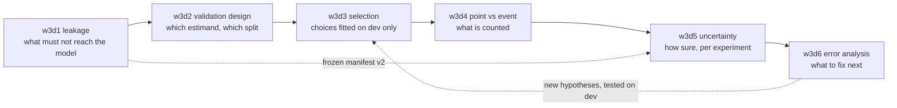

# Week 3 — Evaluation you can defend
{: .no_toc }

**Goal:** by the end of the week you can remove leakage, validate the way the model will be used, and put uncertainty on every number.

1. TOC
{:toc}

---

Six core days of about **2 hours** each (plus an optional hour), and one lighter review day. Every core day is one notebook: read it on this site, run it in Colab, or open it in Jupyter.

## Schedule

| Day | Session | Notebook | Deliverable |
|---|---|---|---|
| 1 | **Leakage: a taxonomy and prevention by construction** | [`13_leakage`](../notebooks/13_leakage.html) · [Colab](https://colab.research.google.com/github/berdakh/mlengineering-/blob/main/notebooks/13_leakage.ipynb) | Leak hunt report on a seeded dataset with corrected estimates and the mechanism of each leak. |
| 2 | **Group-aware and temporal validation** | [`14_group_temporal_validation`](../notebooks/14_group_temporal_validation.html) · [Colab](https://colab.research.google.com/github/berdakh/mlengineering-/blob/main/notebooks/14_group_temporal_validation.ipynb) | Validation design memo + implementation for the project; comparison against a naive random split. |
| 3 | **Hyperparameter and threshold selection without fooling yourself** | [`15_hyperparameter_selection`](../notebooks/15_hyperparameter_selection.html) · [Colab](https://colab.research.google.com/github/berdakh/mlengineering-/blob/main/notebooks/15_hyperparameter_selection.ipynb) | Tuned baseline with a nested estimate and a frozen-threshold test evaluation. |
| 4 | **Point-level versus event-level evaluation for detection** | [`16_point_vs_event_evaluation`](../notebooks/16_point_vs_event_evaluation.html) · [Colab](https://colab.research.google.com/github/berdakh/mlengineering-/blob/main/notebooks/16_point_vs_event_evaluation.ipynb) | Tested `flowguard.evaluation` module; point vs event results table with interpretation. |
| 5 | **Uncertainty: cluster bootstrap, paired comparisons, small-n honesty** | [`17_uncertainty`](../notebooks/17_uncertainty.html) · [Colab](https://colab.research.google.com/github/berdakh/mlengineering-/blob/main/notebooks/17_uncertainty.ipynb) | Confidence intervals and a paired comparison for the baselines, with a stated unit of resampling. |
| 6 | **Error analysis and timed transfer exercise** | [`18_error_analysis_transfer`](../notebooks/18_error_analysis_transfer.html) · [Colab](https://colab.research.google.com/github/berdakh/mlengineering-/blob/main/notebooks/18_error_analysis_transfer.ipynb) | Project error-analysis note; transfer exercise part 2 submission. |
| 7 | **Review and catch-up (light)** | [review below](#day-7--review-and-catch-up) | Week 3 retrieval sheet; interview set 3 (validation, leakage, ML fundamentals, spoken answers). |

## What each day is for

**Day 1 — Leakage: a taxonomy and prevention by construction.** Classify and remove target, preprocessing, temporal, group and selection leakage; use pipelines so the correct thing is the default. *Prerequisites:* w2d6; diagnostic b2 reviewed.

**Day 2 — Group-aware and temporal validation.** Design validation that matches deployment: grouped, temporal, and combined (experiment x time) schemes with purging/embargo where windows overlap. *Prerequisites:* w3d1.

**Day 3 — Hyperparameter and threshold selection without fooling yourself.** Select hyperparameters and decision thresholds using only training/validation data; quantify selection optimism with nested validation. *Prerequisites:* w3d2.

**Day 4 — Point-level versus event-level evaluation for detection.** Implement and interpret point-wise metrics, event matching, detection delay and false alarms per hour; explain when each misleads. *Prerequisites:* w3d2 (your HFO event-evaluation experience transfers directly).

**Day 5 — Uncertainty: cluster bootstrap, paired comparisons, small-n honesty.** Attach defensible intervals to metrics when the independent unit is the experiment, not the sample; compare models with paired resampling. *Prerequisites:* w3d4.

**Day 6 — Error analysis and timed transfer exercise.** Turn errors into a ranked failure taxonomy with slices; then run a complete leak-free evaluation on the unfamiliar business table, unassisted, in 90 minutes. *Prerequisites:* w3d1-w3d5.

## Day 7 — review and catch-up

A lighter day: retrieval practice from memory, one unassisted redo, and a timed interview set. It is also the buffer if a core day ran over.


**Time budget: 60-90 minutes.** No new material.

| Activity | Time |
|---|---|
| 1. Spaced-review items due today (from `w2d7`) | 5-10 min |
| 2. Retrieval sheet, from memory | 25 min |
| 3. Score it; choose what to redo | 10 min |
| 4. Redo one thing, cold and unassisted | 20-30 min |
| 5. Interview set 3 (timed, spoken) | 45 min, or the short form (30 min) |
| 6. Update progress flags and the spaced-review list | 5 min |

On a 60-minute day: activities 1-3, then either 4 or the short form of 5, then 6.

### Purpose

Week 3 was about one question: *how much should anyone believe a reported number?* You classified
the ways information leaks into an evaluation, designed validation that matches how a detector is
deployed, kept selection out of the final estimate, separated point-level from event-level
performance, attached intervals that respect the independent unit, and turned errors into a ranked
list. These are the topics interviewers probe hardest in a candidate from research, because they
are where strong modellers most often fool themselves. Today you find out what you can say about
them without the page open, and for the first time you say it **aloud**.

Units covered: `w3d1` leakage, `w3d2` group and temporal validation, `w3d3` hyperparameter and
threshold selection, `w3d4` point versus event evaluation, `w3d5` uncertainty, `w3d6` error analysis
and the timed transfer exercise; the amendments at the end of
[`docs/maintainers/flowguard-spec.md`](../maintainers/flowguard-spec.html) and the findings in
[`project/README.md`](../guides/project.html).

**Alignment.** The questions and the key were checked against the final Week 3 lessons and handbook
sections H6.1, H6.3-H6.7, H7.2 and H7.3 on 2026-11-22. Every project number quoted comes from those
lessons, which all evaluate on the frozen split manifest `v2` of `w3d1` (7 test, 27 development
experiments).



*How the week fits together: each step protects the number produced by the next one. The dashed
arrows are the two loops that most often go wrong in practice: error analysis feeding back into
selection (allowed only on development data) and the test set fixed once in w3d1.*

### 1. Spaced-review items due today (5-10 minutes)

Open the "Spaced review" list at the top of `progress/notes.md` and answer, closed book, every item
marked due `w3d7`. Check against the `w2d7` (or `w1d7`) answers. Two consecutive *solid* answers
remove an item; otherwise it moves to `w5d7`.

### 2. Retrieval sheet (25 minutes, closed book)

Rules as before: no lessons, handbook, repository or search; two to five sentences each; if you
cannot answer, write what you would check; open the key only when all twelve have an attempt.

**Leakage (w3d1)**

1. The w3d1 taxonomy has eight kinds of leakage. Name at least five, with a one-line example and a
   detection probe for each. Which does an experiment-wise (grouped) split prevent, and which does it
   leave untouched?
2. "Prevention by construction": what does putting preprocessing inside a scikit-learn `Pipeline`
   guarantee, and which steps must be inside it? Name one leak a pipeline cannot prevent.
3. In SKAB, 1,290 rows appear in two files each and 235 of them carry contradictory labels. State
   two separate consequences: one for how splits must be built, one for what any model can achieve.
   Why was the answer a manifest `v2` and not an edit of `v1`, and why did the repair move experiments
   instead of drawing a new test set?

**Validation design (w3d2)**

4. Grouped validation, temporal (forward-chaining) validation, and the combination: say what
   deployment question each one answers. Which matches "a detector trained on past experiments is
   run on a new experiment", and which matches "the same machine next month"?
5. What are *purging* and an *embargo*, when are they needed, and how many rows does each remove for
   a feature window of `w` rows and a label horizon of `h` rows? Why does the experiment-wise protocol
   of this project mostly not need them, and when would it?

**Selection (w3d3)**

6. In nested cross-validation, what does the inner loop do, what does the outer score estimate,
   and which model do you ship? Why is the best inner score not a performance estimate?
7. A decision threshold is described in this course as "a fitted parameter". Explain, and say
   roughly how the optimism from selecting among `K` candidates on the same data grows with `K`.
   On SKAB the best trial scored 0.891 in development cross-validation and the nested estimate was
   0.850: which number goes in the report, and why?

**Point versus event evaluation (w3d4)**

8. Under this course's matching rule, when does an alarm count as a detection, and what happens to an
   alarm that starts before the labelled onset? Define event recall, detection delay and false alarms
   per hour, and say how missed events enter the delay summary. Give one detector that scores well at
   point level and badly at event level. Why must delay and hours be computed from timestamps?

**Uncertainty (w3d5)**

9. Describe a cluster bootstrap for a metric computed on the 7 test experiments of the frozen split:
   what is resampled, what is recomputed, what is reported. Why is resampling rows wrong here, and
   what is still doubtful about an interval built from 7 clusters?
10. Two models are scored on the same test experiments. Why compare them with a *paired* procedure,
    and what exactly is the quantity whose interval you report? When the interval for the
    difference contains zero, what do you write in the report?

**Error analysis (w3d6)**

11. What turns a list of errors into an error *analysis*? Describe the steps from wrong rows to a
    ranked list of failure modes (including the error kinds a detector's runs of wrong rows fall
    into and how modes are ranked), and name two ways error analysis itself misleads.

**Delayed question from Week 2 (w2d1)**

12. On the maintenance database of `w2d1`, `SELECT * FROM sites WHERE site_id NOT IN (SELECT site_id
    FROM technicians)` returns no rows, although you can see sites that have no technician. Give the
    mechanism and two correct rewrites.

### 3. Score and choose (10 minutes)

Open [`solutions/labs/w3d7_review/retrieval_answers.md`](https://github.com/berdakh/mlengineering-/blob/main/solutions/labs/w3d7_review/retrieval_answers.md).
Mark each answer **solid**, **shaky** or **missing** and record the lists:

```bash
python wb.py note w3d7 "solid: ...; shaky: ...; missing: ..."
```

### 4. Redo one thing, unassisted (20-30 minutes)

Choose one, in this priority order:

1. a Week 3 lab or challenge whose checks did not pass, or that you passed only with hint 3 or a solution;
2. the transfer exercise of `w3d6`, if you did not finish it inside its 90 minutes: redo only the
   part you ran out of time for, and record that it is a redo;
3. the task behind your weakest retrieval answer, for example: write `extract_events` and an event
   matcher with tests from a blank file; write a cluster bootstrap for a per-experiment metric;
   write the permutation demonstration that feature selection outside cross-validation invents accuracy.

Protocol (unchanged)

* Fresh directory or branch, blank file. No earlier attempt, hints, solutions or lesson text.
* Timer: 25 minutes. Run the unit's checks at most twice.
  ```bash
  python wb.py check w3d4 --challenge      # example
  ```
* Record the conditions, then set the flag the evidence supports:
  ```bash
  python wb.py note w3d5 "redo cold, 25 min, docs only: cluster bootstrap correct; paired difference resampled rows by mistake"
  python wb.py mark w3d5 independent       # only if completion criteria were met under these conditions
  python wb.py mark w3d5 review            # otherwise
  ```

### 5. Interview set 3 (45 minutes, timed, spoken)

[`interview/set3_validation_fundamentals.md`](https://github.com/berdakh/mlengineering-/blob/main/interview/set3_validation_fundamentals.md): five
"spot the flaw and fix it" scenarios, three fundamentals to explain or derive, and one coding prompt
(grouped K-fold from scratch).

This is the first set under the Weeks 3-5 conditions, and two things change:

* **You speak the answers.** Record them or talk while writing bullet notes. Saying "the mechanism
  is ..." out loud exposes gaps that silent reading of your own notes hides.
* **Rubric first, worked answers later.** After the attempt, open only part A of
  `solutions/interview/set3.md` and score yourself. Make a second attempt at anything below
  "Demonstrated" before reading part B.

```bash
python -m pytest interview/set3_tests -q        # the coding prompt
```

Compare with sets 1 and 2: for the scenarios, was the weak part naming the flaw, explaining the
mechanism, or proposing the fix? Write one sentence about it in your notes.

### 6. Spaced review and progress flags (5 minutes)

**Spaced-review schedule.** Shaky and missing items from today are due on `w4d7` (one week), then
`w6d7`, then `w8d7`. Items carried from `w2d7` that were not solid today move to `w5d7`. An item
leaves the list after two consecutive solid answers.

```
## Spaced review
- w3d7 Q9 (cluster bootstrap, 7 clusters) - due w4d7
- w2d7 Q4 (default window frame, ties)    - due w5d7   (second miss)
```

**Flags.** Set each from evidence:

```bash
python wb.py status
python wb.py mark w3d1 reading
python wb.py mark w3d1 guided            # lab checks passed (hints allowed)
python wb.py mark w3d1 independent       # challenge or cold redo passed without hints or solutions
python wb.py mark w3d5 review            # shaky or missing today
python wb.py mark w3d7 guided            # this session done
```

Checklist

- [ ] Due spaced-review items answered before anything else
- [ ] Twelve retrieval answers attempted before opening the key
- [ ] solid / shaky / missing recorded with `wb.py note`
- [ ] One cold redo done and its conditions recorded
- [ ] Interview set 3 attempted aloud; scored against part A; second attempts made before part B
- [ ] `review` flags and the spaced-review list updated
- [ ] Project check: your split manifest is `v2` (overlap groups kept together), your results table
      contains the elapsed-time baseline, and every reported metric names its unit of resampling

Next: Week 4 starts with `w4d1` (time-series fundamentals and forecast-residual detectors); see
[roadmap/SCHEDULE.md](../guides/schedule.html). Bring the frozen `v2` manifest, the elapsed-time
baseline and the cluster bootstrap: every Week 4 comparison uses all three.

---

*Content status and verification: see `STATUS.md`. Interview set 3's coding reference was executed
against its tests and deliberately wrong answers were rejected; the numbers in its worked answers
were simulated or computed (details in `solutions/interview/set3.md`). The retrieval answers are
prose checked against the final lesson texts; the SQL behaviour in answer 12 was confirmed on the
`w2d1` database and the numerical facts in answers 7 and 9 by execution or from the lessons' recorded
runs.*

**Next session:** [w4d1_timeseries_fundamentals](../notebooks/19_timeseries_fundamentals.html).

