# Week 5 — Inference, artifacts and a prediction API
{: .no_toc }

**Goal:** by the end of the week you can package inference once, version the model, stream it, and serve it through a tested FastAPI service.

1. TOC
{:toc}

---

Six core days of about **2 hours** each (plus an optional hour), and one lighter review day. Every core day is one notebook: read it on this site, run it in Colab, or open it in Jupyter.

## Schedule

| Day | Session | Notebook | Deliverable |
|---|---|---|---|
| 1 | **Research experimentation versus production inference** | [`25_inference_pipeline`](../notebooks/25_inference_pipeline.html) · [Colab](https://colab.research.google.com/github/berdakh/mlengineering-/blob/main/notebooks/25_inference_pipeline.ipynb) | `flowguard predict-batch` with a training/serving parity test. |
| 2 | **Model artifacts, metadata and versioning** | [`26_artifacts_versioning`](../notebooks/26_artifacts_versioning.html) · [Colab](https://colab.research.google.com/github/berdakh/mlengineering-/blob/main/notebooks/26_artifacts_versioning.ipynb) | Versioned artifact bundle + load-time compatibility checks + model card draft. |
| 3 | **Online inference on streams: state, warm-up and parity** | [`27_online_inference`](../notebooks/27_online_inference.html) · [Colab](https://colab.research.google.com/github/berdakh/mlengineering-/blob/main/notebooks/27_online_inference.ipynb) | Streaming scorer with batch/online parity tests and documented warm-up behaviour. |
| 4 | **FastAPI I: endpoints, schemas and input validation** | [`28_fastapi_validation`](../notebooks/28_fastapi_validation.html) · [Colab](https://colab.research.google.com/github/berdakh/mlengineering-/blob/main/notebooks/28_fastapi_validation.ipynb) | `/predict`, `/healthz`, `/readyz` with pydantic schemas and documented error model. |
| 5 | **FastAPI II: API tests, integration tests and model lifecycle** | [`29_api_testing`](../notebooks/29_api_testing.html) · [Colab](https://colab.research.google.com/github/berdakh/mlengineering-/blob/main/notebooks/29_api_testing.ipynb) | API and integration test suite running without a network. |
| 6 | **Project milestone 2: packaged inference + API** | [`30_project_milestone_2`](../notebooks/30_project_milestone_2.html) · [Colab](https://colab.research.google.com/github/berdakh/mlengineering-/blob/main/notebooks/30_project_milestone_2.ipynb) | Tagged project release candidate; submit for review. |
| 7 | **Review and catch-up (light)** | [review below](#day-7--review-and-catch-up) | Week 5 retrieval sheet; ML system design rep 1 (45 min, rubric after). |

## What each day is for

**Day 1 — Research experimentation versus production inference.** Package preprocessing and model as one inference object used identically in training evaluation and serving; build a batch inference command. *Prerequisites:* w4d6.

**Day 2 — Model artifacts, metadata and versioning.** Serialise models with the metadata needed to trust and reload them (schema, feature list, versions, data and code hashes); understand pickle risks and alternatives. *Prerequisites:* w5d1.

**Day 3 — Online inference on streams: state, warm-up and parity.** Implement stateful windowed scoring for one-sample-at-a-time input and prove parity with batch scoring. *Prerequisites:* w5d1, w2d5.

**Day 4 — FastAPI I: endpoints, schemas and input validation.** Expose predictions through a typed HTTP API: request/response models, validation errors versus server errors, health and readiness endpoints. *Prerequisites:* w5d2; diagnostic b3 reviewed.

**Day 5 — FastAPI II: API tests, integration tests and model lifecycle.** Test the service at the HTTP boundary (happy path, invalid input, model missing), manage model loading at startup, reason about concurrency. *Prerequisites:* w5d4, w1d5.

**Day 6 — Project milestone 2: packaged inference + API.** Integrate artifact, inference pipeline and API in the project with tests and usage documentation. *Prerequisites:* w5d1-w5d5.

## Day 7 — review and catch-up

A lighter day: retrieval practice from memory, one unassisted redo, and a timed interview set. It is also the buffer if a core day ran over.


**Time budget: 60-90 minutes.** No new material.

| Activity | Time |
|---|---|
| 1. Spaced-review items due today (from `w4d7`, and second misses from `w3d7`) | 5-10 min |
| 2. Retrieval sheet, from memory | 25 min |
| 3. Score it; choose what to redo | 10 min |
| 4. Redo one thing, cold and unassisted | 20-30 min |
| 5. Interview set 5: first ML system design rep (timed) | 45 min, or the short form (30 min) |
| 6. Update progress flags and the spaced-review list | 5 min |

On a 60-minute day: activities 1-3, then the short form of 5 (the design prompt alone), then 6. The
cold redo moves to `w6d7`.

### Purpose

Week 5 turned an evaluated model into software that serves it: one inference object used by
evaluation and serving, an artifact that refuses what it cannot interpret, a streaming twin with
explicit state, an HTTP contract with documented failure answers, tests at the HTTP boundary, and a
release candidate whose three scoring paths agree. Today checks two things: whether you can
retrieve the week's ideas without the lessons, and whether you can carry them into a **system design
discussion in a domain you have not worked in**. That second skill is what a design round in an
interview for a model-focused role measures.

Units covered: `w5d1` one inference pipeline and batch inference, `w5d2` artifacts and versioning,
`w5d3` online inference on streams, `w5d4` FastAPI endpoints and validation, `w5d5` API, integration
and contract tests, `w5d6` project milestone 2 (release candidate with three-way parity).

The week in one picture. Each arrow is a question the next lesson answers.



All real-data numbers below come from the Week 5 lessons' authoring runs on the frozen manifest v2
(`w3d1`): 7 test and 27 development experiments. The shipped detector is the one chosen in `w4d5`:
burn-in flow-rate |z| (`n_burn` = 100, population standard deviation), threshold 7.2441,
`min_duration` 30, `merge_gap` 10.

### 1. Spaced-review items due today (5-10 minutes)

Open the "Spaced review" list at the top of `progress/notes.md` and answer, closed book, every item
marked due `w5d7` (from `w4d7`: typically T² versus Q, CUSUM, the MPID readings). Two consecutive
*solid* answers remove an item; otherwise it moves to `w7d7`.

If `w4d7` asked you for a second take of the five-minute evaluation walkthrough (interview set 4, E1),
record it today before anything else, and compare the two recordings against the same rubric.

### 2. Retrieval sheet (25 minutes, closed book)

Rules as before: no lessons, handbook, repository or search; two to five sentences each; if you
cannot answer, write what you would check; open the key only when all twelve have an attempt.

**One inference pipeline (w5d1)**

1. Define training/serving skew precisely and say how it differs from numerical noise. Name five
   sources. The `w5d1` parity test compares the evaluated and served paths with a relative tolerance
   of 1e-12 *and* one more requirement: which, and why is the tolerance alone not enough?
2. For the shipped detector, which values are frozen at fit time, and which state is computed per run
   at serving time, from which rows? A colleague "simplifies" serving by calibrating each run on all
   its rows. In the lesson's synthetic demonstration the median score after a 6-SD fault was 5.67 with
   burn-in calibration; what did it become, and why is this not a harmless change?
3. `predict-batch` is "a small data pipeline with an owner it never meets". Give four design choices
   and the property each buys. Then: the served model agrees with its evaluation code to 1e-15 on every
   score, yet production raises twice as many alarms per hour as the offline estimate at the same
   threshold. Give two explanations that are not skew, and the check that tells them apart.

**Artifacts and versioning (w5d2)**

4. List the four files of a `flowguard` bundle and what each answers. A bundle's checksums all match,
   but `load_bundle` refuses it. Give two different reasons the contract allows and name the error
   each raises. What do checksums protect against, and what do they not?
5. Why does loading a pickle run code? Name a safe storage choice for (a) a linear model or a threshold
   detector, (b) a large scikit-learn ensemble, (c) a PyTorch network, (d) serving from another
   language. What did the safe bundle cost compared with pickle in the lesson's measurement, and when
   is pickle acceptable?
6. Four versions are recorded in a bundle. Name them and give an example change that bumps each. For
   the model version: what is a PATCH, a MINOR and a MAJOR change? How does the registry make "1.0.0"
   mean one function forever, how does it avoid a half-written pointer, and how is rollback done?

**Online inference (w5d3)**

7. Write Welford's update for the running mean and `M2`. Why is `E[x²] − E[x]²` dangerous, and roughly
   how wrong was it in the worked example at an offset of 1e6 and of 1e9? Why must the state of a
   streaming scorer be O(1) in the stream length, and what does it consist of for this detector?
8. State the five decisions a streaming scorer must make explicitly (warm-up, late samples, repeated
   samples, gaps, restarts) and what the lab decided for each. Then: a colleague's streaming scores are
   consistently 0.5 % lower than batch on every machine. Most likely cause, and the one-line fix?

**FastAPI and validation (w5d4)**

9. A request can fail at three gates before the model runs. Name them and the status code(s) of each.
   Give the full decision order the lab implements, including 503 and 500. Why does an invalid request
   to a service whose model failed to load get 422 and not 503? A load balancer keeps sending traffic to
   an instance whose model failed to load: which endpoint is wrong, what should it return, and what does
   the other health endpoint return?
10. `flow_rate` is constrained to `ge=0, le=500`. A client sends `NaN`. What does pydantic report with
    and without `allow_inf_nan=False`, and why does it matter? Why is the prediction handler a plain
    `def` and not `async def`? Where is the model loaded, and what goes wrong if it is loaded inside
    the handler?

**Testing the service and the release candidate (w5d5, w5d6)**

11. Name the five layers of tests for a service and what each one can see that the previous cannot.
    In the `w5d5` kill matrix, how many of the 12 injected defects did a status-code-only suite catch,
    and the reference suite without its concurrency test? What makes a concurrency test able to see a
    race that a sequential test cannot? Which FastAPI default turned a 422 into a 500, and how? Is
    adding a required request field a breaking change? Widening a response field to allow `null`?
12. Why must parity cover three paths (evaluation, batch, API) and not two? Give the defect from the
    lab that only a three-way comparison catches. Your API and your batch job disagree by a constant
    factor of 1.0541 on every row: what is the burn-in size, the likely cause, and which side is
    consistent with the evaluation report? Why does the `w5d6` parity code read CSVs with
    `float_precision="round_trip"`?

### 3. Score and choose (10 minutes)

Open [`solutions/labs/w5d7_review/retrieval_answers.md`](https://github.com/berdakh/mlengineering-/blob/main/solutions/labs/w5d7_review/retrieval_answers.md).
Mark each answer **solid**, **shaky** or **missing** and record the lists:

```bash
python wb.py note w5d7 "solid: ...; shaky: ...; missing: ..."
```

### 4. Redo one thing, unassisted (20-30 minutes)

Choose one, in this priority order:

1. a Week 5 lab or challenge whose checks did not pass, or that you passed only with hint 3 or a solution;
2. a **parity test from a blank file** for your own project: evaluation path versus `predict-batch`
   versus the API through `TestClient`, on one real experiment, with a stated tolerance and identical
   decisions. If it fails, finding out why is today's redo;
3. the task behind your weakest retrieval answer, for example: a streaming z-scorer with warm-up,
   duplicate and out-of-order handling and a batch-parity test; or `load_bundle` with integrity and
   format checks and a test for each refusal.

Protocol (unchanged)

* Fresh directory or branch, blank file. No earlier attempt, hints, solutions or lesson text.
* Timer: 25 minutes. Run the unit's checks at most twice.
  ```bash
  python wb.py check w5d3 --challenge      # example
  ```
* Record the conditions, then set the flag the evidence supports:
  ```bash
  python wb.py note w5d6 "cold parity test, 25 min, no notes: eval = batch = API on valve1/5, max diff 0"
  python wb.py mark w5d6 independent       # only if completion criteria were met under these conditions
  python wb.py mark w5d6 review            # otherwise
  ```

### 5. Interview set 5: first ML system design rep (45 minutes, timed)

[`interview/set5_system_design.md`](https://github.com/berdakh/mlengineering-/blob/main/interview/set5_system_design.md):

* **D1 (30 minutes):** design a real-time credit-risk decision for a buy-now-pay-later checkout. The
  domain is new on purpose: delayed labels, outcomes observed only for approved applications, a
  latency budget inside someone else's checkout, and decisions that must be explainable. Speak or
  write it as you would at a whiteboard, with the timer running.
* **C2 (15 minutes):** the scoring endpoint's request contract in FastAPI and pydantic, graded by tests.

```bash
python -m pytest interview/set5_tests -q        # the coding prompt
```

Rubric first (part A of `solutions/interview/set5.md`), worked answers (part B) only after a second
attempt. Score the design against the rubric's eight areas and write down the two areas you did not
reach in time. For most people with a research background they are the serving failure modes and
the plan for what happens after launch. The second design rep, in Week 7, starts from those two.

### 6. Spaced review and progress flags (5 minutes)

**Spaced-review schedule.** Shaky and missing items from today are due on `w6d7` (one week), then
`w8d7`. Items carried from `w4d7` that were not solid today move to `w7d7`. An item leaves the list
after two consecutive solid answers.

```
## Spaced review
- w5d7 Q9 (decision order, 422 before 503)      - due w6d7
- w4d7 Q3 (CUSUM k and h)                       - due w7d7   (second miss)
```

**Flags.** Set each from evidence:

```bash
python wb.py status
python wb.py mark w5d1 reading
python wb.py mark w5d1 guided            # lab checks passed (hints allowed)
python wb.py mark w5d1 independent       # challenge or cold redo passed without hints or solutions
python wb.py mark w5d4 review            # shaky or missing today
python wb.py mark w5d7 guided            # this session done
```

Checklist

- [ ] Due spaced-review items answered before anything else
- [ ] Twelve retrieval answers attempted before opening the key
- [ ] solid / shaky / missing recorded with `wb.py note`
- [ ] One cold redo done and its conditions recorded
- [ ] Design rep done under the timer and scored against the rubric before reading part B
- [ ] `review` flags and the spaced-review list updated
- [ ] Project check: release candidate builds its bundle with one command, and evaluation, batch and
      API scores agree on real data within a stated tolerance

**Next:** Week 6 starts with `w6d1` (Docker I: images, layers and a correct Dockerfile for the API).
Its objective, deliverable and prerequisites are in [roadmap/SCHEDULE.md](../guides/schedule.html).

---

*Content status and verification: see `STATUS.md`. Questions and answers were written against the final
Week 5 lessons on 2026-11-22; every number quoted is copied from those lessons' authoring runs.
Interview set 5's coding reference was executed against its tests and deliberately wrong answers were
rejected (details in `solutions/interview/set5.md`).*

**Next session:** [w6d1_docker_basics](../notebooks/31_docker_basics.html).

