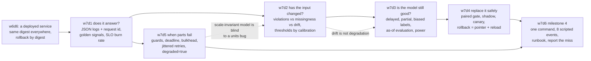

# Week 7 — Operating a model
{: .no_toc }

**Goal:** by the end of the week you can log, monitor inputs and performance, update and roll back safely, and handle failure deliberately.

1. TOC
{:toc}

---

Six core days of about **2 hours** each (plus an optional hour), and one lighter review day. Every core day is one notebook: read it on this site, run it in Colab, or open it in Jupyter.

## Schedule

| Day | Session | Notebook | Deliverable |
|---|---|---|---|
| 1 | **Structured logging and service metrics** | [`37_service_logging_metrics`](../notebooks/37_service_logging_metrics.html) · [Colab](https://colab.research.google.com/github/berdakh/mlengineering-/blob/main/notebooks/37_service_logging_metrics.ipynb) | Structured logs + metrics endpoint; a query that answers 'what happened to request X'. |
| 2 | **Input monitoring and drift statistics** | [`38_input_monitoring_drift`](../notebooks/38_input_monitoring_drift.html) · [Colab](https://colab.research.google.com/github/berdakh/mlengineering-/blob/main/notebooks/38_input_monitoring_drift.ipynb) | Drift monitor with a measured false-alarm rate on stable data. |
| 3 | **Drift is not degradation: delayed labels and measured performance** | [`39_drift_vs_degradation`](../notebooks/39_drift_vs_degradation.html) · [Colab](https://colab.research.google.com/github/berdakh/mlengineering-/blob/main/notebooks/39_drift_vs_degradation.ipynb) | Replay experiment showing drift without degradation and degradation without flagged drift. |
| 4 | **Model updates: retraining triggers, shadow and canary, rollback** | [`40_model_updates_rollback`](../notebooks/40_model_updates_rollback.html) · [Colab](https://colab.research.google.com/github/berdakh/mlengineering-/blob/main/notebooks/40_model_updates_rollback.ipynb) | Update and rollback procedure exercised locally with two model versions. |
| 5 | **Reliability and failure handling** | [`41_reliability`](../notebooks/41_reliability.html) · [Colab](https://colab.research.google.com/github/berdakh/mlengineering-/blob/main/notebooks/41_reliability.ipynb) | Failure-injection test suite and a short incident note. |
| 6 | **Project milestone 4: monitoring demonstration and runbook** | [`42_project_milestone_4`](../notebooks/42_project_milestone_4.html) · [Colab](https://colab.research.google.com/github/berdakh/mlengineering-/blob/main/notebooks/42_project_milestone_4.ipynb) | Monitoring demo + runbook; submit for review. |
| 7 | **Review and catch-up (light)** | [review below](#day-7--review-and-catch-up) | Week 7 retrieval sheet; ML system design rep 2 (45 min, spoken). |

## What each day is for

**Day 1 — Structured logging and service metrics.** Emit structured request and prediction logs with correlation ids; define the service's golden signals (traffic, errors, latency, saturation). *Prerequisites:* w5d6, w1d4.

**Day 2 — Input monitoring and drift statistics.** Detect schema violations, range and missingness changes and distribution shift (PSI, KS, Wasserstein) with windows and thresholds chosen for an acceptable false-alarm rate. *Prerequisites:* w7d1, w3d5.

**Day 3 — Drift is not degradation: delayed labels and measured performance.** Separate input change from measured performance loss; design label backfill, proxy metrics and delayed evaluation. *Prerequisites:* w7d2.

**Day 4 — Model updates: retraining triggers, shadow and canary, rollback.** Define when and how a model is replaced: triggers, offline gate, shadow/canary comparison, versioned rollback. *Prerequisites:* w5d2, w7d3.

**Day 5 — Reliability and failure handling.** Handle bad input, timeouts, missing models and dependency failures deliberately: guards, fallbacks, degradation, failure-injection drills. *Prerequisites:* w5d5, w7d1.

**Day 6 — Project milestone 4: monitoring demonstration and runbook.** Demonstrate monitoring on a replay of held-out experiments and document operating procedures. *Prerequisites:* w7d1-w7d5.

## Day 7 — review and catch-up

A lighter day: retrieval practice from memory, one unassisted redo, and a timed interview set. It is also the buffer if a core day ran over.


**Time budget: 60-90 minutes.** No new material.

| Activity | Time |
|---|---|
| 1. Spaced-review items due today (from `w6d7`, plus the cold redo carried over from a short `w6d7`) | 5-10 min |
| 2. Retrieval sheet, from memory | 25 min |
| 3. Score it; choose what to redo | 10 min |
| 4. Redo one thing, cold and unassisted | 20-30 min |
| 5. Interview set 7: ML system design rep 2 (operating a model) and a retry wrapper in code (timed, recorded) | 45 min, or the short form (30 min) |
| 6. Update progress flags and the spaced-review list | 5 min |

On a 60-minute day: activities 1-3, then the short form of 5 (D1 alone), then 6. The cold redo moves
to `w8d7`.

### Purpose

Week 7 asked what happens after the service is deployed and nobody is watching it: how you would know it
is failing. It built the answer in layers. Structured logs and golden-signal metrics say whether the
service answers. Input monitoring says whether the data still resemble what the model was built for, with
alarm rates you chose. Delayed and biased labels are the only measure of whether the model is still good.
A gate, shadow mode and rollback make replacing the model reversible. Guards, deadlines, retries and
declared fallbacks keep a failing dependency from becoming a silent wrong answer. The milestone wired all
of it into one reproducible demonstration that reports its own miss. Today checks whether you can
retrieve those distinctions without the lessons, and whether you can **design the operation of a model in
a domain you have not seen**, which is what a system-design round for an applied ML role usually asks.

Units covered: `w7d1` structured logging and service metrics, `w7d2` input monitoring and drift
statistics, `w7d3` drift versus degradation and delayed labels, `w7d4` model updates, shadow, canary and
rollback, `w7d5` reliability and failure handling, `w7d6` the monitoring demonstration and runbook
(project milestone 4).

The week in one picture. Each box is a question; the dotted arrows are the traps the week measured.



All numbers below come from the Week 7 lessons' authoring runs (2026-11-22): real SKAB recordings on the
frozen v2 manifest (7 test, 27 development experiments) unless a lesson marked them SYNTHETIC. They
describe those runs; the mechanisms are what you should retrieve.

### 1. Spaced-review items due today (5-10 minutes)

Open the "Spaced review" list at the top of `progress/notes.md` and answer, closed book, every item marked
due `w7d7` (from `w6d7`: typically Little's law sizing and the utilisation target, exec versus shell form
and signal handling, tag versus digest and when rollback is the wrong fix). Two consecutive *solid*
answers remove an item; otherwise it moves to `w8d7`.

If a short `w6d7` postponed its cold redo, do it now, before the retrieval sheet: a Dockerfile for your
project's API from a blank file, or an open-loop load generator with a test against a stalling fake
server.

### 2. Retrieval sheet (25 minutes, closed book)

Rules as before: no lessons, handbook, repository or search; two to five sentences each; if you cannot
answer, write what you would check; open the key only when all twelve have an attempt.

**Structured logging and service metrics (w7d1)**

1. Metrics, logs and traces: which question does each answer, and how does each one's cost grow? Why must
   an error rate never be computed by counting log lines, and why must a request id never be a metric
   label (what does `flowguard` label an unknown path as, and why)? In Starlette, what happens to your
   middleware's bookkeeping when the handler raises, which three symptoms appear if you only write it
   after `call_next`, and what is the fix?
2. Write what the bucket line `x_bucket{le="0.05"} 38` means, and how the `le="+Inf"` bucket relates to
   `_count`. In the worked example, compare the mean of two instances' p99s, the true p99 and the estimate
   from summed buckets (all three numbers), and say why the share of requests slower than 250 ms was
   exact. Then: the error budget for 1,728,000 requests per 30 days at 99.5 %; the definition of a burn
   rate; why a multi-window rule pages on neither a 4-minute blip nor long after a fix. In the real replay,
   why was `in_flight` 1 and why are 2,624 "exceeding" samples not 2,624 anomalous seconds?

**Input monitoring and drift (w7d2)**

3. Name the three questions the input monitor keeps apart, who owns each, and why a schema violation
   must be kept out of the distribution statistics. Define KS, Wasserstein-1 and PSI; which is in the
   sensor's units, and what is W1 for a pure shift by δ? Why does PSI need a floor ε, and what does the
   `nansum` shortcut silently throw away?
4. With no drift at all, what share of KS windows had p < 0.05 at lag-1 autocorrelation 0, 0.5, 0.9 and
   0.98, and why? What did a KS test say about a 0.01 °C difference between two 200,000-sample sets? Why
   does "PSI > 0.1" mean something different at 30 and at 1,440 samples? How does the lab set thresholds
   instead, and what did the correction across 4 sensors change (2.75 % against 13 %)? On real SKAB, how
   often did reference A (pooled) and reference B (each run's burn-in) alert on normal and on fully
   anomalous one-minute windows, and what do these rates say about a drift monitor as a fault detector?

**Drift versus degradation, delayed labels (w7d3)**

5. Define covariate, prior and concept shift with P(x), P(y) and P(y | x). In the replay, period B
   recalibrated the flow sensor (1.08x + 2.5): what did PSI do against its threshold of 0.660, how many of
   the 20 faults were caught, and why? Period C doubled the threshold: what happened to recall and to the
   drift monitor? What did the 198 samples scoring exactly at the threshold teach about choosing
   thresholds?
6. Why is precision measured on investigated alarms biased upward, and why is recall computed from
   reported missed faults an upper bound? State the as-of rule. How many faults does a 95 % Wilson
   interval of half-width 0.10 need at recall 0.6, and how wide is it at 20? Give period C's recall
   estimates on days 65, 90 and 150 against the truth of 4/20, and the verdict the rule gave. In the
   fraud worked example, which signal moved within a week of the concept shift, and why would it not have
   moved with a fixed threshold instead of a fixed alert budget?

**Model updates and rollback (w7d4)**

7. With interval [L, U] for Δ = candidate − current, state the superiority and non-inferiority rules.
   Why does pairing shrink the interval (the variance identity), and what were the paired and unpaired
   intervals in the worked example? On the real gate, what did 1.1.0 get under each rule and why is the
   lower end exactly 0.000? Name the two separate reasons 2.0.0 never reached production. Which four
   things must be versioned together?
8. What can shadow mode measure that the offline gate cannot, and what can it not measure? Describe the
   two coverage problems the real shadow run had. Why can a canary for a fault detector rarely measure its
   primary metric (the f λ T argument), and what was the Poisson upper bound on 1.1.0's false-alarm rate
   from 0 alarms in 1.22 test hours, against a budget of 1 per hour? How is the reload endpoint protected,
   and what did rollback restore?

**Reliability (w7d5)**

9. The three ways an ML service fails, with the `flowguard` example of each and what the caller should
   see. Why did sending flow in L/h (×60) produce exactly the same 313 alarms, and which signal caught
   it? With a corrupt bundle, what should `/healthz` and `/readyz` answer, and why must liveness not check
   the model? How many of the 7 test faults did the model and the fallback envelope rule detect, and why
   must every fallback answer carry `degraded: true`?
10. Which responses should a client retry and which never? Write the full-jitter delay and say when
    `Retry-After` overrides it. In the retry-storm example (200 clients, capacity 20 per 100 ms), what did
    immediate retries, exponential backoff without jitter and full jitter do (requests, clients served,
    peak per bucket)? Why does a deadline not free resources, and when does the lab release the bulkhead
    slot? Size the concurrent work with Little's law at 20 requests/s when the model slows from 50 ms
    to 1 s.

**Monitoring demonstration and runbook (w7d6)**

11. List the eight scripted events of the demo and the signal each is expected to raise. Why is the units
    bug caught by `out_of_support` and not by the detector, and the 80 % flow replay by drift and not by
    alarms? What happened to E5, how did the report present it, and why is that better than leaving it
    out? What does "event recall 0.5 from 2 labelled faults" tell you?
12. How was the drift threshold set (value, data), what false-alarm probability does that choice imply
    for a new healthy window, and how close did a healthy test experiment come to it? Name the three
    planted problems of the starter and the question a reviewer asks to find each. Why is a registry
    pointer change not a rollback until `/version` says so?

### 3. Score and choose (10 minutes)

Open [`solutions/labs/w7d7_review/retrieval_answers.md`](https://github.com/berdakh/mlengineering-/blob/main/solutions/labs/w7d7_review/retrieval_answers.md).
Mark each answer **solid**, **shaky** or **missing** and record the lists:

```bash
python wb.py note w7d7 "solid: ...; shaky: ...; missing: ..."
```

### 4. Redo one thing, unassisted (20-30 minutes)

Choose one, in this priority order:

1. a Week 7 lab or challenge whose checks did not pass, or that you passed only with hint 3 or a solution;
2. a **drift monitor from a blank file** for one sensor: Wasserstein-1 and PSI with a documented floor,
   thresholds set from stable windows for a target false-alarm rate, and a test that measures that rate
   on held-out stable windows (`python wb.py check w7d2` grades the lab version);
3. the task behind your weakest retrieval answer, for example: a paired cluster-bootstrap gate with a
   non-inferiority margin and a test where the candidate is equal to the current model; or an as-of
   delayed-label join with a test where labels arrive out of order and a corrected verdict replaces the
   first one.

Protocol (unchanged)

* Fresh directory or branch, blank file. No earlier attempt, hints, solutions or lesson text.
* Timer: 25 minutes. Run the unit's checks at most twice.
  ```bash
  python wb.py check w7d2                  # example
  ```
* Record the conditions, then set the flag the evidence supports:
  ```bash
  python wb.py note w7d2 "cold drift monitor, 25 min, no notes: 17 checks pass, held-out FA rate 4 % for target 5 %"
  python wb.py mark w7d2 independent       # only if completion criteria were met under these conditions
  python wb.py mark w7d2 review            # otherwise
  ```

### 5. Interview set 7: system design rep 2 and a retry wrapper (45 minutes, timed and recorded)

[`interview/set7_system_design.md`](https://github.com/berdakh/mlengineering-/blob/main/interview/set7_system_design.md):

* **D1 (30 minutes):** operating a prohibited-listing classifier on a second-hand marketplace, with
  delayed human labels that exist only for the listings the model chose to hold. The model already
  exists; the design is everything around it. Three follow-ups at the end.
* **C2 (15 minutes):** `retry_call` with capped exponential backoff, full jitter, `Retry-After` and a
  deadline, graded by tests with a fake clock.

```bash
python -m pytest interview/set7_tests -q        # the coding prompt
```

Fading rule for Weeks 6-8: timed, **spoken aloud and recorded**, and you score the recording against
part A of `solutions/interview/set7.md` **before** reading anything else there. Compare with your set 5
recording: the areas researchers most often miss in a second design rep are where unbiased labels come
from (area 2) and what each monitoring layer cannot see (area 3). Week 8's design session (`w8d3`) starts
from the areas you missed today.

### 6. Spaced review and progress flags (5 minutes)

**Spaced-review schedule.** Shaky and missing items from today are due on `w8d7`. Items carried from
`w6d7` that were not solid today also move to `w8d7`, the last review day; anything still not solid there
goes into the "next eight weeks" plan of `w8d7`. An item leaves the list after two consecutive solid
answers.

```
## Spaced review
- w7d7 Q6 (verification bias, recall as an upper bound)   - due w8d7
- w6d7 Q8 (Little's law sizing, utilisation target)       - due w8d7   (second miss)
```

**Flags.** Set each from evidence:

```bash
python wb.py status
python wb.py mark w7d1 reading
python wb.py mark w7d1 guided            # lab checks passed (hints allowed)
python wb.py mark w7d1 independent       # challenge or cold redo passed without hints or solutions
python wb.py mark w7d3 review            # shaky or missing today
python wb.py mark w7d7 guided            # this session done
```

Checklist

- [ ] Due spaced-review items answered before anything else
- [ ] Twelve retrieval answers attempted before opening the key
- [ ] solid / shaky / missing recorded with `wb.py note`
- [ ] One cold redo done and its conditions recorded
- [ ] D1 recorded under the timer and scored against the rubric before reading part B
- [ ] `review` flags and the spaced-review list updated
- [ ] Project check (milestone 4): `make monitor-demo` runs twice with identical `summary` numbers, the
      report states every miss, every alert has a runbook entry, and no service process is left running

**Next:** Week 8 starts with `w8d1` (project completion audit: reproduce every headline number from a
clean clone). Its objective, deliverable and prerequisites are in
[roadmap/SCHEDULE.md](../guides/schedule.html).

---

*Content status and verification: see `STATUS.md`. Questions and answers were written against the final
Week 7 lessons on 2026-11-22; every number quoted is copied from those lessons' authoring runs. Interview
set 7's coding reference was executed against its tests, and ten deliberately wrong answers were rejected
(details in `solutions/interview/set7.md`).*

**Next session:** [w8d1_project_completion](../notebooks/43_project_completion.html).

