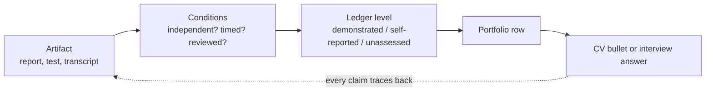
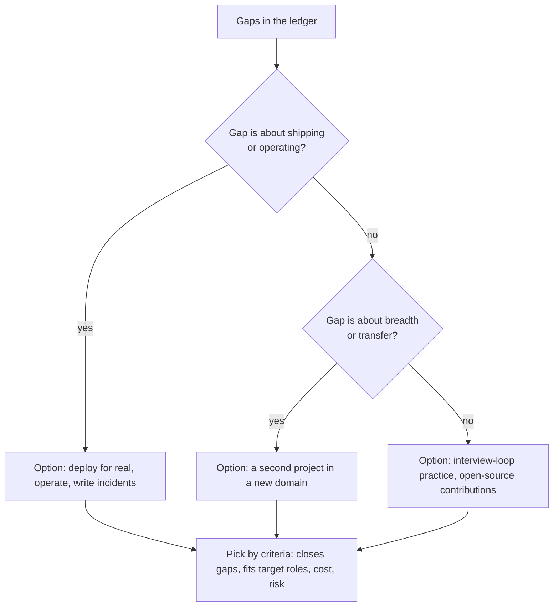

# Week 8 — Finish, document, explain
{: .no_toc }

**Goal:** by the end of the week you can reproduce everything from a clean clone, write the report, practise interviews, and take the final assessment.

1. TOC
{:toc}

---

Six core days of about **2 hours** each (plus an optional hour), and one lighter review day. Every core day is one notebook: read it on this site, run it in Colab, or open it in Jupyter.

## Schedule

| Day | Session | Notebook | Deliverable |
|---|---|---|---|
| 1 | **Project completion audit: reproduce from a clean clone** | [`43_project_completion`](../notebooks/43_project_completion.html) · [Colab](https://colab.research.google.com/github/berdakh/mlengineering-/blob/main/notebooks/43_project_completion.ipynb) | Clean-clone reproduction log; gap list closed or explicitly scoped out. |
| 2 | **Technical report and model limitations** | [`44_report_limitations`](../notebooks/44_report_limitations.html) · [Colab](https://colab.research.google.com/github/berdakh/mlengineering-/blob/main/notebooks/44_report_limitations.ipynb) | 4-page report, model card, limitations. |
| 3 | **ML system design** | [`45_system_design`](../notebooks/45_system_design.html) · [Colab](https://colab.research.google.com/github/berdakh/mlengineering-/blob/main/notebooks/45_system_design.ipynb) | Two written designs scored against the rubric. |
| 4 | **Coding and SQL interviews, timed** | [`46_coding_interviews`](../notebooks/46_coding_interviews.html) · [Colab](https://colab.research.google.com/github/berdakh/mlengineering-/blob/main/notebooks/46_coding_interviews.ipynb) | Timed set results and an error log by pattern. |
| 5 | **Explaining the project and defending tradeoffs** | [`47_project_explanation`](../notebooks/47_project_explanation.html) · [Colab](https://colab.research.google.com/github/berdakh/mlengineering-/blob/main/notebooks/47_project_explanation.ipynb) | Recorded walkthrough + written answers to ten hard questions. |
| 6 | **Final independent assessment** | [`48_final_assessment`](../notebooks/48_final_assessment.html) · [Colab](https://colab.research.google.com/github/berdakh/mlengineering-/blob/main/notebooks/48_final_assessment.ipynb) | Final assessment submission. |
| 7 | **Retrospective and evidence portfolio (light)** | [review below](#day-7--review-and-catch-up) | Evidence portfolio index and personal next-steps plan. |

## What each day is for

**Day 1 — Project completion audit: reproduce from a clean clone.** Audit the project against the deliverables checklist and reproduce every headline number from a fresh clone. *Prerequisites:* Milestones 1-4.

**Day 2 — Technical report and model limitations.** Write a short technical report and a limitations section that a sceptical reviewer would accept. *Prerequisites:* w8d1.

**Day 3 — ML system design.** Apply a repeatable structure (requirements, data, labels, evaluation, serving, monitoring, iteration) to two timed designs, one in an unfamiliar domain. *Prerequisites:* Weeks 5-7.

**Day 4 — Coding and SQL interviews, timed.** Solve Python data-structure and SQL problems under time pressure while explaining aloud. *Prerequisites:* Recurring interview reps.

**Day 5 — Explaining the project and defending tradeoffs.** Deliver 5-minute and 20-minute walkthroughs and answer adversarial questions on evaluation, limitations and alternatives. *Prerequisites:* w8d2.

**Day 6 — Final independent assessment.** Complete a parallel form of the diagnostic and the final transfer task unassisted, for comparison with Week 1 evidence. *Prerequisites:* All previous weeks.

## Day 7 — review and catch-up

A lighter day: retrieval practice from memory, one unassisted redo, and a timed interview set. It is also the buffer if a core day ran over.


Unit id `w8d7_retrospective` · Week 8, day 7 · Content status: see [STATUS.md](../guides/status.html)

### 1. Purpose

**Objective.** Compare the Week 1 and Week 8 evidence, record honestly what is demonstrated,
self-reported and still unassessed, and plan the next eight weeks.

**Why it matters.** Eight weeks of work is only useful to you, a reviewer or an employer if someone
can tell in five minutes what you can do and how they know. A portfolio that links every claim to an
artifact - and says which capabilities are *not* yet shown - is more persuasive than one that claims
everything.

**Deliverable.** In `lab/`: `PORTFOLIO.md` (evidence index), `NEXT_PLAN.md`, `PROJECT_SUMMARY.md`
(one page) and `CV_BULLETS.md`; an updated `progress/SKILLS_LEDGER.md`.

**Completion criteria.** `python wb.py check w8d7` passes; `progress/SKILLS_LEDGER.md` has an
evidence-log line for every aspect you move to "Demonstrated"; `labs/w8d6_final_assessment/COMPARISON.md`
is filled in (after review of the final assessment).

**Prerequisites.** [w8d6](../notebooks/48_final_assessment.html) taken and, ideally, reviewed.

**Time budget (60-90 min, light day).**

| Activity | Minutes |
|---|---|
| Read sections 2-3 | 15 |
| Portfolio index and ledger update | 30 |
| Next-plan draft | 15 |
| One-page summary and CV bullets | 20 |
| Reflection | 5 |

### 2. Concepts

#### 2.1 The evidence chain



*A claim in a CV bullet is only as strong as the artifact and the conditions behind it. The checks
enforce the left end of the chain (the artifact exists); you enforce the rest.*

Three rules keep the chain honest:

1. **Conditions are part of the evidence.** "Passed the w3d1 checks after reading hint 3" and "wrote
   the w3d1 challenge unaided in 60 minutes" are different evidence for the same artifact.
2. **Reference solutions are never your evidence.** The course's reference artifacts show what good
   looks like; your portfolio links only to what you produced.
3. **Gaps are listed, not hidden.** A capability with no evidence gets a row with `none` and
   `not demonstrated`. Reviewers trust a portfolio that shows its gaps.

#### 2.2 Where evidence could have come from


*Parsed from the "What the course is for" table in [ROADMAP.md](../guides/program-design.html). A filled cell is
an opportunity for evidence, not evidence: your portfolio decides which cells became real.*

#### 2.3 What an eight-week course can and cannot show

It **can** show: that you have built one ML system end to end with honest evaluation; that you
can explain and defend its tradeoffs; that you produced specific artifacts under stated conditions;
and how your independent performance on the parallel diagnostic changed.

It **cannot** show: experience operating a service under real traffic over months; working in a
team codebase with review, ownership and on-call; depth in a cloud platform beyond one route;
performance across many domains. Say so before an interviewer does, and say what you are doing about it.

#### 2.4 Choosing the next eight weeks



*Let the ledger, not enthusiasm, choose. Most plans combine one artifact-producing option with
recurring practice.*

Options and when they fit:

| Option | Fits when | Produces |
|---|---|---|
| Deeper MLOps on a real cloud | capability 8/9 not demonstrated live | live deployment, cost report, incident note |
| A second project in a new domain | transfer is the open question (e.g. t1 thin) | a second end-to-end artifact without scaffolding |
| Open-source contributions | team-codebase experience is the gap | reviewed pull requests in a maintained project |
| Interview-loop practice | artifacts are strong, timed performance is not | timed logs, recorded mock interviews |

#### 2.5 Job-search materials, grounded

* **One-page project summary:** what it is, the problem, what made it hard, what was done, results
  with uncertainty, limitations. Plain language; numbers you can source.
* **CV bullets:** action + concrete outcome + artifact. "Cut API median latency from 52 ms to 9.5 ms
  by diagnosing a TCP Nagle interaction" beats "optimised performance". No adjective the artifact
  cannot back. Academic achievements stay; they are translated, not hidden.
* **Seniority:** target roles by what your evidence shows, not by your academic title. Strong research
  judgement plus one shipped system is a credible applied-scientist or mid-level MLE profile; senior
  engineering roles usually expect evidence of operating systems with a team over time.

### 3. Worked example

`solutions/labs/w8d7_retrospective/lab/` holds a reference *example* of the four files. It links to
the course's reference artifacts so the checks can run on it - which is exactly what your own
portfolio must not do. Read it after drafting yours: note that capability 8 has two rows, one of them
`none / not demonstrated` for the live deployment, and that every CV bullet carries a number and an artifact.

### 4. Lab

1. Fill in `labs/w8d6_final_assessment/COMPARISON.md` if the final assessment has been reviewed.
2. `lab/PORTFOLIO.md`: one row per piece of evidence; every capability 1-10 appears; artifacts are
   paths to *your* work (set `WB_PROJECT_DIR` to your project for paths there); conditions honest.
3. Update `progress/SKILLS_LEDGER.md`: move an aspect to "Demonstrated" only with an evidence-log line.
4. `lab/NEXT_PLAN.md`: at least two options, criteria, eight weekly lines `- Week N: objective -> deliverable`.
5. `lab/PROJECT_SUMMARY.md` (150-400 words) and `lab/CV_BULLETS.md` (3-6 bullets).

```bash
export WB_PROJECT_DIR=~/projects/flowguard     # if you cite files in your project repository
python wb.py check w8d7
```

### 5. Independent challenge

None separately: the portfolio *is* the independent work. Ask one person outside the course to read
`PROJECT_SUMMARY.md` and tell you, in their words, what you built and what you did not show. If their
answer differs from yours, revise the summary.

### 6. Hints

If a capability has no artifact, write the row with `none` and `not demonstrated` - the check accepts
it, and the next plan should target it.

### 7. Assessment

Reflection questions (written, no rubric):

1. Which aspect moved most between Week 1 and Week 8, and which artifact proves it?
2. Which capability would an interviewer probe first, and is it in your portfolio as demonstrated?
3. What did the course not give you that your target roles require?

### 8. Reflection and review

* **You should now be able to:** state, with evidence, what you can do independently, what you did
  with guidance, and what is unassessed; and defend a plan for the next eight weeks.
* **Retrieval question for later:** name the three rules of an honest evidence chain.
* **Next:** the plan you just wrote. The course material ends here; `STATUS.md` describes what is
  verified and what remains open.

### Verification record

Executed 2026-11-25 on Python 3.13: `python tools/verify_checks.py labs/w8d7_retrospective`
(reference example passes; 4 mutants rejected); shipped starter fails; figure script runs. The checks
grade structure and the existence of linked artifacts only.

