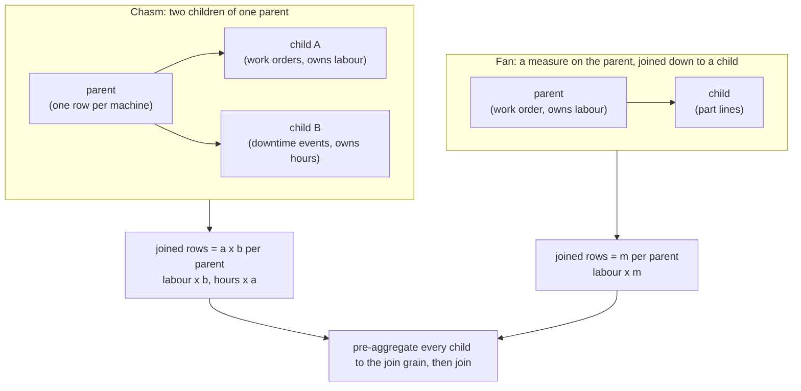
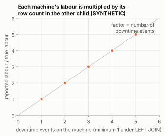
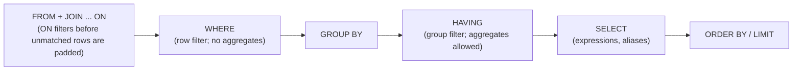

# H3.1 Grain, joins, aggregation and NULLs

**Chapter 3: SQL and data pipelines** · **Status:** Reviewed (sources and verification in [H3.1.9](#h319-sources-and-verification-status))
**Used by:** [lesson w2d1](../../lessons/w2d1_sql_joins_grain/README.md) · **Next section:** H3.2 Window functions and time-series SQL (planned, w2d2)

Examples use the synthetic maintenance database of lesson w2d1
([schema](../../lessons/w2d1_sql_joins_grain/data/README.md)) and the toy recordings database of its
worked example. All quoted results were executed on SQLite 3.53.1.

---

## H3.1.1 Overview

Most analytical SQL is three operations: bring tables together (join), reduce many rows to one
(aggregate), and discard rows (filter). Each is simple alone. Errors come from their interaction,
and they have a common property: **the query runs and returns plausible numbers.** A join that
multiplies rows inflates sums by tens of percent rather than by orders of magnitude. A filter in the
wrong clause removes the entities with no activity, which nobody misses in a list. A NULL in a
subquery makes an anti-join return nothing, which reads as "there are none".

The defence is a habit rather than a feature of the language:

1. state the **grain** of every input and of the result before writing the query;
2. make every join either *towards the one side* or *between tables already at the same grain*;
3. know what NULL does in each clause you use;
4. attach **invariants** to the result (row counts, key uniqueness, reconciliation totals).

For an ML engineer this is not database trivia. The training table is a query result. Its grain is
the unit of prediction, its key decides what a "row" means in a split, and a fan-out in its
construction becomes duplicated examples, re-weighted classes and leakage between folds.

## H3.1.2 Grain, keys and measures

**Grain** is the answer to "what does one row represent?": one site, one work order, one part line
of a work order, one sensor reading. A table has exactly one grain. A **key** is a set of columns
that is unique per row, and a *minimal* key is one from which no column can be removed. The grain
sentence and the minimal key describe the same fact from two sides: `parts_used` has grain "one part
line" and minimal key `(wo_id, part_id)`.

Declared primary keys document the grain of base tables. Query results and views have a grain too,
and nobody declares it for you. Write it as a comment, then test it:

```sql
-- grain: one row per (site, work-order type)
SELECT site_id, wo_type, COUNT(*) AS n
FROM result
GROUP BY site_id, wo_type
HAVING COUNT(*) > 1;          -- must return no rows
```

A **measure** is a numeric column meant to be aggregated. Every measure is *defined at a grain*:
labour hours belong to a work order, a quantity to a part line, a recording's duration to a
recording. This gives the central rule of the section:

> **A measure may be summed only over rows that are at the grain where it is defined, with every such
> row present exactly once.**

Attributes follow the opposite rule. A site's region may be copied onto every machine row, because
you do not add regions up. The same column can be an attribute in one question and a measure in
another (a machine's rated power: an attribute when listing machines, a measure when totalling
installed capacity per site), which is why the rule is about what you *do* with the column.

In signal-processing terms: the grain is the sampling unit. Subject age is defined per subject; if
you average it over windows you have weighted each subject by recording length. Nobody would call
that the cohort's mean age, yet the SQL equivalent is written every day.

### Cardinality

The relationship between two tables on a join predicate is one-to-one, one-to-many or many-to-many.
Foreign keys tell you the *intended* cardinality; data tells you the actual one. Before relying on
"each order has one shipment", check it:

```sql
SELECT order_id, COUNT(*) FROM shipments GROUP BY order_id HAVING COUNT(*) > 1;
```

Assumed one-to-one relationships that are really one-to-many (a customer with two addresses, a
device re-registered under the same serial number, a slowly changing dimension with several validity
periods) are the most common root cause of fan-out in production pipelines.

## H3.1.3 Joins as row-set operations

A join of `A` and `B` on predicate `p` returns one row for every pair `(a, b)` for which `p(a, b)` is
TRUE. Outer joins then add back the rows that found no partner, padded with NULLs.

| Join | Output |
|---|---|
| `INNER JOIN` | matching pairs |
| `LEFT [OUTER] JOIN` | matching pairs + unmatched rows of the left table, NULL-extended |
| `RIGHT [OUTER] JOIN` | mirror image; rewrite as a left join for readability |
| `FULL [OUTER] JOIN` | matching pairs + unmatched rows of both tables |
| `CROSS JOIN` | all pairs |
| semi-join (`WHERE EXISTS …`) | rows of `A` with at least one partner; never duplicates `A` |
| anti-join (`WHERE NOT EXISTS …`) | rows of `A` with no partner |

Let `m(a)` be the number of rows in `B` matching `a`.

```
|A ⋈ B|       = Σ_a m(a)                    (inner)
|A ⟕ B|       = Σ_a max(m(a), 1)            (left)
|A × B|       = |A| · |B|                   (cross)
```

Two consequences are worth memorising.

**Joining towards the one side preserves grain.** If `B`'s join columns are a key of `B`, then
`m(a) ≤ 1` and a left join returns exactly `|A|` rows. Looking up a work order's machine, a
machine's site, a part's unit cost: all safe, in any number, in any order.

**Joining towards the many side changes the grain to the child's.** After
`work_orders JOIN parts_used` a row is a part line. That is right when the question is about part
lines (cost per order) and wrong for anything defined per work order.

Semi-joins and anti-joins deserve more use than they get. "Customers who bought in March" is a
question about customers; `WHERE EXISTS (SELECT 1 FROM orders …)` keeps the customer grain, whereas
`JOIN orders` followed by `DISTINCT` changes the grain and then tries to change it back.

## H3.1.4 Fan-out and double counting

### The mechanism

Two patterns produce wrong sums.

**Pattern 1: a parent measure summed at a child grain.** Joining work orders to part lines repeats
each order's `labor_hours` once per line. An order with `k` lines contributes `k ×` its hours.

**Pattern 2: two independent children under one parent** (sometimes called a chasm trap). Let a
parent row have `a` rows in child `X` and `b` rows in child `Y`, with true sums `S_X` and `S_Y`.
Joining both gives `a·b` rows in which every `X` row appears `b` times and every `Y` row `a` times:

```
Σ x = b · S_X          Σ y = a · S_Y          COUNT(*) = a · b
```

The error in each measure is proportional to the *other* child's row count. That has three
unpleasant properties: it varies by parent row, it is largest for the most active entities, and it
vanishes when the sibling has zero or one row, so spot-checks on quiet entities pass. In the lesson
database, machine 1 (4 work orders, 5 downtime events) reports 92.0 labour hours instead of 18.4,
while machine 2 (6 work orders, no downtime) is exactly right. Summed over machines, the naive
query reports 1,218.1 labour hours against a true 633.8 and 2,523.8 downtime hours against 793.5.

Fan-out frequently coexists with dropped rows. An inner join to the child removes parents without
children; their measures disappear while others are multiplied. The lesson's broken dashboard query
is 32 % too high in total, 100 % too high for one site and 15 % too *low* for another. No correction
factor exists; the query has to be rebuilt.

### The fix: aggregate to the join grain, then join

```sql
WITH wo AS (
    SELECT machine_id, COUNT(*) AS n_work_orders, SUM(labor_hours) AS labor_hours
    FROM work_orders GROUP BY machine_id
),
dt AS (
    SELECT machine_id, SUM(hours) AS downtime_hours
    FROM downtime_events GROUP BY machine_id
)
SELECT m.machine_id,
       COALESCE(wo.n_work_orders, 0)    AS n_work_orders,
       COALESCE(wo.labor_hours, 0.0)    AS labor_hours,
       COALESCE(dt.downtime_hours, 0.0) AS downtime_hours
FROM machines AS m
LEFT JOIN wo ON wo.machine_id = m.machine_id
LEFT JOIN dt ON dt.machine_id = m.machine_id;
```

Each CTE is grouped by the join key, so it has at most one row per machine; both joins are
one-to-at-most-one; the result has exactly `|machines|` rows *by construction*. Correctness no longer
depends on the author remembering which aggregates are safe.

When the target grain is higher than the parent (sites, with children hanging off machines), group
each CTE by the target key, obtaining it by joining *upwards* inside the CTE:

```sql
labor AS (SELECT m.site_id, SUM(w.labor_hours) AS labor_hours
          FROM work_orders w JOIN machines m ON m.machine_id = w.machine_id
          GROUP BY m.site_id)
```

Upward joins (child to its parent) are many-to-one and never duplicate child rows.

### Things that look like fixes

| Tempting patch | Why it fails |
|---|---|
| `COUNT(DISTINCT id)` | repairs identifier counts only; sums stay wrong, and the correct-looking counts lend the query false credibility |
| `SELECT DISTINCT` on the result | removes rows that are identical in every selected column, which is unrelated to which rows were multiplied |
| `SUM(DISTINCT x)` | adds each distinct *value* once: two orders of 4.0 h count as 4.0 |
| dividing by the sibling count | works for one sibling with no NULLs and no dropped rows; unreadable and fragile beyond that |
| correlated scalar subqueries in `SELECT` | correct (each subquery has its own grain) and sometimes the clearest option for one or two measures; verbose and often slower for many |

### Chains are different from siblings

`machines → work_orders → parts_used` is a chain: each part line reaches exactly one work order and
one machine. Joining down a single chain produces rows at the finest grain (part line), each once,
and measures of *that* grain are safe (`SUM(quantity)` per machine is correct). The trouble starts
only when a measure from a coarser level of the chain is summed, or when a second branch is joined.

The two shapes that produce double counting, drawn as grains. An arrow points from the "one" side to
the "many" side; a measure is safe to sum only at the grain of the table that owns it.



On the lesson database the factor can be read off machine by machine: the reported labour of each
machine is its true labour times its number of downtime events.



*Every point lies on the identity line, which is the row-count rule of H3.1.3 made visible. Under a
LEFT JOIN a machine with no downtime events keeps one row per work order, hence the minimum of 1.
SYNTHETIC data; script: `lessons/w2d1_sql_joins_grain/figures/make_figures.py`.*


## H3.1.5 NULL and three-valued logic

NULL marks the absence of a value. SQL does not record why it is absent: not applicable, not yet
known, not recorded and "no matching row in an outer join" all look the same. Predicates therefore
have three results, TRUE, FALSE and UNKNOWN.

| `p` | `q` | `p AND q` | `p OR q` | `NOT p` |
|---|---|---|---|---|
| TRUE | UNKNOWN | UNKNOWN | TRUE | FALSE |
| FALSE | UNKNOWN | FALSE | UNKNOWN | TRUE |
| UNKNOWN | UNKNOWN | UNKNOWN | UNKNOWN | UNKNOWN |

Any ordinary comparison with NULL (`=`, `<>`, `<`, `BETWEEN`, `LIKE`, `IN`) is UNKNOWN, including
`NULL = NULL`. Arithmetic and string operations with NULL yield NULL. Test for NULL with
`IS NULL` / `IS NOT NULL`, which are always TRUE or FALSE.

### What each clause does with UNKNOWN

- **`WHERE`, `HAVING`, `ON`, `CASE WHEN`** act only on TRUE. Rows whose predicate is UNKNOWN are
  filtered out exactly like FALSE. So `WHERE x = 1` and `WHERE x <> 1` together do *not* cover the
  table; rows with NULL `x` are in neither, and `NOT (x = 1)` does not recover them.
- **`GROUP BY`, `DISTINCT`, `UNION`, `ORDER BY`** treat NULLs as equal to each other: all NULLs form
  one group. (Where NULLs sort, first or last, differs between engines.)
- **`CHECK` constraints** accept UNKNOWN. A check `quantity > 0` allows a NULL quantity; add `NOT NULL`
  if you mean it.

### Aggregates

`COUNT(*)` counts rows. Every other aggregate ignores NULL inputs: `COUNT(col)` counts non-NULL
values, `SUM` adds them, `AVG(col) = SUM(col) / COUNT(col)`, `MIN`/`MAX` skip them. Over an empty
input, or one with only NULLs, `COUNT` returns 0 and `SUM`, `AVG`, `MIN`, `MAX` return NULL.

Three practical corollaries:

1. `COUNT(*) - COUNT(col)` is the number of NULLs in `col`, the cheapest data-quality probe there is.
2. `AVG(col)` is a mean over *recorded* values. `AVG(COALESCE(col, 0))` is a mean over all rows under
   the assumption that missing means zero. They are different estimands. On the lesson data they are
   7.64 and 6.82 labour hours; which is reportable depends on why the value is missing (the usual
   missing-data reasoning: if missingness is related to the value, the recorded mean is biased and
   zero-filling is worse).
3. After a `LEFT JOIN`, a sum over a group with no child rows is NULL. Wrap it in `COALESCE(…, 0)`
   when "nothing" really means zero. Apply `COALESCE` to the aggregate, not inside it, unless you
   mean to change the estimand.

### Anti-joins: `NOT IN` versus `NOT EXISTS`

`x IN (v1, v2, …)` means `x = v1 OR x = v2 OR …`; `x NOT IN (…)` means `x <> v1 AND x <> v2 AND …`.
If any `v` is NULL, that conjunct is UNKNOWN, so the whole expression can be FALSE (when `x` equals
some other `v`) or UNKNOWN, never TRUE. A `WHERE x NOT IN (subquery)` therefore returns **no rows at
all** as soon as the subquery yields one NULL.

```sql
-- returns nothing: work_orders.tech_id contains NULLs
SELECT tech_id FROM technicians WHERE tech_id NOT IN (SELECT tech_id FROM work_orders);

-- answers the question
SELECT t.tech_id FROM technicians t
WHERE NOT EXISTS (SELECT 1 FROM work_orders w WHERE w.tech_id = t.tech_id);
```

`EXISTS` asks whether a row exists, which is TRUE or FALSE; the NULL never reaches the outer
predicate. `LEFT JOIN … WHERE b.key IS NULL` is an equivalent anti-join. Prefer `NOT EXISTS` as the
default form: it is correct with nullable columns, it cannot duplicate rows, and extra conditions
("never used *on a corrective order*") go naturally inside the subquery.

An empty anti-join result should never be read as an answer without checking the subquery column
for NULLs.

## H3.1.6 Filters: `ON`, `WHERE`, `HAVING`

A query is evaluated logically in this order (the optimiser may do otherwise, with the same result):

```
FROM + JOIN ... ON   ->   WHERE   ->   GROUP BY   ->   HAVING   ->   SELECT   ->   ORDER BY   ->   LIMIT
```

- `ON` decides which pairs match, before unmatched outer rows are added back.
- `WHERE` filters the joined rows, before grouping. Aggregates are not available.
- `HAVING` filters groups, after aggregation. This is where `SUM(…) >= 1500` goes.

For inner joins a condition may sit in `ON` or `WHERE` with the same result. For outer joins it may
not. A condition on the **nullable side** placed in `WHERE` is UNKNOWN on NULL-extended rows and
removes them, turning the outer join into an inner join:

```sql
-- all sites, with zeros
FROM sites s
LEFT JOIN machines m    ON m.site_id = s.site_id
LEFT JOIN work_orders w ON w.machine_id = m.machine_id
                       AND w.wo_type = 'corrective'
                       AND w.opened_date >= '2025-01-01' AND w.opened_date < '2026-01-01'
GROUP BY s.site_id

-- only sites that have such an order
... LEFT JOIN work_orders w ON w.machine_id = m.machine_id
WHERE w.wo_type = 'corrective' AND ...
```

Rules of thumb. A condition that restricts *which child rows count* belongs in `ON` (or inside a
pre-aggregating CTE, which is clearer still). A condition that restricts *which parent rows are
reported* belongs in `WHERE` and should mention only the preserved side. A deliberate
`WHERE child.key IS NULL` is the anti-join idiom and the one legitimate `WHERE` on the nullable side.

**The NULL-extended row is a row.** `COUNT(*)` counts it (a site with no machines gets 1). Any
`IS NULL` test on a child column is TRUE on it (`CASE WHEN m.decommissioned_date IS NULL THEN 1 END`
counts a phantom active machine). Count a child column that is NOT NULL in the base table
(`COUNT(m.machine_id)`), and guard `IS NULL` tests with `m.machine_id IS NOT NULL`.

### Conditional aggregation

Several filtered aggregates over one pass, without self-joins:

```sql
SELECT wo_type,
       COUNT(*)                                             AS n_orders,
       SUM(CASE WHEN closed_date IS NULL THEN 1 ELSE 0 END) AS n_open,
       COUNT(*) - COUNT(tech_id)                            AS n_unassigned,
       AVG(CASE WHEN wo_type <> 'inspection' THEN labor_hours END) AS avg_hours_non_inspection
FROM work_orders
GROUP BY wo_type;
```

`COUNT(CASE WHEN cond THEN 1 END)` and `SUM(CASE WHEN cond THEN 1 ELSE 0 END)` differ only when
the aggregate receives no rows at all (0 versus NULL). `AVG(CASE WHEN cond THEN x END)` averages `x` over the rows satisfying
`cond`, because the others become NULL and are skipped; adding `ELSE 0` would silently average in
zeros. PostgreSQL, DuckDB and SQLite also accept the standard `AGG(…) FILTER (WHERE cond)` form.

### `GROUP BY` correctness

Every selected expression must be either in the `GROUP BY` list, an aggregate, or functionally
dependent on the grouped columns (the standard allows selecting other columns of a table when its
primary key is grouped; PostgreSQL implements this). Otherwise the value is ambiguous: which of the
group's rows should supply it? Most engines reject such a query. SQLite and MySQL in permissive mode
accept it and return the value from an arbitrary row of the group. That behaviour is a portability
hazard and a correctness hazard; group by everything you select, or wrap the extra column in
`MIN`/`MAX` when it is constant within the group.

The order in which the clauses of one `SELECT` take effect explains where each kind of filter can go:




## H3.1.7 Verifying a query

A query is code. The oracles that work for it (compare lesson w1d5 on test oracles):

**Key uniqueness.** The declared key of the result has no duplicates. Run it on inputs too.

**Row-count invariants.** "One row per site, all sites" means exactly `COUNT(*) FROM sites` rows.
While building, count rows after each join; every increase is a change of grain you must be able to
name, every decrease a set of dropped entities you must be able to justify.

**Reconciliation totals.** For each measure, the grand total of the result equals the total from the
single base table where the measure lives:

```sql
SELECT (SELECT SUM(labor_hours) FROM result)      AS from_result,
       (SELECT SUM(labor_hours) FROM work_orders) AS from_source;
```

A reconciliation catches fan-out (total too high), dropped rows (too low) and, less obviously, their
combination, provided you also check the count. When a filter is intended, reconcile against the
source with the same filter.

**Hand-checked entities.** Verify one parent with no children, one with exactly one child in each
branch, and one with several in each. The last is the only one that exposes sibling fan-out.

**A second implementation.** Compute the same table another way (pandas, or correlated subqueries)
and compare. The checks of lesson w2d1 do this: expected results come from pandas, not from the
reference SQL.

**A second dataset.** Run the query on data you did not look at while writing it. Literals copied
from the visible data, and logic that is right only for its accidents, fail there.

In a pipeline, the first three become assertions that run on every execution (H4.1, planned) and the
last two become tests (H9.1).

## H3.1.8 Practical decisions, failure modes, quick reference

### Decisions and tradeoffs

| Decision | Default | When to choose otherwise |
|---|---|---|
| Combine measures from several children | one CTE per child, aggregated to the join grain | a single measure: a correlated subquery may read better |
| "Rows of A with/without a match in B" | `EXISTS` / `NOT EXISTS` | `IN` with a literal list or a provably non-NULL column |
| Keep entities with no activity | drive from the entity table, `LEFT JOIN` | inner join only if "has activity" is part of the population definition, and then say so |
| NULL in an average | leave NULLs out and report the denominator | zero-fill only when NULL means "none" |
| NULL-safe inequality | `x <> v OR x IS NULL` | `IS DISTINCT FROM` where supported (PostgreSQL, DuckDB) |
| "In year 2025" | half-open range `>= '2025-01-01' AND < '2026-01-01'` | never wrap the column in a function if an index should be used |
| CTE or subquery | CTEs, named for their grain (`wo_per_machine`) | — |
| Wide denormalised table for convenience | build it once, with its grain documented and tested | never as an unlabelled view others will aggregate |

On cost: pre-aggregation is usually cheaper as well as safer, because it joins small aggregates
instead of materialising a multiplied intermediate. Performance tuning (indexes, join order,
partition pruning) is outside this section; correctness comes first and is the part reviewers cannot
see from the plan.

### Common failure modes

| Failure | Symptom | Detection |
|---|---|---|
| Sibling fan-out | sums too high, more for active entities; `COUNT(DISTINCT)` looks right | reconciliation total; hand-check a busy entity |
| Parent measure at child grain | measure multiplied by number of children | reconciliation total |
| Inner join dropping childless parents | entities missing; totals too low | row count against the entity table |
| Outer join cancelled by `WHERE` | zero-activity entities missing | row count; search for nullable-side columns in `WHERE` |
| `NOT IN` with NULL | empty result | `COUNT(*) - COUNT(col)` on the subquery |
| Phantom row counted | 1 instead of 0 for empty parents | check a known-empty parent |
| `<>` treated as complement of `=` | rows with NULL silently excluded | counts of `=`, `<>` and `IS NULL` should add to the total |
| Average over the wrong denominator | plausible but shifted mean | state the denominator; compare `COUNT(*)` and `COUNT(col)` |
| Duplicate rows in a "dimension" | everything joined to it inflates | uniqueness test on the join key |
| Non-grouped column selected | arbitrary values (SQLite) or an error elsewhere | run on a stricter engine; lint |
| Training table with duplicated entities | over-weighted heavy users; leakage across a random split | key uniqueness on the unit of prediction |

### Quick reference

```
Before writing      grain of result?  key?  expected row count?  measure -> grain it is defined at?
Each join           one row on the left matches at most one on the right?  if not: aggregate first
Outer joins         conditions on the nullable side go in ON; COUNT(child_key), not COUNT(*)
Anti-join           NOT EXISTS (correlated subquery)
NULL                compare with IS [NOT] NULL; WHERE keeps TRUE only; aggregates skip NULL
Empty group         COUNT -> 0, SUM/AVG/MIN/MAX -> NULL; COALESCE the aggregate
Row filter / group  WHERE before GROUP BY, HAVING after
After writing       key unique?  row count as predicted?  totals reconcile with source tables?
```

Row-count rule: `|A ⟕ B| = Σ_a max(m(a), 1)`. Sibling fan-out: `Σx = b·S_X`, `Σy = a·S_Y`.

## H3.1.9 Sources and verification status

**Executed (2026-11-22).** Every SQL behaviour stated in this section for SQLite was run on SQLite
3.53.1 by `lessons/w2d1_sql_joins_grain/example/fanout_demo.py` or against
`lessons/w2d1_sql_joins_grain/data/maintenance.db`: the three-valued truth results, aggregate
behaviour on NULL and on empty input, `NOT IN` with NULL, `ON` versus `WHERE`, `FULL OUTER JOIN`,
the lenient `GROUP BY`, and all quoted totals. The twelve reference queries of the lesson were also
run on DuckDB 2.0.1 with identical results, and DuckDB was observed to reject the non-grouped column.

**Opened and read (source files of the PostgreSQL documentation, `postgres/postgres` on GitHub,
`doc/src/sgml/`):**

- `queries.sgml`: joined tables (join types; "a restriction placed in the ON clause is processed
  before the join, while a restriction placed in the WHERE clause is processed after the join … it
  matters a lot with outer joins"); `GROUP BY` and functional dependency on a primary key.
- `func/func-subquery.sgml`: `NOT IN` yields null, not true, when the right-hand side contains a null
  and no equal value.
- `func/func-logical.sgml`: three-valued logic and its truth tables.
- `func/func-comparison.sgml`: `IS [NOT] DISTINCT FROM`.
- `func/func-aggregate.sgml`: aggregates other than `count` return null when no rows are selected.

**Not opened:** the rendered SQLite documentation (sqlite.org was unreachable from the authoring
environment); SQLite statements rest on execution instead. The ISO SQL standard text.

**From memory, not re-verified this session:**

- That MySQL in a permissive SQL mode accepts non-grouped columns, and that BigQuery rejects them.
- SQLite's `IS NOT` as a null-safe inequality was executed; that other engines do not accept it
  for general operands is from memory.
- The term "chasm trap" for sibling fan-out comes from the dimensional-modelling literature
  (commonly associated with Kimball's work); no specific page was consulted.
- The `FILTER (WHERE …)` clause was executed on SQLite 3.53.1 and DuckDB 2.0.1; its support in
  PostgreSQL is stated from memory.
- That a `CHECK` constraint accepts NULL was executed on SQLite; that this is general SQL behaviour
  is from memory.
- `IS DISTINCT FROM` was executed on DuckDB and read in the PostgreSQL documentation source.
- The dashboard anecdotes in the lesson are illustrative composites, not cited incidents.

**Further reading (optional, not required to use this section):** the PostgreSQL manual chapters
"Queries" and "Functions and Operators" are a clear, engine-neutral reference for everything above.
