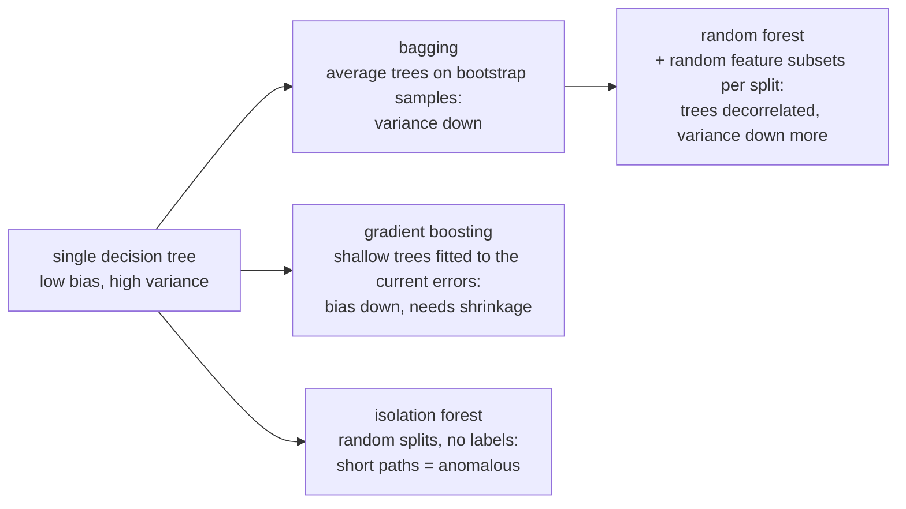
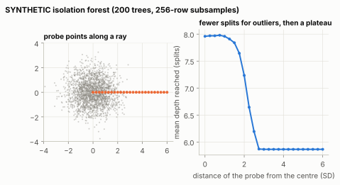

# H5.3 Trees, ensembles and isolation forests

**Status:** Reviewed (numerical claims executed; sources listed in H5.3.8) · **Used by:** [w4d2](../../lessons/w4d2_classical_detectors/README.md)
**Related:** [H5.1 Trivial and linear baselines](h5_1_trivial_and_linear_baselines.md) ·
[H7.5 Multivariate detectors (PCA T² and Q)](../ch07_timeseries_grouped_modeling/h7_5_multivariate_detectors.md) ·
[H6.4 Selection and nested validation](../ch06_evaluation_leakage_uncertainty/h6_4_selection_and_nested_validation.md)

## H5.3.1 Overview

On tabular features, tree ensembles are the default strong learner: random forests are hard to break
and need little tuning; gradient boosting is usually the most accurate model per unit of effort. The
isolation forest reuses the tree idea for unsupervised anomaly scoring. This section gives the
mechanics needed to tune and debug them, and the caveats that matter when rows are grouped and
time-ordered. PCA-based detectors are in H7.5.



## H5.3.2 Decision trees

A tree partitions feature space with axis-aligned splits, chosen greedily. For classification, a node
with class proportions `p_c` has Gini impurity `G = 1 − Σ_c p_c²` (for two classes `2p(1−p)`) or
entropy `H = −Σ p_c log p_c`. A split of `n` rows into `n_L` and `n_R` is scored by the weighted child
impurity `(n_L G_L + n_R G_R)/n`; with features sorted once, all thresholds of a feature are evaluated
in one pass using cumulative class counts (O(n log n) per feature). Regression trees use the variance.

Properties that follow: invariance to monotone transformations of each feature (no scaling needed);
interactions captured by depth; step-shaped, non-extrapolating predictions (outside the training range
the prediction is constant); and high variance — a small change in data changes the top split and the
whole tree.

## H5.3.3 Bagging and random forests

Average `B` trees grown on bootstrap samples. If each tree's prediction has variance `σ²` and pairwise
correlation `ρ`, the average has variance

```
Var(average) = ρ σ² + (1 − ρ) σ² / B
```

so more trees remove only the second term; the first is removed by **decorrelating** the trees, which
is what random forests do by drawing a random subset of features (`max_features`, `√d` for
classification by default in scikit-learn) at every split. Out-of-bag rows (about 37% per tree) give a
free validation estimate — valid only if rows are independent; with grouped or temporal data it is as
optimistic as a random split.


*Figure H5.3-1 (SYNTHETIC classification task, 3,000 training rows).* Most of the gain comes from
averaging; decorrelation adds a little more here (0.947 vs 0.941 at 200 trees). Values from the
authoring run.

## H5.3.4 Gradient boosting

Boosting builds an additive model `F_M(x) = F_0 + ν Σ_m h_m(x)`, each shallow tree `h_m` fitted to the
negative gradient of the loss at the current predictions (for log loss, `y − p`). The learning rate
`ν` shrinks each step. Small `ν` with many iterations generalises better than large `ν` with few, at
the cost of computation; the number of iterations must be chosen on validation data (early stopping or
as a hyperparameter).


*Figure H5.3-2 (SYNTHETIC).* The minimum test loss is similar for the three rates; the number of
iterations at which it occurs, and how fast it is lost afterwards, are not. That is why iterations and
learning rate are tuned together.

Histogram-based implementations (`HistGradientBoostingClassifier`, LightGBM) bin each feature into at
most 255 bins, which makes each iteration cheap and handles missing values natively. scikit-learn
activates **early stopping** automatically above 10,000 rows, holding out a random 10% of rows: with
grouped or time-ordered rows that validation split is leaky. Turn it off and select the number of
iterations with grouped validation, or pass a validation set of whole units.

## H5.3.5 Isolation forest

Each isolation tree is grown on a subsample of `ψ` rows (256 by default) by choosing a random feature and
a random split value between its observed minimum and maximum, until points are isolated or a depth
limit `⌈log₂ ψ⌉` is reached. An anomaly is separated in few splits. With `h(x)` the path length (plus a
correction `c(size)` for unsplit leaves) and

```
c(ψ) = 2 H(ψ − 1) − 2 (ψ − 1)/ψ,      H(i) ≈ ln i + 0.5772
s(x, ψ) = 2^(−E[h(x)] / c(ψ))
```

scores near 1 are anomalous and scores around 0.5 or below are unremarkable. scikit-learn's
`score_samples` returns `−s`.



*Figure H5.3-3 (SYNTHETIC, 200 trees, 256-row subsamples).* Outlying points are isolated sooner, but
the depth (and the score) stops changing beyond the range of the training data: a point at 3 SD and
one at 6 SD get the same score. Isolation-forest scores rank "unusual", they do not measure "how far".

Practical points: `contamination` only sets the threshold used by `predict` (the share of training
rows flagged); the scores are unaffected — choose thresholds on development data. Axis-aligned random
splits isolate points that break a correlation (an oblique direction) slowly; extended isolation forests
use random hyperplanes for that case. Features need no scaling, but irrelevant features dilute the
random feature choice.

## H5.3.6 Practical decisions and tradeoffs

* **Forest or boosting?** A random forest is a robust first model with few knobs; boosting is usually
  more accurate once the learning rate, iterations and leaf size are tuned with a proper scheme.
  Compare them under the same budget (w4d2, H6.4).
* **Supervised or isolation forest?** Decided by the labels: coverage of fault types, independent
  labelled units per type, and the label process (w4d2 section 2.1).
* **Validation:** out-of-bag estimates and built-in early stopping assume independent rows; use grouped
  or temporal validation (H6.3) when rows are not.
* **Explanation:** impurity importance favours high-cardinality and correlated features. Use permutation
  importance on held-out *units*; with correlated features, credit is shared arbitrarily. Importance
  describes the model, not the world (the w4d2 challenge: a per-customer constant carries most of the
  importance because the model uses it to recognise accounts).
* **Extrapolation:** trees predict a constant outside the training range — safe in one sense, blind in
  another (drift beyond the range is invisible to the score).

## H5.3.7 Common failure modes

| Failure | Symptom | Fix |
|---|---|---|
| Identifier-like feature (constant per unit) | excellent random-split CV, poor on new units | grouped validation; drop or justify the feature |
| Leaky early stopping / OOB on grouped data | validation optimistic, too many iterations | grouped validation set or iterations as a hyperparameter |
| `contamination` used as "the anomaly rate" | arbitrary alarm rate | threshold from development data and an alarm budget |
| Isolation-forest score sign | outliers ranked last | negate `score_samples` |
| Unequal tuning budgets in a comparison | the tuned model "wins" by selection optimism | equal budgets, nested estimates |
| Importance read as causation | wrong business conclusions | permutation importance on held-out units, framed as model behaviour |

## Quick reference

```
Gini            G = 1 − Σ p_c²                     two classes: 2p(1 − p)
Split score     (n_L G_L + n_R G_R) / n            evaluate all thresholds in one sorted pass
Ensemble var    ρσ² + (1 − ρ)σ²/B                  more trees: second term; decorrelation: first term
Boosting        F_m = F_{m−1} + ν h_m,  h_m fitted to −∂L/∂F
Isolation       s = 2^(−E[h]/c(ψ)),  c(ψ) = 2H(ψ−1) − 2(ψ−1)/ψ;  sklearn score_samples = −s
sklearn         HistGradientBoosting: early_stopping='auto' turns on above 10,000 rows (random 10% split)
                IsolationForest: contamination affects predict() only
```

## H5.3.8 Sources and verification status

* Executed in the authoring session (2026-11-22): figures H5.3-1 to H5.3-3 and their CSVs
  (`handbook/figures/h5_3/make_figures.py`, scikit-learn 1.9.1); the claim that `contamination` leaves
  `score_samples` unchanged (w4d2 worked example, section 3); the early-stopping behaviour was checked
  in the installed scikit-learn's docstring for `HistGradientBoostingClassifier` (`early_stopping='auto'`
  enables it when the number of samples exceeds 10,000).
* From memory, not re-opened this session: Breiman (2001) *Random Forests* (the `ρσ²` variance argument);
  Friedman (2001) *Greedy function approximation: a gradient boosting machine*; Liu, Ting & Zhou (2008)
  *Isolation Forest* (the `c(ψ)` normaliser and the score); Hariri et al. (extended isolation forest);
  Strobl et al. on impurity-importance bias. The formulas were checked against the scikit-learn behaviour
  shown in the figures, not against the papers.
