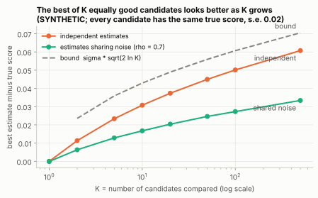
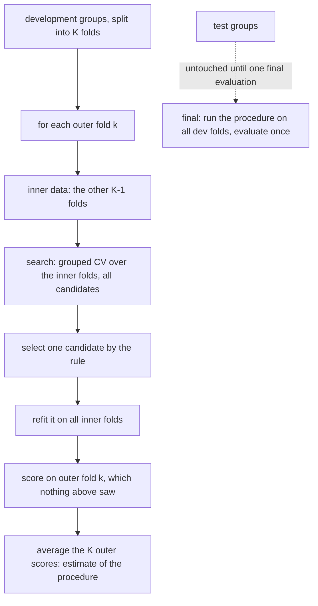
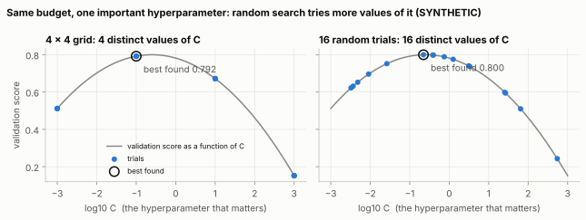
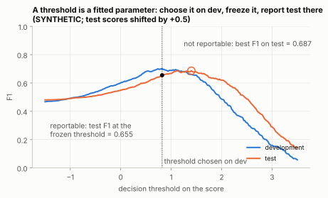

# H6.4 Selection and nested validation

Status: Reviewed (author's check against executed simulations and runs; see 6.4.9). Lesson: [w3d3](../../lessons/w3d3_hyperparameter_selection/README.md).

## 6.4.1 Overview

Choosing hyperparameters, a model family, a feature set, a decision threshold or "the best of the runs"
is a second fitting procedure. Its training data is whatever was used to compare the candidates. The
score of the chosen candidate on that data is biased upward, because the candidate was chosen partly
for being lucky there. This section quantifies the bias (the optimism of the maximum), shows how nested
validation estimates the performance of the whole procedure, covers search strategies and the
one-standard-error rule, treats thresholds as hyperparameters, and sets rules for test-set use.

## 6.4.2 The optimism of the maximum

Let candidates `i = 1..K` have true scores `μ_i` and estimates `μ̂_i = μ_i + ε_i`. Selecting
`î = argmax μ̂_i` and reporting `μ̂_î` overstates `μ_î` by `E[ε_î]`.

**Equal candidates.** If all `μ_i = μ` and `ε_i ~ N(0, σ²)` independent, `E[μ̂_î] − μ = σ E[max of K
standard normals]`, which grows like `σ √(2 ln K)` (an upper bound for large K: `E[max] ≤ σ √(2 ln K)`).
Values of `E[max]` for standard normals: 0.564 (K=2), 1.539 (K=10), 2.249 (K=50).

**Shared noise.** Candidates scored on the same folds share part of their error. With equicorrelated
errors `ε_i = σ(√ρ Z + √(1−ρ) Z_i)`, the shared part `Z` moves every candidate together and cannot
change the argmax, so the optimism scales by `√(1−ρ)`.



*SYNTHETIC simulation (w3d3 worked example, σ = 0.02).* At K = 50 the best of fifty equally good
candidates looks 0.045 better than it is with independent errors, 0.025 with ρ = 0.7. The bound is
loose at small K.

**Unequal candidates (winner's curse).** When the `μ_i` differ, the winner is both good and lucky. In the
w3d3 simulation (60 candidates, true scores with s.d. 0.01, estimates with s.e. 0.02) the winner's dev
estimate exceeds its true score by 0.042 on average, and the winner is the truly best candidate in 11 %
of repetitions. Selection still helps (the winner's true score, 0.710, beats a random candidate's, 0.700)
but the reported number is wrong.

## 6.4.3 Nested validation

To estimate what the *procedure* will achieve on new groups, wrap the procedure in an outer loop:



Properties:

* The outer score estimates the performance of "search + select + refit", not of any single
  configuration. Different outer folds may choose different candidates; that variability is part of
  what is being estimated, and it is informative (an unstable choice means the search cannot tell the
  candidates apart).
* Cost is K times the search. With few groups, use the same grouped folds for both loops (K outer folds,
  K−1 inner folds), as the lab does with 4 folds of SKAB experiments.
* It requires at least three folds: the inner search needs two.
* Two ways to get it wrong, both plausible-looking: tuning once on all folds and then "cross-validating
  the tuned model" (each outer fold has already voted), and inner folds split by rows rather than by
  group (the inner search then rewards memorising groups).

A single fixed validation split is enough when the validation set is large relative to the differences
between candidates and only a handful of candidates are compared; the dev-test split must still be by
group. With 27 development experiments, it is not enough.

## 6.4.4 Search strategy

* **Grid search** evaluates a product of value lists. With a budget of `B` trials and `d` hyperparameters,
  each dimension gets only `B^{1/d}` distinct values.
* **Random search** draws each trial independently, so every dimension gets `B` distinct values. When
  only a few dimensions matter (the usual case), random search covers them far better (Bergstra & Bengio,
  2012). In the w3d3 simulation with 16 trials and one relevant hyperparameter, random search finds a
  better value than a 4×4 grid in 90 % of runs.
* **Scales.** Regularisation strengths, learning rates and tolerances are searched log-uniformly.
* **Early stopping** is a hyperparameter chosen on validation data; the number of epochs it picked is
  then fixed for the refit.
* **Successive halving / Hyperband** allocate more budget to promising candidates; they change the cost,
  not the logic: the selection still happens on validation data and must be nested to be estimated.



*SYNTHETIC.* With 16 trials a 4×4 grid tries 4 values of the hyperparameter that matters; random search
tries 16.

## 6.4.5 The one-standard-error rule

Compute the SE of each candidate's mean over folds. Among candidates whose mean is within one SE (of the
best candidate) of the best mean, choose the simplest. Rationale: differences inside one SE are not
distinguishable with this validation data, so prefer the candidate with lower variance and lower
maintenance cost. It needs an explicit complexity ordering (in the lab: linear before boosted, short
windows before long, stronger regularisation first). The rule does not remove optimism: the number
attached to the chosen candidate must still come from a nested estimate.

## 6.4.6 Thresholds are hyperparameters

The decision threshold is fitted on development scores and frozen. Two consequences:

1. The development scores used to choose it must themselves be out-of-fold (each row scored by a model
   that did not train on its group); in-sample scores are overconfident and give the wrong threshold.
2. Test performance is reported **at the frozen threshold**, never at the threshold that is best on test.



*SYNTHETIC, with test scores shifted by +0.5.* The circled test-optimal F1 is not a property of any
deployable detector; the dot at the frozen threshold is.

Alert-budget thresholds (the lowest threshold whose false-alarm fraction on normal dev rows is within a
budget) follow the same rule, and are the natural choice when the consumer states a capacity.

## 6.4.7 Researcher degrees of freedom and the test set

Every look at the test set that can change a decision is a selection on test. Practical rules:

* Decide the protocol (search space, metric, selection rule, threshold rule, number of test looks) before
  running it, and write it down.
* Record every trial, including the bad ones (the lab's search returns all trials).
* Look at test once per question. If the result prompts a change, the next test number is optimistic, and
  must be reported as such, or a fresh test set must be found.
* Count the comparisons you made in total; with many, even a clean test set gives a winner with optimism
  of order `σ_test √(2 ln K)`.

## 6.4.8 Quick reference

```text
reported dev score of the winner  - biased up by about sigma * E[max of K] * sqrt(1 - rho)
nested estimate                   - outer folds wrap search + select + refit; >= 3 folds; groups, not rows
search                            - random, log scales; record every trial
one-SE rule                       - simplest candidate within best_mean - SE(best); still nest the estimate
threshold                         - choose on out-of-fold dev scores, freeze, report test there
test                              - one look per question; log the looks
```

## 6.4.9 Sources and verification status

* Expected maxima of standard normals (0.5642, 1.5388, 2.2491) and the `√(1−ρ)` scaling: checked by
  simulation in the w3d3 challenge checks (40,000 repetitions); the `σ√(2 ln K)` bound is a standard
  result (from memory).
* All simulation numbers: `lessons/w3d3_hyperparameter_selection/example/selection_demo.py`, run 2026-11-22.
* Bergstra, J. & Bengio, Y. (2012), "Random Search for Hyper-Parameter Optimization", JMLR 13. **From
  memory, not re-opened.**
* Nested cross-validation and the one-SE rule: standard practice (e.g. Hastie, Tibshirani & Friedman,
  *The Elements of Statistical Learning*, ch. 7; Cawley & Talbot, 2010, JMLR, on selection bias in model
  evaluation). **From memory, not re-opened.**
* scikit-learn documents nested CV (`GridSearchCV` inside `cross_val_score`) in its model-selection user
  guide; the w2d4 author read `doc/modules/cross_validation.rst` from GitHub; not re-read for this section.
