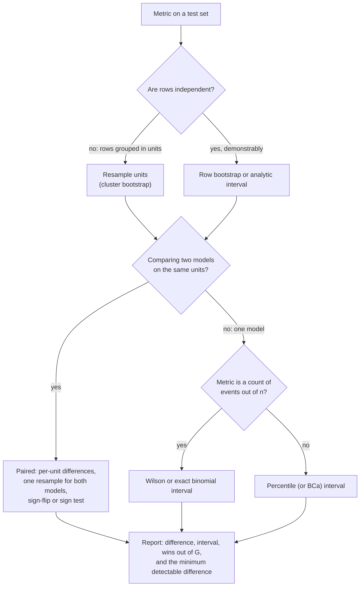
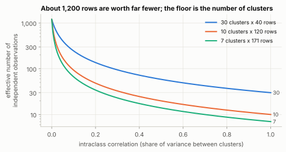
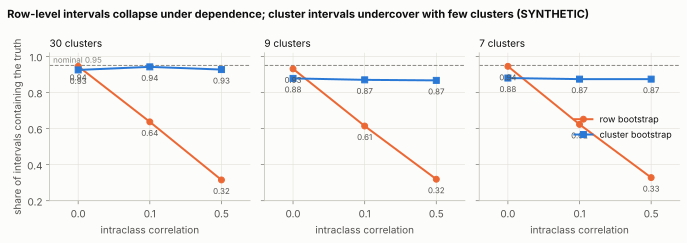
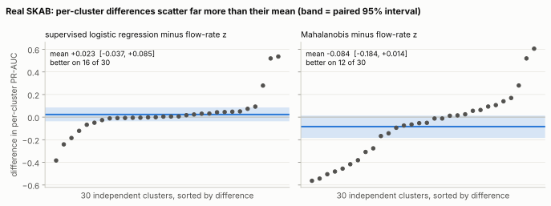
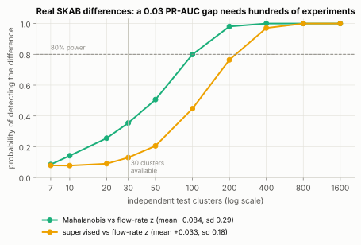

# H6.6 Bootstrap and paired comparisons

Status: Reviewed (see H6.6.9 for what was executed and what is from memory).
Used by: [w3d5](../../lessons/w3d5_uncertainty/README.md); relied on by
[w3d6](../../lessons/w3d6_error_analysis_transfer/README.md) and Week 4 model choice.
Related: H6.4 selection and nested validation (being written for w3d3),
[H6.7 error analysis](h6_7_error_analysis.md),
[H1.2 units, labels, costs](../ch01_problem_formulation/h1_2_units_labels_costs_constraints.md).

## H6.6.1 Overview

An evaluation number is computed on a finite, particular test set. Before acting on it you need to
know how much it would move on another test set drawn the same way, and whether a difference between
two models is larger than that movement. This section gives the tools, in the order you reach for them:

1. **Name the unit of independence.** Usually not the row: the experiment, machine, customer, store
   or subject.
2. **Interval for one model:** the cluster (block) bootstrap for general metrics; a binomial
   interval (Wilson or exact) for counts of events.
3. **Comparison of two models on the same units:** paired. The interval and test are on per-unit
   differences, never on two separate intervals.
4. **Resolution:** the smallest difference the test set could have detected, and the number of units
   needed for the difference you care about.

What none of these tools do: detect leakage, correct a biased test bench, or make up for having few
independent units. They quantify sampling variation, given a correct design.



## H6.6.2 What varies, and what an interval is about

A confidence interval is a procedure with a coverage guarantee over repetitions of something declared
random. For evaluation numbers four things could be redrawn:

| Source | Repetition imagined | Tool |
|---|---|---|
| Test-set sampling | other test units from the same population | cluster bootstrap of the test set; binomial intervals |
| Training-set sampling | another training sample | refit on resampled training units; repeated grouped CV (rough) |
| Optimisation noise | another seed, same data | mean ± sd over seeds, reported separately |
| Selection | the whole choose-and-report process | nested validation; a test set used once (H6.4) |

A test-set bootstrap with a fixed model answers "how well does *this artifact* do on new units". It is
the right quantity for a deployment decision about a trained model and the wrong one for a claim about
a training *method*. Write down which you are reporting.

## H6.6.3 Dependence and the design effect

For `G` clusters of `m` rows with intraclass correlation `ρ` (between-cluster variance over total
variance), the variance of the pooled mean is

$$
\operatorname{Var}(\bar y) \;=\; \frac{\sigma^2}{Gm}\,\bigl[1 + (m-1)\rho\bigr],
\qquad n_{\text{eff}} = \frac{Gm}{1 + (m-1)\rho}.
$$

The bracket is the **design effect** (Kish). Two consequences follow directly. A row-level analysis
underestimates the variance by that factor. And as `m` grows with `G` fixed, `n_eff` approaches
`G/ρ` (exactly `G` when `ρ = 1`): logging more rows per unit cannot buy precision beyond a ceiling
set by the number of units.



*Formula, no data. At ICC 0.2 the same 1,200 rows are worth about 136, 48 or 34 independent
observations depending on whether they come from 30, 10 or 7 clusters (values in
`../figures/h6_6/design_effect.csv`).*

A worked number: 40,000 rows from 8 machines (5,000 each) with ICC 0.2 has a design effect of
`1 + 4,999 × 0.2 ≈ 1,001`, so `n_eff ≈ 40`; whatever is logged per machine, the ceiling is 8/0.2 = 40
for a mean, and the honest unit count for any interval is 8.

Metrics such as PR-AUC, F1 or recall are not means of independent terms, but the mechanism is the same:
rows of one unit move together, so row resamples are too similar to each other.

In EEG terms: epochs from one subject share electrode placement, impedance, anatomy and state; the
subject is the random effect. The same reasoning makes the SKAB experiment, the customer in a churn
model and the store in demand forecasting the resampling unit.

## H6.6.4 The cluster bootstrap

**Procedure.** Given per-unit data for `G` units:

1. draw `G` unit ids with replacement;
2. build the pseudo-test set from all rows of the drawn units (duplicates included);
3. recompute the metric exactly as on the real data, with the model and threshold frozen;
4. repeat `B` times (2,000 is plenty for percentile limits); the 2.5 % and 97.5 % quantiles form the
   percentile interval.

Store per-unit sufficient statistics (TP, FP, FN per unit; or per-unit score arrays) once, so each
replicate is an index operation, not a re-run of the model.

**Choices that change the answer.**

* *Pooled versus per-unit metric.* Pooled PR-AUC weights long units more and mixes score scales across
  units; the mean of per-unit PR-AUC weights units equally. Different estimands, different intervals.
* *The unit is the independent unit, not the file.* On SKAB five pairs of files share identical rows,
  so overlap groups are the clusters; the v2 test set has 9 experiments and 7 clusters.
* *Undefined replicates.* A resample with no positives has no recall or PR-AUC. Decide before looking:
  drop and count (and report the count), or resample stratified by whether a unit contains positives.
  Never set the value to 0 or 1.

**Where it fails.**

* *Few units.* The bootstrap variance is biased low by about `(G − 1)/G`, the number of distinct
  resamples is `C(2G − 1, G)` (1,716 for `G = 7`), and percentile intervals undercover. In the w3d5
  simulation a nominal 95 % interval covered about 87-88 % with 7 or 9 clusters and 93-94 % with 30.
* *Extremes.* "Worst unit" or a maximum cannot be bootstrapped meaningfully.
* *Boundaries.* If every event is detected, every resample says 1.0. Use H6.6.5.

**BCa.** The bias-corrected and accelerated interval adjusts the percentile points for median bias and
for skew estimated by a jackknife over units; it is second-order accurate and is the default method of
`scipy.stats.bootstrap`. It helps with skewed statistics, not with too few units. On the real
per-cluster PR-AUC of the SKAB flow-rate baseline with 7 clusters it moved the limits by about 0.01
(percentile [0.826, 0.942], BCa [0.812, 0.933]; w3d5 lesson, section 2.3).



*SYNTHETIC simulation from `lessons/w3d5_uncertainty/example/coverage_simulation.py`, 1,000 datasets per
point. Even at ICC 0.1 the row bootstrap covers only about 62-64 %.*

## H6.6.5 Proportions from a handful of events

Event recall with `k` of `n` events is a binomial proportion if events are independent. The Wald
interval `p̂ ± z√(p̂(1−p̂)/n)` is unusable for small `n` or `p̂` near 0 or 1. Use the Wilson score
interval,

$$
\frac{\hat p + \frac{z^2}{2n} \pm z\sqrt{\frac{\hat p(1-\hat p)}{n} + \frac{z^2}{4n^2}}}{1 + \frac{z^2}{n}},
$$

or the exact Clopper-Pearson interval when a guaranteed (conservative) coverage is required.
Reference values (z = 1.96): 7/9 → [0.45, 0.94]; 9/9 → [0.70, 1.00]; 8/8 → [0.68, 1.00]; 34/34 →
[0.90, 1.00]; 700/900 → [0.75, 0.80]. The rule of three: zero failures in `n` trials bounds the failure
rate below roughly `3/n` at 95 %.

## H6.6.6 Paired comparisons

Two models evaluated on the same `G` units give per-unit scores `a_i`, `b_i` and differences
`d_i = a_i − b_i`. The variance of the mean difference is

$$
\operatorname{Var}(\bar d) = \frac{\sigma_a^2 + \sigma_b^2 - 2r\,\sigma_a\sigma_b}{G},
$$

where `r` is the correlation of the two models' scores across units. When the same units are hard for
both models (`r` high), most of the between-unit variance cancels. This is why two overlapping marginal
intervals settle nothing: each contains the shared variance; the difference does not.

**Paired bootstrap.** One resample of unit ids per replicate, applied to both models; the percentile
interval of the resampled differences. For pooled metrics recompute both pooled values on the same
resampled rows and subtract.

**Tests on `d_i`.**

| Test | Uses | Assumes | Note |
|---|---|---|---|
| Sign test | signs only | independent units | exact; robust; ignores magnitude |
| Wilcoxon signed-rank | signs and ranks of `|d_i|` | symmetric distribution of `d_i` | more power if symmetric |
| Sign-flip permutation | the values | exchangeability of the two models within a unit under H0 | exact; with `G` units the smallest two-sided p is `2/2^G` (0.0156 for 7; 0.0625 for 5) |
| Paired t | the values | approximate normality of `d̄` | fine for moderate `G`; fragile with outlying units |

On SKAB the correlation between models across clusters is modest (0.42 for supervised versus flow-rate
z, −0.12 for Mahalanobis versus flow-rate z), so pairing helps less than in textbook examples. It is
still the correct analysis, and per-unit differences show something a pooled number hides: the spread
of differences is wide (several clusters differ by more than ±0.4 PR-AUC) while their mean is near zero.



*REAL SKAB, 30 independent clusters. Supervised minus flow-rate z: +0.023 [−0.037, +0.085], better on
16 of 30; Mahalanobis minus flow-rate z: −0.084 [−0.184, +0.014], better on 12 of 30.*

**Many comparisons.** With `k` independent comparisons at α = 0.05 the probability of at least one
false "win" is `1 − 0.95^k` (0.26 for 6, 0.40 for 10). The best of a leaderboard is biased upward
because it is partly the luckiest. Remedies, in order of preference: pre-specify the comparison that
decides; Holm's step-down correction over a handful; confirm the winner on units that played no part
in selecting it.

**Seeds.** For stochastic learners report mean ± sd over seeds on the fixed test set, beside (not
instead of) the test-set interval of one model. Never report the best seed; never bootstrap over seeds
and call it a confidence interval for the metric.

## H6.6.7 Resolution and power

Before claiming "no difference", ask what difference the data could have shown. For paired differences
with spread `σ_d` across `G` units, a two-sided test at α = 0.05 has 80 % power for a true mean
difference of about

$$
\delta_{\min} \approx (z_{0.975} + z_{0.80})\,\frac{\sigma_d}{\sqrt G} = 2.80\,\frac{\sigma_d}{\sqrt G},
\qquad
G_{\text{needed}} \approx \Bigl(2.80\,\frac{\sigma_d}{\delta}\Bigr)^2 .
$$

This normal approximation is optimistic for `G < 15`; simulate with the actual test (the w3d5
challenge does this with a sign-flip permutation test and the empirical differences).



*Simulation resampling the REAL per-cluster differences (`../figures/h6_6/power_curve.csv`). With the 30
clusters available, power is 0.35 (Mahalanobis versus flow-rate z, mean difference −0.084, sd 0.29) and
0.07 (supervised versus flow-rate z, mean +0.023, sd 0.18). The second needs between 400 and 800
independent experiments; the normal approximation gives 459.*

Reading "not significant" correctly: "the data do not show a difference, and could only have shown one
of about δ_min or more" is a statement; "the models are equal" is not. Equivalence needs its own test
(two one-sided tests against a pre-stated margin) and enough units to pass it.

## H6.6.8 Practical decisions, failure modes, quick reference

**Decisions and tradeoffs.**

* *Percentile versus BCa.* Percentile is transparent and easy to check; BCa is better for skewed
  statistics with moderate `G`. Neither fixes small `G`. With `G < 10` show the per-unit values.
* *Pooled versus per-unit metric.* Pick the one that matches the decision (alert volume across the
  fleet: pooled; "how reliably does it work on a machine": per unit). Report the other if they diverge.
* *Bootstrap versus analytic intervals.* Analytic intervals (Wilson; delta method for a mean) are
  exact or fast where they apply; the bootstrap handles any metric if the resampling unit is right.
* *Sign test versus permutation.* The sign test is robust to a few extreme units; the permutation test
  uses magnitudes and is more powerful when differences are consistent.

**Common failure modes.**

1. Resampling rows (or windows, epochs, transactions) when units are the independent draws.
2. Treating files as units when units share data (duplicated or overlapping recordings).
3. Re-tuning the threshold inside the bootstrap on test labels.
4. Comparing two marginal intervals instead of the paired difference.
5. Setting undefined replicates to 0 or 1, or dropping them silently.
6. Reporting the best seed, or bootstrapping over seeds.
7. Reading "not significant" as "equivalent".
8. Ranking many models on one test set and reporting the winner's interval as if it had been chosen in
   advance.
9. Presenting an interval as a guarantee against bias (leakage, shortcut features, unrepresentative test
   bench). It is not.

**Quick reference.**

```python
# cluster bootstrap of any metric (model and threshold frozen)
rng = np.random.default_rng(seed)
ids = np.unique(cluster)
rows_of = {c: np.flatnonzero(cluster == c) for c in ids}
stats = []
for _ in range(n_boot):
    draw = rng.choice(ids, size=len(ids), replace=True)
    idx = np.concatenate([rows_of[c] for c in draw])
    value = metric(y[idx], score[idx])          # may be undefined: then skip and count
    if np.isfinite(value):
        stats.append(value)
low, high = np.quantile(stats, [0.025, 0.975])

# paired: the SAME draw for both models, statistic = metric_b - metric_a
# Wilson: centre (p + z²/2n)/(1 + z²/n), half z·sqrt(p(1-p)/n + z²/4n²)/(1 + z²/n)
# deff = 1 + (m - 1)·ICC ; n_eff = G·m / deff ; δ_min ≈ 2.80·σ_d/sqrt(G)
# P(≥1 false win in k tests) = 1 - 0.95**k
```

## H6.6.9 Sources and verification status

Executed in the authoring sessions (2026-11-21 and 2026-11-22; Python 3.13.18, NumPy 2.5.3,
SciPy 1.18.1, scikit-learn 1.9.1):

* Coverage numbers: `lessons/w3d5_uncertainty/example/coverage_simulation.py` (SYNTHETIC).
* Pairing, proportions, seed-variance numbers: `lessons/w3d5_uncertainty/example/paired_and_proportions.py`.
* SKAB numbers (intervals, paired differences, correlations, power): the w3d5 reference lab
  `solutions/lessons/w3d5_uncertainty/lab/baseline_intervals.py`, the challenge reference
  `solutions/lessons/w3d5_uncertainty/challenge/run_power.py`, and the figure scripts
  `lessons/w3d5_uncertainty/figures/make_figures.py` and `handbook/figures/h6_6/make_figures.py`
  (rerun 2026-11-22; values reproduced).
* Wilson limits and `1 − 0.95^k`: computed directly; Clopper-Pearson for 8/8 with
  `scipy.stats.binomtest(8, 8).proportion_ci()` (0.631 to 1.0).

From memory, not re-verified this session (publisher and documentation sites were not reachable):

* Efron, B. and Tibshirani, R. J. (1993), *An Introduction to the Bootstrap*, Chapman & Hall: the
  percentile and BCa intervals and their coverage behaviour.
* Davison, A. C. and Hinkley, D. V. (1997), *Bootstrap Methods and their Application*, Cambridge
  University Press: resampling for clustered (hierarchical) data, and the small-`G` downward bias.
* Wilson, E. B. (1927), "Probable inference, the law of succession, and statistical inference",
  *JASA*; Clopper, C. J. and Pearson, E. S. (1934), *Biometrika*.
* Kish, L. (1965), *Survey Sampling*, Wiley: the design effect.
* Holm, S. (1979), "A simple sequentially rejective multiple test procedure", *Scand. J. Statistics*.
* That `scipy.stats.bootstrap` defaults to BCa was checked on the installed SciPy 1.18.1 by printing
  its signature (`method='BCa'`).
