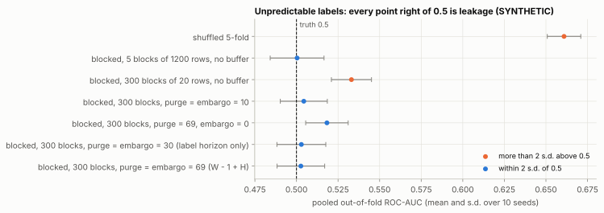

# H7.2 Purging and embargo: buffers for windowed data

Lesson: [w3d2](../../lessons/w3d2_group_temporal_validation/README.md). Related: [H7.1 Windowing and
causality](h7_1_windowing_and_causality.md), [H6.3 Group and temporal validation](../ch06_evaluation_leakage_uncertainty/h6_3_group_and_temporal_validation.md).

## H7.2.1 Overview

Splitting a time series into contiguous blocks is necessary but not sufficient when each row is built
from a window of raw samples. A training row just before a validation block may have a label computed
from samples inside the block; a training row just after it may have features computed from samples
inside it. **Purging** drops training rows before the block, **embargo** drops training rows after it,
and the number of rows to drop follows directly from the window lengths.

## H7.2.2 Derivation

Let row $i$ use features from a trailing window of $w$ raw samples, $[i-w+1, i]$, and a label defined
over the next $h$ samples, $[i, i+h]$ ($h = 0$ if the label belongs to row $i$ alone). Row $i$ then
depends on the raw samples

$$S_i = [\, i-w+1,\; i+h \,].$$

Two rows $i < j$ share a sample iff $S_i \cap S_j \ne \emptyset$, i.e. iff $i + h \ge j - w + 1$:

$$j - i \le w - 1 + h .$$

For a validation block $[a, b]$, a training row $i < a$ shares samples with the block iff
$a - i \le w - 1 + h$, and a training row $j > b$ iff $j - b \le w - 1 + h$. Hence:

| Buffer | Rows dropped from training | Needed in |
|---|---|---|
| purge | $[a - (w-1+h),\; a-1]$ | forward chaining (as `gap`) and blocked K-fold |
| embargo | $[b+1,\; b + (w-1+h)]$ | blocked K-fold only; forward chaining has no training rows after the block |

Edge cases worth checking in code: $w = 1, h = 0$ needs no buffer; a centred feature window of length
$w$ reaches $\lfloor w/2 \rfloor$ samples into the future and must be counted in $h$ (better: do not use
centred windows, H7.1).

```text
          purge = w-1+h                validation block [a, b]               embargo = w-1+h
 ...######|.............|=============================================|.............|######...
          ^ last kept training row: its label window ends before a      ^ first kept training row:
                                                                         its feature window starts after b
```

## H7.2.3 What the buffer does and does not guarantee

The buffer guarantees that **no raw sample** contributes to both a training row and a validation row. It
is therefore independent of the model: no learner can exploit shared samples that are not there. It is a
sufficient condition for independence only if raw samples are themselves independent, which sensor
signals rarely are:

* **autocorrelation** beyond the window: extend the buffer by the signal's correlation length if it is
  long relative to the blocks;
* **slow drift and operating regime**: unaffected by any buffer; needs grouping or forward validation;
* **unit identity**: blocks within one machine still train on that machine; for new-machine deployment,
  group (H6.3);
* **protocol effects** (faults injected at a fixed time): unaffected.



*SYNTHETIC (lesson w3d2, `example/purge_demo.py`): $W = 40$, $H = 30$, 6,000 rows, labels unpredictable
by construction. Shuffled 5-fold 0.661; 300 blocks of 20 rows without buffer 0.533; one-sided purge of
69 rows 0.518; two-sided buffers of 10, 30 or 69 rows 0.503-0.504; 5 long blocks without buffer 0.500.*

Two lessons from the simulation. Block length matters: with blocks of 1,200 rows the boundary rows are a
negligible share and the leak disappears without a buffer; with blocks of 20 rows, as in day-by-day
walk-forward evaluation, it is back. And one-sided buffers leave about half of the leak. In this
construction a 10-row buffer already suffices, because the exploitable similarity decays within a few
rows; the full $w - 1 + h$ is what guarantees the absence of shared samples for *any* model, not what
is necessary for a particular one.

## H7.2.4 Cost and practical decisions

* **Cost:** $2(w-1+h)$ rows per block in blocked K-fold, $w-1+h$ per fold in forward chaining. If that is
  a large share of the data, the windows are long relative to the series, which is a finding to report.
* **Purge by time, not rows,** when sampling is irregular or has gaps: convert $w$ and $h$ to durations
  and drop training rows whose timestamp falls within the duration of the block's edges.
* **Several series:** apply the buffer within each series (unit) separately; buffering the concatenated
  table by row number mixes units.
* **Label delay** is a different buffer: in deployment, labels arrive after a delay $d$. A model retrained
  at time $c$ can only use rows whose labels were observed by $c$, i.e. rows with time $\le c - h - d$.
  The challenge of w3d2 is this case with $d = 0$.

## H7.2.5 Common failure modes

* Purging but not embargoing in blocked K-fold.
* Forgetting the label horizon ($h$) and buffering only the feature window.
* Off-by-one: buffering $w$ instead of $w - 1$ rows (harmless, slightly wasteful) or $w - 2$ (leaky).
* Computing features on the whole series *after* splitting into folds, so windows at the block edges are
  filled with samples from the other side; or computing them *before* splitting with a centred window.
* Applying a row-count buffer to a table with gaps of minutes between rows.

## H7.2.6 Quick reference

```text
row i depends on samples [i - w + 1, i + h]
buffer b = w - 1 + h                  (rows; convert to time for irregular sampling)
forward chaining:  train = rows < start - b            (TimeSeriesSplit(gap=b))
blocked K-fold:    train = rows outside [start - b, end + b]
retrain with label delay d at cut-off c: train on rows with time <= c - h - d
not covered: autocorrelation beyond the window, drift, unit identity, protocol effects
```

## H7.2.7 Sources and verification status

| Source | Used for | Status |
|---|---|---|
| López de Prado, M. (2018), *Advances in Financial Machine Learning*, Wiley, chapter on cross-validation in finance | the terms "purging" and "embargo" and their use with overlapping labels | from memory, not re-opened this session |
| scikit-learn user guide, `TimeSeriesSplit` (`doc/modules/cross_validation.rst`, read 2026-11-22) and the `gap` parameter shown in its example output | correspondence between `gap` and the purge | opened and read |
| Derivation in H7.2.2 | buffer size | worked out here; checked by the w3d2 property test (`required_purge`) and by the simulation |
| Lesson w3d2 `example/purge_demo.py` | numbers and figure | executed 2026-11-22, Python 3.13.18, scikit-learn 1.9.1 |
