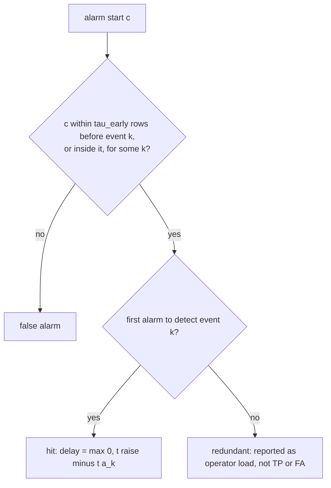
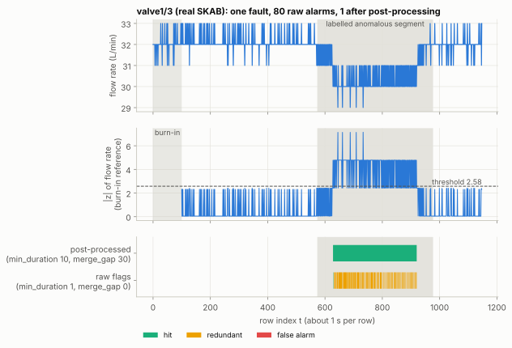

# H7.3 Event matching

Status: Reviewed (author's check against own executed runs; see 7.3.8). Lesson: [w3d4](../../lessons/w3d4_point_vs_event_evaluation/README.md).
Companion section: [H6.5 Point versus event evaluation](../ch06_evaluation_leakage_uncertainty/h6_5_point_vs_event_evaluation.md).

## 7.3.1 Overview

Event metrics are only as meaningful as the rule that decides which alarm "detects" which event. The
rule is a modelling decision about the *labels* and about how the alarm is *used*. It must be written
down before results are seen, kept fixed across detectors, and reported with the numbers. This section
lays out the design space, the rule used in this course and why, and how to adapt a rule to a new domain.

## 7.3.2 Objects

* True event: half-open row interval `(a, b)`; events do not overlap.
* Alarm: half-open interval `(c, d)` after post-processing.
* Timestamps `t(i)` for every row; all durations are computed from them.
* Optional label uncertainty: the true onset is believed to lie in `[a − τ_early, a + τ_late]`.

## 7.3.3 The design space

| Question | Options | Consequence |
|---|---|---|
| What is evidence of detection? | any overlap; IoU ≥ θ; start inside; start inside a window around onset | overlap credits alarms that began in normal operation; IoU penalises short alarms on long events; start-based asks "was this alarm news?" |
| Tolerance before onset | 0; fixed `τ_early`; label-derived | larger tolerance forgives imprecise onsets and rewards random alarms near onsets |
| Grace after the event ends | 0; `τ_late` | needed when events are shorter than detector latency |
| Multiple alarms per event | each TP; first TP rest redundant; extras FP | "each TP" rewards chattering; "extras FP" punishes fragmentation twice |
| One alarm covering several events | detects all; detects the first | with start-based matching an alarm has one start, so it detects at most one |
| Delay origin | labelled onset; changepoint; earliest plausible onset | must match how onsets are labelled |

The course's rule (lab `flowguard.evaluation`): an alarm detects event `k` if its start `c` satisfies
`a_k − τ_early ≤ c < b_k` with `τ_early = 0` by default; the earliest such alarm is the hit, later ones
are redundant; every other alarm is a false alarm; delay is measured to the alarm's *raise* time (start
plus confirmation rows), floored at zero.



## 7.3.4 The cases that decide a rule

A timeline view (rows left to right, `█` = labelled event, `▬` = alarm):

```text
            normal ............ █████████ event █████████ ........ normal
case 1                              ▬▬▬                               start inside: HIT
case 2                    ▬▬▬▬▬▬▬▬▬▬▬▬                                starts before onset, runs in:
                                                                      any-overlap HIT, start-based FALSE ALARM
case 3                              ▬▬   ▬▬   ▬▬                      first HIT, two REDUNDANT
case 4                                                    ▬▬▬         after end: FALSE ALARM (unless grace)
case 5                 ▬▬▬                                            before onset, within tolerance? HIT if τ_early ≥ gap
```

Case 2 is where rules disagree most, and it is common: a drifting signal crosses the threshold shortly
before the labelled onset. On SKAB the elapsed-time "detector" (a single alarm from row 571 onward) is a
case-2 alarm in several test experiments: start-based matching gives it 4/9 events, any-overlap 8/9
(w3d4, run 2026-11-22). Which is right depends on whether the onset label is accurate. If the label is
known to lag reality, case 2 is a genuine early detection and `τ_early` should be raised to the known lag;
if the label is accurate, case 2 is an alarm that preceded the fault, and calling it a detection
rewards alarms that are always on.



*Real SKAB, `valve1/3`.* Case 3 in practice: raw flags give one hit and 79 redundant alarms inside a
single fault. "Redundant" keeps them out of both TP and FA counts; their number is still the operator's
load and is reported separately.

## 7.3.5 Adapting the rule to a domain

Derive every parameter from a property of the labels or of the alarm's use, never from the resulting
score:

| Property | Parameter it fixes |
|---|---|
| Label lag and jitter (e.g. tickets entered 0-8 s late) | `τ_early` = maximum lag; delay resolution = jitter |
| Event length vs required response time | `τ_late` grace when events can end before a timely alarm |
| Event spacing | windows truncated before the next onset so one alarm cannot serve two events |
| How operators act (page, ticket, automatic stop) | whether repeats are redundant or costly; whether clearing time matters |

The w3d4 challenge (part B) applies this to synthetic network outages of 3-20 s with labels lagging by
0-8 s. Under the SKAB rule a fast detector appears to find 11/40 outages with 33 false alarms; with a
window `[s − 8 s, e + 15 s)` truncated 8 s before the next onset it finds 38/40 with 6, matching its
construction (SYNTHETIC; reference `OUTAGE_RULE.md`). The price is stated: delays below 8 s are not
resolvable, and wide windows let random alarms score hits, which must be checked with a random stream of
the same alarm count.

## 7.3.6 Common failure modes

* Choosing the tolerance by trying several and keeping the one that makes the new model win.
* Any-overlap matching on long events (equivalent in spirit to point-adjust).
* Counting each alarm inside an event as a true positive (chattering is rewarded).
* Measuring delay from alarm start while a minimum-duration filter delays the actual raise.
* Matching on row indices across a logging gap, so a "2-row" tolerance spans minutes.

## 7.3.7 Quick reference

```text
write the rule before results:  detection test | tau_early | tau_late | repeats | delay origin | hours
start-based:   a_k - tau_early <= alarm_start < b_k (+ tau_late)
per event:     first such alarm = hit; others redundant
others:        false alarms; exposure = time outside all event windows
sanity check:  score a random alarm stream with the same alarm count under the same rule
```

## 7.3.8 Sources and verification status

* Rule and numbers: implemented and executed in lesson w3d4 (`flowguard.evaluation`, `event_table.py`,
  challenge `outages.py`), 2026-11-22. The clock figures and the outage figures are copied from those runs.
* Comparable conventions exist in seizure- and HFO-detection evaluation (overlap criteria, false detections
  per hour, latency to onset) and in the NAB benchmark (windows around labelled anomalies). These are
  described from general knowledge; **no specific paper was re-opened for this section.**
