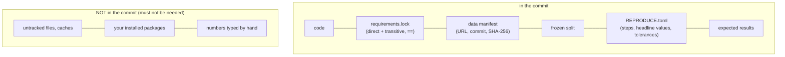
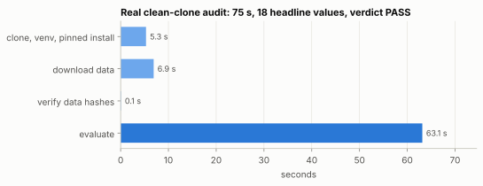

# H8.3 Clean-clone reproduction

Status: Reviewed (sources below) · Lesson: [w8d1](../../lessons/w8d1_project_completion/README.md) ·
Related: [H8.1 Run registries and sweeps](h8_1_run_registries_and_sweeps.md), [H8.2 Seeds and variance](h8_2_seeds_and_variance.md),
[H12.2 Pinning, multi-stage builds, smoke tests](../ch12_docker_reproducible_environments/h12_2_pinning_multistage_smoke_tests.md)

## H8.3.1 Overview

A project result is reproducible from a clean clone when a stranger with the repository URL and a commit hash can
regenerate it on an ordinary machine, without asking the author anything. The test is mechanical: clone into an
empty directory, create an environment from pinned dependencies, obtain the data by a declared and verified
procedure, run the declared commands, and compare the headline numbers with the committed ones under stated
tolerances. Whatever fails points at hidden state: something the result depended on that is not in the commit.



## H8.3.2 Three levels of "same result"

| Term (as used in this course) | What changes | What it shows |
|---|---|---|
| Repeatability | nothing: same machine, environment, code, data | the computation is deterministic |
| Reproducibility | machine and environment; same code and data | the result is a property of the code and data, not of a laptop |
| Replicability | code and/or data (a reimplementation, a new data set) | the *conclusion* holds beyond one implementation |

Terminology differs between fields and committees (some use "reproducibility" for what is called replicability
here); say which you mean. A clean-clone audit tests the middle row only.

## H8.3.3 The procedure

1. **Clone** at a recorded commit into an empty directory. Copying a working tree brings ignored files along
   (data, caches, `results/`), which `git status` does not show.
2. **Scan** tracked files for absolute paths (`/home/...`, `/Users/...`, `C:\Users\...`) and check that the lock
   pins every requirement with `==`.
3. **Create a fresh environment** without system site packages and install the lock. If the lock omits a
   transitive dependency, the install resolves it to whatever is newest that day.
4. **Obtain the data** by a declared step that verifies hashes; fail if a hash differs.
5. **Run the declared steps**, recording exit codes, durations and the tail of their output.
6. **Compare** each declared headline value with the committed expected value under its tolerance. Optionally
   repeat the steps from a clean state and require identical values (determinism).
7. **Write a log** with the commit, environment, step table, comparison table, findings and verdict, and commit
   it next to the report.

## H8.3.4 Tolerances

Floating-point addition is not associative, so a different summation order (threads, vector width, library
version) changes a sum of $n$ terms by at most roughly $\gamma_n \sum_i |x_i|$ with
$\gamma_n = n\varepsilon/(1-n\varepsilon)$ and $\varepsilon = 2^{-53} \approx 1.1 \times 10^{-16}$ (unit roundoff for
doubles). For metrics computed over tens of thousands of values, that is far below $10^{-9}$. Practical rules:

* deterministic CPU pipelines: exact comparison or `abs_tol = 1e-9`;
* integer counts (events detected, rows): exact;
* GPU training, or results depending on parallel reductions you do not control: measure the spread over repeats
  first, then set the tolerance from that spread and state it;
* never widen a tolerance to make an audit pass without a written cause.

## H8.3.5 Decisions and tradeoffs

* **Commit small data vs download by hash.** Committing is simplest and survives upstream changes; licences and
  size often forbid it (SKAB is GPL-3.0 and is downloaded). Downloading adds a dependency on the host; archive a
  copy where allowed.
* **Lockfile vs container image.** A lock reproduces the Python layer; an image also fixes system libraries and
  the interpreter but must itself be built reproducibly (pinned base digest, the same lock). Use both for a
  service, the lock alone for an analysis.
* **What to declare as headline.** Every number a reader would quote: test metrics, intervals, counts of events,
  the chosen model. Provenance fields (commit, timestamp) are expected to differ and are not compared.
* **How often to audit.** At every release and milestone at least; in CI if the pipeline is fast enough (the
  reference evaluation takes about a minute).

## H8.3.6 Failure modes

| Symptom in the audit | Usual cause |
|---|---|
| `ModuleNotFoundError` in the fresh venv | dependency used but not declared; installed on the author's machine |
| `FileNotFoundError` in the clone | data or a config not committed and not downloaded; absolute path |
| `>=` in the lock | lock written by hand or `pip freeze` of direct dependencies only |
| headline mismatch, everything else fine | number edited by hand, results not regenerated after a code change, or nondeterminism |
| different values on a repeat of the same commit | unseeded randomness; thread-dependent reductions; dictionary or file-system iteration order |
| passes locally, fails in CI on another Python version | a dependency whose wheel or behaviour differs by version; untested `requires-python` range |



*Real run, from the w8d1 lesson: the environment and data steps cost seconds; the evaluation dominates.*

## H8.3.7 Quick reference

```bash
# a fully pinned lock: install direct dependencies into a fresh venv, then freeze
python -m venv /tmp/lockvenv && /tmp/lockvenv/bin/pip install numpy==2.5.3 pandas==3.0.5 scikit-learn==1.9.1 scipy==1.18.1
/tmp/lockvenv/bin/pip freeze > requirements.lock

# what the commit actually contains
git ls-files
git status --ignored            # what a copy would bring along that a clone does not

# the audit (w8d1 tool)
python audit/clean_clone_check.py <repo or URL> --ref <commit> --log audit/REPRODUCTION_LOG.md
```

`REPRODUCE.toml`: `[environment] requirements`, one `[[step]]` per command (`name`, `run`, `timeout_s`),
`[headline] produced, expected, repeat`, one `[[headline.value]]` per number (`key`, `abs_tol`).

## H8.3.8 Sources and verification status

* Git: `git clone`, `git ls-files`, `git status --ignored` behaviour exercised in the w8d1 lab and worked example
  (Git 2.43.0); the w1d6 lesson lists the Git documentation sources opened.
* Python `venv` (`EnvBuilder(system_site_packages=False, with_pip=...)`) and `pip freeze`: exercised in this
  lesson on Python 3.13.18; the CPython `venv` documentation source was opened for w1d3 (H2.1).
* Floating-point error bound $\gamma_n$: standard result (Higham, *Accuracy and Stability of Numerical
  Algorithms*, chapter on summation) cited **from memory**, as in H9.1.
* Repeatability / reproducibility / replicability vocabulary: the terms are used inconsistently across bodies (ACM
  artifact badging and the US National Academies report use different conventions); stated **from memory**, not
  re-verified this session.
* The real audit numbers are from `solutions/lessons/w8d1_project_completion/real_audit/REPRODUCTION_LOG.md`.
