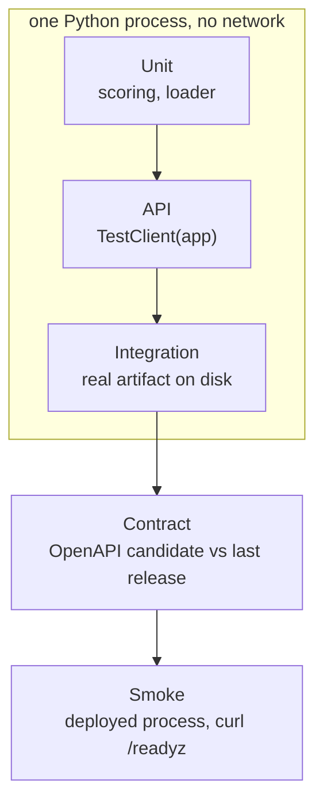
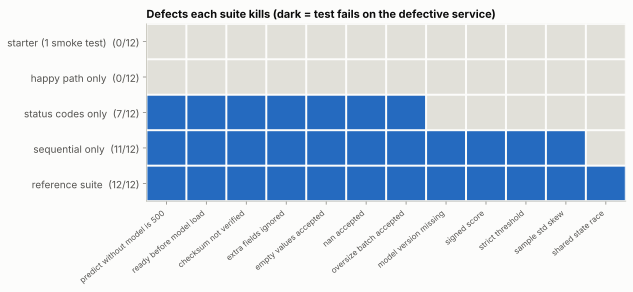
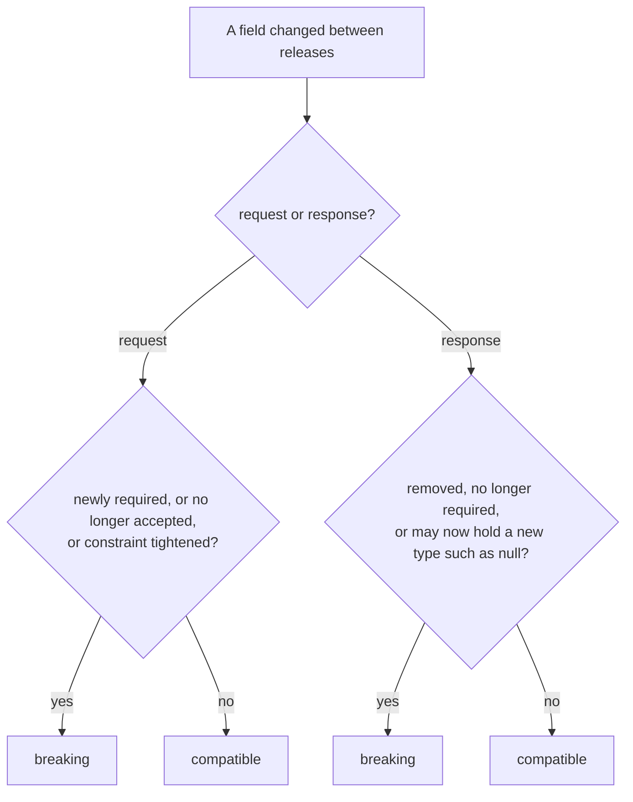

# H9.2 — API, integration and contract tests

**Chapter 9: Testing ML systems** · Section id `H9.2` · **Content status:** Reviewed (FastAPI/Starlette
behaviour checked against the documentation sources in §H9.2.9 and executed in lesson
[w5d5](../../lessons/w5d5_api_testing/README.md); compatibility rules executed in its challenge).

Used by: [w5d5 — Testing the service at the HTTP boundary](../../lessons/w5d5_api_testing/README.md),
[w5d6 — Project milestone 2](../../lessons/w5d6_project_milestone_2/README.md).
Builds on [H9.1 Unit testing ML code](h9_1_unit_testing_ml_code.md).

---

## H9.2.1 Overview

A model behind an API is a small distributed system: a client, a network boundary, a request
schema, a process with a lifecycle, an artifact on disk, and concurrency. Each adds ways to be wrong
that unit tests of the scoring function cannot see. This section sorts service tests into layers,
says what each layer is entitled to claim, and treats the two that ML teams most often skip: tests of
*content* (not only status codes) at the HTTP boundary, and *contract* tests that stop a release from
breaking existing clients.

The central idea carries over from H9.1: a test suite is measured by the defects it would catch. In
w5d5 a suite of a dozen well-chosen tests kills 12 of 12 realistic service defects; a suite that
checks every status code in the contract kills 7; a single smoke test kills none (Figure H9.2-1).

## H9.2.2 Layers



| Layer | Exercises | Can claim | Cannot claim | Runs |
|---|---|---|---|---|
| Unit | functions (`score`, `load_bundle`) | arithmetic and error handling are right | anything about HTTP | every change, ms |
| API | the ASGI app via `TestClient` | statuses, bodies, validation, lifecycle | sockets, timeouts, workers | every change, ms per request |
| Integration | a real boundary (file, database, queue) | the pieces agree on formats | production configuration | every change, seconds |
| Contract | the published schema | old clients still work | the meaning of fields | every change, ms |
| Smoke | a running process after deploy | it started and answers | correctness under load | each deploy |

`TestClient` calls the application object directly through the ASGI interface. There is no server and
no port: tests are fast, deterministic and need no network. What it does not exercise is everything a
server adds: connection handling, request size limits enforced by the server, timeouts, multiple worker
processes, TLS and proxies. Those belong to smoke and load tests (w6d4).

## H9.2.3 Status assertions and content assertions

HTTP status classes carry operational meaning: 4xx says the client must change the request, 5xx says the
server failed and a retry may help, 503 specifically says "not now". Clients' retry logic, gateways'
circuit breakers and the service's error budget all key on the class. So a 500 where a 422 belongs is a
real defect.

A status code says nothing about whether a 200 answer is right. Content assertions check the numbers:
known inputs with hand-computed outputs (H9.1.2), including a negative deviation (absolute value), a
value exactly at the threshold (inclusive or strict), and a calibration where the population and sample
standard deviations differ by a large factor (two values: factor $\sqrt{2}$).



*Figure H9.2-1 (real runs of the w5d5 grader).* A status-code-only suite kills the 7 defects that change a
status, and none of the 5 that change the content of a 200 response or appear only under concurrency.

## H9.2.4 Fixtures for services

Three patterns keep service tests independent and fast:

1. **App factory.** `create_app(model_dir)` instead of a module-level `app`. Each test builds its own app
   from its own configuration; nothing leaks between tests through a shared global.
2. **Artifacts in `tmp_path`.** Each test writes the bundle it needs. A test that edits a shared bundle
   breaks every test that runs after it; the order-dependence that results is the most common cause of
   "flaky" API suites (w5d5 interview rep).
3. **Lifecycle through the context manager.** `with TestClient(app) as client:` runs startup and shutdown
   (the lifespan). Without `with`, the app has not started; use that state deliberately to test readiness.

Dependency overrides (`app.dependency_overrides[get_model] = fake`) replace a dependency for a test. They
are useful for slow or external dependencies; for a model that loads in milliseconds, loading the real
artifact is simpler and tests more.

## H9.2.5 Contract tests

The OpenAPI document generated from the app (`app.openapi()`) is a machine-readable contract. A contract
test compares the candidate's document with the one recorded at the last release and fails on breaking
differences. "Breaking" is defined from the client's side, and requests and responses are asymmetric:

$$\text{request: } T_{\text{old}} \subseteq T_{\text{new}} \qquad \text{response: } T_{\text{new}} \subseteq T_{\text{old}}$$

where $T$ is the set of values a field may take (its type signature together with its constraints).
The server may accept more and return less variety; it may not accept less or return something new.



Practical points:

* FastAPI writes each pydantic body as a `$ref` into `components/schemas`; a diff must resolve references,
  otherwise it compares two identical pointers and misses every field change.
* `extra="forbid"` (OpenAPI `additionalProperties: false`) makes *removing* a request field breaking:
  old clients still send it and now get 422. It is still the right default, because silently ignoring a
  misspelt field is worse (w5d5, §2.8).
* A contract test cannot see semantics. Changing the standard deviation from population to sample leaves
  the schema byte-identical. Behavioural tests carry meaning; contract tests carry shape.
* Version the contract explicitly (`api_schema: "flowguard-api/1"` from `/version`) and allow breaking
  changes only with a new major version served alongside the old one for a migration period.

## H9.2.6 Practical decisions and tradeoffs

| Decision | Option A | Option B | Guidance |
|---|---|---|---|
| Golden responses vs field assertions | byte-for-byte stored body | assert the fields that carry the contract | fields; golden files only for small, stable payloads |
| Real artifact vs fake model | `save_bundle` into `tmp_path` | dependency override | real when it loads fast; fake for slow or remote dependencies |
| Concurrency test in the unit suite | yes, small (dozens of requests) | only in load tests | yes: it is the only cheap detector of shared-state defects |
| Contract baseline | committed `openapi.json` of last release | regenerate from the last tag in CI | committed file: reviewable, no Git archaeology in CI |
| Server in tests | `TestClient` | uvicorn subprocess | `TestClient` in the suite; one smoke test against a real process in delivery |

## H9.2.7 Common failure modes

* **Status-only suites.** Every contract status tested, no response value checked.
* **Happy-path suites.** One valid request per endpoint; edge cases (empty, maximum + 1, non-finite,
  unknown field, exactly at threshold) untested.
* **Shared mutable fixtures.** A module-level bundle or app edited by one test; order-dependent failures.
* **Tests that need a running server.** They fail in CI and are then skipped "temporarily".
* **Testing the implementation.** Expected values computed by calling the same function the service
  calls, so a wrong formula agrees with itself (H9.1.2, differential tests done wrong).
* **Ignoring the 422 body.** FastAPI's default handler echoes the input; a `NaN` in the input then turns
  the 422 into a 500 (observed with FastAPI 0.165). Test that validation errors are 422 *and* do not
  echo the payload.
* **No contract baseline.** The schema changes with every refactor and nobody notices until a client breaks.

## H9.2.8 Quick reference

```python
@pytest.fixture
def client(tmp_path):
    save_bundle(model, tmp_path / "b")
    with TestClient(create_app(tmp_path / "b")) as c:      # runs the lifespan
        yield c

r = client.post("/predict", json=payload)                   # JSON body
r = client.post("/predict", content='{"values": [NaN]}',    # raw bytes (httpx refuses NaN)
                headers={"content-type": "application/json"})
assert r.status_code == 422 and "NaN" not in r.text

TestClient(create_app(d)).get("/readyz").status_code == 503  # no `with`: not started

with ThreadPoolExecutor(8) as pool:                         # concurrency: distinct requests
    results = list(pool.map(call, range(48)))

breaking_changes(json.load(open("openapi-v1.json")), app.openapi()) == []
```

## H9.2.9 Sources and verification status

Opened in this session (documentation source files on GitHub, 2026-11-22):
* FastAPI `docs/en/docs/tutorial/testing.md`, `docs/en/docs/advanced/testing-events.md`,
  `docs/en/docs/advanced/testing-dependencies.md`, `docs/en/docs/tutorial/handling-errors.md`.
* Starlette `docs/testclient.md` (lifespan runs only when `TestClient` is used as a context manager).
* pydantic `docs/concepts/config.md` (`extra` setting).

Executed: everything in the quick reference, with FastAPI 0.165.0, Starlette 1.7.0, pydantic 2.13.5 and
httpx2 2.13.1 (the HTTP client `TestClient` uses in this Starlette version); the NaN-echo failure of the
default 422 handler was observed directly. The compatibility rules are this course's formulation; they
match common practice for additive API evolution but were not checked against a published standard.
