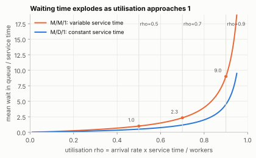
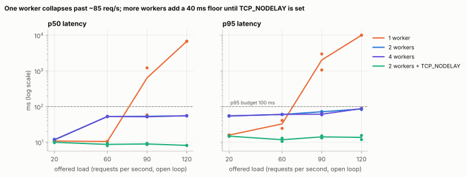
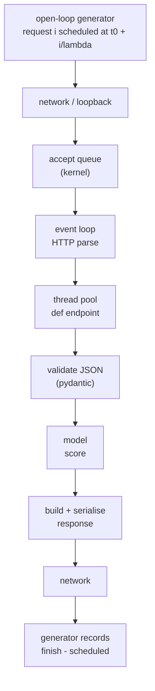

# H10.4 Latency and throughput

Used by lesson [w6d4](../../lessons/w6d4_latency_resources/README.md) · Content status: see
[STATUS.md](../../STATUS.md)

## H10.4.1 Overview

A prediction service is judged on three numbers measured together: how long requests take (latency,
as percentiles), how many it completes per second (throughput), and what it costs to do so (cores,
memory, machines). They are connected: latency depends on load, and the relation turns sharply at the
service's capacity. This section gives the definitions, the one law that connects them (Little's law),
the measurement mistakes that produce optimistic numbers, and the engineering choices that move the
curve for a Python service.

## H10.4.2 Definitions

* **Latency** of one request: completion time minus the time the request *should* have started (its
  arrival or scheduled time). Measured at the client it includes network and queueing; measured inside
  the server it excludes the network and, often, the accept queue.
* **Service time** $S$: the work one request needs when nothing else is waiting (CPU time for a
  CPU-bound service).
* **Offered load** $\lambda$: requests per second arriving. **Throughput**: successful completions per
  second. Below capacity throughput = $\lambda$; above it throughput falls short and, if requests time
  out, can collapse below capacity because work is spent on requests that will be abandoned.
* **Utilisation** $\rho$: the fraction of time servers are busy; for $n$ single-request workers,
  $\rho = \lambda S / n$.
* **Percentile** $P_p$: the value below which a fraction $p/100$ of observations fall. With sorted
  values $x_0 \le \dots \le x_{n-1}$ and linear interpolation (numpy's default),
  $h = (n-1)p/100$ and $P_p = x_{\lfloor h\rfloor} + (h - \lfloor h\rfloor)(x_{\lceil h\rceil} - x_{\lfloor h\rfloor})$.
* **SLO** (service-level objective): a target such as "p95 $\le$ 100 ms and error rate $\le$ 0.1 %
  over 5-minute windows"; an SLA adds a contractual consequence.

## H10.4.3 Why percentiles, and how many samples

Latency distributions are right-skewed and often multi-modal (cache hits and misses; a fixed delay on a
subset of connections). The mean is pulled by the tail and describes no request; the median ignores the
tail entirely. Report p50, p95, p99. Two practical rules:

1. **Enough data for the percentile.** p99 from $n$ requests rests on about $n/100$ of them. With
   $n = 200$ it is decided by 2 requests. Aim for at least 1,000-10,000 requests per configuration for p99.
2. **Percentiles do not compose.** The p95 of combined traffic is not the mean of per-server p95s.
   Aggregate raw latencies or mergeable histograms, then compute percentiles.

A user-facing consequence of tails: if a page needs $k$ independent backend calls, the chance that at
least one exceeds the backend's p99 is $1 - 0.99^k$ (about 18 % for $k = 20$). Tails matter more as
systems fan out.

## H10.4.4 Little's law and the shape of the curve

For a stable system over a long window, **$L = \lambda W$**: average number in the system equals arrival
rate times average time in the system. It holds for any arrival and service distributions and any
scheduling order, which makes it the most useful single equation in capacity work.

* Applied to the servers only: average busy servers $= \lambda S$. To keep utilisation at or below a
  target $\rho^\*$ with single-request workers you need $n = \lceil \lambda S / \rho^\* \rceil$.
* Applied to the whole service: if $W$ grows while $\lambda$ is constant, $L$ grows proportionally;
  those requests are held in queues and memory.

Queueing theory gives the shape of the curve. For a single server with Poisson arrivals, the mean wait
in queue is $W_q = \frac{\rho}{1-\rho} S$ with exponentially distributed service times (M/M/1) and half
that with constant service times (M/D/1). Real services lie in between and their tails are worse than
the mean suggests. Either way, waiting time is modest at $\rho = 0.5$, a few service times at 0.7, and
unbounded as $\rho \to 1$:



*Figure H10.4-1. Mean wait in queue, in units of service time, for two textbook single-server queues
(computed from the formulas above, no data). Capacity plans target $\rho$ of about 0.6-0.75.*

The measured counterpart from lesson w6d4: one worker at about 12 ms per request was within budget at
60 requests/s ($\rho \approx 0.72$), queued for seconds at 90/s, and at 120/s served only 3.5/s with
95 % time-outs while its memory grew past 2 GB.



*Figure H10.4-2. Real measurements from lesson w6d4 (4-core shared machine, 600-sample requests).*

## H10.4.5 Measuring correctly



* **Open loop, latency from the scheduled time.** A closed-loop generator (N users, each waiting for its
  response) stops sending when the server stalls, so the stall's victims are never measured
  (*coordinated omission*). In the lesson's simulation of a server with one 1 s pause, a closed loop
  reported p99 = 10 ms and the open loop p99 = 710 ms for the same server.
* **Warm-up.** Exclude the first seconds (connection set-up, lazy imports, caches) by scheduled time.
* **Separate successful from failed requests.** Fast errors make latency look better; time-outs make
  it look like a fixed ceiling. Report the error rate next to the percentiles.
* **Watch the generator.** It needs CPU and has its own scheduling delays. If requests leave late
  (the lesson's `late_starts`), you are measuring the generator. Co-locating it with the server
  overstates service time on small machines; on a shared machine, repeat runs and interleave
  configurations.
* **Measure at several rates.** A single latency figure without its offered load cannot be compared with
  anything. The knee is the useful number.
* **Profile inside the request.** `time.perf_counter` spans for coarse phases and `cProfile` (or a
  sampling profiler such as py-spy, which attaches to a running process) for function-level detail.
  In the lesson, parsing, scoring and building the response were 3.8 ms of an 11 ms request.

## H10.4.6 What moves the curve in a Python service

| Lever | Effect | Cost or caveat |
|---|---|---|
| More worker processes | raises capacity roughly with cores for CPU-bound Python | memory per process (lesson: 90 MB for 1, about 395 MB for 4); shared-socket details (H10.4.7) |
| More threads per process | more requests in progress; no more CPU-bound throughput under the GIL | helps only for I/O-bound endpoints |
| `OMP_NUM_THREADS=1` (and BLAS equivalents) per worker | avoids oversubscribing cores with library thread pools | course measurement in w4d5: 8,153 ms default vs 3.5 ms single-threaded |
| Smaller payloads / fewer per-sample objects | less parsing and validation work per request | API change; measure first |
| Batching many small requests | amortises per-request overhead | adds waiting time; needs a maximum batch delay |
| Concurrency limit + fast rejection (503, `Retry-After`) | bounded memory and latency under overload | clients must retry with back-off |
| Autoscaling on request rate or utilisation | capacity follows traffic | scale-up is slower than a burst; still needs the limit above |

## H10.4.7 A worked diagnosis: a delay that does not depend on load

Symptom from the lesson: with `uvicorn --workers 2` or `4`, p50 was about 52 ms at 60-120 requests/s
and p95 about 55 ms even at 20/s, while one worker had p50 about 11 ms. Reasoning:

1. Queueing grows with load; this delay did not, so it is a fixed delay on some fraction of requests.
2. 52 - 11 = 41 ms is close to Linux's minimum delayed-acknowledgement time (40 ms; from memory, see
   sources). A fixed ~40 ms on responses that are written in several pieces is the signature of Nagle's
   algorithm meeting delayed ACKs.
3. Servers avoid that with `TCP_NODELAY`. asyncio sets it automatically, but only on sockets whose
   protocol number is `IPPROTO_TCP`; uvicorn 0.54 creates the multi-worker listening socket with
   `socket.socket(family=AF_INET)` (protocol number 0), so the accepted connections were left with Nagle on.
   With one worker uvicorn passes host and port to asyncio, which resolves them with protocol 6 (TCP).
4. Test: forcing `TCP_NODELAY` in the workers cut p50 at 60/s from 52.3 to 9.5 ms. Fix: create the
   listening socket with `IPPROTO_TCP` explicitly (the lesson's `serve.py`); p95 then stayed at 12-15 ms
   up to 120/s.

The general lesson is the method: classify the delay by how it depends on load, form a mechanism that
predicts the number, and confirm it by changing one thing.

## H10.4.8 Common failure modes

* Benchmarking with a closed-loop tool and sizing production from it.
* Reporting the mean, or a single p99 from a few hundred requests.
* Measuring one rate, far below capacity, and calling the service "fast".
* Running the generator and server on one small machine and quoting the result as capacity.
* Unbounded queues: overload turns into memory exhaustion and time-outs instead of fast rejections.
* Adding threads to a CPU-bound Python service and seeing no gain; or adding processes and forgetting
  that each loads the model and the libraries.
* Optimising the model when the profile says the time is in parsing and serialisation.

## H10.4.9 Quick reference

```text
L = lambda * W                      average in system = arrival rate x time in system
rho = lambda * S / n                utilisation of n single-request workers
n = ceil(lambda * S / rho_target)   workers for a utilisation target (0.6-0.75)
Wq / S = rho / (1 - rho)            M/M/1 mean wait in queue, in service times
P(at least one of k > p99) = 1 - 0.99^k
```

Checklist for a latency measurement: open loop; latency from scheduled time; warm-up excluded;
successful vs failed separated; three or more rates around the knee; repetitions interleaved;
percentiles with enough samples; generator lateness reported; memory read under load; the set-up and
its biases written down.

## H10.4.10 Sources and verification status

* Executed in the authoring environment (2026-11-22): all measured numbers above (lesson w6d4,
  `figures/measure.py`; Python 3.13, uvicorn 0.54.0, FastAPI 0.165.0, httpx 0.28.1); the coordinated-
  omission simulation; the profile.
* Read in the installed sources: `asyncio.base_events._set_nodelay` (TCP_NODELAY only when
  `sock.proto == IPPROTO_TCP`); uvicorn 0.54.0 `Config.bind_socket` (multi-worker socket created as
  `socket.socket(family=family)`), `uvicorn.main.run` (multi-worker path uses `Multiprocess`), and
  `uvicorn/server.py` (single-worker path calls `loop.create_server(host=..., port=...)`).
* From memory, not re-verified this session: Little's law (J. D. C. Little, 1961, *Operations Research*);
  the M/M/1 and M/D/1 (Pollaczek-Khinchine) mean-wait formulas; Linux's 40 ms minimum delayed-ACK time;
  Nagle's algorithm (RFC 896) and delayed ACKs (RFC 1122); the term "coordinated omission" (Gil Tene,
  wrk2/HdrHistogram documentation); "The Tail at Scale" (Dean and Barroso, 2013) for the fan-out
  argument; py-spy as a sampling profiler. None of the lesson's checks depend on them.
