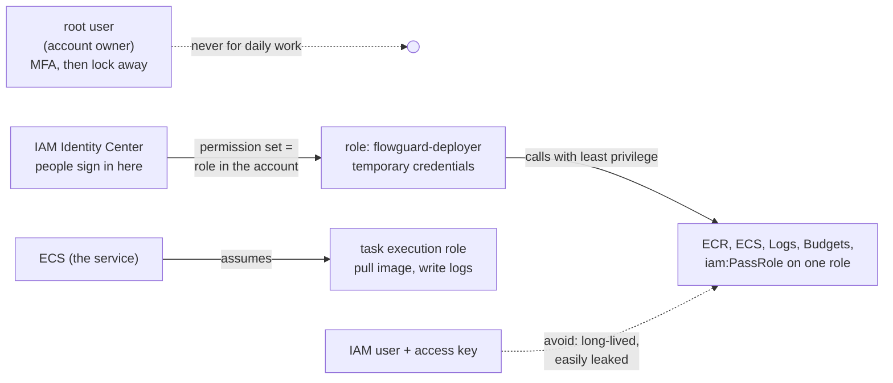
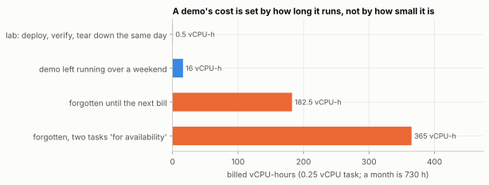

# H13.1 Identity, credentials and cost

Used by lesson [w6d5](../../lessons/w6d5_cloud_deployment/README.md) · Content status: see [STATUS.md](../../STATUS.md)

## H13.1.1 Overview

Before any cloud resource exists, three questions need answers: **who** is acting (identity), **with what
proof** (credentials), and **who pays, and how will they know** (cost controls). Most expensive cloud
incidents in small ML teams are failures of these three, not of compute or models: a long-lived key
leaked through a repository, an identity with far more permission than its task, a resource nobody
remembered. This section gives the vocabulary and the defaults the course uses, so that every later step
(registry, service, teardown; H13.2) rests on them.

The course's defaults, in one line each:

* People sign in through **IAM Identity Center** and receive **temporary** role credentials.
* Each identity has **only** the permissions its task needs (least privilege).
* **No credential** ever appears in a repository, an image, a task definition, a log or a chat.
* A **budget with alerts** exists before anything billable.
* Every created resource has a **scripted teardown** and an independent "nothing is billing" check.

## H13.1.2 Identities: users, roles, and federation



* **Root user.** The account's owner identity, with unrestricted power including closing the account.
  Protect it with MFA and do not use it for work.
* **IAM user.** A long-lived identity that can have a password and **access keys** (an access key id and a
  secret). Keys do not expire unless rotated or deleted. This is what usually leaks.
* **Role.** An identity without permanent credentials. Someone (a person via federation, a service such as
  ECS, a workload) *assumes* it and receives temporary credentials. Roles are the default for both people
  and services.
* **IAM Identity Center** (formerly AWS Single Sign-On). Central sign-in for people across accounts; each
  *permission set* becomes a role in the account. The AWS CLI supports it through `aws configure sso` and
  `aws sso login`; credentials are cached locally and expire.
* **Service roles.** ECS uses a *task execution role* to pull images and send logs (with the AWS managed
  policy `AmazonECSTaskExecutionRolePolicy`), and optionally a *task role* that your application code
  uses. Passing a role to a service requires `iam:PassRole` on that role, which is how least privilege
  limits *which* roles a deployer can hand to the services it creates.

## H13.1.3 Credentials: where they may live

| Place | Acceptable? | Why |
|---|---|---|
| SSO cache after `aws sso login` | yes | temporary, tied to a sign-in with MFA |
| Environment of your shell for one session | acceptable for temporary credentials | gone when the shell ends; never for long-lived keys |
| `~/.aws/credentials` with an access key | avoid | long-lived, readable by every process you run, copied into backups |
| Repository (any file, any branch, any commit) | never | forks, clones and CI logs spread it; history keeps it after deletion |
| Docker image | never | anyone who can pull the image can read every layer |
| Plain `environment` of an ECS task definition | never for secrets | visible to anyone who can describe the task definition; use the `secrets` field backed by Secrets Manager or Parameter Store |
| Logs, error messages, chat, issues | never | widely readable, long retained |

Detecting leaks: secret scanners combine patterns (an AWS access key id is `AKIA` or `ASIA` followed by
16 upper-case letters and digits) with entropy and provider verification. The lesson's worked example shows
both failure modes of patterns: false positives (a 12-digit order number looks like an account id) and false
negatives (a key assembled from two strings). If a key leaks: **deactivate it first**, then find out what it
was used for (CloudTrail), then remove it from history.

## H13.1.4 Least privilege in practice

Start from the actions the task needs, not from what might be convenient. For the w6d5 deployment that is
ECR (create repository, push), ECS (cluster, task definition, service), CloudWatch Logs (log group), Budgets,
EC2 security groups, IAM role creation for one named role, and `iam:PassRole` for that role only. A deployer
with `AdministratorAccess` turns every mistake and every leaked credential into a full account compromise.
The practical compromise for a learner: an Identity Center permission set scoped to these services, used only
for this project, in an account (or AWS Organizations member account) that holds nothing else.

## H13.1.5 Cost: structure first, prices on the day

Cloud costs are sums of *rate × quantity × time*. For a single always-on container service:

$$
C \approx T \cdot n \cdot \big(r_{\text{vCPU}} \cdot v + r_{\text{GB}} \cdot m + r_{\text{IPv4}}\big)
\;+\; r_{\text{store}} \cdot S \;+\; r_{\text{ingest}} \cdot L_{\text{in}} \;+\; r_{\text{logs}} \cdot L_{\text{stored}} \;+\; r_{\text{out}} \cdot D_{\text{out}}
$$

with $T$ hours running, $n$ tasks of $v$ vCPU and $m$ GB, $S$ GB of images stored, $L$ GB of logs, and $D$ GB
transferred out. Two consequences hold whatever the rates are:

1. **Time dominates.** A task forgotten for a month runs $730/T_{\text{demo}}$ times longer than the demo it was
   for: 365 times longer than a 2-hour lab.
2. **Fixed per-hour items do not shrink with size.** Halving $v$ and $m$ does not touch the public IPv4
   address charge, and does nothing about $T$.



*Billed vCPU-hours of a 0.25 vCPU task in four scenarios (arithmetic, no prices; from the lesson).*

**Budgets.** AWS Budgets compares actual and forecasted spend with a limit and notifies (by e-mail or other
channels) when thresholds are crossed. A budget **notifies**; it does not stop resources (budget *actions*
can apply restrictive policies, a separate feature not used here). Create it first, with an alert on actual
spend at a fraction of the limit and one on forecasted spend at the limit.

Prices are deliberately absent from this handbook: they vary by region, change over time, and the official
pricing pages could not be reached when this section was written. Look them up on the day, write them down
with the date, and compute the expected cost before deploying.

## H13.1.6 Practical decisions and trade-offs

| Decision | Default here | When to choose otherwise |
|---|---|---|
| How people authenticate | Identity Center, temporary credentials | Never long-lived keys for people; a workload outside AWS may need workload identity federation |
| Permission scope | one permission set per project, scoped services | A sandbox account where broad permissions are acceptable because nothing else lives there |
| Separate account for experiments | recommended if you can create one | A single personal account: then tag everything and rely on budgets and teardown |
| Budget limit | small, with 50 % actual and 100 % forecast alerts | Larger only with a written expected cost |
| Teardown | scripted, same day, independently verified | Long-running services: then monitoring and ownership replace "same day" |

## H13.1.7 Common failure modes

* **Committed key.** "Private repository" is not a control. Treat any committed key as leaked.
* **Admin for convenience.** The first permission error is "fixed" with `AdministratorAccess` and never
  narrowed again.
* **Budget after the fact.** Created when the bill arrives; the alert would have arrived on day one.
* **Console-only clean-up.** Resources created indirectly (network interfaces, log groups, task definition
  revisions, images) are missed.
* **Secrets in environment variables** of a task definition or a Dockerfile `ENV`.
* **Root user for daily work**, often without MFA.

## H13.1.8 Quick reference

```bash
aws configure sso                              # once: create an SSO profile
aws sso login --profile flowguard-sso          # each session: temporary credentials
aws sts get-caller-identity --profile flowguard-sso   # which account and role am I?
aws budgets create-budget --account-id <id> --budget file://budget.json \
    --notifications-with-subscribers file://notifications.json
```

Rules: no keys in files you commit; no secrets in images or plain task-definition environment; least
privilege plus `iam:PassRole` for named roles only; budget before resources; scripted teardown.

## H13.1.9 Sources and verification status

Opened on 2026-11-22 (raw files on GitHub; docs.aws.amazon.com and aws.amazon.com were not reachable from
the authoring environment, HTTP 403 from the proxy):

* AWS CLI v2 command examples, `aws/aws-cli` repository, branch `v2`, `awscli/examples/`:
  `sts/get-caller-identity.rst`, `budgets/create-budget.rst`, `budgets/delete-budget.rst`,
  `iam/create-role.rst`, `iam/attach-role-policy.rst`, `ecr/get-login-password.rst`.
* botocore service models, `boto/botocore` repository, branch `develop`: `ecs/2014-11-13/service-2.json`
  (the execution role must include `AmazonECSTaskExecutionRolePolicy` or equivalent permissions; the
  task-definition `secrets` and `environment` fields), `budgets/2016-10-20/service-2.json`.
* The archived `awsdocs` GitHub repositories state that they were retired in June 2023 and are out of date;
  they were not used as sources.

From memory, not re-verified this session: the description of IAM Identity Center and `aws configure sso`
behaviour (the CLI's `configure sso` example page returned 404); the `AKIA`/`ASIA` key-id format; that AWS
Budgets notifies rather than enforces by default and that the first budgets are free; that public IPv4
addresses are billed per hour; the AWS shared responsibility model's wording. Prices: none stated, by design.
