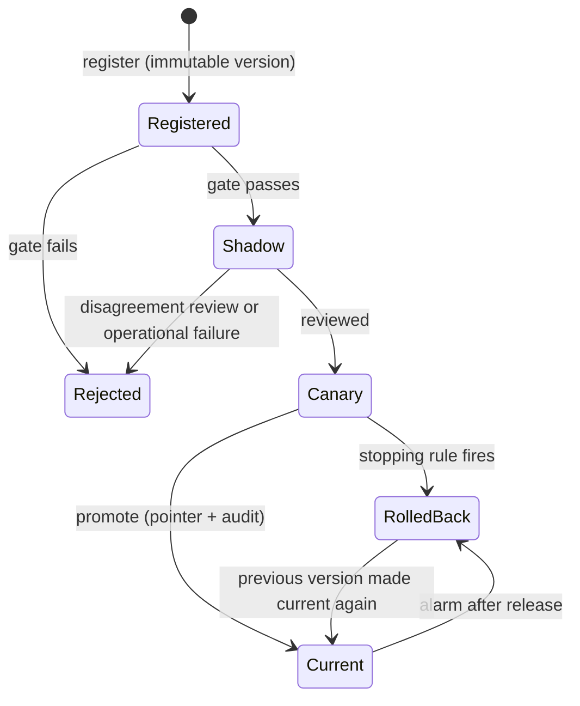
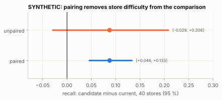
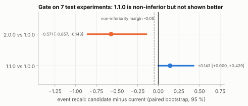

# H15.5 Updates and rollback

**Status:** Reviewed (concepts) and Execution verified (every number quoted from the w7d4 runs).
**Used by:** [w7d4](../../lessons/w7d4_model_updates_rollback/README.md).
**Builds on:** [H15.4](h15_4_drift_vs_degradation_delayed_labels.md) (drift versus degradation),
[H6.6](../ch06_evaluation_leakage_uncertainty/h6_6_bootstrap_and_paired_comparisons.md) (paired comparisons),
[H10.2](../ch10_batch_online_inference/h10_2_artifacts_and_versioning.md) (artifacts and the registry).

## Overview

Replacing a model is a sequence of evidence-gathering steps, each answering a question the previous one
could not, with a cheap way back at every point:

| Step | Question it answers | Evidence | What it cannot tell you |
|---|---|---|---|
| Trigger | Is there a reason to build a candidate? | schedule, measured degradation, new data | whether the candidate will be better |
| Offline gate | Is the candidate at least as good, on the same held-out units? | labelled outcomes, paired interval, guardrails, slices | operational behaviour on live inputs |
| Shadow | Does it run on live inputs, and where does it disagree? | candidate outputs logged, not served | which model is right (no labels yet) |
| Canary | Does it break anything when it decides for real? | guardrail metrics on a traffic share, with a stopping rule | rare-event benefits (too few events) |
| Promote | Make it current | atomic pointer move, audit entry | |
| Rollback | Undo, quickly and exactly | pointer move to the previous verified version | |



## Deeper explanation

### Triggers

*Scheduled* retraining is predictable and easy to staff, and retrains when nothing has changed.
*Performance-based* triggers fire on measured degradation from delayed labels (H15.4); they are the most
relevant and the slowest. *Data-based* triggers fire when new labels or features become available.
*Drift-based* triggers fire on input change; on their own they are weak, because input change does not
imply degradation (in w7d3 a recalibrated sensor moved PSI 9-13x past its threshold and the detector
caught exactly the same faults). Whatever the trigger, a candidate enters the same gate.

### The offline gate

Compare candidate and current **on the same units** (experiments, stores, customers, weeks), resampled
together. For a pooled metric $m$ and units $i$, the paired bootstrap draws indices $I^*$ once per replicate
and computes $m(a_{I^*}) - m(b_{I^*})$. Since
$\mathrm{Var}(\hat m_a - \hat m_b) = \mathrm{Var}(\hat m_a) + \mathrm{Var}(\hat m_b) - 2\,\mathrm{Cov}(\hat m_a, \hat m_b)$,
pairing removes the between-unit difficulty both models share. In the w7d4 worked example (SYNTHETIC,
40 stores) the paired interval for the same difference was $[+0.046, +0.133]$ against $[-0.029, +0.208]$
unpaired.



Decision rules for the interval $[L, U]$ of candidate minus current:
**superiority** $L > 0$; **non-inferiority** with margin $\delta$, $L > -\delta$. Choose the rule and margin
before seeing results, and record the reason in the audit trail. Add **guardrails** (metrics that must
stay within limits regardless of the primary metric: false alarms per hour, latency, cost) and **slice
checks** on predeclared critical subgroups. With few units, some decisions are policy, not statistics: in
w7d4 the re-tuned 1.1.0 caught one more of 7 test faults and missed none, giving $[0.000, 0.429]$, which is
non-inferior but not superior.



Every gate evaluation on a fixed test set is another look at it (H6.4). In production the gate should run
on recent labelled data that neither model was tuned on, refreshed for each decision.

### Shadow mode

The candidate receives a copy of each live input and its outputs are logged. Serving must be unaffected
by construction: compute the current response first, pass the candidate a copy, catch every exception,
and bound its latency (in an async server, run it off the request path with a timeout). Shadow answers
"does it run, how fast, where does it disagree". It does not answer "which is right": the outputs have no
labels yet. Review disagreements by slice and make sure the shadow traffic contains the slices where the
candidate differs; in w7d4 the shadow traffic was valve recordings while all of the candidate's
development false alarms lived in another family.

### Canary, blue/green and stopping rules

A canary serves a fraction $f$ of traffic from the candidate. Over time $T$ with event rate $\lambda$ it
sees about $f\lambda T$ events; for rare events that is often zero, so a canary bounds **guardrails**
(errors, latency, alert volume) rather than the primary metric. For an alert rate with $k$ alerts in
exposure $T$ the exact one-sided bounds are $\chi^2_{\alpha}(2k)/(2T)$ and $\chi^2_{1-\alpha}(2k+2)/(2T)$.
Evaluating a stopping rule at every hour at level $\alpha$ is not a level-$\alpha$ test: the w7d4 challenge
has a scenario that stops at hour 2 on an hourly rule although the full 96 hours give bounds of
[0.874, 1.022] around a budget of 1.0. Use a fixed schedule of looks with a spent error budget (e.g.
Bonferroni over planned looks, or an alpha-spending boundary), or a minimum exposure before a guardrail
may stop. **Blue/green** keeps two full environments and switches all traffic at once; it makes rollback a
router change but gives no partial exposure.

### Rollback, compatibility and lineage

Rollback should never rebuild anything. With an immutable registry it is a pointer move to a version that
was already verified, followed by a reload. Two conditions make it safe: the target is still compatible
with today's serving contract (columns, units, schema version), and the move is atomic and audited. Treat
promotions as a stack so that repeated rollbacks keep going back rather than toggling. What must be
versioned together, as one bundle: parameters, threshold and post-processing, input schema, preprocessing
and its reference statistics. A threshold changed in a config file outside the bundle is an unversioned
model.

## Practical decisions and tradeoffs

| Decision | Options | Guidance |
|---|---|---|
| Gate policy | superiority; non-inferiority | Superiority when the candidate's only benefit is the metric; non-inferiority when it brings another (cost, simplicity, a stakeholder trade-off), with the margin agreed in advance. |
| Gate data | fixed test set; recent labelled data | Recent data not used for tuning; a fixed test set is spent a little more by every decision. |
| Shadow duration | days; weeks | Long enough to cover the slices and cycles where the models differ (weekday/weekend, product families). |
| Canary size | 1 %; 10 %; 50 % | Small enough to bound harm, large enough for the guardrail bounds to be informative in the planned time. |
| Rollback trigger | manual; automatic on guardrail breach | Automatic for fast, unambiguous signals (errors, latency); manual with a runbook for slower ones. |
| Reload mechanism | restart; admin endpoint; new deployment | Admin reload with authentication and a keep-old-on-failure rule; or immutable redeploy with the version pinned. |

## Common failure modes

* Promoting on one offline number without a paired interval or a predeclared rule.
* A shadow implementation that shares mutable state or input objects with serving.
* Canaries judged on the primary metric of a rare-event model.
* Peeking at a canary every hour with a fixed-level test.
* Rollback that depends on rebuilding an image or retraining.
* A promoted model that needs a column the gateway does not send (w7d4's 2.0.0, refused at promotion).
* Audit entries written before the action they describe, or not at all.

## Quick reference

```text
paired diff  = m(candidate[I*]) - m(current[I*]), same I* for both, many replicates
superiority      L > 0
non-inferiority  L > -margin            (margin and policy fixed before looking)
promote only if  primary rule AND guardrails AND slices
shadow:  respond(current, run) first; candidate gets run.copy(); catch everything; log both
canary:  bound guardrails (exact Poisson for rates, Wilson for proportions); plan the looks
promote: registered -> checksums -> schema compatible -> os.replace pointer -> append audit
rollback: stack of promotions; target = top.from; same checks; audit "rollback"
```

## Sources and verification status

* All numbers are from the w7d4 scripts (worked example, `build_models.py`, `update_report.py`, the canary
  challenge's reference solution and figure script), run on 2026-11-22.
* The variance identity, the exact Poisson bounds and the Wilson interval are standard results; the bounds
  were computed with SciPy's `chi2.ppf` and checked against the course's `rate_upper_bound`.
* From memory, not re-opened in this session: the description of shadow, canary and blue/green practices
  follows common industry usage (for example Google's *Site Reliability Engineering* book, O'Reilly 2016,
  on canarying and progressive rollouts); sequential testing and alpha spending follow standard
  group-sequential methods (Pocock 1977; O'Brien and Fleming 1979; Lan and DeMets 1983). Treat
  bibliographic details as unverified.
