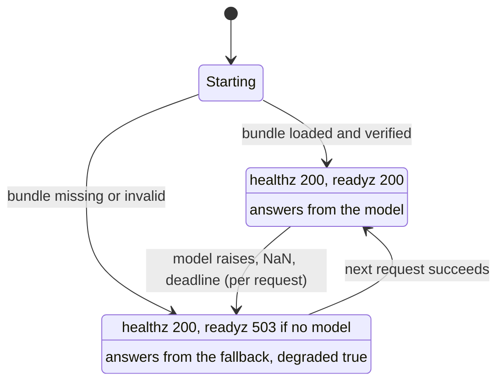
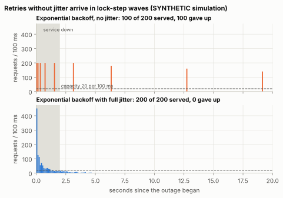
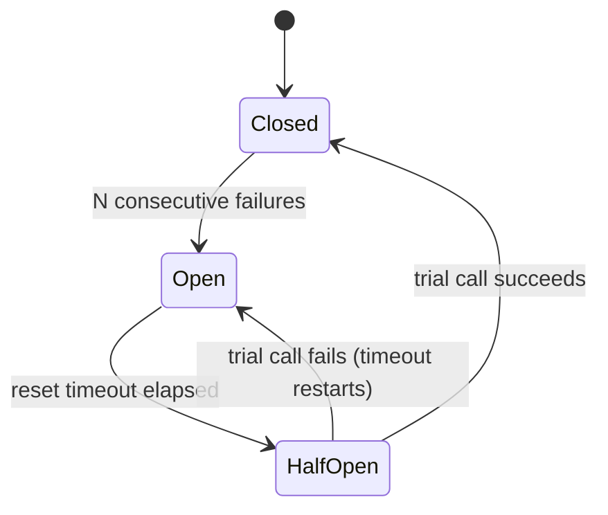

# H15.6 Reliability patterns for ML services

Lesson: [w7d5 Reliability](../../lessons/w7d5_reliability/README.md) · Related: [H15.2 Operational
debugging](h15_2_operational_debugging.md), [H10.4 Latency and throughput](../ch10_batch_online_inference/h10_4_latency_and_throughput.md),
[H11.2 Schemas and validation](../ch11_fastapi_input_validation/h11_2_schemas_and_validation.md) ·
Status: Reviewed (sources listed in H15.6.10)

## H15.6.1 Overview

A reliable ML service is not one that never fails. It is one whose failures are *anticipated, visible
and bounded*. Anticipated means each failure mode has a planned behaviour. Visible means the caller, the
metrics and the logs all say what happened. Bounded means one failure cannot consume every thread,
every retry budget or every instance. The patterns below (validation, guards, deadlines, bulkheads, load
shedding, explicit degradation, disciplined retries, circuit breakers, health probes and
failure injection) are general distributed-systems practice. This section adds what is specific to models:
the most dangerous model failure produces a plausible number, not an exception.

## H15.6.2 A taxonomy of failures

| Class | Examples | Default symptom | Guard |
|---|---|---|---|
| Malformed input | NaN, missing field, wrong type, huge payload | exception deep in the code | schema validation at the edge → 422 |
| Well-formed but unfamiliar input | wrong units, new operating regime, sensor stuck | a confident score about a different situation | training-support check, drift monitoring (H15.3) |
| Model or artifact failure | bundle missing or modified, model raises | 500, crash loop | readiness 503 + explicit degradation |
| Silent model failure | NaN/inf scores, constant output | 200 with a meaningless answer | output guard (`all_finite`, range and variance checks) |
| Slow dependency | CPU starvation, slow feature store | latency grows, threads exhaust | deadline + bulkhead |
| Overload | traffic burst, retry storm | queueing latency for everyone | load shedding (429 + Retry-After), jittered retries |
| Stream ordering | duplicates, reordering, gaps | corrupted rolling state | per-stream ordering guard |
| Deployment | OOM kill, bad configuration | restarts, 503 | resource limits from load tests, config validation, rollback |

The second and fourth rows are the ML-specific ones. In the w7d5 drill, multiplying the flow rate by 60
changed *no* score, because the burn-in z-score is scale invariant:

$$\frac{|c\,x - c\,\bar b|}{c\,s_b} = \frac{|x - \bar b|}{s_b}, \qquad c > 0.$$

Any model that normalises its input by statistics of the same input shares this blindness. The guard
belongs outside the model: compare raw values with the range seen in development data.

## H15.6.3 Liveness, readiness and degradation



* **Liveness** answers "restart me?". It should fail only when a restart can help: a deadlock, a wedged
  event loop. The Kubernetes documentation puts it as "liveness probes determine when to restart a
  container", with a deadlock as its example.
* **Readiness** answers "send me traffic?". "Readiness probes determine when a container is ready to accept
  traffic" (same source). A missing model is a readiness failure.
* **Degradation** is per request: the instance may be ready, but this request's model call failed, so this
  answer comes from the fallback.

Getting this wrong has asymmetric costs. If liveness depends on the model, one bad artifact causes a
cluster-wide crash loop. If readiness ignores the model, rollouts of bad artifacts are never halted.

## H15.6.4 Deadlines and bulkheads

A **deadline** bounds how long a caller waits. With `concurrent.futures`, `future.result(timeout=t)` raises
`TimeoutError` when the call "hasn't completed in *timeout* seconds", but the call itself keeps running:
`Future.cancel()` returns `False` "if the call is currently being executed". So a deadline frees the
*caller* and nothing else.

A **bulkhead** bounds how much work one dependency may hold: a semaphore of size *k* around the call. The
slot must be released when the work ends (a done-callback), not when the response is sent. Otherwise a
slow dependency turns every deadline answer into one more orphaned call, and in-flight work grows
without bound.

Sizing comes from Little's law, `L = λ W`. With arrival rate λ = 20 req/s and service time W = 50 ms, mean
concurrency is 1. A bulkhead of 4 gives headroom for bursts. If W grows to 1 s, the demanded concurrency
is 20, and the bulkhead turns the excess into fast `429`s, a cheap and alertable signal, instead of a
queue.

## H15.6.5 Load shedding and backpressure

Queueing excess work converts overload into latency for every request, including the ones that were
fine. Shedding rejects the excess quickly. `429 Too Many Requests` "indicates the client has sent too many
requests in a given amount of time" and "a `Retry-After` header may be included" (MDN, citing RFC 6585).
`Retry-After` takes either a delay in seconds or an HTTP date, and in a `503` response it indicates how
long the service is expected to be unavailable. flowguard sends delay-seconds.

What to shed first is a product decision. In flowguard every request is equal. In a plant with
priorities, safety-critical machines would get a separate bulkhead.

## H15.6.6 Retries, backoff, jitter and idempotency

**Which failures.** Transport errors, 429, 502, 503 and 504 are worth retrying. 4xx other than 429 is not:
the same request fails the same way. 500 is usually a deterministic bug for that input.

**How far apart.** Exponential backoff with *full jitter*: before retry *k* (*k* = 0 for the first retry),
sleep

$$d_k \sim \mathcal{U}\!\left(0,\ \min(d_{\max},\ d_0\,2^k)\right).$$

The exponential reduces the retry rate geometrically. The jitter de-correlates clients that failed
together. Without jitter, *n* clients that failed at time 0 all return at the same instants
$\sum_{j<k} d_0 2^j$. In the w7d5 simulation that meant 200 requests in one 100 ms bucket against a
capacity of 20, at 3.1 s, 6.3 s, 12.7 s and 19.1 s, and half the clients gave up. With full jitter all 200
were served within 8.05 s, with at most 17 requests per bucket after recovery.



*Figure H15.6-1. SYNTHETIC simulation from the w7d5 worked example. Top: no jitter; bottom: full jitter.*

**How often.** Bound the attempts. Worst-case amplification is `max_attempts` times the offered load while
the failure lasts. With several layers that each retry three times, the multiplication compounds (3 × 3 ×
3 = 27 attempts per user action), so retry at one layer only, usually the outermost client.

**Server knows best.** When `Retry-After` is present, use it, capped at the client's maximum.

**Idempotency.** A retry is safe only if a repeated request cannot cause a repeated effect. Scoring is
naturally idempotent. Side effects (opening a maintenance ticket, sending an alert) need an
idempotency key: one client-chosen identifier for all attempts of one logical request. The server stores
the result under the key and returns it for repeats.

## H15.6.7 Circuit breakers

A circuit breaker wraps a dependency that keeps failing, so that callers fail fast instead of each waiting
for a timeout.



Choices that matter: count *consecutive* failures (or a failure rate over a window), not a lifetime
total; let exactly one trial through in half-open; read time through an injectable clock so the logic is
testable without sleeping. Breakers complement retries. A retry loop inside an open breaker fails
immediately, which is the point.

## H15.6.8 Degradation and fallbacks

A fallback must not share the failed component. flowguard's fallback is a rule on raw values whose bounds
live in service configuration, so it works when the bundle, the burn-in or the model library fails. It
must also be *labelled*: `degraded: true`, a reason, a counter, a log event. Measure its cost rather than
assuming it. On the w7d5 test set the fallback detected 2 of 7 faults against 5 of 7 for the model,
with zero false alarm events for both. It is blinder, not noisier, so an unlabelled fallback would make
silence look like health.

Options in increasing fidelity: refuse (503); a static rule; a previous model version (only if it does
not depend on the failed component); a cached last answer (only where staleness is acceptable and visible).

## H15.6.9 Failure injection

Every claim in a failure-mode table needs a test that produces the failure. Practical rules:

* Inject at the boundary of the component you are testing (`FLOWGUARD_FAULTS` replaces the model call's
  behaviour; it does not monkey-patch internals).
* Read fault configuration once, at startup, from an environment variable that production configuration
  never sets, and log it loudly when set.
* Assert the full contract: status, flag, reason, counter, log event with the request id, and latency
  bound where relevant.
* Grade the drill suite by mutation (w1d5, w5d5): it must fail on services that are broken in the ways you
  claim to guard against.
* Run a drill against a real process at least once (w7d5 `drill.py`). In-process test clients do not
  exercise process startup, sockets or real thread pools.

## H15.6.10 Practical decisions and trade-offs

| Decision | Option A | Option B | Choose A when |
|---|---|---|---|
| Status for degraded answers | 200 + `degraded: true` | 503 | callers read the flag and the fallback has value |
| Where to retry | outermost client only | every layer | almost always; per-layer retries multiply |
| Shed or queue | 429 immediately | bounded queue | latency matters more than throughput |
| Fallback | rule without dependencies | previous model | the previous model shares the failed component |
| Bulkhead size | small (2-4) | large | the dependency is CPU-bound in the same process |

## H15.6.11 Common failure modes

* Fallback answers indistinguishable from model answers (silent degradation).
* Liveness probes that load or check the model, which cause crash loops.
* Deadlines without bulkheads, which leave orphaned work.
* Retries on 4xx, retries without jitter, unbounded retries, retries at every layer.
* NaN passed through, which compares False with any threshold, so the result is "no alarm".
* Fault-injection hooks reachable in production configuration.
* Untested guards: the first time the fallback runs is during the incident.

## H15.6.12 Quick reference

```python
# deadline + bulkhead (thread-based model call)
if not slots.acquire(blocking=False):
    return JSONResponse(429, headers={"Retry-After": "1"}, content={...})
fut = executor.submit(call_model, ...)
fut.add_done_callback(lambda _f: slots.release())      # held until the work ends
try:
    out = fut.result(timeout=deadline_s)
except concurrent.futures.TimeoutError:
    return degraded("deadline")

# full-jitter backoff before retry k (k = 0 first)
delay = random.uniform(0, min(max_delay, base * 2 ** k))
```

Retry: transport errors, 429, 502, 503, 504. Do not retry: 400, 404, 409, 413, 422; 500 only if
idempotent and bounded. One idempotency key per logical request.

## H15.6.13 Sources and verification status

Opened this session (2026-11-22), from source repositories:

* CPython 3.13 documentation source `Doc/library/concurrent.futures.rst`: `Future.result(timeout=...)`
  raises `TimeoutError`; `Future.cancel()` returns False for a running call; `shutdown(cancel_futures=True)`
  does not cancel running futures.
* Kubernetes website source `content/en/docs/concepts/workloads/pods/pod-lifecycle.md`: the definitions of
  liveness ("when to restart a container") and readiness ("when a container is ready to accept traffic")
  probes quoted above.
* MDN content source for `429 Too Many Requests` and `Retry-After` (delay-seconds or HTTP date; meaning in a
  503). RFC 9110 and RFC 6585 themselves were not reachable from the authoring environment.

Executed (w7d5 authoring run): the retry-storm simulation numbers, the drill table, the fallback-versus-model
table, and the claim that the slot must be held until the work ends (check
`test_slot_is_held_until_the_slow_work_ends` and the mutant `slot_released_on_response`).

From memory, not re-verified this session: the names and origins of the bulkhead and circuit-breaker
patterns (popularised by M. Nygard, *Release It!*); "full jitter" as described in the AWS Architecture Blog
post "Exponential Backoff And Jitter" (M. Brooker, 2015); the severity scheme in the lesson is this course's
simplification, not a standard.
