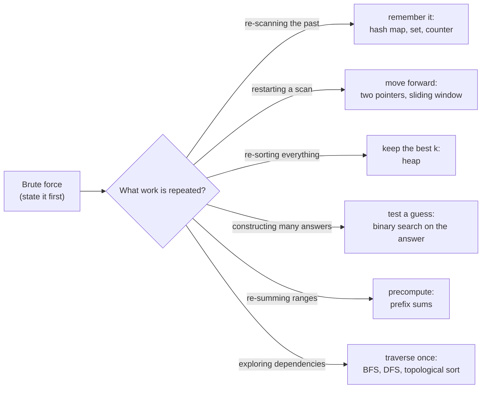
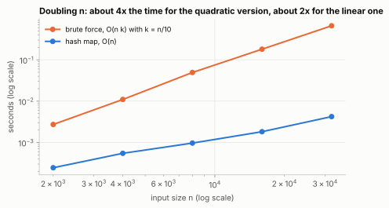

# H16.4 Interview problem patterns

**Status:** Reviewed (see H16.4.9). Used by lesson [w8d4](../../lessons/w8d4_coding_interviews/README.md);
SQL foundations in [H3.1](../ch03_sql_data_pipelines/h3_1_grain_joins_aggregation_nulls.md) and
[H3.2](../ch03_sql_data_pipelines/h3_2_window_functions_timeseries_sql.md).

## H16.4.1 Overview

Coding rounds for data and ML roles draw on a small catalogue of patterns. Each pattern is a way of
removing repeated work from a brute force: remembering instead of re-scanning (hash maps), moving forward
instead of restarting (two pointers, sliding windows), keeping only the best candidates (heaps), testing a
guess instead of constructing the answer (binary search on the answer), and processing items in an order
that respects their dependencies (graph traversal). SQL rounds have their own catalogue built on grain,
joins and window functions. This section lists the patterns with their complexity, the signal in a problem
statement that points to each, and the mistakes that most often cost a pass.



## H16.4.2 The Python pattern catalogue

| Pattern | Signal in the statement | Typical complexity | Data-work example |
|---|---|---|---|
| Hash map / set / Counter | "seen before", "count", "group by", "duplicate" | O(n) | dedupe events; label agreement; join two lists by key |
| Two pointers | two sorted sequences; "pair", "merge", "match within tolerance" | O(n + m) | match detections to annotated events |
| Sliding window | "contiguous", "within the last k", "longest/shortest run such that" | O(n) | rolling statistics; longest stable stretch |
| Monotonic deque | window max/min | O(n) amortised | longest run with max − min ≤ tolerance |
| Heap / top-k | "k largest", "k most frequent", "merge k sorted streams" | O(n log k) | top-k sensors, k-way merge of log files |
| Intervals | "overlap", "merge", "free time", "coverage" | O(n log n) (sort) | merge alarm intervals; event-level evaluation |
| Prefix sums | "sum of a range", many queries | O(n) build, O(1) query | cumulative counts per day |
| Binary search on the answer | "minimise the maximum", "smallest capacity such that" | O(n log range) | batch sizing; capacity planning |
| BFS / DFS | reachability, connected components, shortest path in steps | O(V + E) | lineage of a dataset; connected sensor groups |
| Topological sort | "dependencies", "order of tasks", "cycle" | O(V + E) (+ log V for a heap) | pipeline scheduling |
| Stack | nesting, "next greater element", parsing | O(n) | matching brackets in configs; next higher reading |

Python specifics that matter in interviews: `collections.Counter`, `defaultdict`, `deque` (O(1) at both
ends; a list's `pop(0)` is O(n)), `heapq` (a min-heap: push negated keys or tuples for a max-heap),
`bisect` for binary search on sorted lists, `itertools.groupby` (groups only *adjacent* equal keys), and
the recursion limit (about 1,000 frames by default): write graph traversals iteratively.

## H16.4.3 The SQL pattern catalogue

| Pattern | Signal | Tool |
|---|---|---|
| Grain and fan-out | totals that look too large; one-to-many joins | pre-aggregate to the answer's grain, then join |
| Keep every entity | "for every city/user, including those with none" | `LEFT JOIN` from the entity table; filters in `ON` or a CTE, not `WHERE` |
| Anti-join | "users who never ..." | `NOT EXISTS` (not `NOT IN` when NULLs are possible) |
| Deduplication | "latest record per key", duplicates in an export | `ROW_NUMBER() OVER (PARTITION BY key ORDER BY ts DESC) = 1` |
| Top-n per group | "top 2 per city" | `ROW_NUMBER` with a tie-breaker (`RANK`/`DENSE_RANK` only when ties should be kept) |
| Running and moving values | "cumulative", "7-day average" | window frames `ROWS BETWEEN 6 PRECEDING AND CURRENT ROW` |
| Gaps and islands | "consecutive days", "streak", "sessions" | `day − ROW_NUMBER()` as an island key; or `LAG` + running sum of breaks |
| Cohorts and retention | "users who joined in March and ...", relative windows | first event per user in a CTE; window relative to it |
| Point-in-time | "as of the time of the prediction" | correlated subquery or window over a union; never a later row |

A grain comment at the top of every query (`-- grain: one row per city`) is the cheapest correctness tool
in SQL interviews; say it out loud.

## H16.4.4 Complexity reasoning

Write the cost of each loop and multiply nested ones. Typical sizes and what fits in a few seconds of
Python (roughly 10⁷ simple operations per second):

| n | O(n) | O(n log n) | O(n²) |
|---|---|---|---|
| 10⁴ | instant | instant | ~10 s worst case if each step is a Python-level operation |
| 10⁵ | instant | < 1 s | minutes |
| 10⁶ | < 1 s | a few s | hours |

Hidden costs: `x in list` is O(n) (use a set); slicing copies (O(k)); `sorted()` inside a loop; string
concatenation in a loop; `pop(0)` on a list. Space: say it too; a hash map of all keys is O(distinct keys).



*Slope 2 against slope 1 on log-log axes: the quadratic solution falls behind by a factor that keeps
growing (timings measured in lesson w8d4 on the authoring machine).*

## H16.4.5 The talk-aloud protocol

1. **Restate** the problem in your words with a small example you write down.
2. **Edge cases:** empty input, one element, duplicates, ties, negative or zero values, already sorted.
3. **Brute force** and its complexity, in a sentence or two (code it only if you are short of ideas).
4. **Improve:** name the repeated work, the pattern that removes it, and the invariant that makes it correct.
5. **Code,** narrating decisions ("I update `last_kept` only when I keep an event, because ...").
6. **Test** with your example and an edge case, by hand or by running; fix calmly.
7. **Complexity:** final time and space.

If stuck for more than a minute, say what you are trying and shrink the example. Silence is scored worse
than an honest "I don't see the improvement yet; let me write the brute force first".

## H16.4.6 Testing your own solution in an interview

A good small test set has: the example from the statement; one edge case (empty, single element); one case
that targets the trap of the problem (ties, a value that appears twice in a window, a cycle); and, if you
can run code, a brute-force comparison on random small inputs. The last one is the strongest and takes
three lines; interviewers notice it. For SQL: check row counts against the grain you stated and one total
computed a second way.

## H16.4.7 Common mistakes and how to log them

| Mistake | Pattern behind it | Prevention |
|---|---|---|
| Off-by-one at window or interval boundaries | unclear whether bounds are inclusive | write the inclusive/exclusive rule in the docstring before coding |
| Updating state on every event instead of on kept events | state invariant not stated | say the invariant aloud |
| Correct but O(n²) | nested scan hidden in `in list` or slicing | name the cost of each line |
| Sample vs population statistics; integer division in SQL | defaults assumed | check definitions against the statement |
| Ties handled arbitrarily | no tie rule | ask; then encode the tie-breaker explicitly |
| Recursion on deep inputs | Python's recursion limit | iterative traversal |
| SQL fan-out; `LEFT JOIN` turned into inner by `WHERE` | grain not stated | grain comment; filters in `ON` or CTEs |

Keep an **error log by pattern** in `progress/notes.md`: date, problem, minutes, pass/fail, the mistake, and
the pattern of the mistake (not the problem). Review it before each practice session; the same two or three
patterns usually explain most misses.

## H16.4.8 Quick reference

```text
PROTOCOL  restate + example · edge cases · brute force + O() · improve (pattern + invariant) · code · test · O()
PYTHON    dict/set/Counter O(n) · two pointers O(n+m) · window + deque O(n) · heapq O(n log k)
          binary search on answer O(n log range) · Kahn + heap O((V+E) log V), iterative
          Welford: n+=1; d=x-mean; mean+=d/n; m2+=d*(x-mean); var=m2/n
SQL       grain comment · pre-aggregate then join · LEFT JOIN + filters in ON/CTE · NOT EXISTS
          ROW_NUMBER(PARTITION BY .. ORDER BY .., tiebreak) · day - ROW_NUMBER() for islands
          DATETIME(ts, '+30 days') for relative windows · 1.0 * a / b (no integer division)
TESTS     statement example · empty/single · the trap · brute force on random small inputs
```

## H16.4.9 Sources and verification status

* The catalogue and protocol are this course's synthesis; they match the structure of widely used
  interview-preparation material but are not copied from a single source.
* Python facts (recursion limit default of about 1,000, `deque` and `heapq` complexities, `itertools.groupby`
  grouping adjacent keys only) are stated from memory of the CPython documentation, not re-opened this
  session; the recursion-limit behaviour and the Welford and cancellation behaviour were exercised by the
  lesson's checks (a 30,000-step chain; values near 1e8-1e10).
* SQLite behaviour (window functions, `JULIANDAY`, `DATETIME(ts, '+30 days')`, integer division) was
  executed with SQLite 3.53.1 in the lesson's reference queries.
* The operations-per-second figure in H16.4.4 is a rough planning number for CPython, not a measurement;
  the scaling figure is a measurement on one machine.
