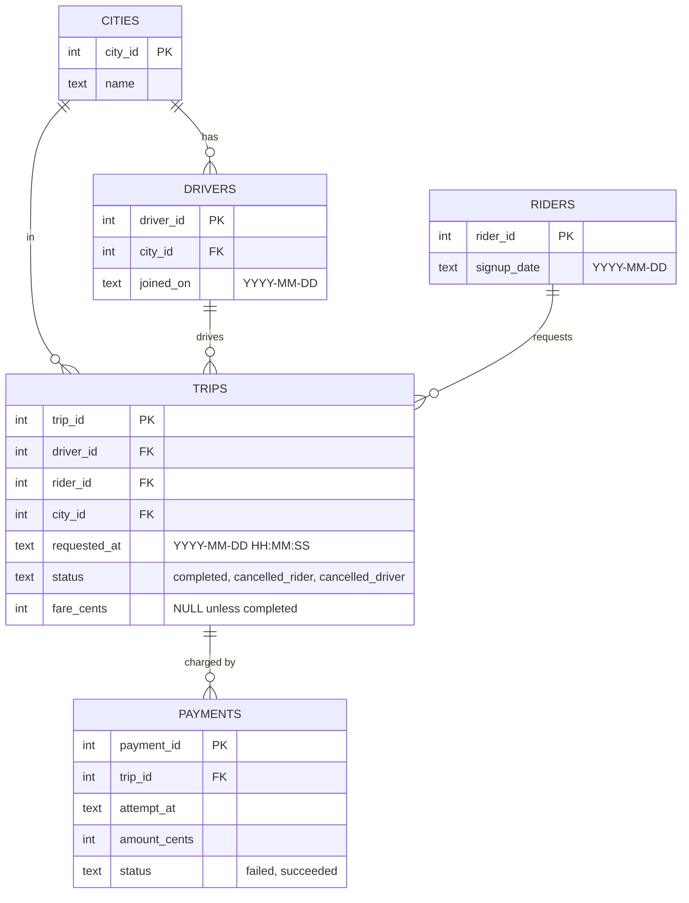

# The rides database (SYNTHETIC)

`rides.db` is generated by [`make_db.py`](make_db.py) with seed 2026 (`python .../make_db.py --check`
confirms the committed file matches). Invented data for SQL practice: 5 cities, 60 drivers, 400 riders,
6,190 trips and 8,119 payment attempts between January and April 2026. It is built to contain the usual
traps: several payment attempts per trip (failed, then succeeded), about 4 % of completed trips never
paid, cancelled trips without a fare, one city (Karaganda) with no drivers active in March, and drivers
with several trips on one day. Nothing about real ride-hailing can be concluded from it.

| Table | Grain (one row is...) |
|---|---|
| `cities` | a city |
| `drivers` | a driver (works in one city) |
| `riders` | a rider |
| `trips` | a trip request, whatever its outcome |
| `payments` | one payment **attempt** for a trip (0-3 per completed trip) |
