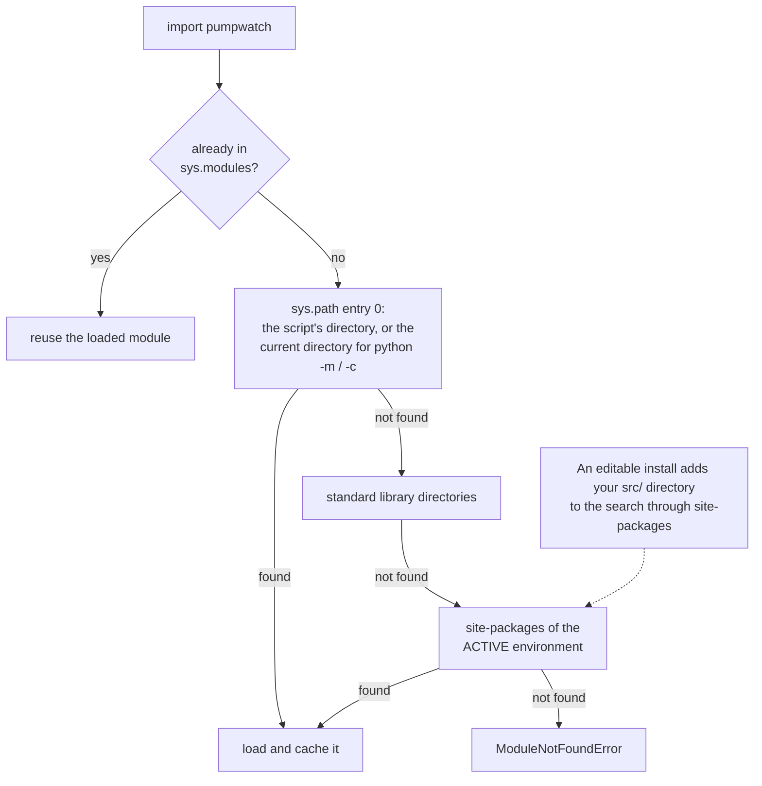
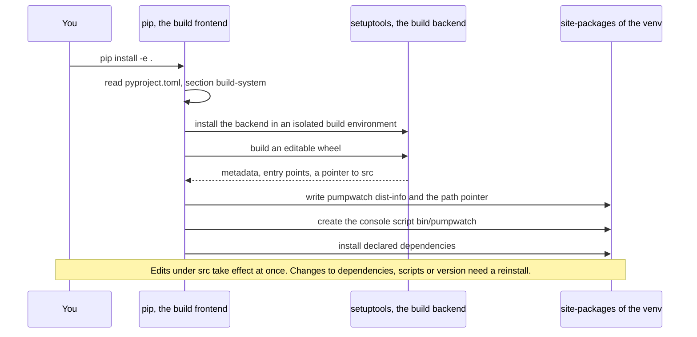
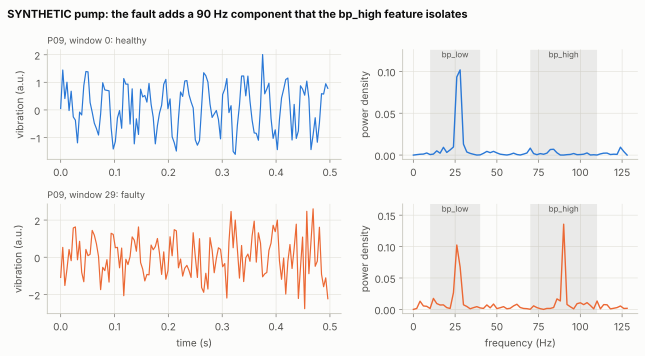
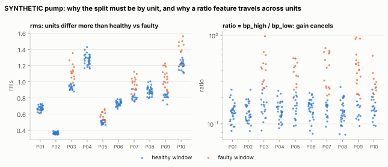
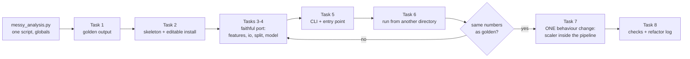

# w1d3 — From script to installable package: project structure and environments

**Unit id:** `w1d3` · **Week 1, core day 3** · **Handbook:** [H2.1 Project structure and environments](../../handbook/ch02_maintainable_python/h2_1_project_structure_environments.md)
**Data:** SYNTHETIC pump vibration (`data/synthetic/pump_vibration.csv`, schema in `data/README.md`)

> Commands are run from the repository root unless a step says otherwise.

---

## 1. Purpose

**Primary objective.** Turn a notebook-export script into an installable `src`-layout
package with a `pyproject.toml`, an isolated environment, an editable install and a
console command — and *prove* with a characterization run that the refactor preserved
behaviour before making one deliberate, recorded behaviour change.

**Why an applied ML engineer needs it.** Everything later in this course — tests, an
inference API, a Docker image, CI — consumes your code as an *installed package with
declared dependencies*, not as a file that happens to run in the directory where you
wrote it. "Works on my machine, from this folder, in this conda env" is the most common
reason research code cannot be handed to anyone. The second skill here is less visible
and more valuable: changing structure without changing results, and being able to show
that you did.

**You will learn to**

- explain where `import pumpwatch` looks, and why the answer depends on how Python was started;
- lay out a project so the *installed* code is what runs and is tested;
- write a minimal, correct `pyproject.toml` (build system, metadata, dependencies, entry point);
- create and use a virtual environment without relying on activation magic;
- separate behaviour-preserving changes from behaviour-changing ones and verify each appropriately.

**Prerequisites.** Fluent Python; you have used `pip` and some environment manager.
Diagnostic sections on Python refactoring (w1d1) attempted. No packaging knowledge assumed.

**Deliverable.** The `lab/` directory containing an installable `pumpwatch` package, `golden.txt`,
and a filled-in `REFACTOR_LOG.md`.

**Completion criteria.**

- [ ] `python -m pytest lessons/w1d3_package_structure/checks -q` passes (guided practice).
- [ ] `pumpwatch train --data <absolute path>` prints the golden metrics when run from `/tmp`.
- [ ] `REFACTOR_LOG.md` lists at least four issues in the original script and separates
      behaviour-preserving from behaviour-changing steps, with before/after numbers.
- [ ] You answered the assessment questions *in writing* before opening the answers.
- [ ] (Independent skill) the challenge checks pass without opening hint 3 or the solution.

**Time budget — essential path, 2 h**

| Activity | Minutes |
|---|---|
| Sections 2–3: concepts and worked example (run it) | 35 |
| Section 4: guided lab | 65 |
| Section 7: assessment questions, written | 10 |
| Section 8: reflection, mark progress | 10 |

**Optional extension, ≤ 1 h:** independent challenge (≈ 45 min) and the interview rep (≈ 15 min).
If you stop at two hours, do the challenge on the review day; "independent skill" stays
unmarked until then.

---

## 2. Conceptual explanation

The full treatment, with more examples and the tradeoff tables, is handbook
[H2.1](../../handbook/ch02_maintainable_python/h2_1_project_structure_environments.md).
This section is the minimum you need for the lab.

### 2.1 Intuition: an import is a search, and you control the search path

`import pumpwatch` walks the list `sys.path` in order and takes the first match. The list
is built at interpreter start-up:

1. **Position 0 depends on how you launched Python.** `python path/to/script.py` puts the
   *script's directory* first. `python -m module`, `python -c ...` and the REPL put the
   *current working directory* first.
2. Then anything in the `PYTHONPATH` environment variable.
3. Then the standard library.
4. Finally the environment's `site-packages` — where `pip install` puts things.

Consequences you have certainly met:

- a notebook imports `utils.py` because Jupyter's working directory happens to contain it;
  move the notebook and it breaks;
- `sys.path.append("../src")` at the top of a script — a search-path patch that is only
  right for one working directory;
- a file named `random.py` or `signal.py` next to your script shadows the standard library.

*Installing* a package means making it findable through step 4, which is the only step
that does not depend on where you are standing or how you started Python.



*An import is a search over `sys.path`, in order. "Works from the repo root, fails elsewhere" means entry 0 found your code and nothing else would have.*

### 2.2 Precise terminology

| Term | Meaning |
|---|---|
| **module** | one importable `.py` file |
| **import package** | a directory of modules you `import` (`pumpwatch/`) |
| **distribution package** (project) | the installable, versioned thing pip deals with (`pumpwatch 0.1.0`). Its name can differ from the import name (`scikit-learn` → `sklearn`). |
| **sdist / wheel** | source archive / built archive that pip installs by unpacking |
| **build frontend** | the tool you invoke: `pip`, `python -m build`, `uv` |
| **build backend** | the library that turns your source tree into a wheel: `setuptools`, `hatchling`, … Named in `[build-system]`; the frontend downloads it into a temporary build environment. |
| **virtual environment** | a directory with its own `site-packages` and a `pyvenv.cfg` pointing at a base interpreter. Cheap, disposable, not relocatable. |
| **editable install** | an install whose `site-packages` entry *points back at your source tree*, so edits take effect without reinstalling |
| **entry point / console script** | `name = "module:callable"` in `[project.scripts]`; the installer generates an executable `name` that imports the callable and calls it |

### 2.3 Why the `src` layout

Two layouts:

```
flat                              src
project/                          project/
  pyproject.toml                    pyproject.toml
  pumpwatch/__init__.py             src/pumpwatch/__init__.py
```

With the flat layout, standing in `project/` and running `python -m pytest` or
`python -c "import pumpwatch"` puts `project/` at `sys.path[0]`, so `pumpwatch` is
imported **from the working tree whether or not it is installed** — and whether or not
the installed copy is complete. You can ship a wheel that is missing a subpackage or a
data file while every local test passes.

With `src/`, the project root contains no importable `pumpwatch`. The only way to import
it is through an installation. If the packaging configuration is wrong, you find out
immediately, on your machine. The cost is one extra step (`pip install -e .`) before
anything runs — which is the step your colleague and your Dockerfile need anyway.

```
flat layout                              src layout
-----------                              ----------
project/                                 project/
  pumpwatch/        <- importable from     pyproject.toml
    __init__.py        the repo root       src/
  pyproject.toml       WITHOUT installing    pumpwatch/      <- importable ONLY
  tests/                                       __init__.py      after installing
                                           tests/

python -c "import pumpwatch"             python -c "import pumpwatch"
  from project/      -> works (entry 0)    from project/      -> fails until installed
  from elsewhere     -> fails              from anywhere      -> works once installed
  => a broken or missing install           => tests always run against the
     can go unnoticed                         installed package
```

*The `src` layout removes the accidental import path, so "it imports" means "it is installed".*

### 2.4 What `pip install -e .` actually does

1. pip reads `[build-system]`, creates an isolated temporary environment, and installs
   the backend (`setuptools`) into it.
2. The backend reads `[project]` and writes metadata into `site-packages`
   (`pumpwatch-0.1.0.dist-info/`): name, version, dependencies, entry points.
3. Instead of copying your code, it writes a small pointer (for setuptools, a `.pth` file
   or an import hook) that makes `src/` importable.
4. pip installs the declared `dependencies`.
5. For each `[project.scripts]` entry it writes an executable into the environment's `bin/`.

Edits to existing `.py` files are live. **Metadata is not live**: after changing
dependencies or entry points in `pyproject.toml`, re-run `pip install -e .`. An editable
install is a development convenience, not a deployment mechanism — images and servers get
a regular install (week 6).



*What an editable install does. The frontend orchestrates; the backend knows how to build your project.*

### 2.5 Environments: isolation, then reproducibility

A virtual environment answers *"which packages can this interpreter see?"* Run
`.venv/bin/python` and you are in the environment; `source .venv/bin/activate` merely puts
`.venv/bin` first on `PATH` so that `python` and `pip` resolve there. Always prefer
`python -m pip` over bare `pip`: it guarantees you install into the interpreter you are
running.

Two different files describe dependencies, and conflating them causes real damage:

- **Abstract requirements** (`dependencies` in `pyproject.toml`): what the package needs,
  with the *loosest* bounds you believe (`numpy>=1.26`). Read by anyone who installs it.
- **A lock / pinned set** (`requirements.txt` from `pip freeze`, `uv.lock`, …): the *exact*
  versions of everything, including transitive dependencies, that one environment
  resolved to. Used to rebuild *that application environment*.

A library pins loosely so it can coexist with others; a deployed service locks tightly so
Tuesday's build equals Monday's. Your project will be both: a package (loose) and, from
week 6, a service image (locked).

### 2.6 Connection to what you already know

- The feature set is your home ground: **line length** `Σ|x[t+1]−x[t]|` (the classic
  seizure/HFO detector feature), **RMS**, and **band power** from a periodogram. A bearing
  fault adds narrow-band energy near a characteristic frequency exactly as an HFO adds
  energy in 80–250 Hz; `ratio = bp_high / bp_low` is the same normalisation trick as a
  relative band power, cancelling the per-unit gain much as it cancels per-channel
  impedance differences.
- `unit_id` plays the role of *subject*. The script already uses a grouped split — you
  would not have let it do otherwise — but look at where it fits the scaler.
- A characterization run is a pilot recording: before changing the rig, record what the
  current rig produces, so later differences can be attributed.



*SYNTHETIC data. The features you will move into `pumpwatch.features` are the ones you compute on EEG windows: here `bp_high` picks up the 90 Hz fault component and `bp_low` the shaft rotation near 25 Hz. Regenerate with `python lessons/w1d3_package_structure/figures/make_figures.py`.*



*SYNTHETIC data. Left: mean `rms` per unit runs from 0.36 to 1.27, a wider spread than the healthy-versus-faulty gap (0.81 versus 1.01 on average), which is why the split is by unit, as it is by subject in your work. Right: a ratio of band powers cancels the unit gain.*

### 2.7 A concrete industry example

A data scientist hands over `churn_model_final.ipynb` plus a pickle. The platform team
must run scoring nightly. The notebook imports `helpers` from the author's home
directory, depends on whatever was in their conda env in March, and reads
`../data/latest.csv`. Three weeks go to archaeology. The replacement is unglamorous: a
repository with `pyproject.toml`, `src/churn/`, a `churn score --input … --output …`
command, and a pinned environment. The nightly job becomes two lines —
`pip install churn==1.4.2` and one command — and when a number looks wrong, "which code
produced this?" has an answer: a version.

### 2.8 Assumptions, limits, and common misconceptions

- **"A package is for publishing on PyPI."** No. You install your own project locally;
  nothing leaves your machine. Packaging is about a stable import path and declared
  dependencies.
- **"`__init__.py` makes it a package, so I'm done."** It makes the directory importable
  *if it is on `sys.path`*. Installation is what puts it there reliably.
- **"Editable means everything updates."** Code yes; metadata, new entry points and
  dependencies no.
- **"`pip freeze > requirements.txt` is my dependency declaration."** It is a snapshot of
  one environment, including things you installed by accident. Useful as a lock, harmful
  as the *only* description.
- **"conda/uv/poetry make this obsolete."** They are frontends and environment managers
  around the same standards (`pyproject.toml`, wheels, `site-packages`). The model above
  is what they all implement.
- **"If the metrics are identical after my change, the change was harmless / the bug was
  not real."** You will see a counterexample in Task 7.
- **Limit of this lesson:** a correct package does not make the *analysis* correct.
  Single split, three test units, a fixed 0.5 threshold — all still there. Those are
  weeks 2–3.

---

## 3. Worked example: `room_report.py` → `tempstats`

A deliberately tiny, different problem so the lab is not a copy exercise.
Files: [`example/`](example/).

**Dataset (SYNTHETIC).** `example/data/room_temps.csv`, 72 rows, hourly readings for
three rooms over one day, two missing values.

| column | type | meaning |
|---|---|---|
| `room` | str | `lab_a`, `lab_b`, `server` |
| `timestamp` | ISO-8601 str | hourly, 2026-03-02 |
| `temp_c` | float, nullable | temperature in °C |

**Before** — [`example/before/room_report.py`](example/before/room_report.py):

```bash
python lessons/w1d3_package_structure/example/before/room_report.py
```

Expected output (exact; the data file is committed):

```
lab_a 21.01 4.28 23
lab_b 23.48 3.31 23
server 26.92 3.23 24
```

Now run it from somewhere else — `cd /tmp && python /path/to/.../before/room_report.py` —
and it fails with `FileNotFoundError`: the data path is relative to the *working
directory*, not to the script.

**After** — [`example/after/`](example/after/): `pyproject.toml`, `src/tempstats/stats.py`,
`src/tempstats/cli.py`.

```bash
python -m venv /tmp/tempstats-venv
/tmp/tempstats-venv/bin/python -m pip install -e lessons/w1d3_package_structure/example/after
cd /tmp
/tmp/tempstats-venv/bin/tempstats /absolute/path/to/lessons/w1d3_package_structure/example/data/room_temps.csv
/tmp/tempstats-venv/bin/python -c "import tempstats; print(tempstats.__file__)"
```

Expected: the same three lines as before, from any directory; the last command prints a
path inside `example/after/src/tempstats/` (the editable pointer at work). No network?
`PYTHONPATH=lessons/w1d3_package_structure/example/after/src python -m tempstats.cli <csv>`
exercises the same code without installing — useful for a quick look, but note that it is
precisely the search-path patching the install replaces.

**Code decisions worth noticing**

1. **`stats.summarize(df) -> df` knows nothing about files or printing.** The I/O boundary
   is `cli.main`. This is the split that makes the function testable (w1d5) and reusable
   behind an API (week 5).
2. **`main(argv=None) -> int` and `sys.exit(main())`.** Returning the exit code instead of
   calling `sys.exit` inside makes `main(["file.csv"])` callable from a test. The generated
   console script does exactly `sys.exit(main())`.
3. **Validation at the boundary.** `summarize` raises `ValueError` naming missing columns;
   `main` converts expected failures into a one-line message and exit code 2. Unexpected
   exceptions still produce a traceback — that is correct; do not catch `Exception`.
4. **`groupby(..., sort=False)`** preserves the script's first-seen room order. Without
   it the rows would come out sorted — the same here, different for other data. Small
   behaviour differences like this are what a characterization run catches.
5. **`requires-python = ">=3.11"`, `dependencies = ["pandas>=2.1"]`.** Lower bounds only.
   NumPy is not listed because the package never imports it directly.

**Interpretation.** The numbers are irrelevant; the result that matters is the pair of
facts *"same output as before"* and *"independent of the working directory"*.

**Reproducibility.** Deterministic: committed data, no randomness. Verified with the
versions in `docs/TESTED_VERSIONS.md`.

---

## 4. Guided lab

Workspace: [`lab/`](lab/). Starter material: `messy_analysis.py` (the script),
`stubs/` (module contracts), `REFACTOR_LOG.md` (template), `compare_to_golden.py`.

**Result to produce:** an installed `pumpwatch` command that reproduces the script's
metrics from any directory, with the scaler leakage removed as a separate logged change.



*The lab in one picture: preserve behaviour first and prove it, then change behaviour once, on purpose.*

### Task 0 — Interpreter and environment (10 min)

```bash
python3 --version          # need >= 3.11 (tomllib and the package's requires-python)
python3 -m venv .venv
source .venv/bin/activate
python -m pip install --upgrade pip
python -m pip install numpy pandas scikit-learn pytest
```

If the repository already has a `.venv` from the course setup, reuse it. On Pop!_OS
22.04 the system interpreter is 3.10: see H2.1 § "Getting a newer interpreter"
(`uv python install 3.12` then `uv venv --python 3.12 .venv` is the shortest route;
if `python3 -m venv` complains about `ensurepip`, install `python3-venv` with apt).

**Checkpoint.** `python -c "import sys; print(sys.prefix != sys.base_prefix, sys.executable)"`
prints `True` and a path inside `.venv`.

### Task 1 — Characterize before touching anything (5 min)

```bash
python lessons/w1d3_package_structure/lab/messy_analysis.py | tee lessons/w1d3_package_structure/lab/golden.txt
```

Expected: `(300, 10)`, test units `['P01', 'P06', 'P09']`, `auc ≈ 0.9992`, `ap ≈ 0.9971`,
`acc ≈ 0.9667`, `f1 ≈ 0.9091`. Run it twice and `diff` the outputs: is anything
non-deterministic? Record the answer in `REFACTOR_LOG.md`.

Then **read** the script and list every problem you see in the log's issue table —
structural, statistical, anything. Do not fix any of them yet. (There are at least eight.)

### Task 2 — Skeleton and editable install (10 min)

Create `lab/pyproject.toml` and `lab/src/pumpwatch/__init__.py`.
Required in `pyproject.toml`: `[build-system]` (setuptools), `[project]` with
`name = "pumpwatch"`, `version = "0.1.0"`, `requires-python`, the runtime `dependencies`
the code imports, and package discovery under `src`
(`[tool.setuptools.packages.find] where = ["src"]`). Use the worked example as a model —
type it, do not copy the file.

```bash
python -m pip install -e lessons/w1d3_package_structure/lab
cd /tmp && python -c "import pumpwatch; print(pumpwatch.__file__, pumpwatch.__version__)"; cd -
```

**Checkpoint.** Prints a path ending in `lab/src/pumpwatch/__init__.py` and `0.1.0`,
from `/tmp`.

### Task 3 — Features (15 min)

Copy `stubs/features.py` to `src/pumpwatch/features.py` and fill it in from the script.
The two band-power blocks are copy-paste twins: write `band_power` once. Keep the
arithmetic *identical* — same detrending, same normalisation, same `[low, high)` band
edges — even where you would choose differently. Improvements come later and separately.

**Checkpoint** (paste into `python`, from the repo root):

```python
import contextlib, io, runpy
import numpy as np
from pumpwatch.features import build_feature_table
import pandas as pd

with contextlib.redirect_stdout(io.StringIO()):
    script = runpy.run_path("lessons/w1d3_package_structure/lab/messy_analysis.py")
old = script["feat"].sort_values(["unit_id", "window_id"]).reset_index(drop=True)
new = build_feature_table(pd.read_csv("data/synthetic/pump_vibration.csv"), fs=256)
new = new.sort_values(["unit_id", "window_id"]).reset_index(drop=True)
cols = ["rms", "line_length", "p2p", "bp_low", "bp_high", "ratio", "temp", "label"]
print(np.abs(old[cols].to_numpy(float) - new[cols].to_numpy(float)).max())
```

Expected: `0.0`, or at most ~1e-15. Anything like 1e-3 is a real difference — find it.

### Task 4 — I/O, split, model: a *faithful* port (10 min)

Copy and complete `stubs/io.py`, `stubs/split.py`, `stubs/model.py`. Port what the script
does, **including the scaler fitted on all rows**. `make_model(C)` returns the
classifier; `train_and_evaluate` returns a dict of metrics.

Why port a known flaw? Because if you fix it during the move and a number changes, you
cannot tell whether the fix or a porting mistake caused it.

### Task 5 — CLI and entry point (10 min)

Copy and complete `stubs/cli.py`; add to `pyproject.toml`:

```toml
[project.scripts]
pumpwatch = "pumpwatch.cli:main"
```

Re-run `python -m pip install -e lessons/w1d3_package_structure/lab` (new entry point ⇒
metadata changed ⇒ reinstall). Then:

```bash
pumpwatch train --data data/synthetic/pump_vibration.csv > /tmp/metrics.json
python lessons/w1d3_package_structure/lab/compare_to_golden.py \
    lessons/w1d3_package_structure/lab/golden.txt /tmp/metrics.json
```

**Checkpoint.** Four `ok` lines. Log it as a behaviour-preserving step.

### Task 6 — Prove independence from the working directory (5 min)

```bash
REPO=$(pwd); cd /tmp
pumpwatch train --data "$REPO/data/synthetic/pump_vibration.csv" | head -3
pumpwatch train --data nope.csv; echo "exit code: $?"
cd "$REPO"
```

**Checkpoint.** Metrics from `/tmp`; for the missing file a one-line `error: …` on stderr,
no traceback, exit code 2.

### Task 7 — One deliberate behaviour change: fix the leak (10 min)

Change `make_model` so that it returns a single estimator that scales *and* classifies
(`sklearn.pipeline.make_pipeline`), and remove the scaling from `train_and_evaluate`.
Before running: write down in the log whether you expect the metrics to go up, down, or
stay, and why. Then run and record before/after.

You will find the four printed metrics **unchanged to every digit**. Explain that in the
log's "Interpretation" column before reading on.

<details><summary>Discussion (open after writing your interpretation)</summary>

The leak is real: standardisation used the mean and variance of rows from the held-out
units. And the fitted model *did* change — in the reference run the scaler fitted on
training units only has scales up to ~13 % different and means shifted by up to ~0.17 SD
compared with the all-rows scaler, so the coefficients and the individual probabilities
are different. What did not change is anything the script *prints*: (a) AUC and AP depend
only on the ranking of test scores, which was preserved, and (b) accuracy and F1 depend
only on which side of 0.5 each probability falls, and the closest test probability is
about 0.10 away from the threshold. Four summary numbers are a coarse instrument. On a harder
problem, with fewer groups, heavier-tailed features, or a preprocessing step with more
capacity than a mean and a variance (feature selection, PCA, target encoding, imputation
models), the same structural mistake inflates results materially.

So the justification for the change is **by construction**: after it, test rows *cannot*
influence fitted preprocessing, on any dataset. "The number did not move" is evidence
that the leak was small here; it is not evidence that there was no leak, and it would be
wrong to conclude the fix was unnecessary. Week 3 returns to this with data where the
number does move.
</details>

### Task 8 — Run the checks, finish the log (5 min)

```bash
python -m pytest lessons/w1d3_package_structure/checks -q
```

Expected: `13 passed, 1 skipped`. Optional, needs network and about a minute — a real
install into a fresh venv: `WB_RUN_SLOW=1 python -m pytest lessons/w1d3_package_structure/checks -q`.

### Debugging guide

| Symptom | Likely cause | What to look at |
|---|---|---|
| `ModuleNotFoundError: No module named 'pumpwatch'` | not installed in *this* interpreter, or discovery found no packages | `python -m pip show -f pumpwatch`; `which python`; is `where = ["src"]` set and does `src/pumpwatch/__init__.py` exist? |
| `import pumpwatch` works in `lab/` but not in `/tmp` | you are importing from the working directory, not an install (flat layout or stray `pumpwatch/` folder) | `python -c "import pumpwatch; print(pumpwatch.__file__)"` |
| `pumpwatch: command not found` | entry point added after the install; or venv not active | reinstall with `-e`; `ls .venv/bin/pumpwatch` |
| `ImportError: cannot import name 'main'` when running `pumpwatch` | `[project.scripts]` names the wrong module or function | the string is `"package.module:function"` |
| `pip install -e` fails with "Multiple top-level packages discovered" | setuptools auto-discovery in a flat layout saw several directories | use `src/` and `where = ["src"]` |
| `externally-managed-environment` | you ran pip against the system Python | create/activate the venv; use `python -m pip` |
| Metrics differ in the 3rd–4th decimal | band edges (`<` vs `<=`), detrending, NaN handling, or row order changed | Task 3 checkpoint, feature by feature |
| Different test units | `GroupShuffleSplit` got different groups/order or a different seed | pass `groups=features["unit_id"]`, `random_state=seed` |
| A different copy of `pumpwatch` is imported | another lab's package was installed with the same name later | `pip show -f pumpwatch`; reinstall the one you want (one distribution name, one install) |

---

## 5. Independent challenge

[`challenge/README.md`](challenge/README.md) — extend the package to a two-stage
pipeline (`pumpwatch features` → `pumpwatch train --features`) that also runs as
`python -m pumpwatch`. Acceptance criteria are listed there; no solution is given.
Checks: `python -m pytest lessons/w1d3_package_structure/checks_challenge -q`.

Work in `challenge/` (start by copying your finished `lab/` package into it).

---

## 6. Progressive hints

Open only as far as you need, and note in `progress` how far you went.

1. [Conceptual hint](hints/hint1_concept.md)
2. [Suggested approach](hints/hint2_approach.md)
3. [Partial implementation](hints/hint3_partial.md)
4. Full reference solution: `solutions/lessons/w1d3_package_structure/` (lab and challenge).
   Opening it before your own attempt passes means the unit counts as *guided*, not *independent*.

---

## 7. Assessment

[`assessment.md`](assessment.md): six short reasoning questions (one is a design-choice
explanation), the rubric for open answers, and one timed interview rep. Write your
answers in `lab/ASSESSMENT_ANSWERS.md` *before* opening
`solutions/lessons/w1d3_package_structure/assessment_answers.md`, which also lists the
common incorrect answers and why they fail.

Automated checks: `checks/` (lab) and `checks_challenge/` (challenge). They test the
packaging contract and behaviour; they do not test whether you could do it again unaided.

---

## 8. Reflection and review

**You should now be able to, without notes:**

- start a new `src`-layout project and get `pip install -e .` plus a console command working;
- diagnose "module not found" by reasoning about `sys.path` rather than by trial and error;
- state the difference between declared dependencies and a lock, and who needs which;
- carry out a refactor as a sequence of verified behaviour-preserving steps, with
  behaviour changes isolated and logged.

**Reflection prompt (5 min, write it in the log).** Pick one repository from your own
research. If a new student cloned it today, which of this lesson's failure modes would
they hit first, and what is the smallest change that would remove it?

**Retrieval practice — answer on the Week 1 review day, from memory:**
> You run `python -m pytest` in a project root and all tests pass. A colleague installs
> the wheel you built from the same commit and gets `ModuleNotFoundError` for one of your
> subpackages. Give the mechanism that lets both be true, and two independent changes
> that would have exposed the problem on your machine.

**Mark progress** (reading / guided / independent / review-needed are separate flags):

```bash
python wb.py mark w1d3 reading
python wb.py mark w1d3 guided        # after the lab checks pass
python wb.py mark w1d3 independent   # only after the challenge, unaided
```

**Next: w1d4 — Configuration, logging and reproducible runs.** The literals you noted in
the issue table (`fs`, band edges, `C`, seed, test fraction) are still scattered through
code and CLI defaults, and a run leaves no trace of which values produced which numbers.
w1d4 gives them one typed home and makes every run write down what it did.

---

*Content status: see `STATUS.md`. Sources and what was verified: handbook H2.1, "Sources and verification status".*
