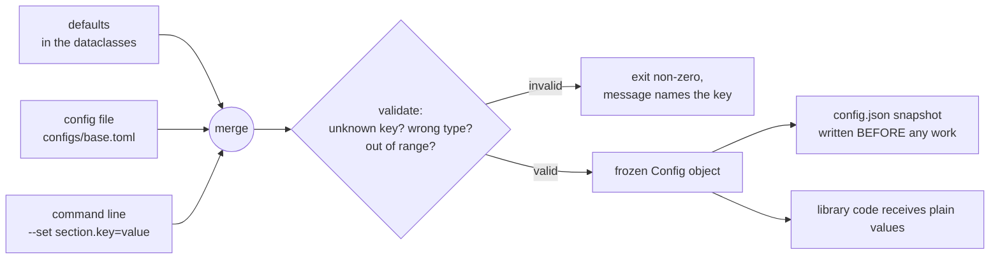
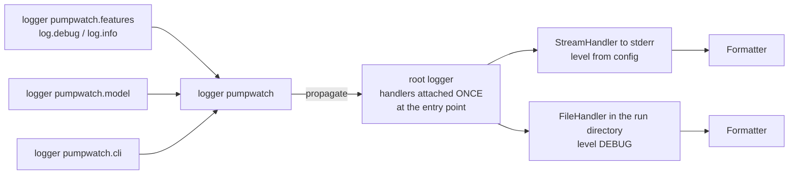
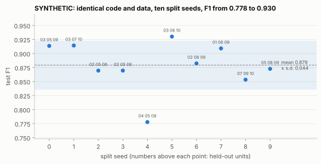
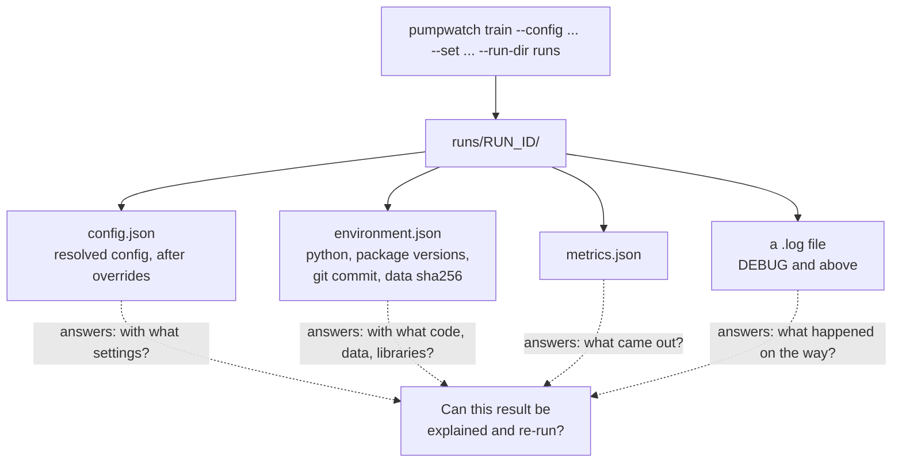

# W1D4 — Configuration, logging and reproducible runs

**Unit id:** `w1d4` · **Week 1, day 4** · **Content status:** Execution verified (see [Verification record](#verification-record))
**Handbook:** [H2.2 Configuration, logging and reproducible runs](../../handbook/ch02_maintainable_python/h2_2_configuration_logging_runs.md)
**Data:** `data/synthetic/pump_vibration.csv` — SYNTHETIC. Metric values in this lesson illustrate mechanics only; they say nothing about real equipment.

---

## 1. Purpose

**Primary objective.** Make a training run *reproducible and inspectable*: every value that
influenced the result is declared in one validated configuration, every run writes a
self-describing directory, and diagnostics go through `logging` rather than `print`.

**What you will learn**

- Treating configuration as typed, validated, immutable data with an explicit precedence order.
- Configuring the standard `logging` module once, at the application entry point, and writing
  library code that only *emits* records.
- Threading a seed explicitly, and stating which nondeterminism you have *not* removed.
- Recording provenance (resolved config, code version, library versions, data hash) per run.

**Why an applied ML engineer needs it.** In research the question after a run is "what number did
I get?". In a team the questions arrive weeks later and from other people: *which settings produced
the model in production, can we regenerate it, what changed between Tuesday's run and today's, why
did the nightly job fail at 03:00?* All four are answered from configuration snapshots and logs or
they are not answered at all. Interviewers probe this directly ("how would you reproduce a model you
trained six months ago?").

**Prerequisites.** [W1D3](../w1d3_package_structure/README.md): the `pumpwatch` package in a `src/`
layout with a `train` command. You have used `argparse` and `print`-debugging for years; no prior
use of `logging` or TOML is assumed.

**Time budget — essential path 2 h**

| Activity | Time |
|---|---|
| Read sections 1–2 (skim what you know; do not skip 2.3 and 2.5) | 25 min |
| Worked example: run, modify, read the code | 20 min |
| Guided lab, tasks 1–5 | 60 min |
| Assessment questions (written answers) | 15 min |

**Optional extension — up to 1 h:** independent challenge (40 min), interview rep (15 min).
If you only have two hours, do the challenge on the review day; the independent-skill flag for
this unit stays unset until it is done without the hints.

---

## 2. Conceptual explanation

### 2.1 Intuition: a run is a function, and you must be able to name its arguments

A training run computes

```
result = f(code, config, data, environment, seed) + ε
```

where `ε` is whatever nondeterminism is left (thread scheduling, GPU kernels, hash ordering).
A notebook hides most of these arguments: `config` is scattered over cells and edited in place,
`code` is "whatever the kernel executed, in whatever order", `data` is "the file that was at that
path that day". Engineering a run means making each argument *explicit and recorded*:

| Argument | Made explicit by | Recorded as |
|---|---|---|
| code | a package under version control | git commit (+ "dirty" flag) |
| config | one typed object built at start-up | resolved config snapshot |
| data | a path in the config | content hash of the file |
| environment | pinned dependencies | interpreter + library versions |
| seed | a config value passed down as an argument | part of the config snapshot |
| ε | — | a written statement of what is not controlled |

You already do the scientific version of this in a methods section. The difference is that a
methods section is written once by a human; a run directory is written every time by the program.

### 2.2 Terminology

- **Configuration** — values that select *what* to compute and may differ between runs or
  deployments (paths, hyperparameters, seeds, log level). Distinct from **constants** of the method
  (the definition of RMS) and from **secrets** (credentials).
- **Resolved configuration** — the final values after all layers are merged. This, not the file, is
  what ran.
- **Precedence** — the fixed order in which layers override each other:
  `defaults < config file < environment variables < command-line flags` (most specific wins).
- **Repeatability / reproducibility / replicability.** Usage is inconsistent across fields — two
  widely cited sources assign *reproducible* and *replicable* opposite meanings (see H2.2). This
  course uses: **repeatable** = same code, config, data, environment → same numbers;
  **reproducible** = someone else obtains the same result from your recorded artefacts;
  **replicable** = the *finding* holds on new data. Today's lab buys repeatability and the records
  needed for reproducibility. It buys no replicability at all.
- **Logger / handler / formatter** — a *logger* is a named entry point that code emits records to;
  a *handler* delivers records somewhere (stderr, file); a *formatter* renders a record as text.
- **Provenance** — the recorded origin of an artefact: which code, data and settings produced it.

### 2.3 Configuration as data

Three rules do most of the work.

**(a) One object, built once, passed down.** `load_config()` runs at start-up and returns a frozen
dataclass. Functions take the *values* they need (`train_and_evaluate(features, test_fraction, seed, C)`),
not the config object and never a global. This keeps `features.py` and `model.py` importable and
testable without any file on disk — which you will rely on tomorrow in W1D5.

**(b) Reject what you do not understand.** The idiom `cfg.get("seed", 7)` turns a typo
(`sed = 3`) into a silently wrong experiment that still completes and still produces a
plausible number. A config loader should fail on unknown keys, wrong types and out-of-range values,
and its error should name the key (`split.sed`), because the person reading the error is usually
not the person who wrote the loader.

**(c) Snapshot what was resolved, not what was requested.** With layers, no single input file
describes the run. Write the merged result into the run directory *before* training starts, so a
crashed run is still explained.

Why TOML and frozen dataclasses here? `tomllib` is in the standard library (Python ≥ 3.11), the
format has real types (ints, floats, strings, booleans, tables) and no implicit conversions, and you
already maintain a `pyproject.toml`. Dataclasses give named, typed fields and immutability
(`frozen=True`) with no dependency. Two limits to know: `tomllib` only *reads* TOML — hence the
JSON snapshot — and dataclasses do **not** validate types at run time; annotations are documentation
unless you check them, which is what the lab's loader does. The handbook discusses YAML, pydantic and
Hydra; we do not adopt Hydra yet because config *composition* and sweep launching solve problems you
do not have in a seven-key config, and they hide exactly the merge logic this lesson asks you to
understand. In W5 the API layer brings in pydantic, at which point revisiting this choice is cheap
because the rest of the package only sees a `Config` object.

**Where secrets go.** Never in the repository and never in a snapshot. The Twelve-Factor App
formulation is the useful test: could the codebase be made public at any moment without leaking a
credential? Credentials are supplied by the environment (environment variables, or a secrets manager
that populates them) and read at the point of use. Note that Twelve-Factor defines "config" as what
varies *between deploys* and puts all of it in environment variables; ML training configuration
(hyperparameters, feature settings) varies between *experiments* and must be versioned and reviewed,
so it belongs in files under version control. Deployment settings of the future service (W5–W6) will
follow the environment-variable rule.



*Precedence is defaults, then file, then command line: later sources override earlier ones, and the snapshot records the result after all of them.*

### 2.4 Logging architecture

```
logger "pumpwatch.features" ──┐                     ┌─ StreamHandler(stderr)  level=config
logger "pumpwatch.split"    ──┼─► logger "pumpwatch" ┤
logger "pumpwatch.cli"      ──┘   (handlers here)    └─ FileHandler(train.log) level=DEBUG
```

- Loggers form a hierarchy by dotted name. A record emitted on `pumpwatch.features` is offered to
  that logger's handlers, then **propagates** to the handlers of each ancestor
  (`pumpwatch`, then the root logger) unless a logger on the way has `propagate = False`.
- A logger's **level** decides whether a record is created at all; each handler's level filters
  again on delivery. That is how one run can show INFO on the console and keep DEBUG in a file.
- **Library code** does exactly one thing: `logger = logging.getLogger(__name__)` at module top, then
  `logger.info(...)`. It never adds handlers, never calls `basicConfig`. The Python logging HOWTO is
  explicit that configuring handlers is the application developer's prerogative.
- **The application** (here: `cli.main`) configures handlers once.
- With no configuration at all, records of WARNING and above still reach stderr through a
  "handler of last resort"; INFO and DEBUG vanish. That is why un-configured code "logs nothing".

Levels, as a working convention: **DEBUG** — detail for diagnosing (coefficients, shapes);
**INFO** — milestones of a healthy run (rows loaded, split sizes, metrics); **WARNING** — the run
continues but something deserves a human look (38 samples interpolated); **ERROR** — the run cannot
produce its result.

**Structured context.** Write `logger.info("loaded data path=%s rows=%d", path, n)`: an event name
followed by `key=value` pairs, with arguments passed separately (the string is only formatted if the
record is actually emitted). Such lines can be grepped and parsed; prose sentences cannot. W7 turns
this into JSON logs for the service; the habit is the same.

**stdout is an interface.** The program's *result* goes to stdout, diagnostics to stderr.
`pumpwatch train ... | jq .metrics.auc` must work at any log level.



*Library modules only obtain loggers and emit records. Where records go is decided in one place. Standard output stays free for the JSON result.*

### 2.5 Seeds, and the mathematics of what a seed does *not* give you

Fixing a seed fixes one draw of a random variable. For a metric $M$ computed on a random
group split $S$,

$$\operatorname{Var}(M) = \underbrace{\operatorname{Var}_S\big(\mathbb{E}[M \mid S]\big)}_{\text{which units are held out}} + \underbrace{\mathbb{E}_S\big[\operatorname{Var}(M \mid S)\big]}_{\text{optimiser, initialisation, } \varepsilon}$$

Logistic regression with a fixed solver has no second term; a neural network has both. A seeded run
reports a single value from this distribution. On the synthetic pump data (10 units, 3 held out),
seeds 0–9 give F1 from **0.778 to 0.930** (mean 0.879, sample s.d. 0.044) with *identical* code and
hyperparameters — executed for this lesson with the reference solution. So:

- A seed makes a run **repeatable**. It does not make the estimate **precise**.
- A difference between two configurations that is smaller than the seed-to-seed spread is not
  evidence. Compare over several seeds (W3 treats this properly; the seed in your config is what
  makes that comparison scriptable).
- Choosing the seed that gives the best number is hyperparameter tuning on the test set.

This is the same phenomenon as the fold-to-fold spread you know from leave-subjects-out EEG
evaluation: with few groups, *which* subjects are held out dominates the variance.

**Practical rules.** (1) No global seeding in library code — pass `seed` (or a
`numpy.random.Generator`) as an argument; scikit-learn's own guidance is that an integer
`random_state` gives the same results across calls. (2) One seed per *purpose* if purposes should
vary independently (split vs. initialisation). (3) Record library versions: NumPy only promises the
same random stream for the same seed *on the same build and machine*, and allows the default
generator's streams to change in feature releases.

**PyTorch, for when it enters in W4** (conceptual; no torch in this lab). The PyTorch
reproducibility notes state that completely reproducible results are not guaranteed across releases,
commits or platforms, nor between CPU and GPU. Within one platform you can narrow `ε`:
`torch.manual_seed`, `torch.backends.cudnn.benchmark = False` (the auto-tuner may otherwise select
different convolution algorithms per run), `torch.use_deterministic_algorithms(True)` (errors on
operations with no deterministic implementation), and seeding DataLoader workers via
`worker_init_fn` plus an explicit `generator`. Each costs speed or convenience — which is why they
are configuration, and why the honest deliverable is a *statement of residual nondeterminism*
rather than a claim of determinism.



*SYNTHETIC data, reference solution. The ten points share code and data and differ only in which three units are held out (numbers above each point). A 0.04 difference between two single runs is inside this spread. Regenerate with `python lessons/w1d4_config_logging/figures/make_figures.py`.*

| seed | 0 | 1 | 2 | 3 | 4 | 5 | 6 | 7 | 8 | 9 |
|---|---|---|---|---|---|---|---|---|---|---|
| test F1 | 0.914 | 0.914 | 0.870 | 0.870 | 0.778 | 0.930 | 0.882 | 0.909 | 0.853 | 0.873 |

### 2.6 Connection to what you already know

Your experiments already have configs — they live in argparse defaults, notebook cells and file
names like `run_lr1e-3_seed2_FINAL`. Encoding settings in file names is a run directory without a
schema. The subject-level bookkeeping you do for cross-patient evaluation (which patients were in
which fold) is provenance; today generalises it to the whole run.

### 2.7 Industry example

A team retrains a fraud-scoring model nightly. One morning precision at the alert threshold is down
four points. With run directories the on-call engineer runs a diff of last night's and the previous
night's runs: the config is identical, the code commit is identical, the *data hash differs and the
row count in the log dropped 30 %*. An upstream export truncated. Time to diagnosis: minutes, and no
model was at fault. Without the snapshot, hash and logged row counts, the same investigation starts
with "did anyone change anything?" in a chat channel. Your independent challenge builds exactly that
diff tool.

### 2.8 Limitations and common misconceptions

- *"I set the seed, so it is reproducible."* The seed is one of five arguments. Change the data file
  or a library version and the same seed gives a different result.
- *"The config file in git is the record."* Not if command-line overrides exist, and not if the file
  was edited after the run. The snapshot is the record.
- *"Logging is print with timestamps."* The value is separation: code decides *what* happened,
  the application decides *where it goes and how much*. `print` cannot be silenced, filtered or
  redirected per component.
- *"More logging is better."* A log that reports every window is not read. Log state changes and
  counts.
- *A run directory is not an experiment tracker.* It has no search, no comparison UI, no access
  control. It is the minimal mechanism; W4 introduces a tracker once you can say what it automates.
- *Recording the environment is not pinning it.* `environment.json` tells you what was installed;
  it does not recreate it. Lock files and containers (W6) do.

---

## 3. Worked example

**Files:** [`example/run_detector.py`](example/run_detector.py), [`example/detector.toml`](example/detector.toml).
A deliberately different problem from the lab so that you see the pattern, not the solution: a
rolling z-score spike detector on a simulated sensor trace.

**Dataset.** Simulated in the script (SYNTHETIC): `n_samples` standard-normal values with `n_spikes`
additive spikes of ±`spike_size` at random positions after index 200. "Schema": a 1-D float array
and an integer array of true spike indices. Nothing about detector quality on real sensors follows
from it.

**Run it** (from the repository root):

```bash
python lessons/w1d4_config_logging/example/run_detector.py
python lessons/w1d4_config_logging/example/run_detector.py --set detector.threshold=3.0
python lessons/w1d4_config_logging/example/run_detector.py --set detector.threshold=2.0
python lessons/w1d4_config_logging/example/run_detector.py --set detector.treshold=3.0
python lessons/w1d4_config_logging/example/run_detector.py 2>/dev/null
```

**Expected output** (obtained with NumPy 2.5.3; other NumPy versions may simulate a different trace
and therefore different counts — see 2.5):

| Command | stdout |
|---|---|
| defaults (threshold 4.0) | `{"n_true": 25, "n_detected": 23, "precision": 0.9565…, "recall": 0.88}` |
| `detector.threshold=3.0` | `{"n_true": 25, "n_detected": 41, "precision": 0.6097…, "recall": 1.0}` |
| `detector.threshold=2.0` | `{"n_true": 25, "n_detected": 249, "precision": 0.1004…, "recall": 1.0}` plus a WARNING on stderr |
| `detector.treshold=3.0` | nothing on stdout; `config error: …unexpected keyword argument 'treshold'…` on stderr; exit code 2 |
| defaults, `2>/dev/null` | only the JSON line |

Each successful run creates `runs_example/<timestamp>/` with `config.json`, `metrics.json`, `run.log`
(delete the directory when done; do not commit run directories).

**Decisions worth reading in the code**

1. `SignalConfig(**raw["signal"])` — passing the parsed table as keyword arguments makes the
   dataclass constructor itself reject unknown keys. This is the cheapest strict loader there is. Its
   weakness is visible in the typo case: the message names the *class and argument*, not the config
   key, and nothing checks types (`threshold = "high"` would be accepted and fail later, inside
   NumPy). The lab's loader fixes both.
2. `__post_init__` holds range checks, because a frozen dataclass has no other hook.
3. `simulate` creates `np.random.default_rng(cfg.seed)` locally. No `np.random.seed` at module level,
   so calling order elsewhere cannot change the trace.
4. `detect` uses `sliding_window_view(x, window)[:-1]` so the baseline for sample *t* uses only
   samples before *t* — no future information. (You will meet this again as temporal leakage in W3.)
5. `logging.basicConfig(...)` is called inside `main()`, not at import. In a single-file script the
   script *is* the application, so `basicConfig` on the root logger is appropriate; in the lab's
   package you attach handlers to the package logger instead.
6. Only `print(json.dumps(metrics))` writes to stdout.

**Interpretation.** Lowering the threshold trades precision for recall, as it must; the point here is
that each of those three numbers is attached to a directory that says which threshold, window and
seed produced it, and that the mistyped run produced no number at all instead of a wrong one.

---

## 4. Guided lab

**Goal.** Take `pumpwatch` from v0.1.0 (flags and `print`) to v0.2.0: `pumpwatch train --config
configs/base.toml [--set section.key=value ...] [--run-dir runs]` producing a run directory.

**Starter:** `lessons/w1d4_config_logging/lab/` — the W1D3 reference package plus
`configs/base.toml`. If you prefer to continue from your own W1D3 package, copy it over the starter
(keep `configs/`); the checks only use the contract below.

**The contract the checks grade** (nothing else about your implementation is prescribed):

| Aspect | Requirement |
|---|---|
| Entry point | `pumpwatch.cli.main(argv=None) -> int`; `train --config PATH [--set SECTION.KEY=VALUE]... [--run-dir DIR]` |
| Config API | `pumpwatch.config.load_config(path, overrides=None)` returns an immutable object with `cfg.data.path`, `cfg.data.fs`, `cfg.split.test_fraction`, `cfg.split.seed`, `cfg.model.C`, `cfg.logging.level`; invalid input raises a `ValueError` (or subclass) |
| Defaults | `data.fs=256.0`, `split.test_fraction=0.3`, `split.seed=7`, `model.C=1.0`, `logging.level="INFO"`; `data.path` is required |
| Precedence | defaults < file < `--set` |
| Validation | unknown key, wrong type, out-of-range value, missing `data.path` → non-zero exit, message containing the dotted key (e.g. `split.sed`) on stderr, no traceback, empty stdout |
| Run directory | each run creates a new sub-directory of `--run-dir` containing `config.json` (resolved, nested by section), `metrics.json`, `environment.json` (keys `python`, `packages`, `git_commit`, `data_sha256`), and a non-empty `*.log` |
| stdout | exactly one JSON object with keys `run_dir` and `metrics` |
| Logging | importing any `pumpwatch` module configures nothing and prints nothing; console verbosity follows `logging.level` and goes to stderr; the log file keeps the run's steps even when the console is at ERROR |
| Determinism | same config → identical `metrics.json`; `split.seed` changes the held-out units |

Run the checks at any time (they take about half a minute):

```bash
python -m pytest lessons/w1d4_config_logging/checks -q
```

Work with the package importable, either `pip install -e lessons/w1d4_config_logging/lab` in your
course virtual environment (then re-install your own W1D3 package later if you use both) or, without
installing, `export PYTHONPATH=lessons/w1d4_config_logging/lab/src` for this shell.

### Task 1 — Typed configuration (20 min)

Create `src/pumpwatch/config.py` with frozen dataclasses for the four sections and
`load_config(path, overrides=None)`. For this task ignore `overrides`.

```python
# starter sketch - complete it
@dataclass(frozen=True)
class SplitConfig:
    test_fraction: float = 0.3
    seed: int = 7

def load_config(path, overrides=None) -> Config:
    with open(path, "rb") as fh:          # tomllib needs binary mode
        raw = tomllib.load(fh)
    ...
```

Required behaviour: unknown section or key → error naming `section.key`; wrong type → error
(an `int` where a `float` is expected is fine; a `str` is not; `True` is not an integer here even
though `isinstance(True, int)` is true in Python); ranges: `fs > 0`, `0 < test_fraction < 1`,
`C > 0`, level in `DEBUG/INFO/WARNING/ERROR`.

**Checkpoint 1**

```bash
python -c "from pumpwatch.config import load_config; print(load_config('lessons/w1d4_config_logging/lab/configs/base.toml'))"
```

prints a nested `Config(...)` showing `seed=7`. Then edit a copy of the TOML to contain `sed = 7`
and confirm you get your own error naming `split.sed`, not a `TypeError` from a constructor.

### Task 2 — Overrides and precedence (10 min)

Implement `overrides`: a list of strings `"section.key=value"`. Decide how the value text becomes a
typed value *before* you write code, and write your rule in the module docstring. Apply overrides to
the raw nested dict **before** building and validating the dataclasses, so that an override passes
through exactly the same checks as a file value.

**Checkpoint 2.** `load_config(path, ["split.seed=11"]).split.seed == 11`;
`load_config(path, ["split.seed=1.5"])` and `["model.depth=3"]` raise your error.

### Task 3 — Run directory and CLI (15 min)

Rewrite `cli.py`: `--config`, repeatable `--set`, `--run-dir` (default `runs`). On each run:
create `RUN_DIR/<run_id>/` (design the id so that two runs never share a directory — think about two
runs started in the same second), write `config.json` *before* doing any work, then compute, then
write `metrics.json` and `environment.json`, then print `{"run_dir": ..., "metrics": ...}`.

`environment.json` needs: `python` (`platform.python_version()`), `packages` (a dict with at least
`numpy`, `pandas`, `scikit-learn` from `importlib.metadata.version`), `git_commit` (hash or `null`
when not in a git checkout or git is absent), `data_sha256` (hash of the data file's bytes).

**Checkpoint 3**

```bash
python -m pumpwatch.cli train --config lessons/w1d4_config_logging/lab/configs/base.toml --run-dir /tmp/pw_runs
ls /tmp/pw_runs/*/
```

Expected metrics for the base config, from the reference solution on the tested versions:
`auc ≈ 0.9992`, `f1 ≈ 0.909`, `test_units = ["P01", "P06", "P09"]`. If your numbers differ at the
second decimal, something other than the config changed — find out what before continuing.



*Anatomy of a run directory: four files, four questions.*

### Task 4 — Logging (10 min)

Add `logger = logging.getLogger(__name__)` to `io`, `features`, `split`, `model` and log, with
`key=value` context: rows and units loaded (INFO), number of interpolated samples if any (WARNING),
windows and positive rate (INFO), seed and held-out units (INFO), fitted coefficients (DEBUG). Write
a `setup_logging(level, log_file)` function, call it once from the CLI after the run directory
exists, and send console output to **stderr**.

**Checkpoint 4**

```bash
python -m pumpwatch.cli train --config lessons/w1d4_config_logging/lab/configs/base.toml --run-dir /tmp/pw_runs 2>/dev/null | python -m json.tool
python -m pumpwatch.cli train --config lessons/w1d4_config_logging/lab/configs/base.toml --run-dir /tmp/pw_runs --set 'logging.level="ERROR"' >/dev/null
```

The first prints valid JSON only. The second prints nothing, and the newest `*.log` still lists the
steps.

### Task 5 — Determinism and the residual-nondeterminism note (5 min)

Run the base config twice and `diff` the two `metrics.json` files (no output expected). Run with
`--set split.seed=3` and confirm `test_units` changes. Then add a section "Reproducibility" to
`lab/README.md` (create it) stating, in your own words, (a) what is fixed by the config, (b) what is
recorded but not fixed, (c) what is neither. Three to six sentences. This note is part of the
deliverable and is graded by the rubric, not by the checks.

### Debugging guidance

| Symptom | Likely cause |
|---|---|
| `TypeError: a bytes-like object is required` / `File must be opened in binary mode` | `tomllib.load` needs `open(path, "rb")` |
| Your INFO lines from `cli.py` are missing but other modules log | under `python -m pumpwatch.cli` the module's `__name__` is `"__main__"`, so `getLogger(__name__)` is not below `pumpwatch`. Name that logger explicitly, or attach handlers to the root logger and accept third-party noise |
| Every log line appears twice | handlers on both your package logger and the root logger (propagation), or `setup_logging` called twice without removing old handlers |
| Nothing is logged at all | no handler configured: only WARNING+ reaches the last-resort handler |
| `--set 'logging.level=ERROR'` fails to parse | decide whether bare words are strings in your override rule; the checks pass the TOML-quoted form `logging.level="ERROR"` |
| `--set data.path=/x/y.csv` rejected | same decision: an unquoted path is not valid TOML |
| Checks report "expected exactly one run directory" | you write files directly into `--run-dir` instead of a per-run sub-directory |
| `git_commit` raises outside a repository | catch the failure and store `null`; provenance collection must never crash a run |
| Checks fail only with `Traceback` in stderr | a config mistake escaped as an exception; catch your config error in `main` and return a non-zero code |

**Deliverable.** The v0.2.0 package in `lab/` passing the checks, one run directory you produced,
and the reproducibility note. Completion criteria: all checks pass **and** you can explain, without
looking, the path of one INFO record from `pumpwatch.split` to the log file.

---

## 5. Independent challenge

[`challenge/README.md`](challenge/README.md) — add `pumpwatch compare-runs RUN_A RUN_B`, the tool
from the industry example in 2.7. It transfers today's ideas to *reading* run directories and
forces a decision about what "the same data" means. Acceptance criteria are in that file; there is
no solution in this directory. Checks: `python -m pytest lessons/w1d4_config_logging/checks_challenge -q`.

## 6. Progressive hints

Open them in order, and only after ten minutes of being stuck. Record which you used in
your progress notes — a challenge solved with hint 3 counts as guided practice, not as independent
skill.

1. [Conceptual hint](hints/hint1_concept.md)
2. [Suggested approach](hints/hint2_approach.md)
3. [Partial implementation](hints/hint3_partial.md)
4. Full reference solutions: `solutions/lessons/w1d4_config_logging/` (`lab/`, `challenge/`).

## 7. Assessment

[`assessment.md`](assessment.md): six reasoning questions, one design-choice explanation, an
interview coding rep, and the rubric. Write your answers before opening
`solutions/lessons/w1d4_config_logging/assessment_answers.md`, which also lists common incorrect
answers and why they fail.

Automated checks: `checks/` (lab) and `checks_challenge/` (challenge). They establish that the
contract holds. They do not establish that you could write this again unaided.

## 8. Reflection and review

**You should now be able to, without notes:**

- write a strict loader for a small typed config with file and command-line layers;
- set up `logging` so that library modules emit and the entry point configures;
- say what a seed fixes, what it does not, and how you would report run-to-run variation;
- list what a run must record for someone else to regenerate it.

**Reflection prompt (5 min, in your journal).** Pick one result from a paper of yours. Which of the
five arguments of `f` could you recover exactly today, and which only approximately? What is the
cheapest change to your research workflow that would close the largest gap?

**Retrieval practice (answer on the W1 review day, from memory).** A colleague's `--set split.seed=3`
run and yours with seed 7 differ by 0.04 F1 and they conclude their feature change helped. State two
distinct reasons this conclusion is not yet supported, and name the file(s) in a run directory you
would inspect for each.

**Next lesson.** [W1D5 — Testing ML code with pytest](../w1d5_testing_ml_code/README.md). Because
the feature and model functions take plain values instead of reading config or files, they can be
tested in isolation; `load_config`'s rejection rules are your first natural table of test cases.

---

## Verification record

Executed in the authoring session on Python 3.13.18, NumPy 2.5.3, pandas 3.0.5, scikit-learn 1.9.1,
pytest 9.1.1 (Linux):

- Worked example: all five commands in section 3 executed; outputs in the table are copied from those runs.
- Reference solution: base config run twice, `metrics.json` identical; `split.seed=3` changes the held-out units.
- `python tools/verify_checks.py lessons/w1d4_config_logging`: reference lab and challenge solutions
  pass; six lab mutants and three challenge mutants are rejected. The unmodified starter fails 23 of 24 lab checks.
- Seed-spread figures in 2.5: computed with the reference solution for seeds 0–9.
- Not verified here: behaviour on Python 3.11/3.12 (the code uses only features available from 3.11);
  `pip install -e` of the lab package (checks import from `src/` via `PYTHONPATH`).
- Sources: see the handbook section H2.2 for the list of documents consulted and how.
