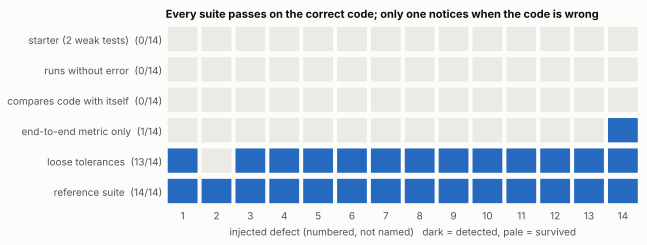
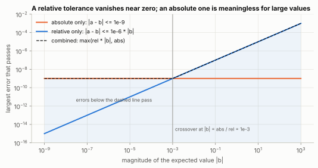
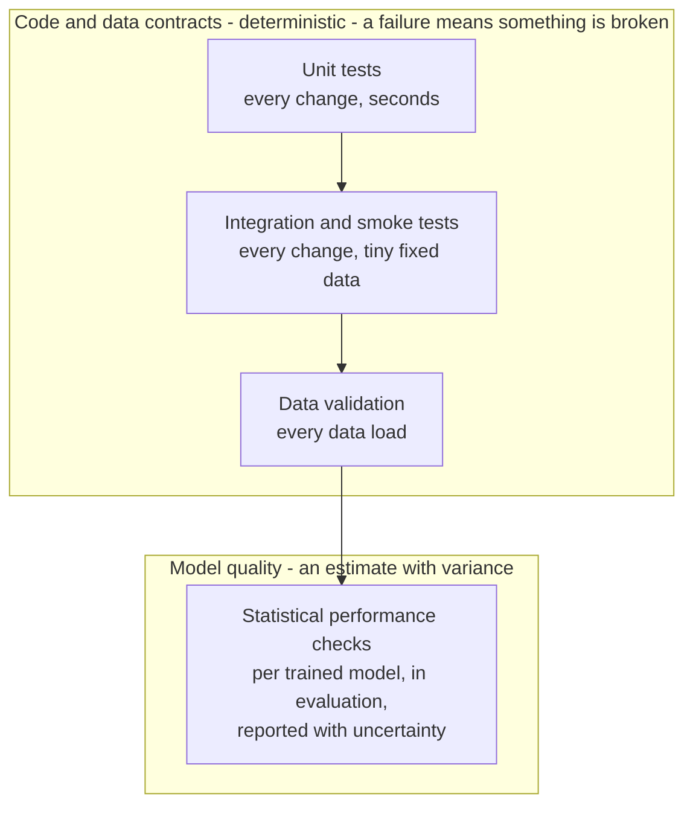
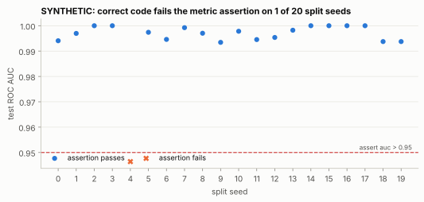
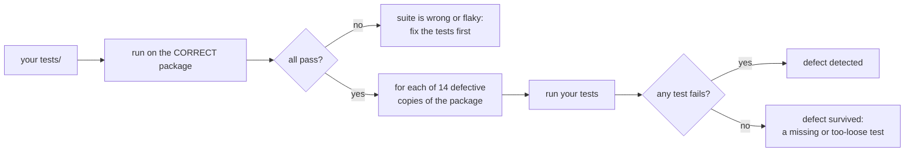

# w1d5 — Testing ML code with pytest: what a unit test can and cannot tell you

**Content status:** Execution verified (see [Verification record](#verification-record)) ·
**Handbook:** [H9.1 Unit testing ML code](../../handbook/ch09_testing_ml_systems/h9_1_unit_testing_ml_code.md) ·
**Solutions (open only after an attempt):** `solutions/lessons/w1d5_testing_ml_code/`

> Data note. The lab's tests build their own signals. One script
> (`example/metric_variability.py`) uses `data/synthetic/pump_vibration.csv`, which is
> **SYNTHETIC**; its numbers illustrate metric variance and say nothing about real pumps.

---

## 1. Purpose

**Primary objective.** Write a pytest suite for signal-feature and data-splitting code
that *demonstrably* detects realistic defects — and be able to say which kinds of defect
no unit test will ever detect.

**What you will learn**

- Where expected values ("oracles") come from when the code computes numbers nobody can
  check by eye: closed-form answers, conservation laws, invariances, and contracts.
- How to choose a floating-point tolerance by reasoning instead of by loosening until green.
- pytest mechanics that matter in practice: fixtures and factories, `tmp_path`,
  `parametrize`, `approx`, `raises`.
- The difference between a **unit test** (deterministic statement about code) and a
  **statistical performance check** (noisy statement about a model on data), and where each belongs.

**Why an applied ML engineer needs it.** ML code fails silently. A feature with a missing
square root, a band edge counted twice, or a split that leaks a unit still produces a
plausible AUC. In research the reviewer of last resort is you, staring at a plot; in a team,
it is a test suite that runs on every change, written so that a colleague who breaks
`band_power` finds out in ten seconds and not from a degraded model three weeks later.
Interviewers probe exactly this: "how do you know your preprocessing is correct?"

**Prerequisites.** [w1d3](../w1d3_package_structure/README.md) (the `pumpwatch` package;
its public API is the code under test). [w1d4](../w1d4_config_logging/README.md) is helpful
but not required. You know what a periodogram and a grouped split are.

**Time**

| Activity | Essential (2 h) | Optional (≤ 1 h) |
|---|---|---|
| Concepts (§2) | 25 min | H9.1 in full: +20 min |
| Worked example (§3) | 20 min | |
| Guided lab (§4) | 60 min | |
| Assessment questions (§7) | 15 min | |
| Independent challenge (§5) | | 40 min |
| Interview rep (§7) | | 15 min |

If you already test numerical code this way, skip to §4 step 0, run the checks, and let the
survivor list tell you what to read.

---

## 2. Conceptual explanation

### 2.1 Intuition: a test is a detector, so evaluate it like one

You validate an HFO or seizure detector by injecting events with known ground truth and
counting what it finds. A test suite is the same kind of object: a detector whose targets
are *defects*. Its sensitivity is measured by injecting known defects into correct code and
counting how many make at least one test fail. That procedure is **mutation testing**; an
injected defect is a **mutant**, a mutant the suite fails on is **killed**, one it passes on
has **survived**. Today's checks grade your suite this way: 14 realistic defects, each must be killed.

The same analogy gives the two error types. A suite that fails on correct code (false
alarm) is **flaky** or **over-specified**; a suite that passes on defective code (miss) is
**weak**. "All tests pass" tells you nothing until you know the suite's sensitivity.



*Real runs of this lesson's grading harness. All six suites pass on the correct package; a suite is only as good as the defects it notices. Defects are numbered rather than named so the figure does not give the lab away. Regenerate with `python lessons/w1d5_testing_ml_code/figures/make_figures.py` (about a minute).*

### 2.2 The oracle problem

A test needs an expected value that does **not** come from the code under test. For numerical
ML code there are four dependable sources, in decreasing order of strength:

1. **Known answers from mathematics.** Construct an input whose output you can derive.
   - RMS of `A·sin` over whole periods: `A/√2`.
   - A pure tone of amplitude `A` carries power `A²/2`, all of it at its own frequency.
   - Parseval: total power in the spectrum equals the variance of the signal.
     With the one-sided periodogram `P_k` used in `band_power` and `Δf = fs/N`:

     `Σ_k P_k · Δf = (1/N) Σ_n (x_n − x̄)²`
2. **Invariances (metamorphic relations).** You may not know `f(x)`, but you know how `f`
   must change when `x` changes: `rms(a·x) = |a|·rms(x)`, `band_power(a·x) = a²·band_power(x)`,
   band power over `[a,c)` = `[a,b)` + `[b,c)`, features do not depend on row order,
   a constant offset adds no band power.
3. **Structural contracts.** Statements about shape and set membership that need no numbers:
   one row per `(unit, window)`, no unit on both sides of a split, train ∪ test = all rows,
   a missing column raises `ValueError`.
4. **Differential testing.** Compare against an independent implementation
   (`scipy.signal.periodogram`, a slow loop). Useful, but two implementations can share a
   misreading of the spec, so it ranks below 1–3.

What is *not* an oracle: the function's own output on a copy of the input, or an "expected"
number pasted from its last run. The second is a **characterisation test** — legitimate for
pinning behaviour during a refactor (w1d3), worthless as evidence of correctness.

Two properties of a good known-answer input, both visible in the lab:

- **It discriminates.** A monotone ramp gives the same line length with or without `abs`.
  Amplitude `A = 1` cannot distinguish `A` from `A²`. Pick inputs on which the plausible
  wrong formula gives a *different* number.
- **It sits on the boundary.** Bugs in comparisons (`<` vs `<=`) are invisible unless a
  sample lies exactly on the edge: a tone at exactly 40 Hz for bands `[10,40)` and `[40,70)`.

### 2.3 Tolerances are a design decision

Floating-point results are compared with a tolerance. The two definitions you will use:

- `pytest.approx(expected, rel=r, abs=a)`: equal if `|actual − expected| ≤ max(r·|expected|, a)`.
  Defaults `rel=1e-6`, `abs=1e-12`. If you pass only `abs`, the relative tolerance is not applied.
- `numpy.testing.assert_allclose(actual, desired, rtol, atol)`: passes if
  `|actual − desired| ≤ atol + rtol·|desired|`. Defaults `rtol=1e-7`, `atol=0`.

Choose the tolerance to sit in the gap between two magnitudes:

`numerical noise  ≪  tolerance  ≪  smallest defect you must detect`

*Numerical noise* for a sum of `N` double-precision terms is of order `N·ε` relative, with
`ε ≈ 2.2e-16`: about `3e-14` for a 128-sample window. *Smallest defect*: mean-absolute-value
instead of RMS gives `2A/π = 0.637A` instead of `0.707A`, a 10 % error. So `rel=1e-9` is five
orders above the noise and eight below the defect; `rel=0.15` "to be safe" lets the defect through.

A relative tolerance is meaningless when the expected value is 0 (`r·0 = 0`); that is the
case for "a 92 Hz tone has no power in 10–40 Hz", which needs `abs=`.

If a test needs a loose tolerance, something in the *input* is uncontrolled — typically a
tone that does not fall on an FFT bin (spectral leakage) or a non-integer number of periods.
Fix the input (`fs=256`, `N=128` → 2 Hz bins; use 24, 40, 92 Hz), not the tolerance. Reserve
loose tolerances for tests whose claim is itself approximate ("interpolating three missing
samples changes RMS by < 5 %"), and say so in a comment.



*Arithmetic, not data. Below `|b| = abs / rel` the absolute term decides; above it the relative term does. An expected value of exactly zero needs an absolute tolerance.*

### 2.4 The test pyramid for ML, and the line that matters

| Layer | Claim | Deterministic? | Runs | Example |
|---|---|---|---|---|
| Unit tests | this function obeys its contract | yes | every change, seconds | `rms(sine) = A/√2` |
| Integration / smoke | the pieces are wired together | yes (fixed seeds, tiny data) | every change | pipeline reaches AUC ≥ 0.9 on a trivially separable frame |
| Data validation | *this dataset* satisfies the schema | yes | every data load | columns present, ranges (Week 2) |
| Statistical performance checks | *this model* is good enough on held-out data | **no** — an estimate with variance | per trained model, in evaluation | grouped-CV AUC with interval vs. baseline (Week 3) |

The first three are about **code and data contracts**; a failure means something is broken.
The fourth is about **a model's quality**; its outcome is a random variable and a "failure"
may be bad luck in which units were held out.

Concrete evidence, produced by `example/metric_variability.py` on the synthetic pump data:
the same correct code with 20 different split seeds gives held-out AUC from 0.946 to 1.000
and F1 from 0.78 to 0.95. A unit test `assert auc > 0.95` fails for seed 4 with no defect
present — and, as you will measure in the lab, a suite consisting only of such a test
*passes* with 13 of the 14 injected defects present. It is both flaky and weak.

A **defensible minimal-performance smoke check** inside a unit suite has three properties:
(1) data constructed so the task is trivially separable, with a margin so wide that only a
wiring error can fail it; (2) all seeds fixed, so it is deterministic; (3) a docstring
stating that it checks wiring, not quality. `auc >= 0.9` on such a frame catches "used the
probability of the wrong class" (AUC ≈ 0) and "labels misaligned with features" (AUC ≈ 0.5).
Real performance thresholds belong in the evaluation stage, with uncertainty attached.



*The line that matters runs between the two boxes: above it a red result is a defect, below it a red result may be an unlucky split.*



*SYNTHETIC data. The same correct code under 20 split seeds: `assert auc > 0.95` fails once (seed 4) with no defect present.*

### 2.5 What coverage means

Line coverage is the fraction of lines *executed* by the suite. It is a good detector of
untested code (0 % is informative) and a poor measure of tested code: the "runs without
error" suite in today's mutants executes nearly every line of `features.py` and kills none
of the feature defects, because executing a line is not the same as checking its result.
Use coverage to find gaps; use mutation (even by hand: break the code, see if a test fails)
to judge strength.

### 2.6 Connection to what you already know

- Synthetic signals with known ground truth are your daily tool for validating detectors;
  known-answer tests are that practice made permanent and automatic.
- A leak-free cross-subject split is a *structural* property. You have been verifying it by
  inspection; `train_units.isdisjoint(test_units)` verifies it on every commit.
- Reviewer question "is the improvement within noise?" is the statistical-check layer.
  Keeping it out of the unit suite is the software form of not confusing a bug with variance.

### 2.7 Industry example

A payments team computes "transactions in the last 24 h" as a fraud feature. The training
pipeline (batch SQL) uses a half-open window `[t−24h, t)`; the online service's
reimplementation uses `<=` at one end. Offline metrics are unaffected; online, every
transaction counts itself, the feature is shifted by one, and precision at the operating
threshold drops. No AUC assertion catches this, because each implementation is
self-consistent. A boundary unit test on each side — an event exactly at `t` and exactly at
`t−24h` — does. The same defect class is in today's lab (`band_power` edge) and in the
challenge (`>` vs `>=`).

### 2.8 Limitations and common misconceptions

- *"The tests pass, so the code is correct."* They pass, so none of the defects *your tests
  can detect* is present.
- *"Unit tests cannot be written for ML because outputs are stochastic."* Feature code,
  splitting, loading and metric computation are deterministic. Only model quality is statistical.
- *"A metric threshold is the most relevant test."* It is the least sensitive to code defects (§2.4).
- *"100 % coverage."* See §2.5.
- *"Random test data is more thorough."* Unseeded random data makes failures unreproducible;
  seeded random data is fine for invariances but gives no known answer.
- **What unit tests cannot detect:** a correct implementation of the wrong idea (features
  that do not generalise), leakage that lives in the *experimental design* rather than in a
  function (scaler fitted before the split — fixed in w1d3 by construction with a `Pipeline`,
  because it is hard to assert from outside), and data that violates assumptions at runtime.

---

## 3. Worked example — testing a rolling z-score from its specification

Different code from the lab, same method. Files: [`example/`](example/).

**Function under test.** `rolling_zscore(x, window)` scores each sample against the
`window` samples *before* it (a trailing baseline, as used in equipment monitoring and in
causal EEG artefact detection): `z[t] = (x[t] − mean(B_t)) / std(B_t)`, `B_t = x[t−window : t]`,
sample std (`ddof=1`), NaN during warm-up and where the baseline is flat.
No dataset: inputs are hand-written arrays and `default_rng(0)` noise (200 samples).

**Run it** (from the repository root):

```bash
python -m pytest lessons/w1d5_testing_ml_code/example -q                    # corrected version
ZSCORE_IMPL=buggy python -m pytest lessons/w1d5_testing_ml_code/example -q  # first version
```

**Expected output.** Corrected version: `9 passed`. First version: `3 failed, 6 passed`, with

```
FAILED ...::test_known_answer_computed_by_hand        (obtained 1.4608, expected 5.8095)
FAILED ...::test_flat_baseline_gives_nan_not_infinity (obtained 1.5, expected NaN)
FAILED ...::test_spike_does_not_dilute_its_own_score  (obtained 4.23, expected 32.24)
```

**Important decisions in the test code**

1. *Known answer by hand.* `[1,2,3,4,10]`, window 4: baseline mean 2.5, sample variance 5/3,
   so `z = 7.5/√(5/3) = 5.8095`. The expected value is written as the formula, not as a
   pasted number, so the reader can audit it. Tolerance `1e-12`: five numbers, no cancellation.
2. *Invariances.* A z-score is unitless, so `z(a·x + b) = z(x)` for `a > 0`
   (parametrised over three gain/offset pairs), and it is causal: altering samples from
   index 120 on must leave `z[:120]` bit-identical (`assert_array_equal`, no tolerance,
   because the same arithmetic is performed).
3. *A property taken from a sentence of the spec.* "An anomaly must not dilute its own
   score" becomes: a 10× larger spike has a 10× larger z.
4. *Fixture.* `noise` is a function-scoped fixture, so each test receives a fresh array and
   a test that mutated it could not affect another.

**Interpretation.** The defect is one slice: `x[t-window+1 : t+1]` includes the current
sample in its own baseline. Look at *which* tests fail. The affine-invariance and causality
tests pass on the defective version — the bug respects both symmetries. The hand-computed
answer and the spec-derived property catch it. That is the general pattern: invariances are
cheap and broad but blind to anything that preserves the symmetry; at least one known answer
per function anchors the absolute value. In a detector this defect is consequential: the
largest anomalies suppress their own scores (5.8 → 1.5 here) while offline AUC, which only
ranks, may barely move.

**Second script — metric variance** (uses the SYNTHETIC pump data):

```bash
python lessons/w1d5_testing_ml_code/example/metric_variability.py
```

Expected last line: `AUC min 0.9464  max 1.0000  -> runs below 0.95: 1 of 20`. This is the
evidence behind §2.4. It cannot tell you how variable metrics are on real equipment data;
it shows only that *identical code* produces a spread, which is all the argument needs.

**Reproducibility.** Deterministic; versions in the verification record below.

---

## 4. Guided lab — make the suite kill 14 defects

**Result to produce:** `lab/tests/` — a suite that passes on the correct package, runs in
under 20 s, and fails on every injected defect; plus `lab/TESTING_NOTES.md` (step 8).

**Code under test:** `lab/src/pumpwatch/` (v0.1.0, identical to the w1d3 reference). You may
test your own package from w1d3/w1d4 instead if it keeps the same public API — the checks
always grade your *tests* against the reference copy in `checks/reference_pkg/`.

**Rules of the game**

- Tests import `pumpwatch` normally (`from pumpwatch.features import rms`). Do not touch `sys.path`.
- Tests build their own data. The checks run your suite from a temporary directory with
  networking blocked; a test that reads `data/synthetic/...` will fail there.
- `checks/bugs.py` lists the defects. Reading it first turns this lab into guided
  practice — your call, but record it honestly in the workbench.



*How the lab grades you: your tests are the detector, the injected defects are the ground truth.*

### Step 0 — baseline (5 min)

```bash
cd lessons/w1d5_testing_ml_code/lab
python -m pytest -q                      # the starter suite: 2 passed
cd ../../..
python -m pytest lessons/w1d5_testing_ml_code/checks -q
```

*Checkpoint:* `14 failed, 2 passed`. All 14 defects survive the starter tests. Read
`lab/tests/test_starter.py` and decide why before continuing.

### Step 1 — deterministic signals and a frame factory (10 min)

Create `lab/tests/signals.py` (a plain module; test files in the same folder can
`from signals import ...`) and `lab/tests/conftest.py`:

```python
# signals.py
import numpy as np

FS = 256.0
N = 128          # TODO: what is the frequency resolution? Which tone frequencies are "safe"?

def tone(freq_hz, amplitude=1.0, n=N, fs=FS, phase=0.3):
    ...          # amplitude * sin(2*pi*f*t + phase)
```

```python
# conftest.py
import numpy as np, pandas as pd, pytest
from signals import tone

@pytest.fixture
def rng():
    return np.random.default_rng(12345)

@pytest.fixture
def make_frame():
    """Factory fixture: returns a function that builds a long-format frame."""
    def _make(n_units=6, n_windows=8, n_samples=64, seed=0):
        ...      # columns: unit_id, window_id, sample, vibration, temperature_c, label
                 # make label-1 windows differ by a LARGE 92 Hz component; give every unit both labels
    return _make
```

*Checkpoint:* `python -c "import sys; sys.path.insert(0,'lessons/w1d5_testing_ml_code/lab/tests'); from signals import tone; print(tone(24).std())"` prints `0.7071...`.

### Step 2 — scalar features (10 min) → kills 4

Write `tests/test_features.py`. For `rms`, `line_length`, `peak_to_peak`: one known answer
each **that discriminates** (§2.2), plus the scaling law, parametrised over a few `a`
including a negative one.

*Checkpoint:* `python -m pytest lessons/w1d5_testing_ml_code/checks -q -k "rms or line_length or p2p"` → `4 passed`.
*If `line_length_missing_abs` survives:* what is `sum(diff(x))` for your input?

### Step 3 — band power (15 min) → kills 3

Tests for: Parseval (total power = variance — read the docstring about the upper edge),
pure tone power `A²/2`, a tone outside the band (expected 0 → which tolerance?), a tone
exactly on a band edge, additivity over adjacent bands, a constant offset.

*Checkpoint:* `-k band_power` → `3 passed`.
*If Parseval fails on the correct package:* is the Nyquist bin inside `[low, high)`? Are you
comparing against `np.var(x)` (ddof=0) or `ddof=1`?
*If the edge bug survives:* is any spectral power exactly on your edge frequency?

### Step 4 — gaps and the feature dictionary (5 min) → kills 2

`fill_gaps` on a hand-written array with an interior NaN and NaNs at both ends;
`window_features` on a two-tone signal with known `bp_low`, `bp_high` and `ratio`.

### Step 5 — feature table and loader (10 min) → kills 2

`build_feature_table`: row count and uniqueness of `(unit_id, window_id)`; invariance to
row order (`df.sample(frac=1, random_state=0)`). `load_windows`: write CSVs into `tmp_path`;
a good file loads, a file missing a column raises `ValueError` (use
`pytest.raises(..., match=...)` and `parametrize` over the dropped column), a missing path
raises `FileNotFoundError`.

*If the row-order bug survives:* which features are order-dependent? Compare those.

### Step 6 — split (5 min) → kills 2

On a small features frame with ~10 units: no unit on both sides; indices form a partition;
same seed → same split; and a test that fails if the `seed` argument is ignored. Think about
why "same seed, same result" cannot be that test.

### Step 7 — smoke test of training (5 min) → kills 1

`train_and_evaluate` on `build_feature_table(make_frame(), FS)`: contract of the returned
dict and a wiring check as defined in §2.4, with a docstring that says what it is.

### Step 8 — verify and write notes (5 min)

```bash
python -m pytest lessons/w1d5_testing_ml_code/checks -q      # target: 16 passed
```

Then create `lab/TESTING_NOTES.md` (≤ 15 lines): which defect survived longest and why;
one tolerance you chose and its justification in the form of §2.3; two defects in this
package that *no* test in your suite could catch.

**Debugging guidance**

| Symptom | Likely cause |
|---|---|
| `ModuleNotFoundError: pumpwatch` when running your tests | run from `lab/` (its `pyproject.toml` sets `pythonpath = ["src"]`) |
| `ModuleNotFoundError: signals` | `signals.py` must sit in `tests/`, and `tests/` must not contain `__init__.py` |
| check "passes on correct package" fails but local run passes | test depends on cwd, repo data, or network |
| test passes locally with a bug you inserted by hand | your input does not discriminate, or tolerance too wide |
| suite > 20 s | you are building large frames or looping in Python; 6 units × 8 windows × 64 samples is enough |

Stuck for more than 10 minutes on one defect → [hints](#6-progressive-hints).

---

## 5. Independent challenge — test and repair an event extractor *(optional extension, 40 min)*

Task and acceptance criteria: [`challenge/README.md`](challenge/README.md).

In short: `challenge/eventkit/events.py` converts a per-sample anomaly score into events
(threshold → merge close runs → drop short ones) — the step between a detector's output and
event-level evaluation, which the portfolio project needs in Week 3. It was "written quickly
and never tested" and contains an undisclosed number of defects. You write tests **from the
specification**, use them to find and fix the defects, and are graded on both the repaired
function and the strength of your tests. No starter tests beyond one happy-path case, no
step list. This is the unit's evidence of *independent* skill.

```bash
python -m pytest lessons/w1d5_testing_ml_code/checks_challenge -q
```

---

## 6. Progressive hints

Open in order, and only as far as you need. Note in your progress which level you used.

1. [Conceptual hint](hints/hint1_concept.md) — how to think about each family of defect.
2. [Suggested approach](hints/hint2_approach.md) — which test design kills what, without code.
3. [Partial implementation](hints/hint3_partial.md) — fixture and several complete tests; skeleton for the challenge.
4. Full reference solutions (separate tree): `solutions/lessons/w1d5_testing_ml_code/lab/` and `.../challenge/`.

---

## 7. Assessment

- Questions, design-choice explanation, rubric and the interview rep: [`assessment.md`](assessment.md).
- Model answers and common incorrect answers: `solutions/lessons/w1d5_testing_ml_code/assessment_answers.md`.
- Automated checks: `checks/` (lab) and `checks_challenge/` (challenge). They grade
  behaviour of your *suite* (passes on correct code, fails on defective code, fast,
  self-contained), never its file names, test names or number of tests.

What the automated checks do **not** establish: that your tests are readable, that your
tolerances are justified, or that you could do this unaided on unfamiliar code. The written
questions and the challenge address those.

---

## 8. Reflection and review

**You should now be able to, without notes:**

- derive a known-answer test and an invariance test for a numerical function you did not write;
- choose and defend a tolerance;
- write fixtures/factories and file-based tests with `tmp_path`;
- state which layer (unit / smoke / data validation / statistical check) a given assertion
  belongs to, and why a metric threshold is a poor unit test;
- estimate a suite's strength by injecting a defect.

**Progress flags** (set them separately; see the workbench):
*reading* — §2–3 read · *guided practice* — lab checks pass · *independent skill* —
challenge checks pass **without** hints 3–4 and without reading `bugs.py` · *review needed* —
any assessment answer you could not justify.

**Reflection prompt (5 min, write it down).** Think of the feature-extraction code behind
one of your published results. Name one defect that could be present in it today without
having changed the paper's headline metric. Which single test would detect it?

**Retrieval practice (answer from memory in ~1 week, before w2d5; answer key is in the solutions file).**
A colleague's test reads `assert band_power(x, fs, 8, 12) == pytest.approx(expected, rel=0.2)`
where `expected` was copied from a notebook run. Name the two independent problems with
this test and rewrite its *design* (not code) so that it can detect a factor-of-two error.

**Next lesson.** [w1d6 — Notebook → package, independently](../../ROADMAP.md): you refactor a
different notebook with reduced assistance. The method is today's in reverse order: first
pin current behaviour with characterisation tests, then restructure, then replace the pins
with real oracles as each function gets a contract. In Week 2 the same contract thinking is
applied to *data* (schema and quality checks); in Week 3 the statistical layer of §2.4 gets
its own tools (grouped CV, intervals).

---

## Verification record

Executed in the authoring environment on 2026-11-21: Python 3.13.18, pytest 9.1.1,
numpy 2.5.3, pandas 3.0.5, scikit-learn 1.9.1, scipy 1.18.1 (Linux).

| What | Command | Result |
|---|---|---|
| Worked example, corrected | `python -m pytest lessons/w1d5_testing_ml_code/example -q` | 9 passed |
| Worked example, first version | `ZSCORE_IMPL=buggy python -m pytest lessons/w1d5_testing_ml_code/example -q` | 3 failed, 6 passed |
| Metric variance script | `python lessons/w1d5_testing_ml_code/example/metric_variability.py` | AUC 0.9464–1.0000 over 20 seeds |
| Starter suite on checks | `python -m pytest lessons/w1d5_testing_ml_code/checks -q` | 14 failed, 2 passed (all 14 defects survive) |
| Lab: solution + mutants | `python tools/verify_checks.py lessons/w1d5_testing_ml_code --part lab` | solution passes; 5/5 weak suites rejected |
| Challenge: solution + mutants | `python tools/verify_checks.py lessons/w1d5_testing_ml_code --part challenge` | solution passes; 3/3 mutants rejected |
| Challenge starter on checks | `python -m pytest lessons/w1d5_testing_ml_code/checks_challenge -q` | 8 failed, 7 passed |

Survivors measured for the weak suites: *runs_without_error* 14/14, *self_consistency_only*
14/14, *end_to_end_metric_only* 13/14, *loose_tolerances* 1/14 (`rms_is_mean_abs`).
Check runtime: about 7 s for the lab checks and 2 s for the challenge checks on an idle
machine (reference suite itself ≈ 2 s).

Not verified here: behaviour on Python 3.11/3.12 and on other library versions; coverage
tooling (`pytest-cov` is not installed and no coverage numbers are quoted).
