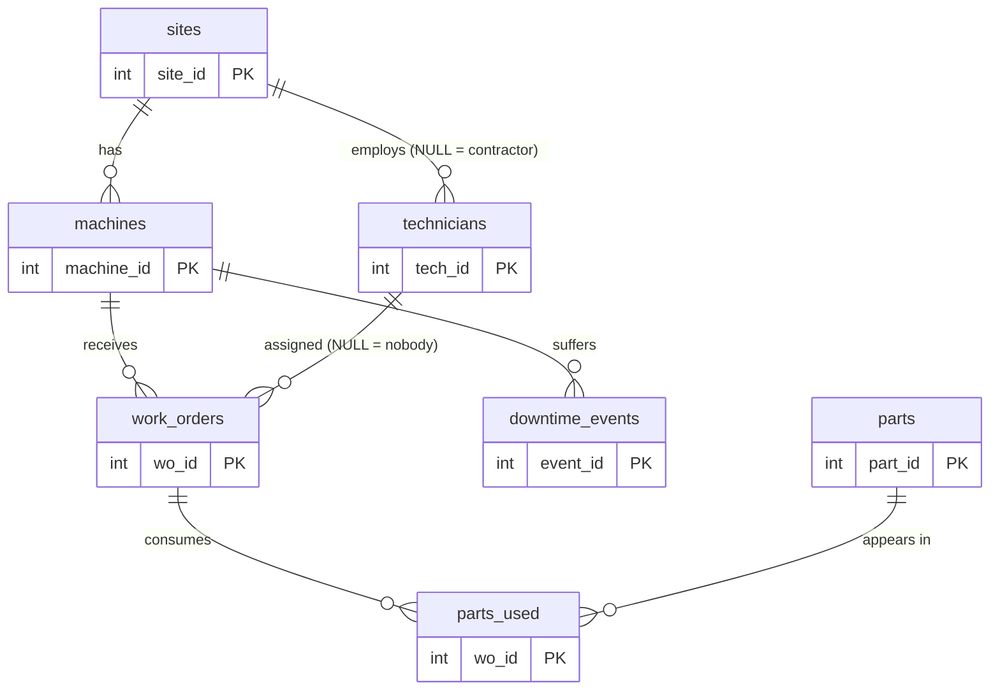
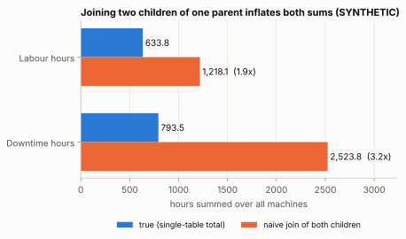
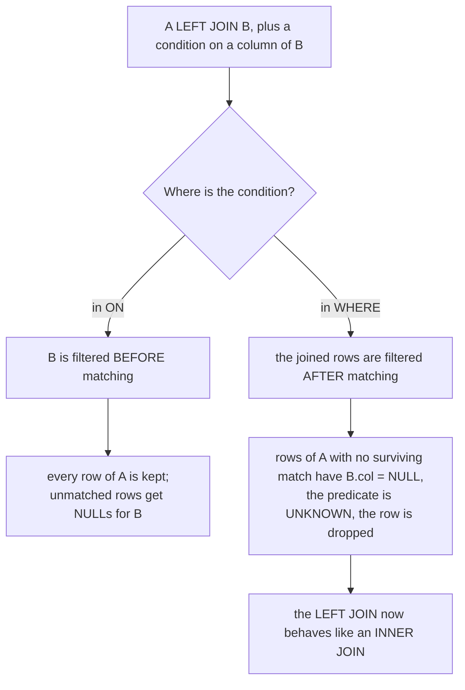
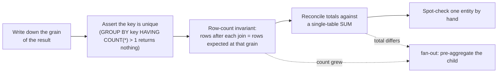

# W2D1 — SQL I: grain, joins, aggregation and NULL semantics

**Unit id:** `w2d1` · **Week 2, day 1** · **Content status:** Execution verified (see [Verification record](#verification-record))
**Handbook:** [H3.1 Grain, joins, aggregation and NULLs](../../handbook/ch03_sql_data_pipelines/h3_1_grain_joins_aggregation_nulls.md)
**Data:** `data/maintenance.db` — SYNTHETIC ([schema](data/README.md)). Totals in this lesson are properties of a generator; they say nothing about real maintenance operations.

---

## 1. Purpose

**Primary objective.** Write multi-table queries that are *correct by construction*: decide the
grain of the result first, bring every input to that grain before joining, and prove the result with
invariants instead of by looking at it.

**What you will learn**

- Stating the grain (what one row means) and key of every table and of every intermediate result.
- Predicting the row count of a join from the cardinality of the relationship.
- Recognising fan-out (double counting) and fixing it by pre-aggregating to the join grain.
- SQL's three-valued logic: what NULL does to comparisons, `WHERE`, aggregates, `NOT IN`, `COUNT`.
- Where a filter belongs with a `LEFT JOIN` (`ON` versus `WHERE`), and `WHERE` versus `HAVING`.
- Verifying a query with row-count and reconciliation checks.

**Why an applied ML engineer needs it.** Training tables in industry are assembled by joins, usually
by you. A fan-out join does not raise an error; it duplicates rows, inflates sums, duplicates labels
and puts copies of one entity on both sides of a split. A filter in the wrong clause silently removes
exactly the entities with no activity, which are often the negative class. These bugs survive code
review because the query runs and the numbers look plausible. SQL rounds in interviews for ML roles
are mostly this: joins, aggregation, NULLs, and whether you check your own result.

**Prerequisites.** Diagnostic `a2_sql` attempted (its review tells you how much of section 2 to skim).
`SELECT … FROM … WHERE … GROUP BY` is assumed. Nothing from Week 1 is required except a working
environment; SQLite ships with Python.

**Time budget — essential path 2 h**

| Activity | Time |
|---|---|
| Read sections 1–2 (2.2, 2.3 and 2.5 are the core) | 25 min |
| Worked example: run it, predict each output before reading it | 15 min |
| Guided lab, tasks 1–8 | 60 min |
| Assessment questions (written) | 15 min |
| Reflection and progress flags | 5 min |

**Optional extension — up to 1 h:** independent challenge (40 min), interview rep (15 min), DuckDB
comparison (5 min). The `independent` flag for this unit stays unset until the challenge is done
without hints.

---

## 2. Conceptual explanation

### 2.1 Intuition: you already do this, with different names

In your EEG work the same recording exists at several resolutions: one row per **sample**, per
**window**, per **channel × window**, per **recording**, per **subject**. You would never average
subject age over windows and call it the cohort's mean age, because subjects with longer recordings
would count more. You would also never let windows from one subject fall on both sides of a split.
Both instincts are statements about *grain*: what one row represents, and what the independent unit is.

SQL bugs in industry are the same mistake made with a join. A per-recording metadata table joined to
a per-channel table yields one row per channel; any per-recording quantity (duration, age, label) is
now repeated once per channel, and `SUM` or `AVG` over it is wrong. Nothing warns you. The discipline
of this lesson is to make the grain explicit before writing the `SELECT`.

### 2.2 Precise terms

- **Grain** of a table or result: the real-world thing one row stands for ("one work order",
  "one part line of a work order").
- **Key**: a set of columns whose values are unique per row. A *minimal* key has no removable column.
  The grain and the minimal key are two descriptions of the same fact. `parts_used` has grain "part
  line" and key `(wo_id, part_id)`.
- **Measure**: a numeric column you aggregate. Every measure is *defined at a grain*:
  `labor_hours` at the work-order grain, `quantity` at the part-line grain. **A measure may only be
  summed over rows that are at its own grain** (or after being deliberately allocated to a finer one).
- **Cardinality** of a relationship: one-to-one, one-to-many, many-to-many. It determines what a
  join does to the row count.

**The lesson database at a glance** (SYNTHETIC; full schema in [`data/README.md`](data/README.md)).
Read each line as "one parent row has zero or more child rows"; the grain of a table is its primary key.



`machines` has two independent children (`work_orders`, `downtime_events`), and `work_orders` has a
child of its own (`parts_used`). Those two shapes are where every fan-out in this lesson comes from.


### 2.3 Joins as row-set operations, and the row-count rule

A join of `A` and `B` on a predicate produces one output row for every *pair* `(a, b)` that satisfies
the predicate. Everything else follows from that.

| Join | Rows produced |
|---|---|
| `A INNER JOIN B` | matching pairs only |
| `A LEFT JOIN B` | matching pairs, plus each unmatched `a` once with NULLs for `B`'s columns |
| `A FULL OUTER JOIN B` | matching pairs, plus unmatched rows of both sides |
| `A CROSS JOIN B` | all `|A|·|B|` pairs |

Let `m(a)` be the number of rows of `B` that match row `a`. Then

```
|A INNER JOIN B| = Σ_a m(a)              |A LEFT JOIN B| = Σ_a max(m(a), 1)
```

So joining *towards the "one" side* (work order → its machine, `m(a) = 1`) preserves the row count
and the grain of `A`. Joining *towards the "many" side* (work order → its part lines) changes the
grain to that of the child. This is not a problem in itself. It becomes a bug in two situations:

1. **A measure from the parent is aggregated after the join.** Each work order's `labor_hours`
   appears `m(a)` times.
2. **Two independent children are joined to the same parent.** A machine with `a` work orders and
   `b` downtime events yields `a·b` rows, so labour is multiplied by `b` and downtime by `a`:

   ```
   Σ_rows labor = b · (true labor)        Σ_rows downtime = a · (true downtime)
   ```

   On the lesson database machine 1 has 4 work orders (18.4 h) and 5 downtime events (63.5 h); the
   naive join reports 92.0 h and 254.0 h. Over all machines it reports 1,218.1 labour hours against
   a true 633.8.

**The fix is always the same: aggregate each child to the grain you are joining at, then join.**
After pre-aggregation every join is one-to-(zero or one), `m(a) ≤ 1`, and the row count cannot grow.

```sql
WITH wo AS (SELECT machine_id, SUM(labor_hours) AS labor_hours FROM work_orders GROUP BY machine_id),
     dt AS (SELECT machine_id, SUM(hours) AS downtime_hours FROM downtime_events GROUP BY machine_id)
SELECT m.machine_id, COALESCE(wo.labor_hours, 0), COALESCE(dt.downtime_hours, 0)
FROM machines m LEFT JOIN wo USING (machine_id) LEFT JOIN dt USING (machine_id);
```

`COUNT(DISTINCT …)` and `SELECT DISTINCT` are not fixes. They repair counts of identifiers and leave
sums wrong, and `SUM(DISTINCT labor_hours)` is wrong in a new way (two orders of 4.0 h count once).

What the naive join does to one machine with 2 work orders and 3 downtime events:

```text
work_orders (machine 7)        downtime_events (machine 7)        machines ⋈ work_orders ⋈ downtime_events
 wo_id  labor_hours             event_id  hours                    wo_id  labor  event_id  hours
  101       4.0                    901     2.0                      101    4.0     901      2.0
  102       6.0                    902     5.0                      101    4.0     902      5.0
        ─────────                  903     1.0                      101    4.0     903      1.0
 true labour 10.0                      ─────────                    102    6.0     901      2.0
                                true downtime 8.0                   102    6.0     902      5.0
                                                                    102    6.0     903      1.0
                                                                   ───────────────────────────────
                                                    2 x 3 = 6 rows:  SUM(labor) 30.0   SUM(hours) 16.0
                                                                     = 3 x 10.0        = 2 x 8.0
```

(The six-row block is illustrative, not rows of the lesson database.) On the lesson database the same
mechanism produces these totals:



*Both sums are inflated, by different factors, because each child is multiplied by the row count of the
other. SYNTHETIC data; regenerate with `python lessons/w2d1_sql_joins_grain/figures/make_figures.py`.*


### 2.4 NULL and three-valued logic

NULL means "no value here", and SQL does not know *why*. Predicates evaluate to TRUE, FALSE or
UNKNOWN (which SQLite displays as NULL):

| Expression | Result |
|---|---|
| `NULL = NULL`, `NULL <> 1`, `NOT NULL` | UNKNOWN |
| `NULL AND FALSE` | FALSE |
| `NULL OR TRUE` | TRUE |
| `NULL AND TRUE`, `NULL OR FALSE` | UNKNOWN |
| `NULL IS NULL` | TRUE |

Consequences, all executed in the worked example:

- **`WHERE`, `HAVING` and join `ON` keep a row only when the predicate is TRUE.** UNKNOWN is dropped
  like FALSE. `WHERE criticality <> 'high'` does not return the machines whose criticality was never
  assessed: on the lesson database 7 machines are `high`, 12 are returned by `<> 'high'`, and 13 are
  NULL and appear in neither.
- **Aggregates skip NULL.** `COUNT(*)` counts rows; `COUNT(col)` counts non-NULL values; `SUM` and
  `AVG` ignore NULLs, so `AVG(labor_hours)` is the mean over orders *with recorded hours*, a different
  estimand from "mean hours per order". Over zero rows `COUNT` is 0 while `SUM` and `AVG` are NULL,
  which is why outer-joined sums need `COALESCE(…, 0)`.
- **`x NOT IN (subquery)` returns no rows if the subquery yields any NULL.** `x NOT IN (1, NULL)` is
  `x <> 1 AND x <> NULL`, which is never TRUE. Use `NOT EXISTS` (or `LEFT JOIN … WHERE b.key IS NULL`).
- **`GROUP BY` treats NULLs as one group**, and `DISTINCT` treats them as equal, unlike `=`.

Decide what each NULL *means* before choosing how to treat it. "Labour not recorded" must not be
turned into 0 inside an average; "no work orders" should become 0 in a count.

### 2.5 Filters and outer joins: `ON` versus `WHERE`

Logical evaluation order: `FROM`/`JOIN … ON` → `WHERE` → `GROUP BY` → `HAVING` → `SELECT` →
`ORDER BY`. For an inner join a condition gives the same result in `ON` or `WHERE`. For a `LEFT JOIN`
it does not:

- a condition on the **right** table in `ON` restricts which right rows may match; unmatched left
  rows are still kept, NULL-extended;
- the same condition in `WHERE` is evaluated after the join; on NULL-extended rows it is UNKNOWN,
  they are dropped, and the outer join has become an inner join.

"All sites with their number of corrective orders in 2025, including zero" therefore needs the type
and date conditions in `ON`. `WHERE` filters rows before grouping; `HAVING` filters groups after
aggregation and is the only place an aggregate may appear as a filter.

A subtler version of the same trap: on a NULL-extended row *every* right-hand column is NULL, so
`CASE WHEN m.decommissioned_date IS NULL THEN 1 END` counts a phantom "active machine" for a site
that has no machines at all.

Where a condition on the outer-joined table goes decides which rows survive:




### 2.6 Verifying a query

Treat a query like code under test (W1D5). Useful oracles:

- **Key uniqueness.** `SELECT key, COUNT(*) FROM result GROUP BY key HAVING COUNT(*) > 1` returns
  nothing. Do this for inputs as well: an assumed one-to-one relationship that is really one-to-many
  is the commonest root cause.
- **Row-count invariants.** "One row per site" means exactly `SELECT COUNT(*) FROM sites` rows. Count
  rows after each join while building the query.
- **Reconciliation totals.** The grand total of a measure in the result equals the total computed
  from the single table at whose grain the measure is defined. This catches fan-out *and* dropped rows.
- **Known small cases.** Check one entity by hand, preferably one with zero children and one with many.




### 2.7 A concrete industry example

A subscription company's dashboard showed monthly revenue 18 % above the finance ledger. The query
joined `orders` to `order_items` (to show product categories) and to `shipments` (to show delivery
status), then summed `orders.total`. Orders with two items and two shipments were counted four times.
Marketing dashboards built on the same view had been used to set acquisition budgets. The fix was
three CTEs at the order grain and a reconciliation test against the ledger total in CI. The ML
variant is identical: a churn training table built by joining customers to tickets and to payments
duplicates customers in proportion to their activity, so heavy users are over-weighted and a random
row split leaks customers across train and test.

### 2.8 Limits and common misconceptions

- *"The query ran and the numbers look reasonable."* Fan-out errors are often modest (here +32 % in
  total) and can coexist with dropped rows that pull the other way; site 2 in the lab is *under*-reported
  by the same query that over-reports the total.
- *"`DISTINCT` fixes duplicates."* It hides the symptom for identifiers and leaves measures wrong.
- *"`LEFT JOIN` guarantees all left rows."* Only until a `WHERE` condition touches the right table.
- *"NULL is like 0 / empty string / False."* It is none of these; `NULL = NULL` is not TRUE.
- *"`COUNT(*)` and `COUNT(col)` are interchangeable."* Only when `col` is never NULL, which an outer
  join can change.
- **Engine differences.** SQLite is permissive: it accepts a selected column that is neither grouped
  nor aggregated and returns the value from an arbitrary row of the group; PostgreSQL, DuckDB and
  BigQuery reject that. SQLite also has dynamic typing and no date type. The reasoning in this lesson
  is standard SQL; the leniency is not.
- **What this lesson does not cover:** window functions, as-of joins and gaps-and-islands (W2D2),
  query performance and indexing, and transactions.

---

## 3. Worked example: recordings, channels, annotations

**Data.** A toy in-memory database in a shape you know (SYNTHETIC, created inside the script):

| Table | Grain | Columns |
|---|---|---|
| `recordings` (4 rows) | recording | `recording_id`, `subject_id`, `duration_s` |
| `channels` (9 rows) | (recording, channel) | `recording_id`, `channel`, `is_bad` (NULL = not reviewed) |
| `annotations` (5 rows) | annotated event | `annotation_id`, `recording_id`, `kind`, `duration_s` |

Recording 2 has no annotations; recording 4 has neither channels nor annotations.

**Run it** (reproducible: no randomness, no files):

```bash
python lessons/w2d1_sql_joins_grain/example/fanout_demo.py
```

**Predict before you read each block.** The script prints seven blocks; the important ones:

```
-- truth, from the table whose grain matches the measure
   total_recorded_s
   2250.0

-- WRONG: duration summed after joining channels (one row per channel)
   total_recorded_s | rows_summed
   6000.0 | 9

-- WRONG: two one-to-many children joined to the same parent
   recording_id | intermediate_rows | n_channels_reported | event_s_reported
   1 | 6 | 6 | 135.0
   2 | 2 | 2 | NULL
   3 | 12 | 12 | 420.0
   4 | 1 | 0 | NULL

-- RIGHT: each child aggregated to the parent grain, then joined
   recording_id | n_channels | event_s
   1 | 3 | 45.0
   2 | 2 | 0
   3 | 4 | 105.0
   4 | 0 | 0
```

**Interpretation.** Recording 3 has 4 channels and 3 annotations, so the naive join has 12 rows;
channels are reported as 12 (each counted 3 times) and event seconds as 420 = 4 × 105. Recording 2
shows the other face of the problem: its channel count happens to be right (no annotations, so the
LEFT JOIN added one NULL-extended row per channel) and its event time is NULL instead of 0. A
spot-check on recording 2 would have passed. The row-count block makes the mechanism visible:

```
-- how many rows after each step?
   recordings | after_inner_channels | after_left_channels | after_both
   4 | 9 | 10 | 21
```

4 → 10 → 21: each step that increases the count is a change of grain that you must be able to name.

**Code decisions worth noticing.** Each child is reduced in its own CTE whose `GROUP BY` column is
the join key, so the join is provably at most one row per parent. `COALESCE` is applied *after* the
outer join, where "no children" has become NULL and should read as 0. The NULL block shows the
difference between two estimands:

```
-- aggregates: COUNT(*) counts rows, COUNT(col)/SUM/AVG skip NULL
   n_rows | n_reviewed | n_bad | bad_rate_of_reviewed | bad_rate_of_all
   9 | 7 | 1 | 0.14285714285714285 | 0.1111111111111111
```

`AVG(is_bad)` is the bad-channel rate among *reviewed* channels (1/7). Dividing by `COUNT(*)` (1/9)
silently assumes unreviewed channels are good. Neither is "the" answer; you must choose and say which.

The anti-join block shows `NOT IN` returning no rows when the list contains a NULL, while
`NOT EXISTS` and `LEFT JOIN … IS NULL` both return recordings 2 and 4. The last block shows SQLite
accepting `SELECT subject_id, recording_id, SUM(…) … GROUP BY subject_id`; the `recording_id` it
prints is one arbitrary member of each group.

---

## 4. Guided lab

**Result to produce:** seven correct queries in `lab/queries/`, each with its grain stated, and a
short bug report on a broken dashboard query. You work in `lessons/w2d1_sql_joins_grain/lab/`.

Run a query file, or an ad-hoc statement, with the helper:

```bash
python lessons/w2d1_sql_joins_grain/lab/run.py lessons/w2d1_sql_joins_grain/lab/queries/q1_machines_per_site.sql
python lessons/w2d1_sql_joins_grain/lab/run.py -c "SELECT COUNT(*) FROM work_orders"
python wb.py check w2d1          # all lab checks
```

Rules for every file: one `SELECT` statement (CTEs allowed); the column names given in the file's
header; replace the `-- grain: TODO` line **before** writing the query. Column order is free; row
order is free unless the header requires one. The checks run each query on `data/maintenance.db` and
on a second database with different rows, so reason about the schema, not about the values you see.

### Task 1 — Orient: write down grains and prove the keys (8 min)

Read [data/README.md](data/README.md). For `work_orders`, `parts_used` and `downtime_events` run a
uniqueness check of the key you believe in, for example:

```sql
SELECT wo_id, part_id, COUNT(*) FROM parts_used GROUP BY wo_id, part_id HAVING COUNT(*) > 1;
```

*Checkpoint:* each returns no rows. Then answer for yourself: is `wo_id` alone a key of `parts_used`?
(`SELECT COUNT(*), COUNT(DISTINCT wo_id) FROM parts_used` gives 121 and 57.)

### Task 2 — `q1_machines_per_site`: outer join and what `COUNT` counts (7 min)

Every site, with its number of machines and of machines still in service.
*Checkpoint:* 6 rows; `Fenwick Yard` shows 0 and 0; `Aldermoor` shows 9 and 7.
*If Fenwick Yard shows 1:* you are counting rows, and the NULL-extended row is a row. *If it shows 0
machines but 1 active:* reread the last paragraph of 2.5.

### Task 3 — `q2_unassigned_technicians`: anti-join (5 min)

*Checkpoint:* 3 technicians. *If you get no rows at all:* your subquery returns a NULL (section 2.4).
Run `SELECT COUNT(*), COUNT(tech_id) FROM work_orders` to see how many.

### Task 4 — `q3_machine_hours`: two children of one parent (12 min)

All machines with number of work orders, labour hours and downtime hours.
*Checkpoints:* 32 rows; machine 1 → 4 orders, 18.4 labour hours, 63.5 downtime hours; machine 2 has
downtime 0. Then reconcile: the sum of your `labor_hours` column must equal
`SELECT SUM(labor_hours) FROM work_orders` (633.8) and the downtime column must sum to 793.5.
*If machine 1 shows 92.0 and 254.0:* that is 18.4 × 5 and 63.5 × 4. Apply 2.3.

### Task 5 — `q4_corrective_2025_per_site`: filter placement (8 min)

*Checkpoint:* 6 rows, two of them with 0. *If you get 4 rows:* a condition on `work_orders` is in
`WHERE`. Note that the dates are text; `opened_date >= '2025-01-01' AND opened_date < '2026-01-01'`
is the robust form of "in 2025".

### Task 6 — `q5_type_summary`: conditional aggregation and NULL-aware averages (7 min)

One row per `wo_type` with four different counts/averages from a single pass over `work_orders`.
*Checkpoint:* `n_orders` sums to 93; `corrective` has 38 orders, 8 open, 8 unassigned.
Decide deliberately what the average is over, and say so in a comment.

### Task 7 — `q6_expensive_orders`: `WHERE` versus `HAVING`, required order (5 min)

*Checkpoint:* first row is work order 1 with 6 part lines and a parts cost of 4,064.36. Here joining
to the part-line grain is correct, because cost is defined there. Say why in your grain comment.

### Task 8 — Diagnose `broken/dashboard_site_costs.sql` (15 min)

Finance reports that the tile's labour hours are too high and that work orders seem to be missing.

1. Run the broken query. Compare its totals with totals taken from single tables.
2. Count rows along the join chain (after `work_orders`, after `parts_used`). Name each grain.
3. Find how many work orders the query drops, and which site is *under*-reported and why.
4. Write the corrected query in `queries/q7_site_costs_fixed.sql` (all sites; zeros where nothing).
5. Fill in `FANOUT_REPORT.md`: the three numbers at the top and four short sections.

*Checkpoint:* your fixed query has 6 rows and passes all three reconciliations (work-order count,
labour hours, parts cost). Parts cost is identical in the broken and fixed queries; be able to
explain why that column was right all along.

**Debugging guidance**

| Symptom | Likely cause |
|---|---|
| `…sql must be a single SELECT` | a second statement, or text before `SELECT`/`WITH` |
| `result columns … do not match` | alias missing or misspelled; names are compared case-insensitively |
| passes on `committed`, fails on `reseeded` | a literal id or value from the data is in the query |
| right row count, wrong sums | fan-out upstream of the `SUM` |
| right sums for some rows, rows missing | inner join or `WHERE` on an outer-joined table |
| `NULL` where 0 is expected | missing `COALESCE` after an outer join |

When all checks pass: `python wb.py mark w2d1 guided`.

---

## 5. Independent challenge

[challenge/README.md](challenge/README.md): five unseen questions on the same schema. For each you
declare the grain and the minimal key of the result; the checks verify the result on both databases
and that your declared key is unique and minimal. No step-by-step guidance. Aim for 40 minutes
without hints.

```bash
python wb.py check w2d1 --challenge
```

## 6. Progressive hints

Open only as far as you need, and record which level you used.

1. [Concept](hints/hint1_concept.md) — the question to ask of every join.
2. [Approach](hints/hint2_approach.md) — a query-building routine and which trap each question hides.
3. [Partial implementation](hints/hint3_partial.md) — CTE skeletons with the aggregations left out.

The full reference queries are in `solutions/lessons/w2d1_sql_joins_grain/` (open after attempting).

## 7. Assessment

[assessment.md](assessment.md): six reasoning questions, one design-choice explanation, a rubric, and
a 15-minute SQL interview rep. Write answers before opening
`solutions/lessons/w2d1_sql_joins_grain/assessment_answers.md`. The automated checks cover the queries;
the written questions cover whether you can explain *why*.

## 8. Reflection and review

**You should now be able to do, alone:**

- state the grain and key of any table or intermediate result and predict a join's row count;
- spot a fan-out from the shape of a query, before running it, and rewrite it with pre-aggregation;
- choose between `ON`, `WHERE` and `HAVING` for a condition and say what changes;
- predict what a NULL does in a comparison, an aggregate and `NOT IN`;
- attach at least two invariants to any aggregate query you hand to someone else.

**Reflection prompt** (3–4 sentences, `python wb.py note w2d1 "…"`): think of a training table you
built in the past by merging dataframes. What was its grain, what was the independent unit, and is
there a merge in it whose row count you never checked?

**Retrieval question for a later day** (answer from memory on W2D7): *A parent table has two child
tables. You join both and sum one measure from each child. By what factor is each sum wrong for a
given parent row, and what is the general fix? Then: why does `x NOT IN (SELECT y …)` return nothing
when one `y` is NULL?*

**Next:** [W2D2 — SQL II: CTEs, window functions and time-series queries](../w2d2_sql_windows_timeseries/README.md)
builds on this. Window functions keep the grain of their input, which is exactly why they are
the right tool for running statistics and as-of features and the wrong tool for fixing a fan-out.

---

## Verification record

Executed 2026-11-22 on Python 3.13.18, SQLite 3.53.1, pandas 3.0.5, pytest 9.1.1.

| What | Result |
|---|---|
| `python lessons/w2d1_sql_joins_grain/example/fanout_demo.py` | ran; outputs in section 3 are copied from this run |
| `python lessons/w2d1_sql_joins_grain/data/make_db.py --check` | contents match the committed database |
| `python tools/verify_checks.py lessons/w2d1_sql_joins_grain` | lab: reference passes, 5 mutants rejected; challenge: reference passes, 4 mutants rejected |
| Shipped starter | fails the lab checks and the challenge checks, as intended |
| Expected results | computed in pandas (`checks/w2d1_oracle.py`), independently of the reference SQL; both agree on two databases |
| Optional: reference queries on DuckDB 2.0.1 | all 12 return the same result sets as SQLite; DuckDB rejects the non-grouped column that SQLite accepts |

Not verified: PostgreSQL/BigQuery behaviour is stated from the SQL standard's rules and from memory,
not executed. The industry example in 2.7 is an illustrative composite, not a cited incident. Time
boxes are estimates.
